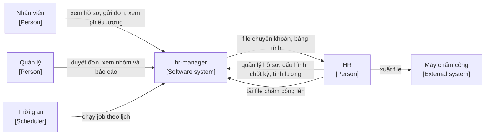
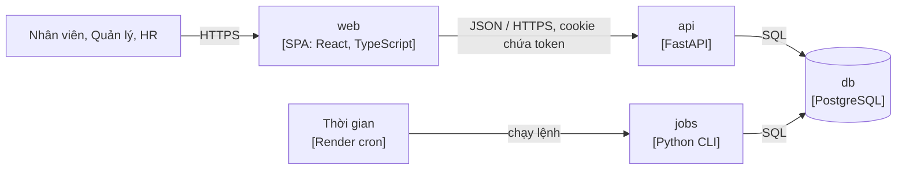

# Architecture: hr-manager

- **Status:** Draft
- **Updated:** 2026-10-30
- **Reviewed:** [YYYY-MM-DD: review nguội; AI review; người ngoài nếu có]
- **Related:** [requirements](docs/requirements.md) · [SPEC](docs/SPEC.md) · [decisions](docs/decisions/README.md) ·
  [design guide](docs/playbook/design.md)

> Trang này giúp người mới và agent nắm hệ thống ở hai mức đầu của C4, Context và Container, cùng các quyết định chi phối
> toàn hệ thống. Chi tiết từng phần nằm ở `docs/design/`, lý do nằm ở ADR, module nằm ở SPEC.

## Context

C4 Level 1. Actor lấy từ mục Actors của [requirements](docs/requirements.md#actors).

| External system | Used for | Direction | When unavailable |
|---|---|---|---|
| Máy chấm công | Nguồn lượt chấm công (M3). Hệ thống không kết nối với máy; HR xuất file rồi tải lên (A-006) | Vào, qua HR | HR nhập file sau; ngày thiếu dữ liệu ở trạng thái Thiếu chấm công cho tới khi có file |
| Ngân hàng, cơ quan thuế, BHXH | Nhận file chuyển khoản và số liệu HR tự nộp | Ra, qua HR | Không ảnh hưởng hệ thống; không có kết nối trực tiếp (Non-goals của M4) |

Hệ thống không gửi email hay tin nhắn ra ngoài; thông báo chỉ hiện trong hệ thống (Non-goals của M2).

## Architecture drivers

Các dòng `H/H` và `H/M` trong mục Quality attributes của [requirements](docs/requirements.md#quality-attributes), cộng
các ràng buộc ở mục Constraints dưới đây.

| Driver | Tactic | Where | ADR |
|---|---|---|---|
| QA-001 Data integrity: duyệt và chốt đồng thời không phá luật | Exclusion constraint cho khoảng hiệu lực không chồng; khóa dòng theo nhân viên khi trừ phép hay kiểm giới hạn làm thêm; cột trạng thái kèm điều kiện cập nhật để chốt kỳ chỉ thành công một lần; mỗi thao tác là một transaction | [data](docs/design/data.md), [flows](docs/design/flows.md) | ADR-0003 |
| QA-002 Correctness: lương đúng tới từng đồng | Tính bằng `Decimal`, lưu số nguyên đồng; công thức là hàm thuần trong domain, không đọc DB; tham số luật có ngày hiệu lực lưu trong DB; phiếu lương chụp lại mọi đầu vào; bộ phiếu mẫu chạy ở mọi PR | [components](docs/design/components.md), [data](docs/design/data.md) | ADR-0002 |
| QA-003 Security: mọi thao tác ngoài quyền bị từ chối | Mặc định từ chối; mỗi route khai báo quyền bằng dependency của FastAPI; truy vấn luôn lọc theo phạm vi của người xem; kiểm tài khoản và `token_version` ở mỗi request; test tự động cho cả ma trận phân quyền | [api](docs/design/api.md), [components](docs/design/components.md) | ADR-0004 |
| QA-004 Performance ở quy mô 300 nhân viên (M/M) | Index theo truy vấn chính; phân trang mọi danh sách; nhập file và tính lương xử lý theo lô trong một transaction; công từng ngày tính lại khi dữ liệu nguồn đổi, không tính khi đọc | [data](docs/design/data.md) | — |
| QA-005 Recoverability: mất tối đa 24 giờ, chạy lại trong 4 giờ | Point-in-time recovery của Postgres managed; logical backup tải về hằng tuần; diễn tập khôi phục mỗi quý theo runbook | Deployment, [runbook](docs/runbook.md) | ADR-0005 |
| Ràng buộc: luật lao động, BHXH, thuế thay đổi | Mọi tỷ lệ, mức tiền, giới hạn là tham số; tham số luật có ngày hiệu lực, HR cập nhật không cần deploy (BR-123) | [data](docs/design/data.md) | — |
| Ràng buộc: một người vận hành, $10–25 mỗi tháng | Modular monolith; một service web, một DB, một cron; không cache, không hàng đợi | Containers | ADR-0001, ADR-0005 |

## Containers

C4 Level 2.

| Container | Responsibility | Tech | Talks to | Detail |
|---|---|---|---|---|
| web | Giao diện theo [UI flow](docs/ui-flow.md); không giữ luật nghiệp vụ, chỉ ẩn nút theo quyền để dễ dùng | React, TypeScript, Vite; build thành file tĩnh do `api` phục vụ cùng domain (ADR-0002, ADR-0005) | api | [ui](docs/design/ui.md), [components](docs/design/components.md) |
| api | Xác thực, kiểm quyền, giữ luật nghiệp vụ, đọc ghi DB, nhận file chấm công, xuất bảng tính | FastAPI, Pydantic, SQLAlchemy (ADR-0002) | db | [api](docs/design/api.md), [components](docs/design/components.md), [data](docs/design/data.md) |
| jobs | Việc của actor Thời gian: cộng phép tháng, chuyển và hủy phép tồn, mở kỳ công, khóa tài khoản sau ngày làm việc cuối cùng | Cùng codebase với `api`, gọi cùng module domain; chạy bằng `python -m app.jobs <tên job>` | db | [flows](docs/design/flows.md) |
| db | Lưu toàn bộ dữ liệu, nhật ký thao tác, refresh token, thông báo | PostgreSQL 16 trở lên (ADR-0003) | — | [data](docs/design/data.md) |

`api` và `jobs` là một codebase, deploy cùng phiên bản. Nhập file chấm công và tính bảng lương chạy đồng bộ trong
request, vì ở quy mô 300 nhân viên vẫn trong ngưỡng của QA-004; khi vượt thì chuyển sang job nền (Revisit when của
ADR-0001).

## Cross-cutting concerns

| Concern | Approach | Detail |
|---|---|---|
| Authentication | Mã nhân viên và mật khẩu băm argon2id. Access token JWT 15 phút và refresh token 12 giờ, cả hai trong cookie `HttpOnly`, `Secure`, `SameSite=Strict`. Mỗi request kiểm trạng thái tài khoản và `token_version` | ADR-0004, [api](docs/design/api.md) |
| Authorization | Vai trò Nhân viên, Quản lý, HR theo BR-006; Quản lý có phạm vi theo cây phòng ban tại ngày hôm nay (BR-013). Mặc định từ chối; mỗi operation khai báo quyền ở tầng API; truy vấn danh sách lọc theo phạm vi ở tầng truy cập dữ liệu. Tài nguyên ngoài phạm vi trả về 404 để không lộ sự tồn tại; thao tác không đủ vai trò trả về 403 | [api](docs/design/api.md), [permission matrix](docs/requirements.md#permission-matrix) |
| Validation | Ba lớp: Pydantic ở biên API kiểm kiểu và định dạng; domain kiểm luật `BR-xxx`; constraint của DB là lớp cuối cho invariant | [api](docs/design/api.md), [data](docs/design/data.md) |
| Errors | Mọi lỗi trả về dạng `application/problem+json` (RFC 9457) kèm `code` ổn định, ví dụ `leave_insufficient_balance`, và mã luật liên quan nếu có. Lỗi luật nghiệp vụ là 409 hoặc 422 có thông báo tiếng Việt cho người dùng. Lỗi không lường trước trả về 500 với mã request, không lộ chi tiết | [api](docs/design/api.md) |
| Logging and monitoring | Log JSON ra stdout, xem trên Render: mã request, người dùng, route, thời gian xử lý, kết quả. Không ghi mật khẩu, token, số CCCD, tài khoản ngân hàng, số tiền lương hay lý do nghỉ. Nhật ký thao tác (BR-030) là dữ liệu nghiệp vụ trong DB, ghi trong cùng transaction với thay đổi, không phải log | Phase 5, [data](docs/design/data.md) |
| Configuration and secrets | Secret và thông tin kết nối là biến môi trường: `DATABASE_URL`, `JWT_SIGNING_KEY`, `APP_ENV`. Tham số nghiệp vụ không đổi theo thời gian nằm trong bảng cấu hình; tham số luật có ngày hiệu lực nằm trong bảng riêng (BR-123). Không có giá trị nghiệp vụ hard-code trong code | [components](docs/design/components.md) |
| Time | Thời điểm lưu `timestamptz` theo UTC. Ngày nghiệp vụ như ngày hiệu lực, ngày nghỉ, ngày công lưu kiểu `date`, không có giờ. "Hôm nay" và giờ chấm công tính theo `Asia/Ho_Chi_Minh`; giao diện hiển thị theo múi giờ này. Job theo lịch đặt theo giờ Việt Nam | [data](docs/design/data.md) |
| Background jobs | Mỗi job idempotent: ghi lần chạy vào bảng `job_runs` theo khóa job và kỳ, chạy lại không cộng trùng (EC-038). Job lỗi thì ghi log và hiện cảnh báo trên trang tổng quan của HR. Trạng thái suy ra được từ ngày, như Sắp vào làm hay Đang làm, tính khi đọc thay vì chờ job | [flows](docs/design/flows.md) |
| Files | File chấm công: CSV hoặc XLSX, tối đa 10 MB, chỉ đọc trong bộ nhớ rồi bỏ, không lưu file; chỉ lưu lượt chấm và thông tin lần nhập. File xuất ra tạo khi người dùng yêu cầu và trả về ngay, không lưu trên server. Baseline không có file đính kèm | [api](docs/design/api.md) |

## Data and trust boundaries

Mỗi dòng ứng với một loại dữ liệu trong mục Sensitive data của [domain](docs/domain.md#sensitive-data). Mọi dữ liệu nằm
trong `db`; nhà cung cấp mã hóa ổ đĩa và backup. Không dữ liệu nào được gửi tới hệ thống ngoài, trừ file do người dùng tự
tải về.

| Data | Stored in | Sent to | Protection |
|---|---|---|---|
| Số CCCD, ngày sinh, giới tính, địa chỉ thường trú | db | Trình duyệt của HR và chính nhân viên | Quyền theo BR-033; không ghi log; ẩn danh theo BR-141 |
| Tài khoản ngân hàng | db | HR; file chuyển khoản | Chỉ HR sửa (EC-012); không ghi log; xóa theo BR-140 |
| Điện thoại, email, địa chỉ cá nhân; người liên hệ khẩn cấp | db | HR, chính nhân viên | Quyền theo BR-033; xóa theo BR-140 |
| Hợp đồng lao động | db | HR, chính nhân viên | Quyền theo BR-033 |
| Mật khẩu | db, chỉ bản băm argon2id | Không đi đâu | Không ai xem được; không ghi log |
| Refresh token | db, chỉ bản băm | Cookie của chính người dùng | Đổi mới mỗi lần dùng; thu hồi khi khóa tài khoản (ADR-0004) |
| Nhật ký thao tác | db | HR | Không có thao tác sửa hay xóa (BR-031); không chép lại giá trị đã xóa theo BR-140 |
| Lý do nghỉ; đơn ốm đau, thai sản | db | Chính nhân viên, người duyệt, HR | Quản lý khác chỉ thấy loại nghỉ (BR-067) |
| Lương, phụ cấp, phiếu lương, bảng lương | db | HR, chính nhân viên | Quản lý chỉ thấy số tổng hợp, gộp nhóm nhỏ (BR-122, BR-128, BR-129); không ghi log |
| Mã số thuế, mã số BHXH, người phụ thuộc | db | HR, chính nhân viên | Quyền theo BR-122 |
| File báo cáo và bảng tính xuất ra | Máy của người tải | Người tải | Chỉ chứa dữ liệu người đó được xem; nhật ký ghi lần xuất (BR-136) |

## Threats

| Threat | Impact | Mitigation | Where |
|---|---|---|---|
| Người dùng sửa id trong URL để xem hồ sơ, đơn hay phiếu lương của người khác | Lộ dữ liệu cá nhân và lương | Mọi truy vấn lọc theo người xem và phạm vi; tài nguyên ngoài phạm vi trả về 404; test ma trận phân quyền (QA-003) | [api](docs/design/api.md) |
| Đoán mật khẩu bằng mã nhân viên, vì mã có dạng dễ đoán | Chiếm tài khoản | Khóa tạm sau `max_failed_logins` lần (BR-003); giới hạn số lần đăng nhập theo IP; thông báo lỗi không cho biết mã có tồn tại không | [api](docs/design/api.md) |
| Script độc chèn vào giao diện đánh cắp token | Chiếm phiên | Token trong cookie `HttpOnly`; React tự escape; Content-Security-Policy chặn script ngoài | [ui](docs/design/ui.md) |
| Trang khác gửi request thay người dùng đang đăng nhập (CSRF) | Thao tác trái ý, như duyệt đơn | Cookie `SameSite=Strict`; request ghi dữ liệu phải có header `Origin` đúng domain | [api](docs/design/api.md) |
| Refresh token bị lộ và dùng lại | Chiếm phiên kéo dài | Đổi mới mỗi lần dùng; phát hiện dùng lại thì thu hồi cả chuỗi (ADR-0004) | [api](docs/design/api.md) |
| Người bị khóa hoặc đã nghỉ việc vẫn dùng token cũ | Truy cập trái phép | Kiểm trạng thái tài khoản và `token_version` ở mỗi request | ADR-0004 |
| File chấm công độc hoặc quá lớn | Treo hoặc làm sập service | Giới hạn 10 MB; chỉ nhận CSV, XLSX; đọc từng dòng, từ chối cả file khi sai định dạng (EC-088) | [api](docs/design/api.md) |
| Ô bảng tính xuất ra bắt đầu bằng `=`, `+`, `-`, `@` chạy công thức khi mở | Chạy lệnh trên máy HR | Thêm ký tự `'` trước giá trị như vậy khi xuất | [api](docs/design/api.md) |
| HR lạm quyền sửa dữ liệu rồi xóa dấu vết | Gian lận lương, phép | Nhật ký ghi trong cùng transaction; user DB của ứng dụng không có quyền `UPDATE`, `DELETE` trên bảng nhật ký (BR-031) | [data](docs/design/data.md) |
| Suy ra lương của một người từ báo cáo tổng hợp | Lộ lương | Gộp nhóm dưới `report_min_group_size` người (BR-129) | [api](docs/design/api.md) |
| Secret lộ qua repo hoặc log | Ký được JWT giả, đọc được DB | Secret chỉ ở biến môi trường; `.env` trong `.gitignore`; không log header `Cookie` và `Authorization` | Deployment |
| Dữ liệu cá nhân lưu ở máy chủ ngoài Việt Nam | Vi phạm Luật Bảo vệ dữ liệu cá nhân 2025 | Chỉ dùng dữ liệu giả cho tới khi lập hồ sơ chuyển dữ liệu ra nước ngoài hoặc đổi hosting (ADR-0005) | Deployment |

## Deployment

| Environment | Purpose | Deploy | Config and secrets |
|---|---|---|---|
| local | Phát triển và chạy test | `make setup`, rồi chạy `api` và PostgreSQL ở máy theo [setup](docs/setup.md) | `.env` ở local, không commit |
| staging | Thử trước khi phát hành, chạy E2E, dữ liệu giả | Tự động khi merge vào `main`. Render web service gói miễn phí, PostgreSQL gói miễn phí của Neon | Biến môi trường trên Render; khóa ký JWT riêng |
| production | Công ty dùng thử | Chạy tay sau khi qua release gate. Render web service Starter, Render Postgres, Render cron, vùng Singapore | Biến môi trường trên Render; khóa ký JWT và mật khẩu DB riêng |

Migration Alembic chạy trước khi bản mới nhận request, trong bước pre-deploy của Render.

## Constraints

- Một người làm cùng coding agent, khoảng 6 giờ mỗi ngày ([brief](docs/brief.md#scope)).
- Chi phí hạ tầng $10–25 mỗi tháng (Q-009, ADR-0005).
- Hệ thống chạy trên web; quy mô thiết kế tới 300 nhân viên (A-011).
- Tuân theo luật Việt Nam về lao động, BHXH, thuế TNCN và bảo vệ dữ liệu cá nhân; giá trị luật là tham số (A-013).
- Chỉ dùng dữ liệu giả cho tới khi có thỏa thuận với công ty và lập hồ sơ chuyển dữ liệu ra nước ngoài
  ([brief](docs/brief.md#scope), ADR-0005).
- Thiết kế API và giao diện chi tiết chỉ cho MVP; kiến trúc và dữ liệu cho cả M1–M5 ([project](docs/project.md)).

## Design details

| File | Covers |
|---|---|
| [components](docs/design/components.md) | C4 Component, dependency rule, frontend, configuration |
| [data](docs/design/data.md) | ERD, luật giữ ở tầng dữ liệu, truy vấn và index, transaction, migration |
| [api](docs/design/api.md) | Contract, operation, lỗi, auth, quy ước; contract ở `contracts/openapi.yaml` |
| [flows](docs/design/flows.md) | Sequence diagram cho luồng chính và job |
| [ui](docs/design/ui.md) | Design system, trạng thái màn hình, định dạng, accessibility |
