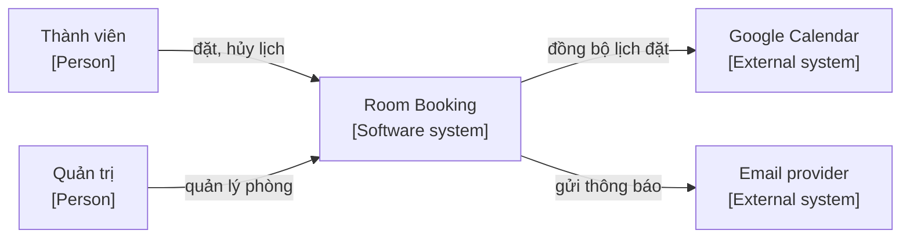
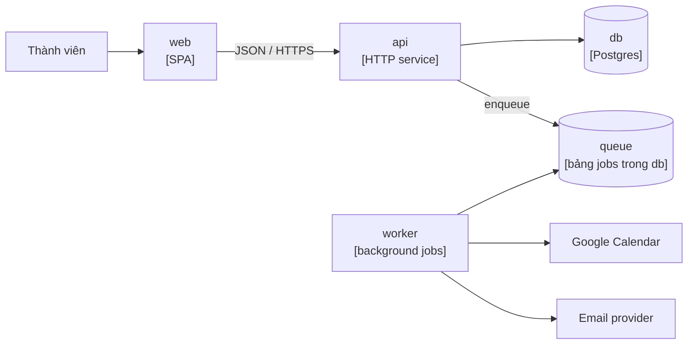

# Architecture: [tên dự án]

- **Status:** [Draft | Accepted | Superseded]
- **Updated:** [YYYY-MM-DD]
- **Reviewed:** [YYYY-MM-DD: review nguội; AI review; người ngoài nếu có]
- **Related:** [requirements](docs/requirements.md) · [SPEC](docs/SPEC.md) · [decisions](docs/decisions/README.md) ·
  [design guide](docs/playbook/design.md)

> Điền ở Phase 3. Trang này giúp người mới và agent nắm hệ thống ở hai mức đầu của C4, Context và Container, cùng các
> quyết định chi phối toàn hệ thống. Chi tiết từng phần nằm ở `docs/design/`, lý do nằm ở ADR, module nằm ở SPEC. Cách
> làm từng mục nằm ở design guide. Dòng in nghiêng và sơ đồ mẫu là ví dụ, xóa khi điền.

## Context

C4 Level 1: hệ thống là một hộp, xung quanh là actor và hệ thống ngoài. Actor lấy từ Actors trong requirements.

| External system | Used for | Direction | When unavailable |
|---|---|---|---|
| *Google Calendar* | *Đưa lịch đặt sang lịch cá nhân* | *Ra* | *Giữ trong hàng đợi, đồng bộ lại sau; đặt phòng vẫn chạy* |

## Architecture drivers

Quality attribute đứng đầu (`H/H`, `H/M` trong requirements) và các ràng buộc quyết định hình dạng kiến trúc. Mỗi driver
có ít nhất một tactic; tactic khó đảo ngược có ADR.

| Driver | Tactic | Where | ADR |
|---|---|---|---|
| *QA-002 Data integrity: không đặt trùng* | *Exclusion constraint trong DB, không kiểm trùng ở tầng app* | *[data](docs/design/data.md)* | *ADR-0004* |
| *QA-001 Performance: lịch tuần p95 < 500 ms* | *Index theo phòng và khoảng thời gian; chỉ tải một tuần mỗi lần* | *[data](docs/design/data.md)* | *—* |
| *Constraint: chi phí < $10 mỗi tháng* | *Một ứng dụng scale-to-zero; DB managed ở gói miễn phí* | *Deployment* | *ADR-0002* |

## Containers

C4 Level 2: những thứ chạy hoặc lưu dữ liệu riêng, và cách chúng giao tiếp.

| Container | Responsibility | Tech | Talks to | Detail |
|---|---|---|---|---|
| *api* | *Nhận request, giữ luật nghiệp vụ, ghi DB, xếp job* | *[framework] (ADR-0002)* | *db* | *components, api, data* |
| *worker* | *Chạy job đồng bộ lịch và gửi email* | *Cùng codebase với api* | *db, Google Calendar, Email provider* | *flows* |

## Cross-cutting concerns

Câu hỏi cần trả lời cho từng concern nằm ở design guide. Bỏ dòng không áp dụng.

| Concern | Approach | Detail |
|---|---|---|
| Authentication | [cách đăng nhập, thời hạn phiên] | [ADR, api] |
| Authorization | [mô hình quyền; kiểm ở tầng nào] | [api] |
| Validation | [kiểm đầu vào ở biên nào] | [api] |
| Errors | [format lỗi chung; lỗi nào báo người dùng, lỗi nào chỉ ghi log] | [api] |
| Logging and monitoring | [ghi gì, không ghi gì; công cụ] | [Phase 5] |
| Configuration and secrets | [config ở đâu; secret ở đâu] | [components] |
| Time | [lưu UTC; hiển thị theo timezone nào] | [data] |

## Data and trust boundaries

Mỗi loại dữ liệu nhạy cảm trong mục Sensitive data của [domain](docs/domain.md) có một dòng ở đây.

| Data | Stored in | Sent to | Protection |
|---|---|---|---|
| *Email thành viên* | *db* | *Email provider, chỉ khi gửi thông báo* | *Không ghi vào log; quyền đọc theo chủ sở hữu* |

## Threats

Threat model rút gọn: các mối đe dọa có thật với hệ thống này, lấy từ actor, bề mặt tấn công và dữ liệu nhạy cảm ở
trên. Biện pháp nằm trong code hoặc cấu hình, không chỉ trong tài liệu.

| Threat | Impact | Mitigation | Where |
|---|---|---|---|
| *Thành viên gọi thẳng API để hủy lịch của người khác* | *Sai quyền* | *Backend kiểm người đặt hoặc quản trị cho mọi operation hủy* | *[api](docs/design/api.md)* |
| *Câu mô tả cuộc họp chứa lệnh điều khiển model* | *AI trả kết quả sai* | *Câu của người dùng nằm trong khối dữ liệu; model không có tool* | *[ai](docs/design/ai.md)* |

## Deployment

| Environment | Purpose | Deploy | Config and secrets |
|---|---|---|---|
| *staging* | *Thử trước khi phát hành, chạy E2E* | *Tự động khi merge vào `main`* | *Biến môi trường; secret trong password manager* |
| *production* | *Người dùng thật* | *Chạy tay sau khi qua release gate* | *Như staging, key riêng* |

## Constraints

- [Ràng buộc kỹ thuật ảnh hưởng tới thiết kế, kèm nguồn trong brief hoặc ADR. Ví dụ: chạy được trên gói miễn phí của
  hosting.]

## Design details

| File | Covers |
|---|---|
| [components](docs/design/components.md) | C4 Component, dependency rule, frontend, configuration |
| [data](docs/design/data.md) | ERD, luật giữ ở tầng dữ liệu, truy vấn và index, transaction, migration |
| [api](docs/design/api.md) | Contract, operation, lỗi, auth, quy ước; contract ở `contracts/openapi.yaml` |
| [flows](docs/design/flows.md) | Sequence diagram cho luồng chính, job và lời gọi ra ngoài |
| [ui](docs/design/ui.md) | Design system, trạng thái màn hình, định dạng, accessibility; khi có giao diện |
| [ai](docs/design/ai.md) | Component AI, khi sản phẩm có tính năng AI |
