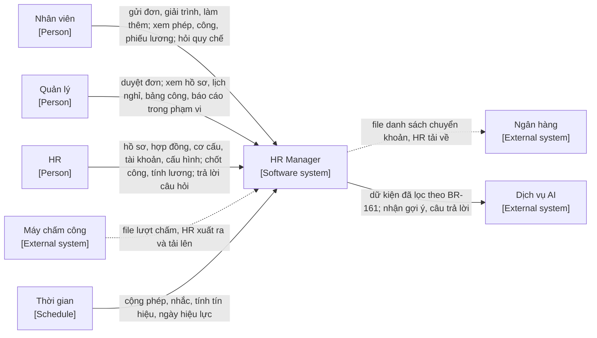
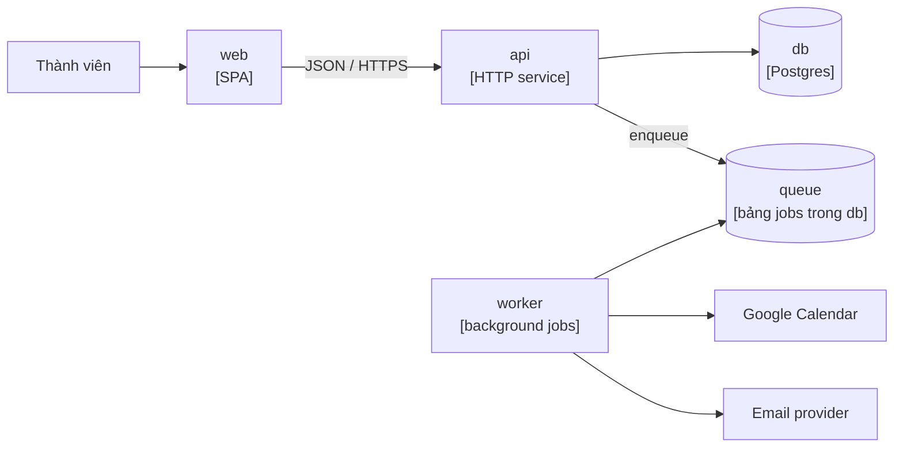

# Architecture: hr-manager

- **Status:** Draft
- **Updated:** 2026-11-03
- **Reviewed:** [YYYY-MM-DD: review nguội; AI review; người ngoài nếu có]
- **Related:** [requirements](docs/analysis/requirements.md) · [SPEC](docs/build/SPEC.md) · [decisions](docs/decisions/README.md) ·
  [design guide](docs/playbook/design.md)

> Trang này giúp người mới và agent nắm hệ thống ở hai mức đầu của C4, Context và Container, cùng các quyết định chi
> phối toàn hệ thống. Chi tiết từng phần nằm ở `docs/design/`, lý do nằm ở ADR, module nằm ở SPEC. Cách làm từng mục
> nằm ở design guide.
>
> Đang làm ở #8, trước khi duyệt prototype (#61) theo lựa chọn của chủ dự án ngày 2026-11-03. Đã điền Context,
> Architecture drivers và Constraints. Các mục từ Containers trở đi điền sau khi ADR-0007 tới ADR-0011 được chọn; dòng
> in nghiêng ở các mục đó vẫn là ví dụ của mẫu.

## Context

C4 Level 1: hệ thống là một hộp, xung quanh là actor và hệ thống ngoài. Actor lấy từ Actors trong requirements.

Nét đứt là đường đi qua tay HR: hệ thống không kết nối trực tiếp với máy chấm công hay ngân hàng. Hệ thống không gửi
email hay tin ngoài; mọi thông báo nằm trong hệ thống (BR-213).

| External system | Used for | Direction | When unavailable |
|---|---|---|---|
| Máy chấm công | Lượt chấm công của nhân viên, qua file HR xuất từ máy (UC-007) | Vào, qua HR | HR nhập file khi có; công tính lại sau mỗi lần nhập (BR-216) |
| Ngân hàng | Trả lương, qua file danh sách chuyển khoản sau khi chốt bảng lương (BR-126) | Ra, qua HR | Không ảnh hưởng hệ thống; HR tải file lên ngân hàng khi được |
| Dịch vụ AI | Ba tính năng AI của M6: diễn giải câu mô tả nghỉ, viết insight, trả lời câu hỏi | Ra và vào | Nghiệp vụ chạy như khi không có AI: form, rule và nội dung mẫu (BR-162, QA-008) |

Thời gian là actor trong requirements: các việc chạy theo lịch, như cộng phép cuối tháng (BR-049), nhắc duyệt
(BR-148), tính tín hiệu lúc 0:00 và tóm tắt tuần (BR-181).

## Architecture drivers

Quality attribute `H/H`, `H/M` trong requirements và các ràng buộc trong brief. Mỗi driver có ít nhất một tactic;
tactic khó đảo ngược có ADR. ADR-0007 tới ADR-0011 đang `Proposed`.

| Driver | Tactic | Where | ADR |
|---|---|---|---|
| QA-001 Data integrity: hai thao tác đồng thời không làm số dư phép âm, không vượt giới hạn làm thêm, không chốt bảng lương hai lần | Giữ luật trong một transaction cùng DB; khóa dòng số dư hoặc bảng lương khi ghi; constraint trong DB cho invariant đơn giản như số dư không âm | [data](docs/design/data.md) | ADR-0007, ADR-0009 |
| QA-007 Security (AI): 0 đầu ra ngoài quyền người nhận, 0 thao tác ghi do AI tự làm | AI chỉ đọc qua công cụ chạy với quyền của người dùng; chỉ gửi trường cần cho tác vụ (BR-161, BR-199); AI không có đường ghi, ghi chỉ qua nút của màn hình nghiệp vụ (BR-157, BR-204); kiểm đầu ra trước khi hiện (BR-163) | [ai](docs/design/ai.md) | ADR-0007 |
| QA-002 Correctness: bảng lương khớp tính tay tới từng đồng | Tính tiền bằng kiểu số thập phân chính xác, làm tròn theo BR-114; logic lương thuần, không phụ thuộc framework, chạy bộ phiếu mẫu ở mọi PR | [components](docs/design/components.md) | ADR-0008 |
| QA-003 Security: thao tác ngoài quyền bị từ chối ở backend | Kiểm quyền ở backend cho mọi operation theo vai trò và phạm vi phòng ban; test sinh từ ma trận phân quyền | [api](docs/design/api.md) | ADR-0010 |
| QA-006, QA-010, QA-011 Correctness (AI) | AI là component riêng sau một interface; prompt, model và pipeline có eval chạy khi đổi; core cung cấp dữ kiện và kiểm con số | [ai](docs/design/ai.md) | ADR-0008 |
| Ràng buộc: nghiệp vụ chạy đủ khi tắt AI (BR-162) | Core không gọi AI trên đường bắt buộc; mỗi chỗ có AI có nội dung mẫu và timeout (QA-008) | [ai](docs/design/ai.md) | — |
| Ràng buộc: một người làm cùng coding agent, khoảng 6 giờ mỗi ngày | Một codebase, một lần deploy, ít dịch vụ phải vận hành | Containers | ADR-0007, ADR-0011 |
| Ràng buộc: hạ tầng khoảng $10–25 mỗi tháng (Q-009) | Ít container chạy thường trực; DB managed gói nhỏ có backup | Deployment | ADR-0011 |
| Ràng buộc: luật Việt Nam về lao động, BHXH, thuế TNCN và bảo vệ dữ liệu cá nhân | Tham số luật nằm trong config có ngày hiệu lực; dữ liệu nhạy cảm theo mục Data and trust boundaries; nơi đặt máy chủ và dịch vụ AI xét theo Q-035 | Data and trust boundaries | ADR-0011 |

QA-004 và QA-012 về performance ở mức `M/M`, không phải driver. Quy mô thiết kế là 300 nhân viên (A-011): một DB và
một backend là đủ, tính lương và nhập file có thể chạy trong request.

## Containers

C4 Level 2: những thứ chạy hoặc lưu dữ liệu riêng, và cách chúng giao tiếp.

| Container | Responsibility | Tech | Talks to | Detail |
|---|---|---|---|---|
| *api* | *Nhận request, giữ luật nghiệp vụ, ghi DB, xếp job* | *[framework] (ADR-0002)* | *db* | *components, api, data* |
| *worker* | *Chạy job đồng bộ lịch và gửi email* | *Cùng codebase với api* | *db, Google Calendar, Email provider* | *flows* |

## Cross-cutting concerns

Câu hỏi cần trả lời cho từng concern nằm ở design guide. Bỏ dòng không áp dụng.

| Concern | Approach | Detail |
|---|---|---|
| Authentication | [cách đăng nhập, thời hạn phiên] | [ADR, api] |
| Authorization | [mô hình quyền; kiểm ở tầng nào] | [api] |
| Validation | [kiểm đầu vào ở biên nào] | [api] |
| Errors | [format lỗi chung; lỗi nào báo người dùng, lỗi nào chỉ ghi log] | [api] |
| Logging and monitoring | [ghi gì, không ghi gì; công cụ] | [Phase 5] |
| Configuration and secrets | [config ở đâu; secret ở đâu] | [components] |
| Time | [lưu UTC; hiển thị theo timezone nào] | [data] |

## Data and trust boundaries

Mỗi loại dữ liệu nhạy cảm trong mục Sensitive data của [domain](docs/analysis/domain.md) có một dòng ở đây.

| Data | Stored in | Sent to | Protection |
|---|---|---|---|
| *Email thành viên* | *db* | *Email provider, chỉ khi gửi thông báo* | *Không ghi vào log; quyền đọc theo chủ sở hữu* |

## Threats

Threat model rút gọn: các mối đe dọa có thật với hệ thống này, lấy từ actor, bề mặt tấn công và dữ liệu nhạy cảm ở
trên. Biện pháp nằm trong code hoặc cấu hình, không chỉ trong tài liệu.

| Threat | Impact | Mitigation | Where |
|---|---|---|---|
| *Thành viên gọi thẳng API để hủy lịch của người khác* | *Sai quyền* | *Backend kiểm người đặt hoặc quản trị cho mọi operation hủy* | *[api](docs/design/api.md)* |
| *Câu mô tả cuộc họp chứa lệnh điều khiển model* | *AI trả kết quả sai* | *Câu của người dùng nằm trong khối dữ liệu; model không có tool* | *[ai](docs/design/ai.md)* |

## Deployment

| Environment | Purpose | Deploy | Config and secrets |
|---|---|---|---|
| *staging* | *Thử trước khi phát hành, chạy E2E* | *Tự động khi merge vào `main`* | *Biến môi trường; secret trong password manager* |
| *production* | *Người dùng thật* | *Chạy tay sau khi qua release gate* | *Như staging, key riêng* |

## Constraints

- Hệ thống chạy trên web, dùng được trên điện thoại; màn của Nhân viên thiết kế cho điện thoại ([brief](docs/project/brief.md#scope), [prototype](docs/design/prototype.md)).
- Một công ty dùng; không làm nhiều công ty trên một hệ thống ([brief](docs/project/brief.md#scope)).
- Một người làm cùng coding agent, khoảng 6 giờ mỗi ngày ([brief](docs/project/brief.md#scope)).
- Hạ tầng khoảng $10–25 mỗi tháng (Q-009); ngân sách dịch vụ AI chưa có (Q-031).
- Dữ liệu nhạy cảm ở BR-161 không bao giờ gửi tới dịch vụ AI.
- Không kết nối trực tiếp máy chấm công hay ngân hàng; không gửi email hay tin ngoài hệ thống ([requirements](docs/analysis/requirements.md#non-goals)).

## Design details

| File | Covers |
|---|---|
| [components](docs/design/components.md) | C4 Component, dependency rule, frontend, configuration |
| [data](docs/design/data.md) | ERD, luật giữ ở tầng dữ liệu, truy vấn và index, transaction, migration |
| [api](docs/design/api.md) | Contract, operation, lỗi, auth, quy ước; contract ở `contracts/openapi.yaml` |
| [flows](docs/design/flows.md) | Sequence diagram cho luồng chính, job và lời gọi ra ngoài |
| [ui](docs/design/ui.md) | Design system, trạng thái màn hình, định dạng, accessibility; khi có giao diện |
| [ai](docs/design/ai.md) | Component AI, khi sản phẩm có tính năng AI |
