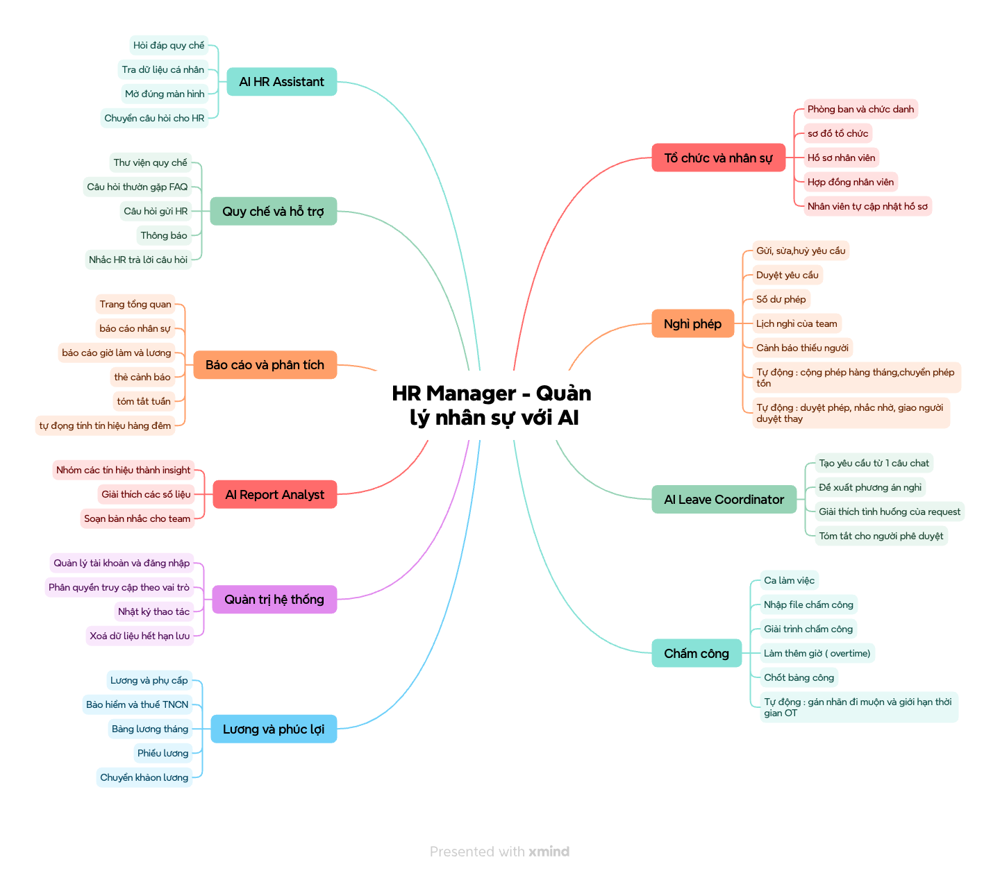
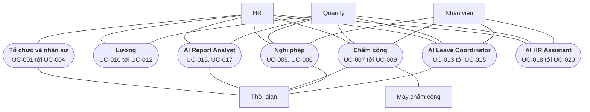
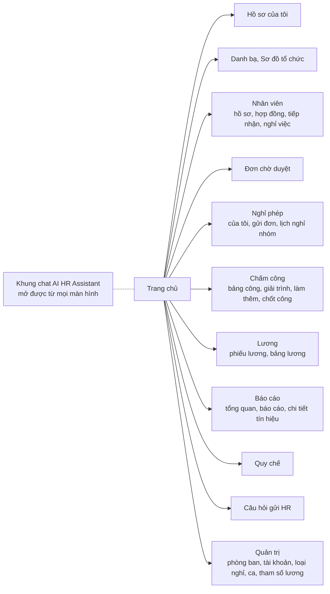

# HR Manager

Hệ thống quản lý nhân sự chạy trên web cho doanh nghiệp nhỏ và vừa tại Việt Nam, có ba tính năng AI hỗ trợ người dùng.

> **Trạng thái:** đã xong phân tích yêu cầu; đang làm UI prototype dùng dữ liệu giả
> ([#52](https://github.com/pbaodev/hr-manager/issues/52)). Chưa có code. Stack và kiến trúc được chọn ở Phase 3, sau
> khi prototype được duyệt. Cập nhật 2026-11-03.

## Project Overview

HR Manager gom hồ sơ nhân viên, cơ cấu tổ chức, nghỉ phép, chấm công, lương và báo cáo vào một hệ thống, thay cho tin
nhắn Zalo và các bảng tính rời rạc. Mọi con số được tính theo quy chế công ty và luật lao động Việt Nam. AI giúp ở những
chỗ form và rule không làm được; quyết định vẫn do người.

### Problem

Ở công ty mục tiêu, nhân viên xin nghỉ qua Zalo hoặc nói trực tiếp, và quản lý duyệt bằng lời. Không nơi nào ghi lại số
ngày phép đã dùng, nên cả nhân viên lẫn HR đều không biết mỗi người còn bao nhiêu ngày. Cuối tháng HR lục lại tin nhắn
để tính công, rồi tính lương trên nhiều bảng tính. Kết quả là công và lương dễ sai, và hai bên hay tranh cãi về số ngày
phép.

Ngoài ra còn ba việc tốn thời gian mà form hay bảng báo cáo không giải hết:

- HR trả lời lặp lại cùng một câu hỏi về quy chế, số ngày phép và phiếu lương.
- Nhân viên không biết lý do nghỉ của mình thuộc loại nghỉ nào, nên đơn bị trả lại hoặc lương bị tính sai. Đơn bị treo
  khi quản lý bận hay đang nghỉ.
- Quản lý và ban giám đốc ít khi đọc hết báo cáo, nên thấy muộn những điều đáng chú ý, như một phòng ban có nhiều người
  nghỉ việc.

Đây là nhận định của chủ dự án, chưa được công ty xác nhận. Các câu cần hỏi công ty nằm ở
[questions](docs/project/questions.md).

### Solution

Hệ thống có ba lớp. Mỗi lớp chỉ dựa vào lớp dưới nó, nên khi tắt AI thì mọi nghiệp vụ vẫn làm được bằng form và báo cáo.

| Lớp | Làm gì | Ví dụ |
|---|---|---|
| Core nghiệp vụ | Lưu dữ liệu, tính toán theo luật và quy chế, kiểm quyền; là nơi duy nhất quyết định dữ liệu đúng | Hồ sơ, đơn nghỉ và số dư phép, bảng công, bảng lương, báo cáo |
| Tự động hóa bằng rule | Chạy việc lặp lại theo lịch hoặc theo sự kiện | Cộng phép hằng tháng, chuyển phép tồn, nhắc duyệt, cảnh báo thiếu người |
| AI | Hiểu câu tự nhiên, tóm tắt, giải thích và gợi ý | Ba tính năng ở bảng dưới |

| Tính năng AI | Dành cho | Làm gì |
|---|---|---|
| AI Leave Coordinator | Mọi vai trò | Soạn đơn nghỉ từ một câu, đề xuất phương án hợp lệ, giải thích tình huống của đơn, tóm tắt tác động cho người duyệt |
| AI Report Analyst | Quản lý, HR | Gom các tín hiệu do rule phát hiện thành vài điều đáng chú ý, giải thích con số, soạn tin nhắc nhóm và tóm tắt tuần |
| AI HR Assistant | Mọi vai trò | Trả lời câu hỏi về quy chế kèm nguồn, tra dữ liệu người hỏi được xem, mở đúng màn hình nghiệp vụ, chuyển câu chưa trả lời được cho HR |

Ba luật áp dụng cho cả ba tính năng:

- AI không tự thay đổi dữ liệu nghiệp vụ. Mọi thay đổi do người có quyền bấm xác nhận; duyệt đơn luôn do người làm
  (BR-155 tới BR-158).
- AI không bao giờ nhận số CCCD, tài khoản ngân hàng, mã số thuế, mã số BHXH và thông tin người phụ thuộc (BR-161).
- AI lỗi hay chậm thì màn hình chạy như khi không có AI (BR-162).

Chi tiết ở [brief](docs/project/brief.md#solution) và mục luật AI trong [domain](docs/analysis/domain.md).

### Target users

| Vai trò | Ai | Dùng hệ thống để |
|---|---|---|
| Nhân viên | Mọi người có tài khoản | Xem hồ sơ, số dư phép, bảng công và phiếu lương của mình; gửi đơn nghỉ, giải trình, đăng ký làm thêm; hỏi quy chế |
| Quản lý | Trưởng phòng ban, tự có khi được bổ nhiệm | Duyệt đơn của nhóm, xem hồ sơ, lịch nghỉ, bảng công và báo cáo trong phạm vi mình phụ trách |
| HR | Người làm nhân sự, được gán vai trò | Quản lý hồ sơ, hợp đồng, cơ cấu, tài khoản và cấu hình; chốt bảng công; tính và chốt lương; trả lời câu hỏi gửi HR |

Ban giám đốc không có vai trò riêng: giám đốc là trưởng phòng ban gốc nên dùng vai trò Quản lý với phạm vi toàn công ty.
Quyền chi tiết của từng thao tác nằm ở [permission matrix](docs/analysis/requirements.md#permission-matrix).

## Product Mind Map



Bản tiếng Anh: [product-mindmap-en.png](docs/design/product-mindmap-en.png). Dàn ý để dựng lại bằng Xmind nằm ở
[product-mindmap](docs/design/product-mindmap.md); phân rã chức năng chính thức ở
[research](docs/project/research.md#decomposition).

## Key Features

v1.0 là bản phát hành đầu tiên cho công ty, gồm mọi story của M1 tới M6. M1 tới M5 là mốc nội bộ: mỗi mốc được kiểm
trên staging nhưng chưa giao cho công ty. Ba tính năng AI làm ở M6, sau khi phần nghiệp vụ đã chạy đúng.

| Milestone | Tính năng | Story (Must) |
|---|---|---|
| M1 Tổ chức và nhân sự | Đăng nhập, tài khoản, vai trò; phòng ban, chức danh, sơ đồ tổ chức; hồ sơ, hợp đồng, thay đổi công tác, nghỉ việc; thư viện quy chế, câu hỏi thường gặp, câu hỏi gửi HR; thông báo; nhật ký thao tác | 29 (20) |
| M2 Nghỉ phép | Gửi, đổi, hủy và duyệt đơn; số dư phép; lịch nghỉ của nhóm; danh mục lý do nghỉ; cảnh báo thiếu người; tự cộng phép, chuyển phép tồn, nhắc duyệt và giao người duyệt thay | 24 (18) |
| M3 Chấm công | Ca làm việc, nhập file máy chấm công, tính công, giải trình, làm thêm giờ, chốt bảng công; cờ đi muộn và gần giới hạn làm thêm | 17 (14) |
| M4 Lương và phúc lợi | Lương và phụ cấp theo ngày hiệu lực, BHXH, thuế TNCN, người phụ thuộc; tính và chốt bảng lương; phiếu lương, so sánh với tháng trước; file chuyển khoản | 16 (13) |
| M5 Báo cáo và phân tích | Trang tổng quan; báo cáo nhân sự, nghỉ phép, công và lương; tín hiệu tính hằng đêm, thẻ cảnh báo, tóm tắt tuần | 14 (9) |
| M6 AI | AI Leave Coordinator, AI Report Analyst, AI HR Assistant, theo thứ tự này | 20 (11) |

Tổng cộng 120 story, trong đó 85 story `Must`. Danh sách đầy đủ ở [stories](docs/analysis/stories.md#summary).

## Tech Stack and Architecture

Chưa chọn. Stack, kiến trúc, dữ liệu và API được thiết kế ở Phase 3, sau khi prototype được duyệt
([#61](https://github.com/pbaodev/hr-manager/issues/61)), theo các Issue
[#8](https://github.com/pbaodev/hr-manager/issues/8) tới [#13](https://github.com/pbaodev/hr-manager/issues/13).

## Project Structure

Code sẽ được thêm khi dựng khung dự án ([#14](https://github.com/pbaodev/hr-manager/issues/14)). Danh mục đầy đủ của
tài liệu và trạng thái từng file ở [docs/README.md](docs/README.md).

```text
ARCHITECTURE.md        C4 Context và Container, driver, cross-cutting, threat, deployment; mẫu, điền ở Phase 3
AGENTS.md              Hướng dẫn cho AI agent
contracts/
  openapi.yaml         Contract API; mẫu, điền ở Phase 3
docs/
  README.md            Index: tài liệu nào trả lời câu hỏi nào, trạng thái ra sao
  project/             Dự án, bài toán, nghiên cứu, câu hỏi chờ công ty xác nhận
  analysis/            Requirements, user story, INVEST, luật nghiệp vụ, màn hình
  design/              Prototype, dữ liệu giả, product mindmap; component, data, API, UI, AI điền ở Phase 3
  decisions/           ADR
  build/               SPEC, setup, testing, conventions
  operations/          Runbook
  playbook/            Quy trình làm việc của dự án
scripts/               Script dựng GitHub
.github/               Mẫu Issue và PR, CI
```

## Documentation

### Requirements

[Requirements](docs/analysis/requirements.md) có 3 vai trò người, ma trận quyền, 20 use case và 12 quality attribute,
trong đó 7 dành cho tính năng AI. [Domain](docs/analysis/domain.md) có 221 luật nghiệp vụ và 142 edge case; mỗi luật có
mã `BR-xxx` để truy tới story và test.

**Use case diagram**

Sơ đồ tóm tắt actor nào tham gia nhóm use case nào. Luồng chi tiết của từng use case ở
[requirements](docs/analysis/requirements.md#use-cases).



| Nhóm | Use case |
|---|---|
| Tổ chức và nhân sự | UC-001 Tiếp nhận nhân viên mới · UC-002 Ghi nhận thay đổi công tác · UC-003 Ghi nhận nghỉ việc · UC-004 Tái cấu trúc phòng ban |
| Nghỉ phép | UC-005 Gửi và duyệt đơn nghỉ · UC-006 Cộng phép và chuyển phép tồn |
| Chấm công | UC-007 Nhập file chấm công và tính công · UC-008 Đăng ký và duyệt làm thêm giờ · UC-009 Chốt bảng công tháng |
| Lương | UC-010 Tính và chốt bảng lương tháng · UC-011 Thay đổi lương của nhân viên · UC-012 Xem báo cáo chi phí lương |
| AI Leave Coordinator | UC-013 Tạo đơn nghỉ với AI · UC-014 Điều phối tình huống của đơn nghỉ · UC-015 Hỗ trợ người duyệt đơn nghỉ |
| AI Report Analyst | UC-016 Phát hiện tín hiệu và tạo insight · UC-017 Xử lý điều đáng chú ý trên trang tổng quan |
| AI HR Assistant | UC-018 Hỏi đáp với AI HR Assistant · UC-019 Chuyển ý định từ chat sang workflow nghiệp vụ · UC-020 Gửi câu hỏi cho HR |

Một đường nối nghĩa là actor tham gia ít nhất một use case trong nhóm; actor của từng use case ghi ở đầu mục use case
đó. Thời gian là actor lịch: nó làm các thay đổi có ngày hiệu lực, cộng phép hằng tháng, nhắc đơn chờ lâu và tính tín
hiệu hằng đêm.

**User stories INVEST**

Mỗi story có acceptance criteria dạng Given, When, Then. 85 story `Must` được chấm theo sáu tiêu chí INVEST:

| Criterion | Pass khi | Pass |
|---|---|---|
| Independent | Chỉ cần story `Must` của cùng milestone hoặc milestone trước | 85 / 85 |
| Negotiable | Nói người dùng cần gì, không áp đặt cách làm | 85 / 85 |
| Valuable | Có vai trò rõ và lợi ích cho vai trò đó | 85 / 85 |
| Estimable | Luật và edge case đã có mã, không còn câu hỏi mở hay spike chặn story | 82 / 85 |
| Small | Làm xong backend, frontend và test trong một PR, khoảng 3 ngày công | 74 / 85 |
| Testable | Mọi AC kiểm được; AC về nội dung AI kiểm bằng eval | 85 / 85 |

72 story đạt đủ sáu tiêu chí. 13 story còn lại đã có Issue xử lý, ghi ở [INVEST review](docs/analysis/invest.md). Kết
quả chấm đang ở trạng thái Draft: chủ dự án chưa đọc lại.

### Information Architecture

52 màn hình, nhóm theo menu. Menu chỉ hiện mục người dùng có quyền; quyền vẫn được kiểm ở backend. Sơ đồ dưới chỉ có mục
menu; sơ đồ đủ màn hình và quyền của từng vai trò theo menu ở [UI flow](docs/analysis/ui-flow.md#information-architecture).



Luồng giữa các màn hình ở [UI flow](docs/analysis/ui-flow.md#flows).

### UI/UX Prototype

<!-- Ảnh prototype: bổ sung sau khi design system và prototype hoàn tất (#52) -->

Dự án làm theo [playbook](docs/playbook/README.md) sáu phase; AI agent làm việc theo [AGENTS.md](AGENTS.md).

## License

[MIT](LICENSE)
