# HR Manager

Hệ thống quản lý nhân sự chạy trên web cho doanh nghiệp nhỏ và vừa tại Việt Nam.

> **Trạng thái:** Phase 3, Thiết kế. Phân tích yêu cầu đã chốt; kiến trúc, dữ liệu, API và giao diện của MVP đã có bản
> Draft. Chưa có code. Cập nhật 2026-10-30.

## Project Overview

HR Manager gom hồ sơ nhân viên, cơ cấu tổ chức, nghỉ phép, chấm công, lương và báo cáo vào một hệ thống, thay cho tin
nhắn Zalo và các bảng tính rời rạc.

### Problem

Ở công ty mục tiêu, nhân viên xin nghỉ qua Zalo hoặc nói trực tiếp, và quản lý duyệt bằng lời. Không nơi nào ghi lại số
ngày phép đã dùng, nên cả nhân viên lẫn HR đều không biết mỗi người còn bao nhiêu ngày. Cuối tháng HR lục lại tin nhắn
để tính công, rồi tính lương trên nhiều bảng tính. Kết quả là công và lương dễ sai, và hai bên hay tranh cãi về số ngày
phép.

Đây là nhận định của chủ dự án, chưa được công ty xác nhận. Các câu cần hỏi công ty nằm ở
[questions](docs/project/questions.md).

### Solution

Các ý dưới đây có trong MVP, trừ hai ý ghi "Sau MVP".

- Nhân viên tự gửi đơn nghỉ và xem số ngày phép còn lại, kể cả trên điện thoại.
- Quản lý duyệt đơn ngay trên hệ thống và thấy lịch nghỉ của nhóm.
- Hệ thống tự cộng phép hằng tháng, chuyển phép tồn, và tính số ngày nghỉ theo lịch làm việc và ngày lễ.
- HR quản lý hồ sơ, hợp đồng và cơ cấu tổ chức ở một nơi, có lịch sử theo ngày hiệu lực.
- Mỗi người chỉ thấy dữ liệu theo vai trò của mình; Quản lý chỉ thấy nhân viên của các phòng ban mình phụ trách.
- Quản lý và HR xem báo cáo nhân sự, nghỉ phép và xuất ra bảng tính.
- Sau MVP, chấm công: HR nhập file từ máy chấm công; hệ thống tính công, đi muộn, về sớm, làm thêm giờ, rồi HR chốt
  bảng công tháng. Nhân viên xem bảng công, gửi giải trình và đăng ký làm thêm trên hệ thống.
- Sau MVP, lương: hệ thống tính lương từ bảng công đã chốt, gồm phụ cấp, làm thêm, BHXH và thuế TNCN; nhân viên xem
  phiếu lương. Báo cáo có thêm chấm công và chi phí lương.
- Mọi tỷ lệ và mức theo luật lao động, BHXH, thuế là tham số có ngày hiệu lực; HR cập nhật khi luật đổi mà không cần
  sửa code.

### Target users

| Vai trò | Ai | Dùng hệ thống để |
|---|---|---|
| Nhân viên | Mọi người có tài khoản | Xem và sửa thông tin liên hệ của mình, gửi và hủy đơn nghỉ, xem số dư phép. Sau MVP: xem bảng công, gửi giải trình, đăng ký làm thêm, xem phiếu lương |
| Quản lý | Trưởng phòng ban, tự có khi được bổ nhiệm; giám đốc là trưởng phòng ban gốc | Duyệt đơn của nhóm, xem hồ sơ và lịch nghỉ trong phạm vi, xem báo cáo. Sau MVP: duyệt giải trình và làm thêm, xem bảng công của nhóm, xem chi phí lương ở mức tổng hợp |
| HR | Người làm nhân sự, được gán vai trò | Quản lý hồ sơ, hợp đồng, cơ cấu, tài khoản, loại nghỉ, lịch làm việc; duyệt thay. Sau MVP: nhập chấm công, chốt bảng công, tính và chốt bảng lương |

Quyền chi tiết của từng thao tác nằm ở [permission matrix](docs/analysis/requirements.md#permission-matrix).

## Product Mind Map

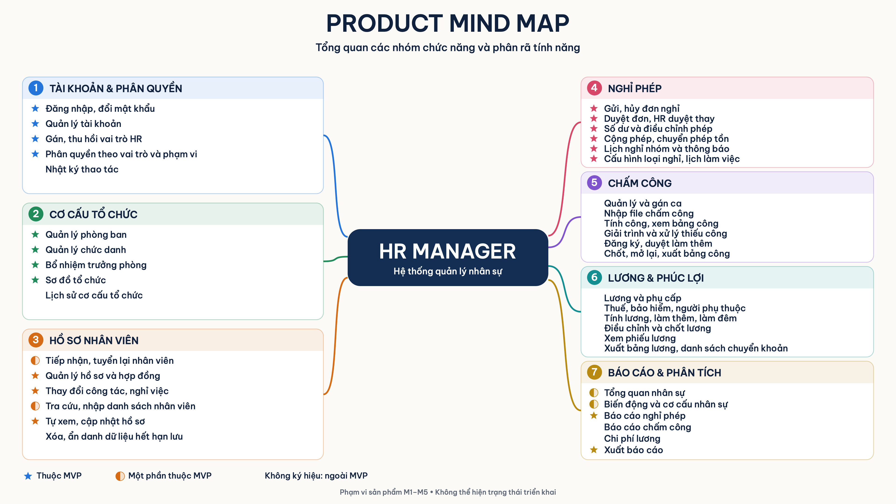

Bảy nhóm chức năng thuộc phạm vi M1 tới M5; nhãn ở góc mỗi nhóm là milestone. Ngôi sao là thuộc MVP, nửa vòng tròn là
một phần thuộc MVP, không ký hiệu là làm sau MVP.

## Tech Stack

| Layer | Choice | Decision |
|---|---|---|
| Kiến trúc | Modular monolith: một backend, một SPA | [ADR-0001](docs/decisions/0001-architecture-style.md) |
| Backend | Python 3.13, FastAPI, Pydantic v2, SQLAlchemy 2.0, Alembic, uv | [ADR-0002](docs/decisions/0002-stack.md) |
| Frontend | React, TypeScript, Vite; Mantine, TanStack Query, openapi-fetch, React Router | [ADR-0002](docs/decisions/0002-stack.md), [ADR-0006](docs/decisions/0006-frontend-libraries.md) |
| Database | PostgreSQL 16 trở lên, với `btree_gist`, `pg_trgm`, `unaccent` | [ADR-0003](docs/decisions/0003-data-store.md) |
| Xác thực | Tự làm: JWT 15 phút và refresh token lưu DB, trong cookie `HttpOnly` | [ADR-0004](docs/decisions/0004-authentication.md) |
| Hosting | Render vùng Singapore cho production, khoảng $15 mỗi tháng; gói miễn phí của Render và Neon cho staging | [ADR-0005](docs/decisions/0005-hosting.md) |
| API contract | OpenAPI 3.1, viết contract trước code | [API design](docs/design/api.md) |
| Kiểm tra | pytest, ruff, mypy; ESLint, Vitest. CI hiện lint tài liệu và contract | [ADR-0002](docs/decisions/0002-stack.md) |

## Key Features

MVP là bản phát hành đầu tiên, gồm 32 trên 72 user story. MVP giải chỗ đau xin nghỉ trước, để công ty dùng thử sớm, trước
hai milestone có nhiều rủi ro về luật là chấm công và lương.

| Milestone | Tính năng | MVP |
|---|---|---|
| M1 Nhân sự và tổ chức | Đăng nhập, đổi mật khẩu; quản lý tài khoản và vai trò HR | ✅ |
| | Phòng ban có lịch sử theo ngày hiệu lực, chức danh, bổ nhiệm trưởng phòng ban, sơ đồ tổ chức | ✅ |
| | Tiếp nhận nhân viên, sửa hồ sơ, tìm và lọc nhân viên, thay đổi công tác, nghỉ việc, hợp đồng và hợp đồng sắp hết hạn | ✅ |
| | Nhân viên tự xem và sửa thông tin liên hệ; Quản lý xem hồ sơ trong phạm vi | ✅ |
| | Nhật ký thao tác, giải thể phòng ban, cơ cấu tại ngày trong quá khứ, danh bạ, nhập từ bảng tính, tuyển lại, xóa dữ liệu hết hạn lưu | Sau |
| M2 Nghỉ phép | Số dư và biến động phép; gửi, hủy, duyệt, từ chối đơn nghỉ; HR duyệt thay | ✅ |
| | Lịch nghỉ nhóm, loại nghỉ, lịch làm việc, cộng phép tháng, chuyển phép tồn, điều chỉnh phép, thông báo | ✅ |
| | HR ghi đơn thay nhân viên, số phép chưa nghỉ khi nghỉ việc | Sau |
| M3 Chấm công | Ca, gán ca, nhập file máy chấm công, tính công, giải trình, làm thêm giờ, chốt bảng công | Sau |
| M4 Lương | Lương và phụ cấp theo ngày hiệu lực, BHXH, thuế TNCN, người phụ thuộc, tính và chốt bảng lương, phiếu lương | Sau |
| M5 Báo cáo | Trang tổng quan, biến động nhân sự, nghỉ phép, xuất bảng tính | ✅ |
| | Cơ cấu nhân sự, chấm công, chi phí lương | Sau |
| M6 AI | Hướng mở rộng sau M1 tới M5 | Sau |

Danh sách story đầy đủ ở [stories](docs/analysis/stories.md#summary).

## System Architecture

Hệ thống là một modular monolith: một codebase backend chia theo module nghiệp vụ, một SPA, một PostgreSQL. Lựa chọn
này hợp với một người vận hành và ngân sách $10 tới $25 mỗi tháng, và giữ được transaction trên nhiều module, ví dụ khi
duyệt đơn phải trừ phép và ghi nhật ký cùng lúc.

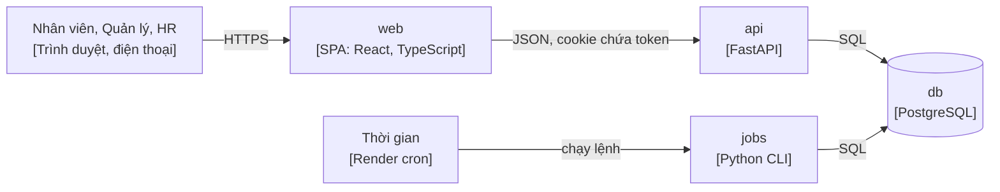

| Container | Vai trò |
|---|---|
| web | Giao diện; không giữ luật nghiệp vụ. Build thành file tĩnh, do `api` phục vụ cùng domain |
| api | Xác thực, kiểm quyền, giữ luật nghiệp vụ, đọc ghi DB, xuất bảng tính |
| jobs | Việc theo lịch: cộng phép tháng, chuyển và hủy phép tồn, khóa tài khoản sau ngày làm việc cuối; từ M3 thêm mở kỳ công |
| db | Toàn bộ dữ liệu, nhật ký thao tác, refresh token, thông báo |

Module backend chỉ phụ thuộc theo một chiều. Module bên trái được dùng module bên phải; chiều ngược lại đi qua interface
hoặc event, và được kiểm tự động bằng `import-linter`.

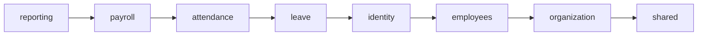

Điểm thiết kế chính:

- **Dữ liệu theo ngày hiệu lực:** phòng ban, quá trình công tác, hợp đồng, lương lưu khoảng `daterange`; PostgreSQL chặn
  hai khoảng chồng nhau bằng exclusion constraint.
- **Số dư phép không âm khi duyệt đồng thời:** khóa dòng tài khoản phép của nhân viên rồi tính lại từ sổ phép chỉ ghi
  thêm.
- **Quyền:** mặc định từ chối; Quản lý chỉ thấy cây phòng ban mình phụ trách; tài nguyên ngoài phạm vi trả về 404.
- **Khóa tài khoản có tác dụng ngay:** mỗi request kiểm trạng thái tài khoản và `token_version`.
- **Dữ liệu:** chỉ dùng dữ liệu giả cho tới khi có thỏa thuận với công ty, vì máy chủ ở Singapore là chuyển dữ liệu cá
  nhân ra nước ngoài.

| Môi trường | Hạ tầng | Deploy |
|---|---|---|
| local | Máy cá nhân | `make setup` theo [setup](docs/build/setup.md) |
| staging | Render gói miễn phí, Neon PostgreSQL gói miễn phí, dữ liệu giả | Tự động khi merge vào `main` |
| production | Render web service Starter, Render Postgres, Render cron, vùng Singapore | Chạy tay sau release gate |

Chi tiết ở [ARCHITECTURE.md](ARCHITECTURE.md): driver, cross-cutting, trust boundary, 12 threat.

## Project Structure

Code backend và frontend sẽ được thêm khi dựng khung dự án (Issue #14). Danh mục đầy đủ của tài liệu ở
[docs/README.md](docs/README.md).

```text
ARCHITECTURE.md        C4 Context và Container, driver, cross-cutting, threat, deployment
AGENTS.md              Hướng dẫn cho AI agent
contracts/
  openapi.yaml         Contract API của MVP
docs/
  README.md            Index: tài liệu nào trả lời câu hỏi nào, trạng thái ra sao
  project/             Dự án, bài toán, nghiên cứu, câu hỏi chờ công ty xác nhận
  analysis/            Requirements, user story, INVEST, luật nghiệp vụ, màn hình
  design/              Component, data, schema DBML, API, flow, UI
  decisions/           ADR
  build/               SPEC, setup, testing, conventions
  operations/          Runbook
  assets/              Ảnh: mind map, use case, information architecture, prototype
  playbook/            Quy trình làm việc của dự án
scripts/               Script dựng GitHub
.github/               Mẫu Issue và PR, CI
```

## Documentation

### Requirements

[Requirements](docs/analysis/requirements.md) có 3 actor người, ma trận quyền, 12 use case và 5 quality attribute.
[Domain](docs/analysis/domain.md) có 141 luật nghiệp vụ và 91 edge case, mỗi luật có mã `BR-xxx` để truy tới story và test.

**Use case diagram**

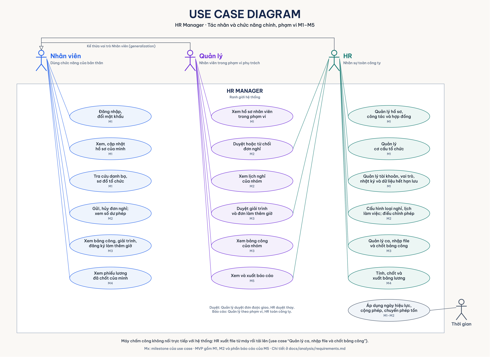

Ảnh có nhúng sơ đồ draw.io; mở `use-case.drawio.png` bằng draw.io để sửa.

**User stories INVEST**

Có 72 story, mỗi story kèm acceptance criteria dạng Given, When, Then. 32 story của MVP được chấm theo rubric INVEST:

| Criterion | Pass khi | Pass |
|---|---|---|
| Independent | Làm và kiểm được trong MVP, không cần story ngoài MVP | 30 / 32 |
| Negotiable | Nói người dùng cần gì, không áp đặt cách làm | 32 / 32 |
| Valuable | Có vai trò rõ và lợi ích cho vai trò đó | 32 / 32 |
| Estimable | Luật và edge case đã có mã, không còn câu hỏi mở chặn story | 32 / 32 |
| Small | Làm xong backend, frontend và test trong một PR, khoảng 3 ngày công | 29 / 32 |
| Testable | Mọi AC kiểm được | 32 / 32 |

27 story đạt đủ sáu tiêu chí. Năm story còn lại và cách sửa đề xuất nằm ở [INVEST review](docs/analysis/invest.md).

### Information Architecture

46 màn hình, nhóm theo menu. Menu chỉ hiện mục người dùng có quyền; quyền vẫn được kiểm ở backend.

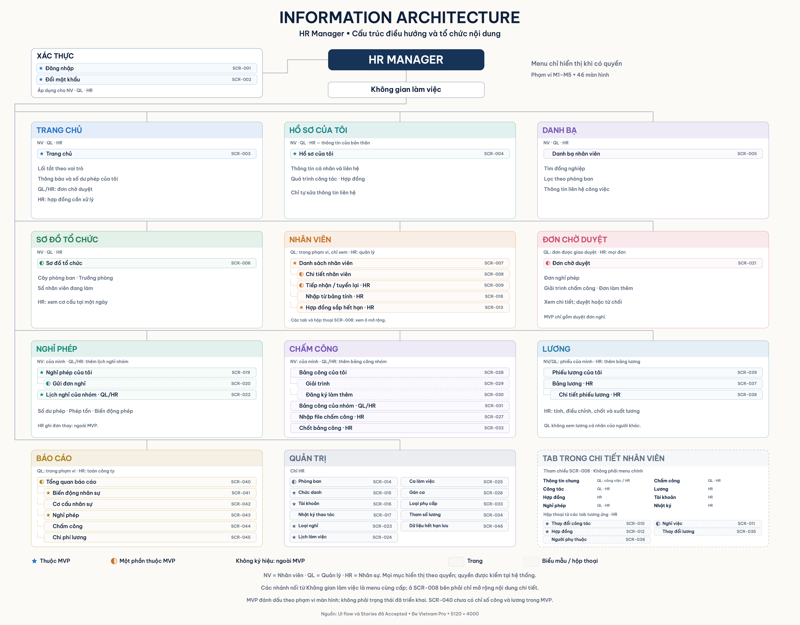

Luồng giữa các màn hình ở [UI flow](docs/analysis/ui-flow.md); design system, trạng thái màn hình và accessibility ở
[UI design](docs/design/ui.md).

### UI/UX Prototype

Prototype của 5 màn hình chính trong MVP, dùng dữ liệu giả.

| Màn hình | Prototype |
|---|---|
| SCR-007 Danh sách nhân viên, HR | 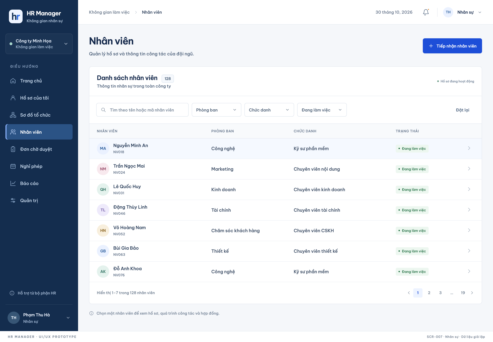 |
| SCR-008 Chi tiết nhân viên, HR | 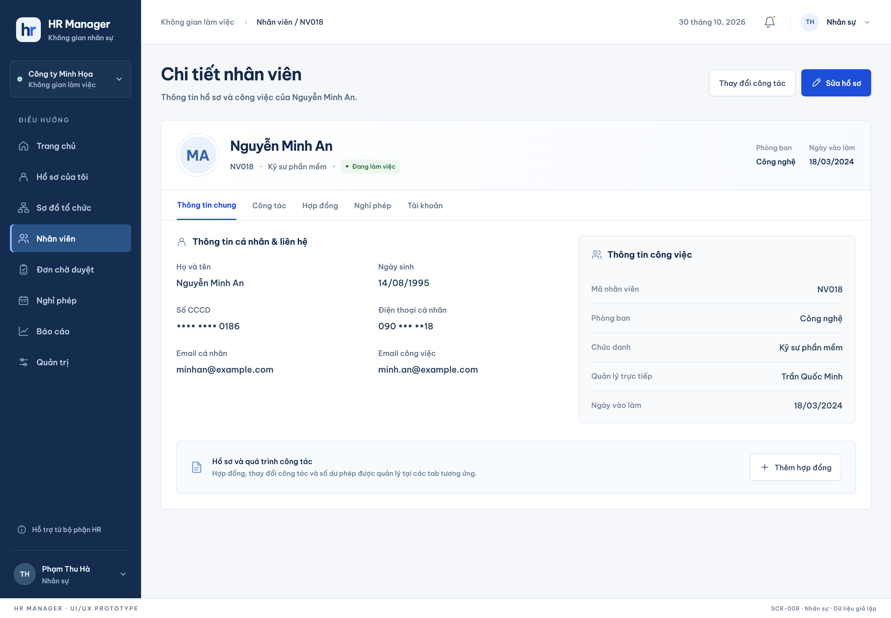 |
| SCR-019 Nghỉ phép của tôi, Nhân viên | 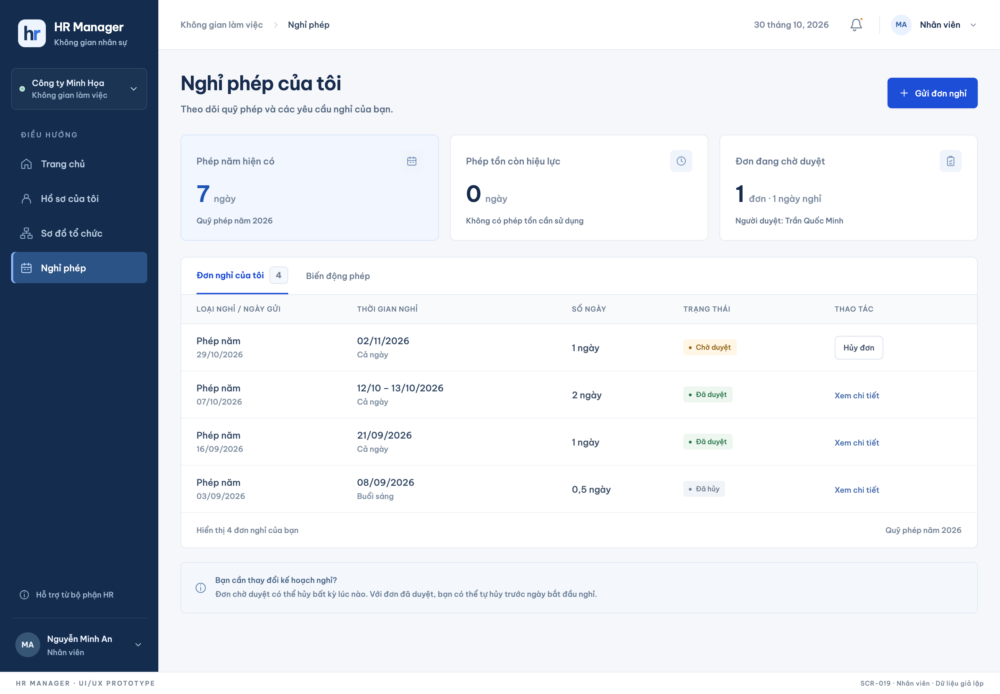 |
| SCR-021 Đơn chờ duyệt, Quản lý | 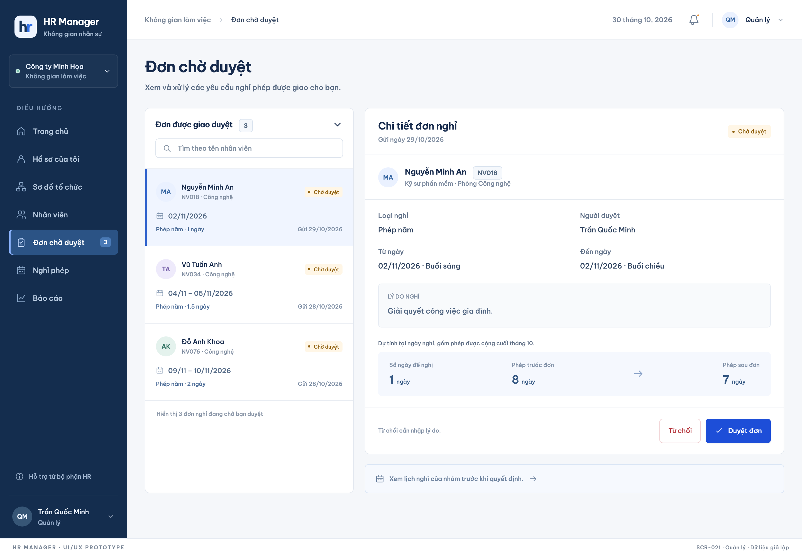 |
| SCR-040 Tổng quan báo cáo, HR | 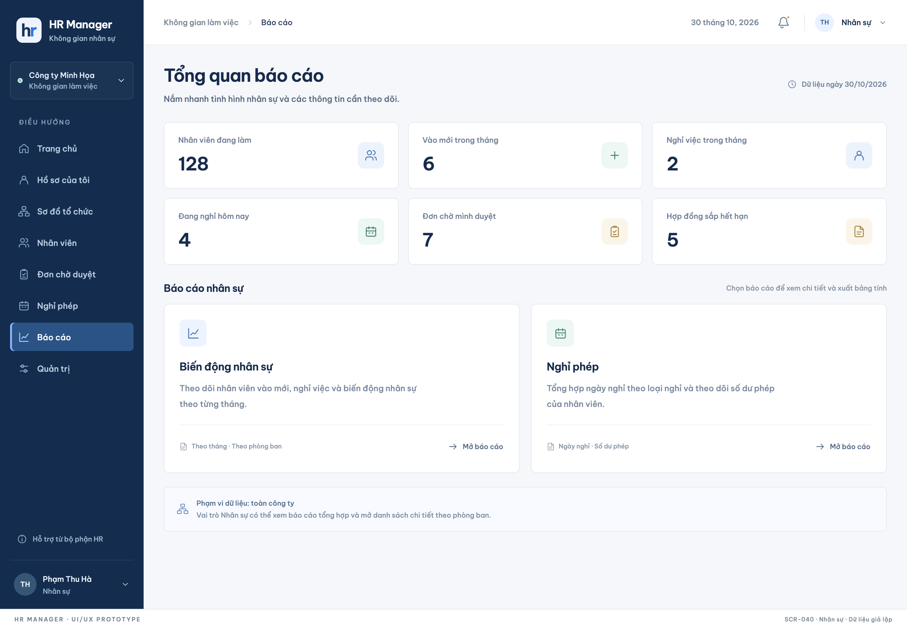 |

### DBML

Schema đầy đủ cho M1 tới M4 ở [schema.dbml](docs/design/schema.dbml); dán vào [dbdiagram.io](https://dbdiagram.io) để
xem sơ đồ. Sơ đồ dưới đây chỉ gồm bảng của MVP.

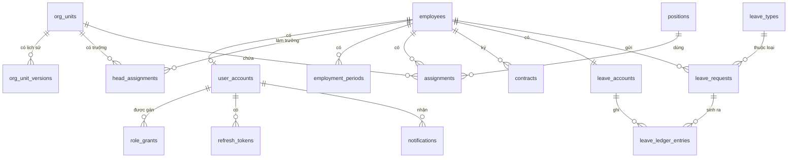

Luật giữ ở tầng dữ liệu, index, transaction và migration ở [data design](docs/design/data.md).

### OpenAPI Document

Contract [openapi.yaml](contracts/openapi.yaml) có 48 path và 61 operation cho MVP; CI lint contract ở mọi PR.

| Group | Operations | Ví dụ |
|---|---|---|
| Auth | 5 | `POST /auth/login`, `GET /me` |
| Accounts | 7 | `POST /accounts/{accountId}/lock` |
| Organization | 9 | `GET /org-units/tree`, `POST /org-units/{orgUnitId}/heads` |
| Employees | 14 | `GET /employees`, `PUT /employees/{employeeId}/termination` |
| Leave | 16 | `POST /leave-requests`, `POST /leave-requests/{leaveRequestId}/approve` |
| Notifications | 3 | `GET /notifications` |
| Reports | 7 | `GET /reports/overview`, `GET /reports/leave-usage/export` |

Lỗi trả về theo RFC 9457 kèm `code` ổn định và mã luật liên quan. Quy ước API ở [API design](docs/design/api.md). Xem
contract dạng tài liệu ở máy:

```sh
npx @redocly/cli@1 preview-docs contracts/openapi.yaml
```

### C4 Documentation

| Level | Nội dung | File |
|---|---|---|
| 1 Context | Người dùng, actor Thời gian, máy chấm công và hệ thống ngoài | [ARCHITECTURE.md](ARCHITECTURE.md#context) |
| 2 Container | web, api, jobs, db và cách chúng nói chuyện | [ARCHITECTURE.md](ARCHITECTURE.md#containers) |
| 3 Component | Module nghiệp vụ, cấu trúc trong module, dependency rule, frontend | [components](docs/design/components.md) |

Sequence diagram của luồng chính và job ở [flows](docs/design/flows.md). Lý do của từng quyết định ở
[ADR index](docs/decisions/README.md).

Dự án làm theo [playbook](docs/playbook/README.md) sáu phase; AI agent làm việc theo [AGENTS.md](AGENTS.md).

## License

[MIT](LICENSE)
