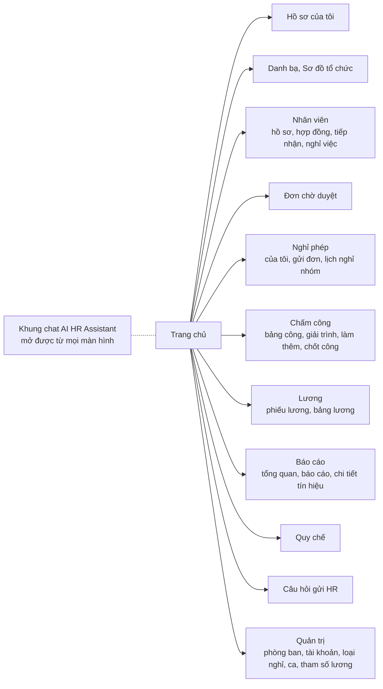

# HR Manager

Phần mềm quản lý nhân sự trên web cho doanh nghiệp nhỏ và vừa ở Việt Nam: hồ sơ, nghỉ phép, chấm công, lương và báo
cáo ở cùng một chỗ.

> **Trạng thái:** đã xong phân tích yêu cầu, đang làm prototype ([#52](https://github.com/pbaodev/hr-manager/issues/52)),
> chưa có code. Cập nhật 2026-11-03.

## Project Overview

### Problem

Công tác quản lý nhân sự tại các doanh nghiệp nhỏ còn một số khó khăn:

- Đơn nghỉ phép được gửi qua Zalo và duyệt bằng trao đổi trực tiếp, khó theo dõi trạng thái đơn và số ngày phép còn lại.
- HR tổng hợp công từ tin nhắn và tính lương trên nhiều file Excel, mất thời gian đối chiếu và dễ sai sót.
- Các câu hỏi về quy chế, ngày phép và phiếu lương lặp lại thường xuyên, HR phải trả lời từng người.
- Nhân viên chưa rõ cách chọn loại nghỉ phù hợp nên đơn thường phải chỉnh sửa và gửi lại.
- Quản lý chưa theo dõi báo cáo thường xuyên, dẫn đến chậm phát hiện các vấn đề cần xử lý.

### Solution

HR Manager tập trung hồ sơ nhân viên, nghỉ phép, chấm công và lương trên một hệ thống. Nhân viên tự gửi đơn và tra cứu
thông tin; quản lý duyệt đơn; HR tổng hợp công và tính lương theo quy chế công ty và luật lao động.

| Nhóm chức năng | Nội dung |
|---|---|
| Quản lý nhân sự | Quản lý hồ sơ, nghỉ phép, chấm công và lương; phân quyền xem và thao tác |
| Tự động hóa | Cộng phép hằng tháng, chuyển phép tồn, nhắc duyệt đơn và cảnh báo phòng ban thiếu người |
| Hỗ trợ bằng AI | Hỗ trợ tạo đơn nghỉ, phân tích báo cáo và trả lời câu hỏi về quy chế |

| Trợ lý AI | Chức năng |
|---|---|
| AI Leave Coordinator | Soạn đơn từ mô tả của nhân viên, gợi ý loại nghỉ phù hợp và giúp quản lý kiểm tra nhân sự còn lại trước khi duyệt |
| AI Report Analyst | Chỉ ra các điểm đáng chú ý trong báo cáo và giải thích số liệu |
| AI HR Assistant | Trả lời câu hỏi về quy chế kèm nguồn tham khảo; chuyển cho HR khi không có nguồn phù hợp |

AI chỉ đưa ra gợi ý; mọi thay đổi dữ liệu đều cần người dùng xác nhận. Các thông tin như số CCCD, tài khoản ngân hàng,
mã số thuế và mã số BHXH không được gửi cho AI. Hệ thống vẫn đáp ứng đầy đủ nghiệp vụ khi tắt AI.

Chi tiết ở [brief](docs/project/brief.md#solution) và BR-155 tới BR-165 trong [domain](docs/analysis/domain.md).

### Target users

| Vai trò | Dùng để |
|---|---|
| Nhân viên | Gửi đơn nghỉ, giải trình, đăng ký làm thêm; xem số phép, bảng công, phiếu lương; hỏi quy chế |
| Quản lý | Trưởng phòng ban. Duyệt đơn, xem hồ sơ, lịch nghỉ, bảng công và báo cáo của phòng mình và các phòng con |
| HR | Quản lý hồ sơ, hợp đồng, phòng ban, tài khoản; chốt bảng công; tính lương; trả lời câu hỏi |

Giám đốc dùng vai trò Quản lý với phạm vi toàn công ty. Quyền từng thao tác ở
[permission matrix](docs/analysis/requirements.md#permission-matrix).

## Product Mind Map


[Bản tiếng Anh](docs/design/product-mindmap-en.png) · [dàn ý Xmind](docs/design/product-mindmap.md)

## Key Features

v1.0 là bản đầu tiên giao cho công ty, gồm cả sáu milestone, làm theo thứ tự. AI làm sau cùng, khi nghiệp vụ đã chạy
đúng.

| Milestone | Tính năng | Story (Must) |
|---|---|---|
| M1 Tổ chức và nhân sự | Tài khoản và vai trò; phòng ban, chức danh, sơ đồ tổ chức; hồ sơ, hợp đồng, thay đổi công tác, nghỉ việc; quy chế, câu hỏi gửi HR; thông báo | 29 (20) |
| M2 Nghỉ phép | Gửi, đổi, hủy, duyệt đơn; số dư phép; lịch nghỉ của nhóm; cảnh báo thiếu người; tự cộng phép và nhắc duyệt | 24 (18) |
| M3 Chấm công | Ca làm việc, nhập file máy chấm công, giải trình, làm thêm giờ, chốt bảng công | 17 (14) |
| M4 Lương và phúc lợi | Lương, phụ cấp, BHXH, thuế TNCN; bảng lương tháng; phiếu lương; file chuyển khoản | 16 (13) |
| M5 Báo cáo | Trang tổng quan; báo cáo nhân sự, nghỉ phép, công, lương; cảnh báo và tóm tắt tuần | 14 (9) |
| M6 AI | AI Leave Coordinator, AI Report Analyst, AI HR Assistant | 20 (11) |

Tổng 120 story, 85 story `Must`. Danh sách ở [stories](docs/analysis/stories.md#summary).

## Tech Stack and Architecture

Chưa chọn. Thiết kế ở Phase 3, sau khi duyệt prototype ([#61](https://github.com/pbaodev/hr-manager/issues/61)).

## Project Structure

Chưa có code. Danh mục tài liệu và trạng thái từng file ở [docs/README.md](docs/README.md).

```text
ARCHITECTURE.md        C4 Context và Container, driver, cross-cutting, threat, deployment; mẫu, điền ở Phase 3
AGENTS.md              Hướng dẫn cho AI agent
contracts/
  openapi.yaml         Contract API; mẫu, điền ở Phase 3
docs/
  README.md            Index: tài liệu nào trả lời câu hỏi nào, trạng thái ra sao
  project/             Dự án, bài toán, nghiên cứu, câu hỏi chờ công ty xác nhận
  analysis/            Requirements, user story, INVEST, luật nghiệp vụ, màn hình
  design/              Prototype, dữ liệu giả, product mindmap; component, data, API, UI, AI điền ở Phase 3
  decisions/           ADR
  build/               SPEC, setup, testing, conventions
  operations/          Runbook
  playbook/            Quy trình làm việc của dự án
scripts/               Script dựng GitHub
.github/               Mẫu Issue và PR, CI
```

## Documentation

### Requirements

- [Requirements](docs/analysis/requirements.md): 3 vai trò, ma trận quyền, 20 use case, 12 quality attribute.
- [Domain](docs/analysis/domain.md): 221 luật nghiệp vụ (`BR-xxx`) và 142 edge case (`EC-xxx`).

**Use case diagram**


| Nhóm | Use case |
|---|---|
| Tổ chức và nhân sự | UC-001 Tiếp nhận nhân viên mới · UC-002 Ghi nhận thay đổi công tác · UC-003 Ghi nhận nghỉ việc · UC-004 Tái cấu trúc phòng ban |
| Nghỉ phép | UC-005 Gửi và duyệt đơn nghỉ · UC-006 Cộng phép và chuyển phép tồn |
| Chấm công | UC-007 Nhập file chấm công và tính công · UC-008 Đăng ký và duyệt làm thêm giờ · UC-009 Chốt bảng công tháng |
| Lương | UC-010 Tính và chốt bảng lương tháng · UC-011 Thay đổi lương của nhân viên · UC-012 Xem báo cáo chi phí lương |
| AI Leave Coordinator | UC-013 Tạo đơn nghỉ với AI · UC-014 Điều phối tình huống của đơn nghỉ · UC-015 Hỗ trợ người duyệt đơn nghỉ |
| AI Report Analyst | UC-016 Phát hiện tín hiệu và tạo insight · UC-017 Xử lý điều đáng chú ý trên trang tổng quan |
| AI HR Assistant | UC-018 Hỏi đáp với AI HR Assistant · UC-019 Chuyển ý định từ chat sang workflow nghiệp vụ · UC-020 Gửi câu hỏi cho HR |

Thời gian là các việc chạy theo lịch, như cộng phép hằng tháng. Actor của từng use case ở
[requirements](docs/analysis/requirements.md#use-cases).

**User stories INVEST**

85 story `Must` được chấm theo INVEST:

| Criterion | Pass khi | Pass |
|---|---|---|
| Independent | Không cần story của milestone sau | 85 / 85 |
| Negotiable | Nói cần gì, không áp cách làm | 85 / 85 |
| Valuable | Rõ ai được lợi và lợi gì | 85 / 85 |
| Estimable | Không còn câu hỏi mở chặn story | 82 / 85 |
| Small | Làm xong trong khoảng 3 ngày công | 74 / 85 |
| Testable | Mọi acceptance criteria kiểm được | 85 / 85 |

72 story đạt cả sáu tiêu chí; 13 story còn lại đã có Issue xử lý. Kết quả ở [INVEST review](docs/analysis/invest.md),
đang Draft.

### Information Architecture

52 màn hình, nhóm theo menu. Mỗi người chỉ thấy mục mình có quyền. Sơ đồ đủ 52 màn ở
[UI flow](docs/analysis/ui-flow.md#information-architecture).



### UI/UX Prototype

<!-- Ảnh prototype: bổ sung sau khi design system và prototype hoàn tất (#52) -->

Quy trình làm việc ở [playbook](docs/playbook/README.md); hướng dẫn cho AI agent ở [AGENTS.md](AGENTS.md).

## License

[MIT](LICENSE)
