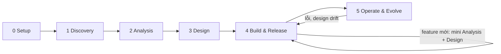

# Software Design Playbook

Template để một người cùng AI agent xây software, từ ý tưởng tới vận hành, với trọng tâm là phân tích yêu cầu và
thiết kế hệ thống. Template gồm quy trình sáu phase, hướng dẫn kỹ thuật phân tích và thiết kế, các mẫu tài liệu và
cấu hình GitHub. Default dành cho dự án cá nhân vừa để học vừa để chạy thật: phân tích và thiết kế làm kỹ, vận hành
làm gọn.

AI có hai chỗ trong template. AI agent hỗ trợ ở mọi bước, nhưng người quyết định. Tính năng AI của sản phẩm, nếu có,
được thiết kế như một component bình thường.

## Structure

```text
AGENTS.md              Hướng dẫn cho AI agent
ARCHITECTURE.md        Phase 3: C4 Context và Container, drivers, cross-cutting, threats, deployment
CHANGELOG.md           Phase 4 trở đi: thay đổi của từng bản phát hành
docs/
  playbook/            Hướng dẫn và default: phase, mũ, kỹ thuật phân tích và thiết kế, cách làm việc, git workflow
  project.md           Phase 0: mục tiêu, quỹ thời gian, công cụ, chỗ làm khác default
  brief.md             Phase 1: có nên làm không, làm theo hướng nào
  questions.md         Phase 1 trở đi: câu hỏi và assumption
  requirements.md      Phase 2: actor, phân quyền, use case, quality attribute
  stories.md           Phase 2: user story và acceptance criteria
  domain.md            Phase 2: thuật ngữ, entity, vòng đời, luật nghiệp vụ, edge case
  ui-flow.md           Phase 2: màn hình và luồng, khi có giao diện
  design/              Phase 3: component, data, API, UI, luồng, AI
  decisions/           Phase 1 trở đi: ADR và index
  conventions/         Phase 3 trở đi: quy tắc code máy không tự kiểm được
  SPEC.md              Phase 3: module, traceability, lệnh, boundaries; tài liệu chính khi làm task
  setup.md             Phase 3: chạy dự án trên máy sạch
  testing.md           Phase 3 trở đi: ca thử tay, mức lỗi, kết quả test mỗi bản phát hành
  runbook.md           Phase 5: deploy, rollback, backup, sự cố
  user-guide.md        Phase 5: hướng dẫn người dùng cuối, khi có người dùng khác
  handover.md          Phase 5: bàn giao, chỉ cho Client delivery
contracts/             Phase 3: contract API (OpenAPI), CI lint
scripts/               Script dựng GitHub: label, branch protection, Issue baseline
.github/               Mẫu Issue và PR, CI
```

## How it flows



Phase 0–3 làm một lần để có baseline: requirements, domain và thiết kế đã `Accepted`. Từ Phase 4, mỗi feature mới chạy
một vòng phân tích và thiết kế nhỏ trên chính các tài liệu đó trước khi code.

## Quick start

1. Tạo repo bằng **Use this template**, hoặc copy thư mục này.
2. Đọc [playbook](docs/playbook/README.md): nguyên tắc, sáu phase, bảng Project types.
3. Phase 0: điền [project.md](docs/project.md); chạy `scripts/bootstrap-github.sh --protect --baseline` để tạo label,
   bật branch protection cho `main` và tạo Issue cho deliverable baseline; tạo board GitHub Projects.
4. Đi theo [phases.md](docs/playbook/phases.md). Ở Phase 2 và 3, mở [analysis.md](docs/playbook/analysis.md) và
   [design.md](docs/playbook/design.md) bên cạnh mẫu đang điền.
5. Xóa mẫu không dùng theo bảng Project types, ví dụ `ui-flow.md` và `design/ui.md` khi sản phẩm không có giao diện,
   `design/ai.md` khi không có tính năng AI, `handover.md` khi không giao cho bên nhận.
6. Khi biến README này thành README của sản phẩm, giữ link tới playbook, [ARCHITECTURE.md](ARCHITECTURE.md) và
   [AGENTS.md](AGENTS.md).

## Tooling

- Sơ đồ viết bằng Mermaid trong Markdown: GitHub render được, agent đọc và sửa được, và thay đổi hiện rõ trong diff.
- `.github/` dành cho GitHub. Dùng công cụ khác thì chuyển mẫu Issue và PR sang công cụ đó, rồi ghi vào `project.md`.
- CI hiện kiểm link nội bộ trong Markdown, lint `contracts/openapi.yaml` và kiểm tiêu đề PR theo Conventional Commits.
  `make setup` và `make check` trả lỗi "chưa được cấu hình" cho tới khi cấu hình theo stack ở Phase 3.
- `scripts/bootstrap-github.sh` cần `gh` CLI đã đăng nhập; chạy lại nhiều lần được.

## Origin

Chuyển từ ai-team-playbook, bản dành cho nhóm làm sản phẩm AI. So với bản đó: sáu vai được thay bằng bốn mũ cho một
người; review chéo được thay bằng review nguội và AI phản biện; Phase Design được tách thành Analysis và Design, kèm
hướng dẫn kỹ thuật riêng; eval chuyển thành một phần của component AI. Sau đó bổ sung từ một playbook giao dự án theo
phase: script dựng GitHub, contract OpenAPI có lint, exit criteria dạng checklist, INVEST trong Definition of Ready,
Traceability nhiều cột có Status, git workflow chi tiết, testing, runbook, CHANGELOG và loại dự án Client delivery.

## License

[MIT](LICENSE)
