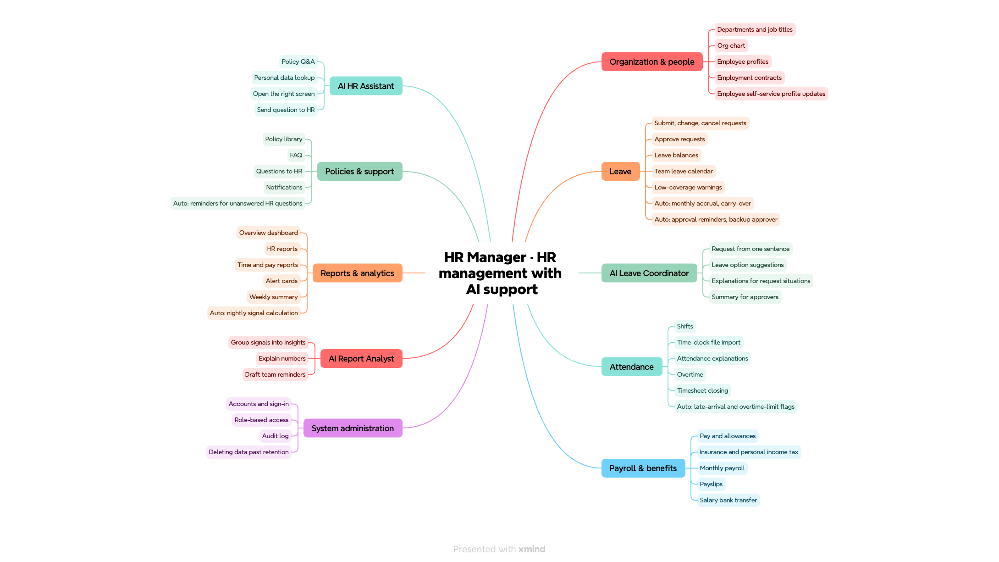
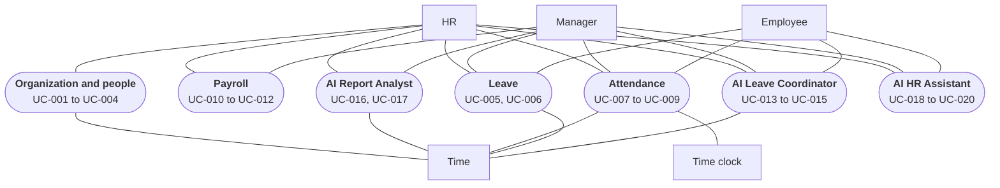
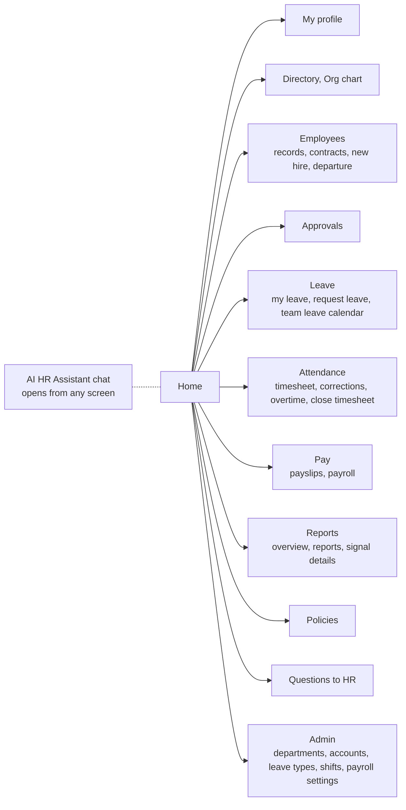
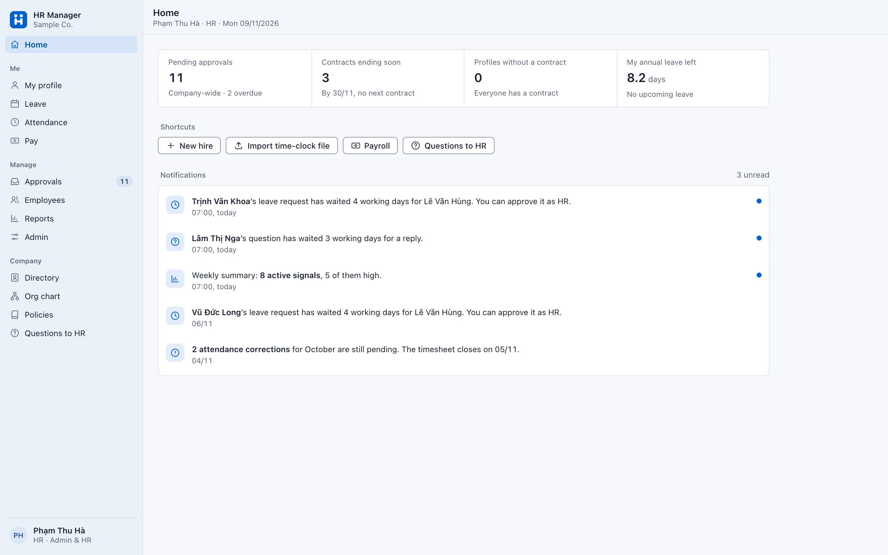
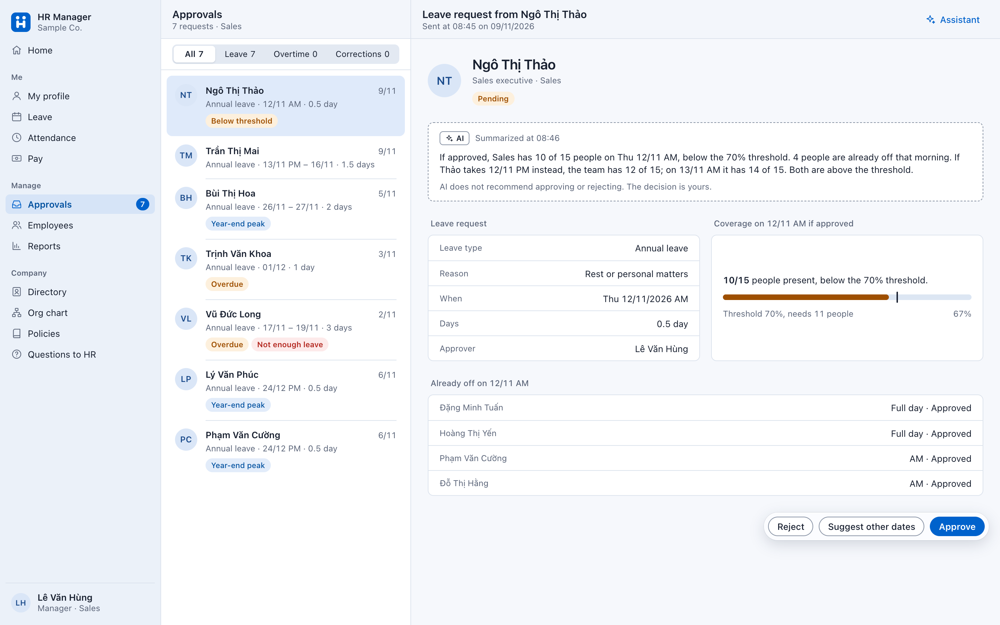
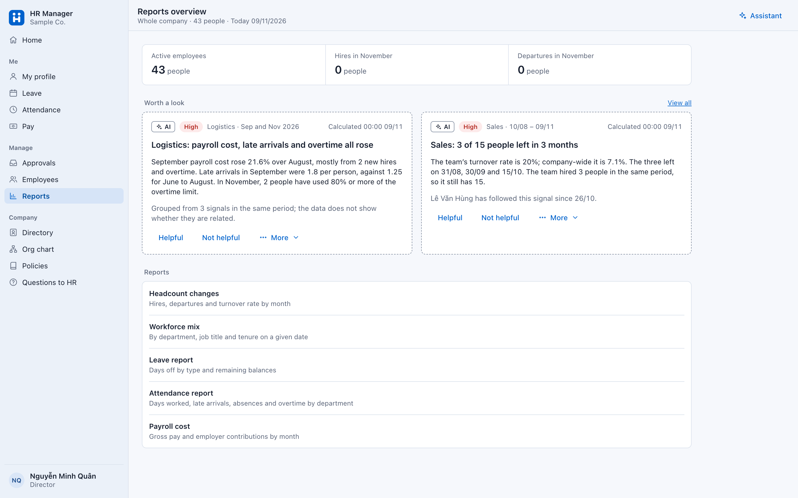
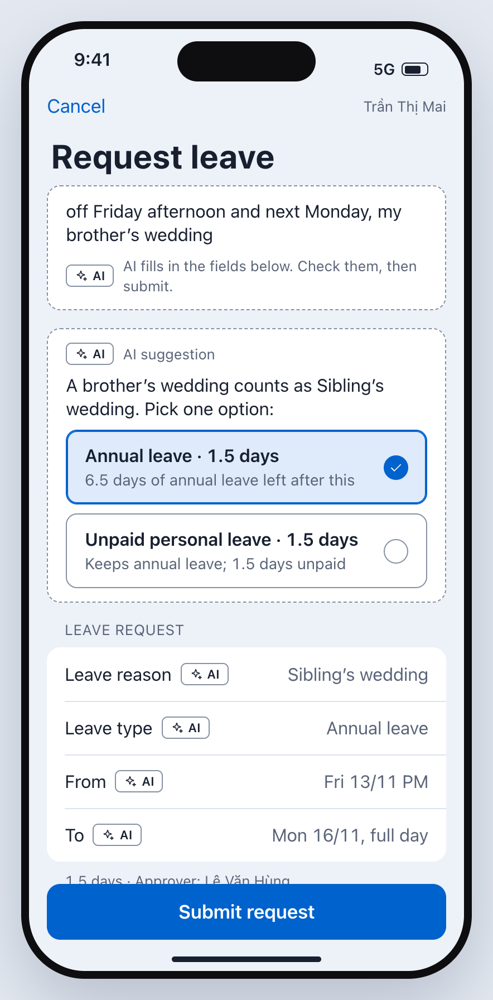

# HR Manager

Web-based HR software for small and medium-sized businesses in Vietnam. Employee records, leave, attendance, payroll
and reports in one place.

> **Status:** requirements analysis is done and the prototype is in progress
> ([#52](https://github.com/pbaodev/hr-manager/issues/52)). There is no code yet. Updated 2026-11-03.
>
> The detailed documentation in [docs/](docs/README.md) is written in Vietnamese.

## Project Overview

### Problem

HR work in small companies runs into a few recurring problems:

- Leave requests are sent over Zalo and approved in conversation, so it is hard to track a request's status and how
  many days of leave are left.
- HR collects attendance from chat messages and calculates pay across several Excel files, which takes time to
  reconcile and is error-prone.
- The same questions about policies, leave and payslips come up again and again, and HR answers each person
  individually.
- Employees are not sure which leave type to choose, so requests often have to be corrected and sent again.
- Managers do not follow reports regularly, so problems are spotted late.

### Solution

HR Manager brings employee records, leave, attendance and payroll into one system. Employees send requests and look
up their own information; managers approve requests; HR closes timesheets and calculates pay according to company
policy and labour law.

| Area | What it covers |
|---|---|
| HR management | Employee records, leave, attendance and payroll; permissions for viewing and actions |
| Automation | Monthly leave accrual, carried-over leave, approval reminders and alerts when a department is short-staffed |
| AI support | Help with leave requests, report analysis and answers to policy questions |

| AI assistant | What it does |
|---|---|
| AI Leave Coordinator | Drafts a request from the employee's description, suggests the right leave type and helps the manager check staffing before approving |
| AI Report Analyst | Points out what stands out in a report and explains the numbers |
| AI HR Assistant | Answers policy questions with sources; hands the question to HR when no source fits |

AI only makes suggestions; every change to data needs the user's confirmation. ID card numbers, bank accounts, tax
codes and social insurance numbers are never sent to the AI. The system still covers every business task with AI
turned off.

Details are in the [brief](docs/project/brief.md#solution) and BR-155 to BR-165 in [domain](docs/analysis/domain.md).

### Target users

| Role | Uses it to |
|---|---|
| Employee | Send leave requests, attendance corrections and overtime requests; see their leave balance, timesheet and payslips; ask about policies |
| Manager | Department heads. Approve requests; see records, team leave calendar, timesheets and reports for their department and its sub-departments |
| HR | Manage employee records, contracts, departments and accounts; close timesheets; run payroll; answer questions |

The director uses the Manager role with the whole company in scope. Permissions for each action are in the
[permission matrix](docs/analysis/requirements.md#permission-matrix).

## Product Mind Map



[Vietnamese version](docs/design/product-mindmap-vi.png) · [Xmind outline](docs/design/product-mindmap.md)

## Key Features

v1.0 is the first release delivered to the company. It includes all six milestones, built in order. AI comes last, once
the business features work correctly.

| Milestone | Features | Stories (Must) |
|---|---|---|
| M1 Organization and people | Accounts and roles; departments, job titles, org chart; employee records, contracts, job changes, departures; policies, questions to HR; notifications | 29 (20) |
| M2 Leave | Send, change, cancel and approve requests; leave balance; team leave calendar; short-staffing alerts; automatic accrual and approval reminders | 24 (18) |
| M3 Attendance | Shifts, time-clock file import, attendance corrections, overtime, closing the timesheet | 17 (14) |
| M4 Payroll and benefits | Salary, allowances, social insurance, personal income tax; monthly payroll; payslips; bank transfer file | 16 (13) |
| M5 Reports | Overview; workforce, leave, attendance and payroll reports; alerts and weekly summary | 14 (9) |
| M6 AI | AI Leave Coordinator, AI Report Analyst, AI HR Assistant | 20 (11) |

120 stories in total, 85 of them `Must`. The full list is in [stories](docs/analysis/stories.md#summary).

## Tech Stack and Architecture

Not chosen yet. The stack and architecture are designed in Phase 3, after the prototype is approved
([#61](https://github.com/pbaodev/hr-manager/issues/61)). Known constraints: a web app that also works on phones,
AI that can be turned off without losing any business feature, and sensitive personal data that is never sent to the
AI.

## Project Structure

There is no code yet. The list of documents and the status of each file are in [docs/README.md](docs/README.md).

```text
ARCHITECTURE.md        C4 Context and Container, drivers, cross-cutting concerns, threats, deployment; template, filled in Phase 3
AGENTS.md              Instructions for AI agents
contracts/
  openapi.yaml         API contract; template, filled in Phase 3
docs/
  README.md            Index: which document answers which question, and its status
  project/             Project, problem, research, questions waiting for the company
  analysis/            Requirements, user stories, INVEST, business rules, screens
  design/              Prototype, mock data, screenshots, product mind map; components, data, API, UI, AI filled in Phase 3
  decisions/           ADRs
  build/               SPEC, setup, testing, conventions
  operations/          Runbook
  playbook/            How the project is run
scripts/               GitHub setup scripts
.github/               Issue and PR templates, CI
```

## Documentation

### Requirements

- [Requirements](docs/analysis/requirements.md): 3 roles, a permission matrix, 20 use cases, 12 quality attributes.
- [Domain](docs/analysis/domain.md): 221 business rules (`BR-xxx`) and 142 edge cases (`EC-xxx`).

**Use case diagram**



| Group | Use cases |
|---|---|
| Organization and people | UC-001 Hire a new employee · UC-002 Record a job change · UC-003 Record a departure · UC-004 Restructure departments |
| Leave | UC-005 Send and approve leave requests · UC-006 Accrue leave and carry it over |
| Attendance | UC-007 Import the time-clock file and calculate attendance · UC-008 Request and approve overtime · UC-009 Close the monthly timesheet |
| Payroll | UC-010 Calculate and close monthly payroll · UC-011 Change an employee's salary · UC-012 View the payroll cost report |
| AI Leave Coordinator | UC-013 Request leave with AI · UC-014 Coordinate a leave request's situation · UC-015 Support the leave approver |
| AI Report Analyst | UC-016 Detect signals and create insights · UC-017 Act on what stands out on the overview |
| AI HR Assistant | UC-018 Ask the AI HR Assistant · UC-019 Move from chat to a business workflow · UC-020 Send a question to HR |

Time stands for scheduled jobs, such as the monthly leave accrual. The actors of each use case are in
[requirements](docs/analysis/requirements.md#use-cases).

**User stories INVEST**

The 85 `Must` stories were checked against INVEST:

| Criterion | Passes when | Pass |
|---|---|---|
| Independent | Needs no story from a later milestone | 85 / 85 |
| Negotiable | Says what is needed, not how to build it | 85 / 85 |
| Valuable | Says clearly who benefits and how | 85 / 85 |
| Estimable | No open question blocks the story | 82 / 85 |
| Small | Can be done in about 3 working days | 74 / 85 |
| Testable | Every acceptance criterion can be checked | 85 / 85 |

72 stories pass all six criteria; the other 13 already have Issues to fix them. Results are in the
[INVEST review](docs/analysis/invest.md), which is still Draft.

### Information Architecture

52 screens, grouped by menu. Each user sees only the items they have permission for. The full map of all 52 screens is
in [UI flow](docs/analysis/ui-flow.md#information-architecture).



### UI/UX Prototype

The prototype uses mock data from [prototype-data](docs/design/prototype-data.md). Employee screens are drawn for a
phone; Manager and HR screens for a 1440 px web layout.

<table>
<tr>
<td width="50%"><br><b>Home · HR</b></td>
<td width="50%"><br><b>Approvals · Manager, with the AI summary</b></td>
</tr>
<tr>
<td width="50%"><br><b>Reports overview · Director, with AI insights</b></td>
<td width="50%" align="center"><br><b>Request leave · Employee phone, with AI</b></td>
</tr>
</table>

Every screen drawn so far is in [docs/design/screenshots/](docs/design/screenshots/). The plan for which screens are
drawn and how they are reviewed is in [prototype.md](docs/design/prototype.md).

The workflow is described in the [playbook](docs/playbook/README.md); instructions for AI agents are in
[AGENTS.md](AGENTS.md).

## License

[MIT](LICENSE)
