# Domain: hr-manager

- **Status:** Accepted
- **Updated:** 2026-10-31
- **Reviewed:** 2026-10-30: chủ dự án review từng phần qua PR #17 tới #22; agent chạy Analysis checklist. Chưa có
  người ngoài review
- **Related:** [requirements](requirements.md) · [questions](../project/questions.md) · [research](../project/research.md) ·
  [data design](../design/data.md) · [analysis guide](../playbook/analysis.md)

Bản hiện tại có đủ phần dùng chung, M1 tới M5 và ba tính năng AI của M6.

## Glossary

Hệ thống có một bounded context.

| Term | Meaning | Code name | Not to confuse with |
|---|---|---|---|
| Nhân viên | Người có hồ sơ trong hệ thống, ở mọi trạng thái, kể cả đã nghỉ việc | `Employee` | Tài khoản |
| Tài khoản | Thông tin để một nhân viên đăng nhập | `UserAccount` | Nhân viên |
| Vai trò | Nhóm quyền trong hệ thống: Nhân viên, Quản lý, HR | `Role` | Chức danh |
| Chức danh | Tên công việc của nhân viên, ví dụ Kế toán viên | `Position` | Vai trò |
| Phòng ban | Một nút trong cây tổ chức, như khối, phòng hay nhóm | `OrgUnit` | — |
| Phòng ban gốc | Phòng ban ở đỉnh cây, đại diện cho cả công ty | `OrgUnit` có `parent` trống | — |
| Trưởng phòng ban | Nhân viên được bổ nhiệm phụ trách một phòng ban trong một khoảng thời gian | `HeadAssignment` | Quản lý trực tiếp |
| Quản lý trực tiếp | Người theo dõi và duyệt yêu cầu của một nhân viên, suy ra từ trưởng phòng ban theo BR-012 | `lineManager` | Trưởng phòng ban |
| Phạm vi quản lý | Tập nhân viên mà một Quản lý được xem, theo BR-013 | `managerScope` | — |
| Quá trình công tác | Một khoảng thời gian nhân viên thuộc một phòng ban với một chức danh | `Assignment` | Hợp đồng lao động |
| Ngày hiệu lực | Ngày một thay đổi bắt đầu có tác dụng; có thể trước hoặc sau ngày ghi nhận | `effectiveDate` | Ngày ghi nhận: ngày HR nhập thay đổi |
| Khoảng hiệu lực | Từ ngày tới ngày, tính cả hai đầu; ngày kết thúc trống nghĩa là chưa kết thúc | `DateRange` | — |
| Ngày vào làm | Ngày làm việc đầu tiên của nhân viên | `hireDate` | Ngày ký hợp đồng |
| Ngày làm việc cuối cùng | Ngày cuối cùng nhân viên làm việc; từ ngày hôm sau nhân viên ở trạng thái Đã nghỉ việc | `lastWorkingDate` | Ngày nộp đơn nghỉ việc |
| Khoảng làm việc | Từ ngày vào làm tới ngày làm việc cuối cùng, hoặc tới nay nếu chưa nghỉ. Người được tuyển lại có nhiều khoảng làm việc (BR-139) | `EmploymentPeriod` | Quá trình công tác |
| Hợp đồng lao động | Thỏa thuận lao động giữa công ty và nhân viên, gồm cả hợp đồng thử việc | `EmploymentContract` | Quá trình công tác |
| Nhật ký thao tác | Bản ghi không sửa được về mọi thay đổi dữ liệu | `AuditEntry` | — |
| Loại nghỉ | Một kiểu nghỉ có luật riêng, như phép năm, kết hôn, ốm đau | `LeaveType` | — |
| Đơn nghỉ | Yêu cầu nghỉ của một nhân viên cho một khoảng ngày, theo một loại nghỉ | `LeaveRequest` | — |
| Phép năm | Loại nghỉ có hưởng lương theo Điều 113 Bộ luật Lao động, trừ vào số dư phép | `ANNUAL` | Nghỉ việc riêng có lương: không trừ số dư |
| Phép năm cơ bản | Số ngày phép năm một nhân viên được hưởng cho cả năm, gồm cả ngày tăng theo thâm niên | `annualEntitlement` | Số dư phép |
| Số dư phép | Số ngày phép năm còn dùng được tại một ngày | `leaveBalance` | Phép năm cơ bản |
| Phép tồn | Phép năm chưa dùng được chuyển sang năm sau, có hạn dùng | `carryover` | — |
| Biến động phép | Một lần số dư phép thay đổi, kèm ngày, số ngày và lý do | `LeaveLedgerEntry` | — |
| Năm phép | Năm dương lịch dùng để tính phép năm | `leaveYear` | — |
| Ngày làm việc | Ngày nhân viên phải đi làm theo lịch làm việc của công ty | `workingDay` | Ngày dương lịch |
| Ngày làm bù | Ngày cuối tuần được đổi thành ngày làm việc, thường để bù cho kỳ nghỉ lễ dài | `makeupWorkday` | — |
| Buổi | Nửa ngày làm việc: sáng hoặc chiều | `HalfDay` | — |
| Người duyệt | Người được giao duyệt một đơn nghỉ, đơn làm thêm giờ hoặc giải trình chấm công | `approver` | Quản lý trực tiếp: người duyệt mặc định |
| Lý do nghỉ | Một mục trong danh mục do HR quản lý, như Bản thân kết hôn hay Ông bà mất; quyết định loại nghỉ nào hợp lệ (BR-142) | `LeaveReason` | Loại nghỉ; mô tả thêm: chữ nhân viên tự ghi cho đơn |
| Mức phủ | Tỷ lệ nhân viên có mặt của một phòng ban ở một buổi (BR-145) | `coverage` | — |
| Ngưỡng nhân sự | Mức phủ tối thiểu của một phòng ban (BR-146) | `minStaffRatio` | — |
| Giai đoạn hạn chế nghỉ | Khoảng ngày công ty hạn chế nghỉ, như mùa cao điểm (BR-147) | `LeaveRestrictionPeriod` | Ngày nghỉ lễ |
| Người duyệt thay | Người được giao thêm một đơn khi người duyệt đang nghỉ (BR-149) | `delegateApprover` | HR duyệt thay (BR-058): HR chủ động duyệt bất kỳ đơn nào |
| Đề nghị đổi ngày | Khoảng ngày khác mà người duyệt đề nghị cho một đơn đang chờ (BR-150) | `ChangeProposal` | Đổi đơn: nhân viên tự đổi đơn của mình (BR-152) |
| Ca làm việc | Khung giờ làm việc lặp lại theo tuần, gồm giờ bắt đầu, giờ kết thúc, nghỉ giữa ca và các ngày làm việc trong tuần | `Shift` | — |
| Giờ làm chuẩn | Số giờ làm việc bình thường của một ca trong một ngày | `standardHours` | Giờ làm thực tế |
| Mã chấm công | Số định danh của nhân viên trên máy chấm công | `deviceUserId` | Mã nhân viên |
| Lượt chấm | Một lần nhân viên chấm trên máy, gồm mã chấm công và thời điểm | `PunchRecord` | — |
| Giờ vào, giờ ra | Lượt chấm sớm nhất và muộn nhất trong khoảng tính của một ngày ca | `checkIn`, `checkOut` | — |
| Công | Phần ngày làm việc được tính là đã làm: 1, 0,5 hoặc 0 | `workCredit` | Giờ làm thêm |
| Giải trình chấm công | Yêu cầu sửa giờ vào hoặc giờ ra của một ngày, kèm lý do, cần người duyệt | `AttendanceAdjustment` | — |
| Làm thêm giờ | Thời gian làm việc ngoài giờ làm chuẩn, đã được đăng ký và duyệt trước | `Overtime` | Ngồi lại muộn không đăng ký |
| Giờ làm ban đêm | Giờ làm trong khoảng từ `night_start` tới `night_end` | `nightHours` | — |
| Kỳ công | Một tháng dương lịch dùng để tổng hợp và chốt công | `AttendancePeriod` | — |
| Bảng công tháng | Tổng hợp công, nghỉ, đi muộn và làm thêm của một nhân viên trong một kỳ công | `MonthlyTimesheet` | — |
| Lương cơ bản | Mức lương tháng theo công việc hoặc chức danh, ghi trong hợp đồng, chưa gồm phụ cấp | `baseSalary` | Lương đóng bảo hiểm |
| Lương đóng bảo hiểm | Mức lương HR khai để tính BHXH, BHYT, BHTN | `insuranceSalary` | Lương cơ bản |
| Phụ cấp | Khoản trả thêm theo tháng ngoài lương cơ bản, như ăn giữa ca hay trách nhiệm | `Allowance` | Khoản điều chỉnh: chỉ áp cho một phiếu lương |
| Bản ghi lương | Lương cơ bản, lương đóng bảo hiểm và các phụ cấp của một nhân viên trong một khoảng hiệu lực | `SalaryRecord` | Hợp đồng lao động |
| Công chuẩn | Số ngày làm việc của cả tháng theo ca, dùng làm mẫu số khi tính lương (BR-103) | `standardWorkDays` | Số ngày làm việc chuẩn trong bảng công: chỉ đếm ngày trong khoảng làm việc (BR-092) |
| Công hưởng lương | Công cộng ngày nghỉ được công ty trả lương (BR-104) | `paidWorkDays` | Công |
| Đơn giá giờ | Tiền lương cho một giờ làm việc bình thường (BR-107) | `hourlyRate` | — |
| Lương tối thiểu vùng | Mức lương tháng thấp nhất theo vùng do Chính phủ quy định | `regionalMinWage` | Mức tham chiếu |
| Mức tham chiếu | Mức tiền dùng để tính trần đóng BHXH, BHYT theo Luật Bảo hiểm xã hội 2024 | `referenceWage` | Lương tối thiểu vùng |
| Người phụ thuộc | Người được nhân viên khai để giảm trừ gia cảnh khi tính thuế | `Dependent` | Người liên hệ khẩn cấp |
| Thu nhập chịu thuế | Phần thu nhập từ tiền lương, tiền công phải tính thuế, sau khi bỏ phần được miễn (BR-111) | `taxableIncome` | Thu nhập tính thuế |
| Thu nhập tính thuế | Thu nhập chịu thuế trừ bảo hiểm nhân viên đóng và giảm trừ gia cảnh; là cơ sở áp biểu thuế (BR-112) | `assessableIncome` | Thu nhập chịu thuế |
| Cam kết thu nhập | Văn bản nhân viên không có hợp đồng từ 3 tháng cam kết tổng thu nhập năm chưa tới mức phải nộp thuế | `incomeCommitment` | — |
| Tham số lương | Giá trị luật định dùng khi tính lương, như tỷ lệ bảo hiểm hay biểu thuế, có ngày hiệu lực | `PayrollParameter` | Tham số khác trong mục Parameters: một giá trị cấu hình, không có ngày hiệu lực |
| Bảng lương | Tập phiếu lương của mọi nhân viên trong một tháng | `PayrollRun` | Bảng công tháng |
| Phiếu lương | Kết quả tính lương của một nhân viên trong một tháng, gồm từng dòng thu nhập và khấu trừ | `Payslip` | — |
| Khoản điều chỉnh | Dòng HR thêm tay vào một phiếu lương, như thưởng, tạm ứng, truy lĩnh hay truy thu | `PayAdjustment` | Phụ cấp |
| Thực lĩnh | Số tiền nhân viên nhận sau mọi khoản khấu trừ (BR-114) | `netPay` | Tổng thu nhập |
| Chi phí lương | Số tiền công ty bỏ ra cho một nhân viên trong một tháng: tổng thu nhập cộng phần công ty đóng (BR-131) | `laborCost` | Thực lĩnh; tổng thu nhập |
| Biến động nhân sự | Số người đầu kỳ, vào mới, nghỉ việc, chuyển đến, chuyển đi và cuối kỳ trong một kỳ báo cáo (BR-132) | `headcountMovement` | — |
| Tỷ lệ nghỉ việc | Số người nghỉ việc trong kỳ chia số người bình quân của kỳ (BR-132) | `turnoverRate` | — |
| Kỳ báo cáo | Khoảng tháng hoặc khoảng ngày người xem chọn cho một báo cáo | `reportPeriod` | Kỳ công, kỳ lương |
| Quy chế | Một văn bản quy định của công ty dành cho mọi nhân viên, như nội quy lao động hay quy chế lương thưởng (BR-192) | `Policy` | Cấu hình: loại nghỉ, lý do nghỉ, tham số do HR khai trên hệ thống |
| Phiên bản quy chế | Nội dung của một quy chế từ một ngày hiệu lực, chia theo mục (BR-192) | `PolicyVersion` | — |
| Câu hỏi thường gặp | Một cặp câu hỏi và trả lời do HR đăng, có thể gắn với mục quy chế (BR-194) | `FaqEntry` | Câu hỏi gửi HR |
| Câu hỏi gửi HR | Câu hỏi một người dùng gửi cho HR trong hệ thống, kèm các lượt trả lời (BR-195) | `HrQuestion` | Câu hỏi thường gặp |
| Tín hiệu | Một điều đáng chú ý do rule phát hiện từ số liệu báo cáo, theo danh mục ở mục Default signal types (BR-172) | `Signal` | Insight |
| Mức độ của tín hiệu | Cao hoặc Thường; tín hiệu mức Cao được thông báo ngay (BR-177) | `severity` | — |
| Thẻ cảnh báo | Thẻ trên trang tổng quan hiện một tín hiệu với nội dung mẫu (BR-175) | `signalCard` | Thẻ đề xuất |
| Phân rã chỉ số | Phần đóng góp của từng thành phần vào thay đổi của một chỉ số giữa hai kỳ, như người vào mới hay làm thêm trong chi phí lương (BR-176) | `metricBreakdown` | — |
| Tóm tắt tuần | Thông báo đầu tuần liệt kê các tín hiệu đang có mà người nhận xem được (BR-181) | `weeklyDigest` | Gửi báo cáo định kỳ qua email: không làm |
| AI Leave Coordinator | Phần AI tham gia quy trình nghỉ phép: hiểu yêu cầu, đề xuất phương án, điều phối tình huống, hỗ trợ người duyệt | `LeaveCoordinator` | Rule tự động: phần không dùng AI, như nhắc hay chuyển đơn |
| Tầng hành động của AI | Ba mức quyền của AI: tự làm, đề xuất chờ người xác nhận, chỉ người làm (BR-156 tới BR-158) | `aiActionTier` | — |
| Thẻ đề xuất | Một thao tác AI đề xuất, chỉ thực hiện khi người có quyền bấm xác nhận (BR-157) | `ActionProposal` | — |
| Phương án nghỉ | Một cách nghỉ hợp lệ do core sinh và AI chọn, kèm hệ quả (BR-168) | `LeaveOption` | — |
| AI Report Analyst | Phần AI trên trang tổng quan: gom tín hiệu thành insight, giải thích, soạn việc tiếp theo, viết cập nhật và tóm tắt tuần | `ReportAnalyst` | Thẻ cảnh báo: phần rule, chạy cả khi không có AI |
| Insight | Một điều đáng chú ý do AI gom từ một hoặc nhiều tín hiệu của một phạm vi, kèm tiêu đề và giải thích (BR-186) | `Insight` | Tín hiệu |
| AI HR Assistant | Lối vào hội thoại của hệ thống: hỏi đáp, nhận ra ý định và chuyển người dùng sang workflow nghiệp vụ đã có (BR-204) | `HrAssistant` | Màn hình nghiệp vụ: nơi mọi thao tác được xác nhận |
| Hội thoại | Các lượt hỏi và trả lời giữa một người dùng và AI HR Assistant (BR-203) | `Conversation` | Câu hỏi gửi HR |
| Ngữ cảnh màn hình | Loại và mã của đối tượng người dùng đang xem khi mở chat, như phiếu lương tháng 5 (BR-211) | `screenContext` | — |

## Entities

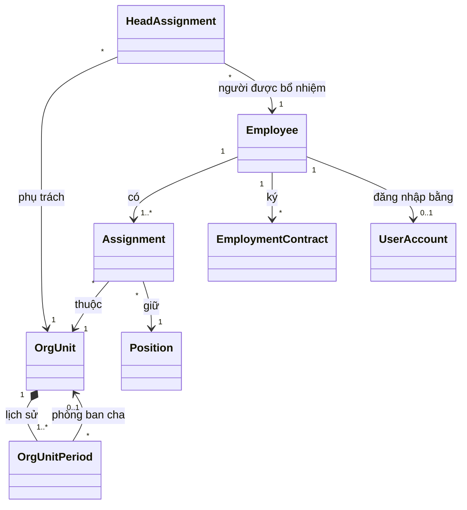

| Name | Kind | Key attributes | Relations |
|---|---|---|---|
| Employee | Entity | Mã nhân viên, họ tên, ngày sinh, giới tính, số CCCD, địa chỉ thường trú, địa chỉ hiện tại, điện thoại và email cá nhân, điện thoại và email công việc, tài khoản ngân hàng, người liên hệ khẩn cấp, trạng thái | Có nhiều EmploymentPeriod, Assignment và EmploymentContract; có tối đa một UserAccount |
| EmploymentPeriod | Value object | Ngày vào làm, ngày làm việc cuối cùng, lý do nghỉ | Thuộc một Employee; các khoảng không chồng nhau |
| Assignment | Entity | Khoảng hiệu lực, phòng ban, chức danh, lý do | Thuộc một Employee |
| OrgUnit | Entity | Mã phòng ban, ngày thành lập, ngày giải thể, trạng thái | Có lịch sử OrgUnitPeriod và nhiều HeadAssignment |
| OrgUnitPeriod | Value object | Khoảng hiệu lực, tên, phòng ban cha | Thuộc một OrgUnit |
| HeadAssignment | Entity | Khoảng hiệu lực, phòng ban, người được bổ nhiệm | — |
| Position | Entity | Tên, đang dùng hay ngừng dùng | Được nhiều Assignment dùng |
| EmploymentContract | Entity | Số hợp đồng, loại, nhóm công việc khi thử việc, ngày ký, ngày bắt đầu, ngày kết thúc, trạng thái | Thuộc một Employee |
| UserAccount | Entity | Tên đăng nhập, có vai trò HR hay không, có phải đổi mật khẩu không, số lần đăng nhập sai liên tiếp, trạng thái | Thuộc một Employee |
| AuditEntry | Entity | Thời điểm, người làm, đối tượng, thao tác, giá trị trước và sau, lý do | — |
| DateRange | Value object | Ngày bắt đầu, ngày kết thúc có thể trống; ngày kết thúc không trước ngày bắt đầu | — |

**M1: quy chế và câu hỏi gửi HR**

Phần này là lớp rule mà AI HR Assistant ở M6 dựa vào, và dùng được khi không có AI.

| Name | Kind | Key attributes | Relations |
|---|---|---|---|
| Policy | Entity | Tên, trạng thái (đang dùng, ngừng dùng) | Có nhiều PolicyVersion |
| PolicyVersion | Entity | Số phiên bản, ngày hiệu lực, trạng thái (nháp, đã đăng), người đăng, thời điểm đăng | Thuộc một Policy; có nhiều PolicySection |
| PolicySection | Value object | Số thứ tự, tiêu đề, nội dung | Thuộc một PolicyVersion |
| FaqEntry | Entity | Câu hỏi, trả lời, trạng thái (nháp, đã đăng, ẩn), cờ cần rà lại, người tạo | Có thể gắn với một PolicySection |
| HrQuestion | Entity | Người hỏi, nội dung, nguồn (form hoặc chat), trạng thái, thời điểm gửi | Có nhiều HrQuestionMessage |
| HrQuestionMessage | Value object | Người viết, nội dung, thời điểm | Thuộc một HrQuestion |

**M2: nghỉ phép**

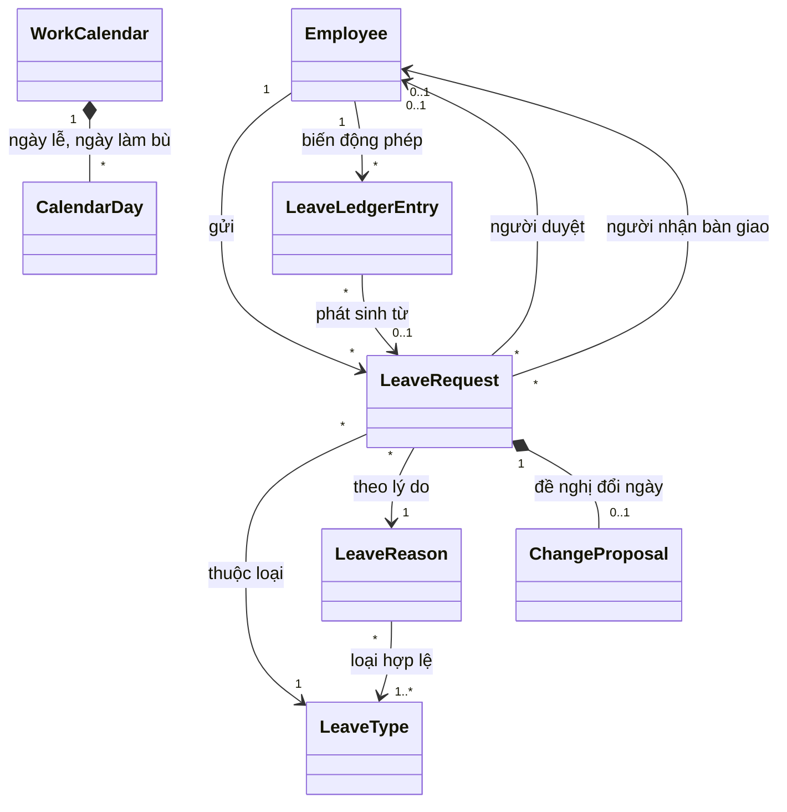

| Name | Kind | Key attributes | Relations |
|---|---|---|---|
| Employee | Entity, bổ sung ở M2 | Phép năm cơ bản không tính thâm niên: 12, 14 hoặc 16 ngày | — |
| OrgUnit | Entity, bổ sung ở M2 | Ngưỡng nhân sự riêng; để trống thì dùng `min_staff_ratio` (BR-146) | — |
| LeaveType | Entity | Tên, chế độ hưởng (công ty trả lương, BHXH chi trả, không hưởng lương), có trừ phép năm không, số ngày tối đa mỗi đơn, đang dùng hay ngừng | Có nhiều LeaveRequest |
| LeaveReason | Entity | Tên, các loại nghỉ hợp lệ, số ngày theo luật, nguồn, đang dùng hay ngừng | Được nhiều LeaveRequest dùng |
| LeaveRequest | Entity | Loại nghỉ, lý do nghỉ, mô tả thêm, ngày và buổi bắt đầu, ngày và buổi kết thúc, số ngày, người duyệt, người duyệt thay nếu có, người ghi nếu HR ghi thay, người nhận bàn giao, có hỗ trợ AI hay không, trạng thái, lý do từ chối hoặc hủy | Thuộc một Employee |
| ChangeProposal | Value object | Khoảng ngày và buổi đề nghị, lời nhắn, người đề nghị, thời điểm, phản hồi của nhân viên | Thuộc một LeaveRequest |
| LeaveRestrictionPeriod | Entity | Khoảng ngày, phạm vi (toàn công ty hoặc danh sách phòng ban), ghi chú | — |
| LeaveLedgerEntry | Entity | Ngày, loại biến động, số ngày có dấu, năm phép, là phép tồn hay không, hạn dùng nếu là phép tồn, lý do | Thuộc một Employee; có thể phát sinh từ một LeaveRequest |
| WorkCalendar | Entity | Ngày nghỉ lễ và ngày làm bù của công ty; ngày làm việc trong tuần thuộc về ca từ M3 | Một lịch cho cả công ty; chứa nhiều CalendarDay |
| CalendarDay | Value object | Ngày, loại (nghỉ lễ hoặc làm bù), tên | Thuộc WorkCalendar |

**M3: chấm công**

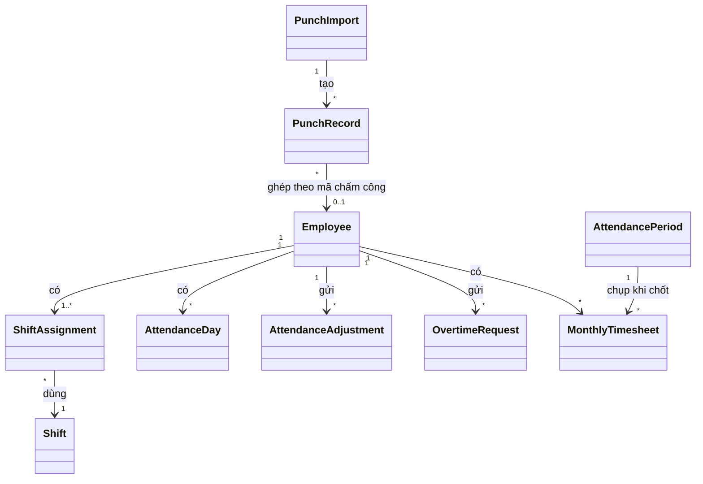

| Name | Kind | Key attributes | Relations |
|---|---|---|---|
| Employee | Entity, bổ sung ở M3 | Mã chấm công | — |
| Shift | Entity | Tên, giờ bắt đầu, giờ kết thúc, khoảng nghỉ giữa ca, nghỉ giữa ca có tính vào giờ làm không, các ngày làm việc trong tuần, đang dùng hay ngừng | Có nhiều ShiftAssignment |
| ShiftAssignment | Entity | Khoảng hiệu lực, ca | Thuộc một Employee |
| PunchImport | Entity | Tên file, người nhập, thời điểm, số dòng đã lưu, số dòng trùng, các dòng bị bỏ qua kèm lý do | Tạo nhiều PunchRecord |
| PunchRecord | Entity | Mã chấm công, thời điểm | Thuộc một PunchImport; ghép với Employee theo mã chấm công |
| AttendanceDay | Entity | Ngày, ca, giờ vào, giờ ra, phút đi muộn, phút về sớm, công, loại nghỉ nếu có, giờ làm thêm theo loại, giờ làm ban đêm, trạng thái, đánh dấu cần xem | Thuộc một Employee; được tính từ lượt chấm, đơn nghỉ, đơn làm thêm và giải trình |
| AttendanceAdjustment | Entity | Ngày, giờ vào đề nghị, giờ ra đề nghị, lý do, người duyệt, trạng thái | Thuộc một Employee |
| OvertimeRequest | Entity | Ngày, giờ bắt đầu, giờ kết thúc, lý do, người duyệt, trạng thái | Thuộc một Employee |
| AttendancePeriod | Entity | Tháng, trạng thái, người chốt, thời điểm chốt, lý do mở lại | Một kỳ công cho cả công ty |
| MonthlyTimesheet | Entity | Các số tổng hợp theo BR-092 | Thuộc một Employee và một AttendancePeriod |

Trạng thái của AttendanceDay được tính lại mỗi khi dữ liệu nguồn đổi, nên không có vòng đời riêng: Chưa tới, Ngày nghỉ,
Đủ công, Nghỉ theo đơn, Nửa công nửa nghỉ, Thiếu chấm công, Vắng chưa xử lý, Vắng không lý do.

**M4: lương và phúc lợi**

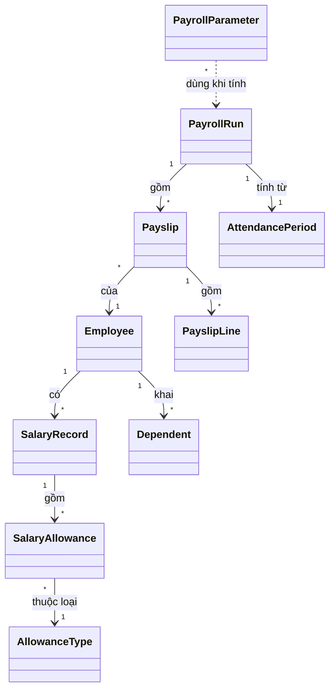

| Name | Kind | Key attributes | Relations |
|---|---|---|---|
| Employee | Entity, bổ sung ở M4 | Mã số thuế, mã số BHXH, năm có cam kết thu nhập | — |
| AllowanceType | Entity | Tên, cách tính (theo công hoặc cố định theo tháng), chế độ thuế (chịu thuế, miễn thuế, miễn thuế trong mức), mức miễn thuế, đang dùng hay ngừng | Có nhiều SalaryAllowance |
| SalaryRecord | Entity | Khoảng hiệu lực, lương cơ bản, lương đóng bảo hiểm, lý do | Thuộc một Employee; gồm nhiều SalaryAllowance |
| SalaryAllowance | Value object | Loại phụ cấp, số tiền mỗi tháng | Thuộc một SalaryRecord |
| Dependent | Entity | Họ tên, quan hệ, ngày sinh, số định danh hoặc mã số thuế, tháng bắt đầu, tháng kết thúc | Thuộc một Employee |
| PayrollParameter | Entity | Tên tham số, giá trị, ngày hiệu lực. Biểu thuế là danh sách bậc, mỗi bậc có cận dưới, cận trên và thuế suất | Một tham số có nhiều giá trị theo ngày hiệu lực |
| PayrollRun | Entity | Tháng, trạng thái, người và thời điểm tính gần nhất, người và thời điểm chốt | Một bảng lương mỗi tháng cho cả công ty; gồm nhiều Payslip |
| Payslip | Entity | Công chuẩn, công hưởng lương, số người phụ thuộc, giá trị tham số đã dùng, tổng thu nhập, thu nhập chịu thuế, thu nhập tính thuế, thuế, thực lĩnh, phần công ty đóng, lỗi và cảnh báo | Thuộc một PayrollRun và một Employee; gồm nhiều PayslipLine |
| PayslipLine | Entity | Nhóm (thu nhập, khấu trừ, công ty đóng), tên, số tiền, phần chịu thuế, nguồn (hệ thống tính hoặc HR thêm), lý do nếu HR thêm | Thuộc một Payslip |

Phiếu lương lưu lại mọi số liệu đầu vào đã dùng, để đọc phiếu cũ không phải tính lại từ dữ liệu hiện tại.

**M5: báo cáo**

Báo cáo đọc từ entity của M1 tới M4 (BR-138); việc xuất báo cáo được ghi bằng AuditEntry. M5 chỉ thêm entity cho tín
hiệu, vì tín hiệu cần được lưu để theo dõi và để không báo trùng.

| Name | Kind | Key attributes | Relations |
|---|---|---|---|
| Signal | Entity | Loại tín hiệu, phòng ban hoặc cả công ty, kỳ, số liệu và phân rã tại lúc tính, mức độ, thời điểm phát hiện, thời điểm tính gần nhất, cờ số liệu đang sửa, trạng thái | — |
| SignalReaction | Entity | Người xem, đã xem, đang theo dõi từ ngày nào, đã đóng, đánh giá hữu ích hay không | Thuộc một Signal hoặc một Insight |
| UserAccount | Entity, bổ sung ở M5 | Các loại tín hiệu người dùng đã tắt (BR-178) | — |

**M6: AI**

| Name | Kind | Key attributes | Relations |
|---|---|---|---|
| AiOutput | Entity | Thời điểm, tính năng, lối vào (form, chat, thông báo, trang tổng quan), tình huống, người nhận, dữ liệu đã gửi tới dịch vụ AI, đầu ra, kết quả kiểm (BR-163), lựa chọn cuối của người dùng | Có thể gắn với một LeaveRequest, một ActionProposal, một Insight hoặc một Conversation |
| ActionProposal | Entity | Thao tác đề xuất, người được xác nhận, trạng thái (chờ, đã xác nhận, bỏ qua, hết hiệu lực) | Có thể gắn với một LeaveRequest hoặc một Insight |
| Insight | Entity | Phạm vi, vai trò người xem, tiêu đề, giải thích, việc tiếp theo, thời điểm tính | Gom một hoặc nhiều Signal; nội dung là một AiOutput |
| Conversation | Entity | Người hỏi, các lượt hỏi và trả lời, công cụ đã gọi ở mỗi lượt, ngữ cảnh màn hình, thời điểm | Thuộc một UserAccount; mỗi câu trả lời là một AiOutput; có thể sinh một HrQuestion |

## Aggregates and invariants

| Aggregate (root) | Contains | Invariants | Cross-aggregate rules |
|---|---|---|---|
| Employee | Employee, EmploymentPeriod, Assignment | Mã nhân viên không đổi (BR-015); khoảng làm việc không chồng (BR-139); quá trình công tác không chồng, không hở trong mỗi khoảng làm việc (BR-016) | Phòng ban của mỗi quá trình công tác phải đang hoạt động (BR-014); số CCCD không trùng (BR-022) |
| EmploymentContract | EmploymentContract | Thời hạn hợp lệ theo loại hợp đồng (BR-024, BR-028) | Hợp đồng của một nhân viên không chồng thời gian (BR-025); kiểm số hợp đồng xác định thời hạn liên tiếp (BR-026); số hợp đồng không trùng (BR-037) |
| OrgUnit | OrgUnit, OrgUnitPeriod | Các khoảng lịch sử không chồng; tên không trống | Đúng một phòng ban gốc (BR-007); cây không có vòng (BR-008); điều kiện giải thể (BR-010) |
| HeadAssignment | HeadAssignment | Khoảng hiệu lực hợp lệ | Mỗi phòng ban có tối đa một trưởng mỗi ngày; người được bổ nhiệm đang làm việc (BR-011) |
| UserAccount | UserAccount | BR-001, BR-002, BR-003 | Luôn còn ít nhất một HR đang hoạt động (BR-004) |
| LeaveRequest | LeaveRequest, ChangeProposal | Số ngày khớp lịch làm việc (BR-044); không vượt tối đa của loại nghỉ (BR-047); loại nghỉ thuộc lý do nghỉ (BR-142) | Không chồng buổi với đơn khác (BR-045); nằm trong khoảng làm việc (BR-046); hai đơn phép năm gửi hoặc duyệt cùng lúc không được làm thiếu phép (BR-053, EC-024); gửi nhiều đơn một lần thì tạo cả hoặc không đơn nào (BR-153) |
| LeaveLedgerEntry | LeaveLedgerEntry | Không sửa, không xóa (BR-054) | Số dư phép bằng tổng các biến động (BR-054); mỗi tháng chỉ được cộng một lần (EC-038) |
| LeaveType | LeaveType | BR-040 | Có đúng một loại Phép năm (BR-041) |
| LeaveReason | LeaveReason | BR-143 | Lý do đã có đơn không xóa được (BR-143) |
| WorkCalendar | WorkCalendar, CalendarDay | Một ngày không vừa là ngày nghỉ lễ vừa là ngày làm bù | Đổi lịch thì tính lại các đơn chưa bắt đầu (BR-064); không đổi lịch trong tháng đã chốt (BR-090) |
| Shift | Shift | Giờ làm chuẩn và hai buổi tính được (BR-068, BR-069) | — |
| Employee (M3) | ShiftAssignment | Mỗi ngày từ ngày vào làm có đúng một ca (BR-070) | Mã chấm công không trùng giữa nhân viên đang làm (BR-072) |
| PunchImport | PunchImport, PunchRecord | Lượt chấm không trùng (BR-073) | Không nhập vào tháng đã chốt (BR-090) |
| OvertimeRequest | OvertimeRequest | Nằm ngoài giờ ca; gửi trước giờ bắt đầu (BR-083, BR-086) | Giới hạn giờ làm thêm theo ngày, tháng, năm, tính cả đơn khác (BR-084) |
| AttendancePeriod | AttendancePeriod, MonthlyTimesheet | Bảng công đã chụp không đổi khi kỳ đã chốt | Điều kiện chốt (BR-089); mở lại chỉ khi bảng lương chưa chốt (BR-091) |
| AllowanceType | AllowanceType | Tên không trùng (BR-097) | — |
| SalaryRecord | SalaryRecord, SalaryAllowance | Mỗi loại phụ cấp tối đa một lần trong một bản ghi | Các bản ghi của một nhân viên không chồng, không hở (BR-093); mức sàn theo lương tối thiểu vùng tại ngày hiệu lực (BR-094, BR-096) |
| Dependent | Dependent | Tháng kết thúc không trước tháng bắt đầu | Một người phụ thuộc không được tính cho hai nhân viên trong cùng tháng (BR-099) |
| PayrollParameter | PayrollParameter | Biểu thuế có các bậc liền nhau, bậc đầu từ 0, bậc cuối không có cận trên | Mỗi tham số không có hai giá trị cùng ngày hiệu lực; giá trị đã dùng ở bảng lương đã chốt không sửa được (BR-123) |
| PayrollRun | PayrollRun, Payslip, PayslipLine | Thực lĩnh của phiếu bằng tổng các dòng (BR-114); không đổi khi đã chốt (BR-118) | Chỉ tính khi bảng công đã chốt (BR-102); điều kiện chốt (BR-117); hai thao tác chốt cùng lúc chỉ một thành công (EC-072) |
| Signal | Signal | Số liệu và phân rã là bản chụp tại lúc tính gần nhất | Mỗi loại tín hiệu, phòng ban và kỳ có tối đa một tín hiệu Đang có (BR-172) |
| SignalReaction | SignalReaction | — | Mỗi người xem có tối đa một SignalReaction cho một thẻ |
| Policy | Policy, PolicyVersion, PolicySection | Phiên bản đã đăng không sửa được (BR-192) | Tại một ngày, mỗi quy chế có tối đa một phiên bản hiệu lực (BR-192) |
| HrQuestion | HrQuestion, HrQuestionMessage | Lượt trả lời không sửa, không xóa | — |

## Lifecycles

Chuyển trạng thái không có trong bảng là không được phép. Chuyển trạng thái do "Thời gian" xảy ra khi tới ngày tương
ứng, không cần ai thao tác.

**Employee**

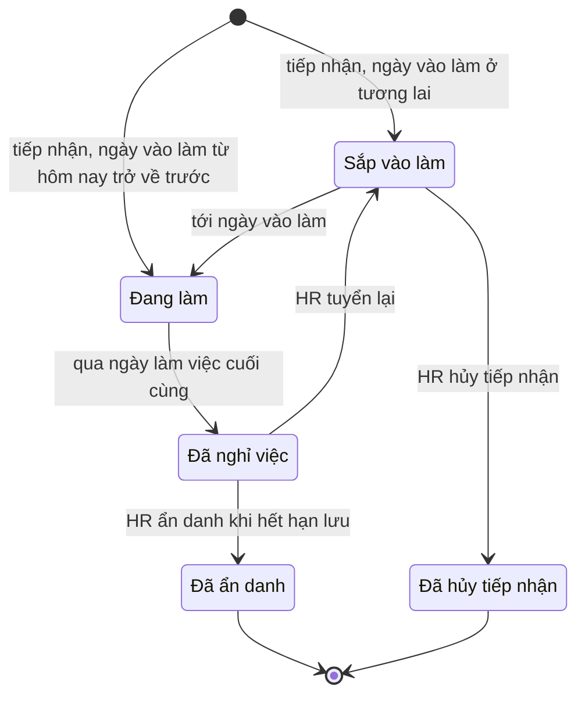

| From | To | Trigger and actor | Guard |
|---|---|---|---|
| — | `upcoming` | HR tiếp nhận | Ngày vào làm sau hôm nay |
| — | `active` | HR tiếp nhận hoặc nhập từ bảng tính | Ngày vào làm từ hôm nay trở về trước |
| `upcoming` | `active` | Thời gian, tới ngày vào làm | — |
| `upcoming` | `cancelled` | HR hủy tiếp nhận | Trước ngày vào làm |
| `active` | `terminated` | Thời gian, sang ngày sau ngày làm việc cuối cùng | HR đã ghi nhận nghỉ việc (BR-019) |
| `terminated` | `upcoming` | HR tuyển lại; tới ngày vào làm mới thì sang `active` như trên | Ngày vào làm mới sau ngày làm việc cuối cùng của khoảng trước (BR-139) |
| `terminated` | `anonymized` | HR xác nhận ẩn danh | Đã quá `retention_years` năm từ ngày làm việc cuối cùng (BR-141) |

**UserAccount**

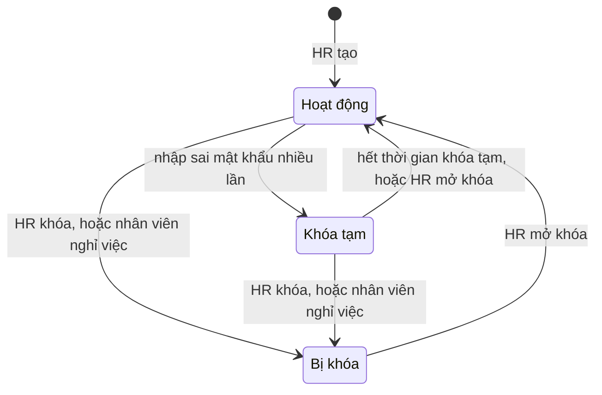

| From | To | Trigger and actor | Guard |
|---|---|---|---|
| — | `active` | HR tạo tài khoản | Nhân viên chưa có tài khoản (BR-001) |
| `active` | `throttled` | Người dùng nhập sai mật khẩu `max_failed_logins` lần liên tiếp | — (BR-003) |
| `throttled` | `active` | Thời gian, sau `lockout_minutes` phút; hoặc HR mở khóa | — |
| `active`, `throttled` | `locked` | HR khóa; hoặc Thời gian, khi nhân viên nghỉ việc | Không phải HR đang hoạt động cuối cùng (BR-004) |
| `locked` | `active` | HR mở khóa | Nhân viên chưa nghỉ việc (BR-005) |

**OrgUnit**

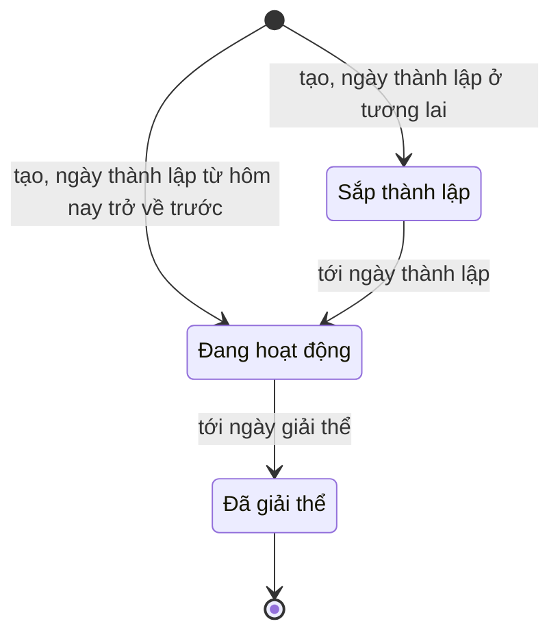

| From | To | Trigger and actor | Guard |
|---|---|---|---|
| — | `planned`, `active` | HR tạo phòng ban | Phòng ban cha đang hoạt động tại ngày thành lập |
| `planned` | `active` | Thời gian, tới ngày thành lập | — |
| `active` | `dissolved` | Thời gian, tới ngày giải thể do HR đặt | BR-007, BR-010 |

**EmploymentContract**

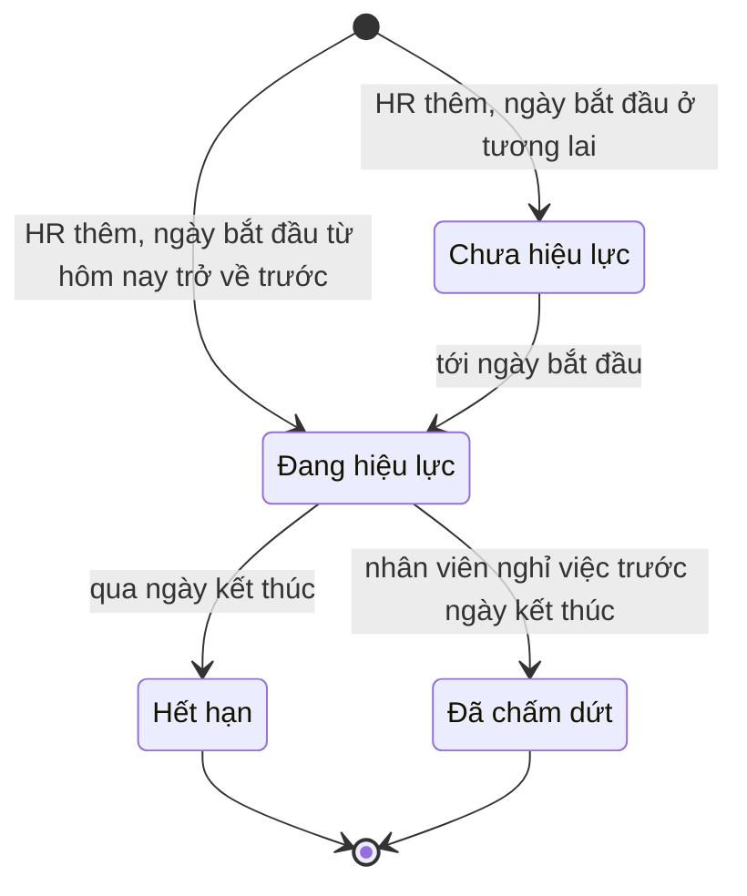

| From | To | Trigger and actor | Guard |
|---|---|---|---|
| — | `upcoming`, `active` | HR thêm hợp đồng | BR-023 tới BR-028 |
| `upcoming` | `active` | Thời gian, tới ngày bắt đầu | — |
| `active` | `expired` | Thời gian, qua ngày kết thúc | Hợp đồng có ngày kết thúc |
| `active` | `terminated` | HR ghi nhận nghỉ việc | Ngày làm việc cuối cùng trước ngày kết thúc của hợp đồng (BR-019) |

**LeaveRequest**

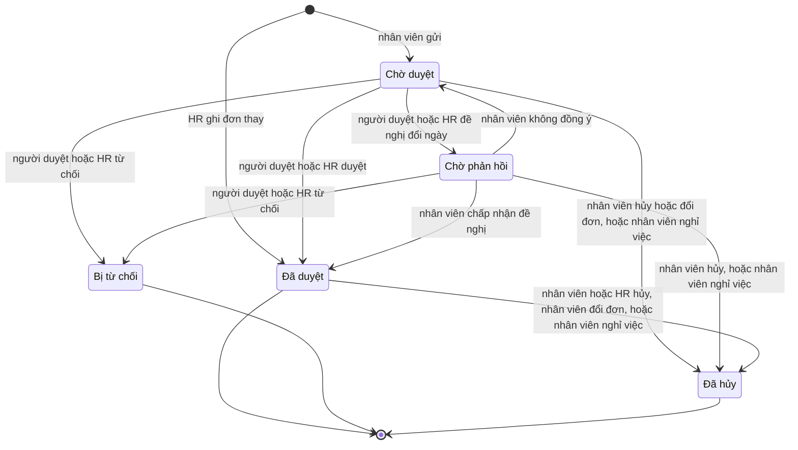

| From | To | Trigger and actor | Guard |
|---|---|---|---|
| — | `pending` | Nhân viên gửi đơn | BR-043 tới BR-047, BR-053, BR-062, BR-142 |
| — | `approved` | HR ghi đơn thay | Như trên, trừ giới hạn ghi bù (BR-062, BR-063) |
| `pending` | `approved` | Người duyệt, người duyệt thay hoặc HR duyệt | Người duyệt không phải người gửi (BR-060); vẫn đủ phép (BR-053) |
| `pending` | `rejected` | Người duyệt, người duyệt thay hoặc HR từ chối | Có lý do (BR-059) |
| `pending` | `awaiting` | Người duyệt, người duyệt thay hoặc HR đề nghị đổi ngày | Khoảng đề nghị qua BR-044 tới BR-047 và BR-053 (BR-150) |
| `pending` | `cancelled` | Nhân viên hủy hoặc đổi đơn; hoặc Thời gian, khi việc nghỉ việc có hiệu lực | Đổi đơn: đơn mới phải qua mọi luật, nếu không thì đơn cũ giữ nguyên (BR-152) |
| `awaiting` | `approved` | Nhân viên chấp nhận đề nghị | Vẫn không chồng đơn và đủ phép (BR-045, BR-053, BR-151) |
| `awaiting` | `pending` | Nhân viên không đồng ý | — |
| `awaiting` | `rejected` | Người duyệt, người duyệt thay hoặc HR từ chối | Có lý do (BR-059) |
| `awaiting` | `cancelled` | Nhân viên hủy; hoặc Thời gian, khi việc nghỉ việc có hiệu lực | — |
| `approved` | `cancelled` | Nhân viên hủy hoặc đổi đơn; HR hủy; hoặc Thời gian, khi việc nghỉ việc có hiệu lực | Nhân viên chỉ hủy hoặc đổi được trước ngày bắt đầu; HR phải nhập lý do (BR-061, BR-065, BR-152) |
| `approved` | `approved` | HR rút ngắn đơn đã bắt đầu | Có lý do; phép năm được hoàn phần rút ngắn (BR-061) |

Mọi chuyển trạng thái của LeaveRequest bị chặn khi đơn có ngày thuộc tháng đã chốt (BR-090).

**OvertimeRequest và AttendanceAdjustment**

Hai loại đơn này dùng chung vòng đời và luật duyệt của đơn nghỉ (BR-056 tới BR-059), không có HR ghi thay.

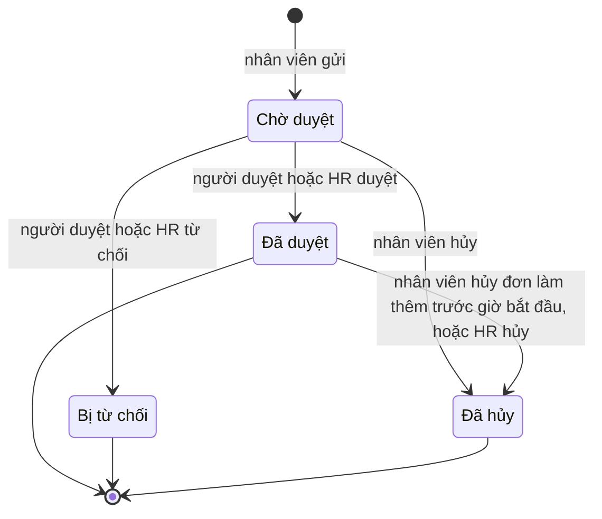

| From | To | Trigger and actor | Guard |
|---|---|---|---|
| — | `pending` | Nhân viên gửi | Đơn làm thêm: BR-083, BR-084, BR-086, BR-087. Giải trình: BR-081. Tháng chưa chốt (BR-090) |
| `pending` | `approved` | Người duyệt hoặc HR duyệt | Người duyệt không phải người gửi (BR-060); đơn làm thêm vẫn trong giới hạn (BR-084) |
| `pending` | `rejected` | Người duyệt hoặc HR từ chối | Có lý do (BR-059) |
| `pending` | `cancelled` | Nhân viên hủy | Tháng chưa chốt |
| `approved` | `cancelled` | Nhân viên hủy đơn làm thêm trước giờ bắt đầu; HR hủy kèm lý do | Tháng chưa chốt |

**AttendancePeriod**

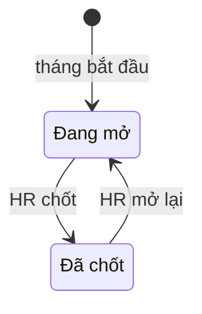

| From | To | Trigger and actor | Guard |
|---|---|---|---|
| — | `open` | Thời gian, ngày đầu tháng | — |
| `open` | `closed` | HR chốt | Không còn việc chặn theo BR-089 |
| `closed` | `open` | HR mở lại | Có lý do; bảng lương của tháng chưa chốt (BR-091) |

**PayrollRun**

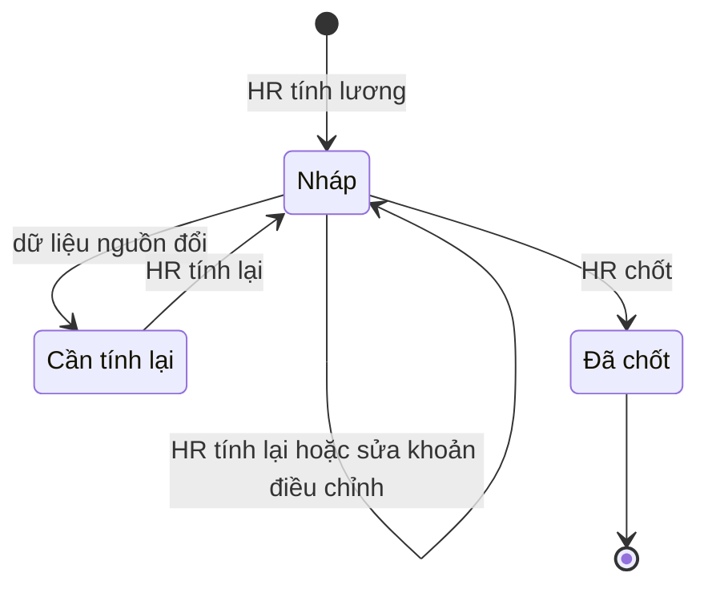

| From | To | Trigger and actor | Guard |
|---|---|---|---|
| — | `draft` | HR tính lương | Bảng công của tháng đã chốt (BR-102) |
| `draft` | `draft` | HR tính lại; HR thêm, sửa hoặc xóa khoản điều chỉnh | — (BR-115, BR-116) |
| `draft` | `stale` | Hệ thống, khi dữ liệu nguồn của tháng đổi | BR-119 |
| `stale` | `draft` | HR tính lại | Bảng công của tháng đã chốt (BR-102) |
| `draft` | `closed` | HR chốt | BR-117 |

Bảng lương đã chốt không có chuyển trạng thái nào (BR-118).

**Signal**

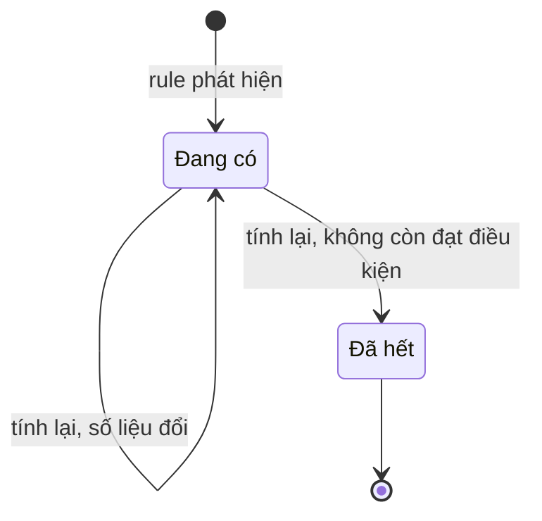

| From | To | Trigger and actor | Guard |
|---|---|---|---|
| — | `active` | Thời gian, khi tính tín hiệu | Đạt điều kiện của loại tín hiệu ở mục Default signal types (BR-172, BR-173) |
| `active` | `active` | Thời gian, khi tính lại | Vẫn đạt điều kiện; số liệu và mức độ được cập nhật |
| `active` | `resolved` | Thời gian, khi tính lại | Không còn đạt điều kiện (BR-179) |

Tín hiệu đã hết không quay lại Đang có; điều kiện xuất hiện lại thì rule tạo tín hiệu mới.

**HrQuestion**

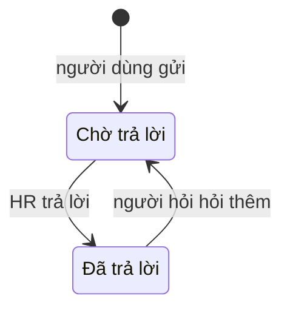

| From | To | Trigger and actor | Guard |
|---|---|---|---|
| — | `pending` | Người dùng gửi câu hỏi, từ form hoặc từ chat | Nội dung không trống (BR-195) |
| `pending` | `answered` | HR trả lời | Nội dung không trống |
| `answered` | `pending` | Người hỏi hỏi thêm trên cùng câu hỏi | — (BR-195, EC-129) |

## Business rules

- **Status:** `Confirmed` khi có nguồn xác nhận; `Assumed` khi dựa trên assumption; `Disputed` khi các nguồn mâu thuẫn và
  chưa ai chốt. Luật `Disputed` không được đưa vào code.
- **Nguồn A-003:** luật do agent đề xuất theo cách làm phổ biến ở doanh nghiệp nhỏ, chưa được HR công ty xác nhận.
- **Nguồn là văn bản pháp luật:** luật giữ `Assumed` cho tới khi đối chiếu văn bản gốc (A-013).

**Tài khoản và vai trò**

| ID | When | Then | Source | Status |
|---|---|---|---|---|
| BR-001 | Tạo tài khoản cho một nhân viên | Mỗi nhân viên có tối đa một tài khoản; tên đăng nhập là mã nhân viên | A-003, A-004 | Assumed |
| BR-002 | Tài khoản vừa được tạo hoặc vừa được HR đặt lại mật khẩu | Người dùng phải đặt mật khẩu mới ở lần đăng nhập kế tiếp, trước khi dùng chức năng khác | A-003 | Assumed |
| BR-003 | Nhập sai mật khẩu `max_failed_logins` lần liên tiếp | Tài khoản bị khóa tạm `lockout_minutes` phút | A-003 | Assumed |
| BR-004 | Thu hồi vai trò HR, khóa tài khoản hoặc ghi nhận nghỉ việc của HR đang hoạt động cuối cùng | Từ chối | A-003 | Assumed |
| BR-005 | Nhân viên qua ngày làm việc cuối cùng | Tài khoản tự bị khóa và không mở khóa được nữa, trừ khi nhân viên được tuyển lại (BR-139) | A-003 | Assumed |
| BR-006 | Xác định vai trò của một người tại ngày D | Nhân viên: có tài khoản đang hoạt động. Quản lý: đang là trưởng của ít nhất một phòng ban tại D; không gán tay. HR: được gán tay | Chủ dự án, 2026-10-30 | Confirmed |
| BR-036 | Đặt mật khẩu mới | Mật khẩu dài tối thiểu `min_password_length` ký tự và khác mật khẩu hiện tại | A-003 | Assumed |

**Cơ cấu tổ chức**

| ID | When | Then | Source | Status |
|---|---|---|---|---|
| BR-007 | Tạo hoặc sửa cơ cấu tổ chức | Cơ cấu là một cây nhiều cấp có đúng một phòng ban gốc. Phòng ban gốc không có phòng ban cha, không bị chuyển, không bị giải thể; chỉ đổi tên được | Chủ dự án, 2026-10-30 | Confirmed |
| BR-008 | Đổi phòng ban cha của P thành Q từ ngày D | Từ chối nếu tại D, Q là P hoặc Q nằm trong nhánh con của P | Hệ quả của BR-007 | Confirmed |
| BR-009 | Đổi tên hoặc phòng ban cha của một phòng ban với ngày hiệu lực D | Thay đổi có tác dụng từ D; cơ cấu tại một ngày bất kỳ dùng giá trị có hiệu lực tại ngày đó | Chủ dự án, mục tiêu học trong [project](../project/project.md) | Confirmed |
| BR-010 | Giải thể phòng ban P từ ngày D | Từ chối nếu từ D trở đi còn nhân viên thuộc P, kể cả do thay đổi công tác đã ghi cho tương lai, hoặc còn phòng ban con của P đang hoạt động | A-003 | Assumed |
| BR-011 | Bổ nhiệm trưởng cho phòng ban P trong một khoảng hiệu lực | Mỗi ngày P có tối đa một trưởng. Người được bổ nhiệm phải đang làm việc trong suốt khoảng đó. Một người được làm trưởng nhiều phòng ban; trưởng không bắt buộc thuộc P | A-003 | Assumed |
| BR-012 | Xác định quản lý trực tiếp của nhân viên X tại ngày D | Lấy trưởng của phòng ban X thuộc tại D. Nếu phòng ban đó không có trưởng, hoặc trưởng chính là X, thì đi lên phòng ban cha gần nhất có trưởng khác X. Không tìm được ai thì X không có quản lý trực tiếp | Chủ dự án, 2026-10-30 | Confirmed |
| BR-013 | Xác định phạm vi của Quản lý M tại ngày D | Gồm mọi nhân viên thuộc các phòng ban M làm trưởng tại D và mọi phòng ban con của chúng | Chủ dự án, 2026-10-30 | Confirmed |
| BR-014 | Xếp nhân viên vào một phòng ban | Phòng ban phải đang hoạt động trong mọi ngày của quá trình công tác | A-003 | Assumed |
| BR-034 | Thêm hoặc đổi tên chức danh | Tên chức danh không trùng, không phân biệt hoa thường | A-003 | Assumed |
| BR-035 | Xóa chức danh đã được dùng trong quá trình công tác | Từ chối; chỉ ngừng dùng được. Chức danh ngừng dùng không chọn được cho thay đổi mới | A-003 | Assumed |

**Hồ sơ và công tác**

| ID | When | Then | Source | Status |
|---|---|---|---|---|
| BR-015 | Cấp mã nhân viên | Mã duy nhất trong toàn hệ thống, không đổi, không dùng lại kể cả sau khi nhân viên nghỉ việc. Hệ thống tự cấp theo `employee_code_format` khi tiếp nhận; khi nhập từ bảng tính thì giữ mã trong file | A-003 | Assumed |
| BR-016 | Lưu quá trình công tác của một nhân viên | Trong mỗi khoảng làm việc, mỗi ngày nhân viên có đúng một quá trình công tác; các quá trình không chồng, không hở. Ngoài khoảng làm việc thì không có quá trình công tác | A-003 | Assumed |
| BR-017 | Ghi nhận thay đổi công tác với ngày hiệu lực D | D phải nằm trong khoảng làm việc. Quá trình chứa D kết thúc ở D−1. Quá trình mới bắt đầu từ D và kéo dài tới ngày trước thay đổi kế tiếp đã có, hoặc tới ngày làm việc cuối cùng | A-003 | Assumed |
| BR-018 | Ghi nhận thay đổi công tác với ngày hiệu lực trước hôm nay | Lý do là bắt buộc | A-003 | Assumed |
| BR-019 | Ghi nhận nghỉ việc với ngày làm việc cuối cùng L | Quá trình công tác, bổ nhiệm trưởng và hợp đồng đang hiệu lực kết thúc ở L. Từ ngày sau L, nhân viên ở trạng thái Đã nghỉ việc và tài khoản bị khóa | A-003 | Assumed |
| BR-020 | Hủy ghi nhận nghỉ việc | Chỉ được khi L chưa qua | A-003 | Assumed |
| BR-021 | Nhân viên tự sửa hồ sơ của mình | Chỉ sửa được điện thoại cá nhân, email cá nhân, địa chỉ hiện tại và người liên hệ khẩn cấp; thay đổi có hiệu lực ngay. Thông tin còn lại chỉ HR sửa | A-003 | Assumed |
| BR-022 | Lưu số CCCD | Số CCCD không trùng giữa các hồ sơ chưa bị hủy tiếp nhận | A-003 | Assumed |
| BR-139 | HR tuyển lại nhân viên ở trạng thái Đã nghỉ việc | Dùng lại hồ sơ và mã nhân viên cũ, thêm một khoảng làm việc mới với ngày vào làm sau ngày làm việc cuối cùng của khoảng trước. Quá trình công tác, hợp đồng, ca và bản ghi lương được nhập mới cho khoảng đó. Tài khoản cũ được mở khóa lại. Phép năm bắt đầu từ 0 vì phép chưa nghỉ đã được trả khi nghỉ việc (BR-120); thâm niên ở BR-048 chỉ tính từ ngày vào làm mới | Chủ dự án, 2026-10-30 | Confirmed |
| BR-140 | Nhân viên đã nghỉ việc quá `contact_retention_months` tháng | Hệ thống đưa người đó vào danh sách cần xóa thông tin liên hệ. HR xác nhận thì xóa điện thoại, email, địa chỉ cá nhân, người liên hệ khẩn cấp và tài khoản ngân hàng. Hệ thống không tự xóa khi chưa có xác nhận. Nhật ký ghi việc xóa nhưng không chép lại giá trị đã xóa | Chủ dự án, 2026-10-30; Luật Bảo vệ dữ liệu cá nhân 2025 | Confirmed |
| BR-141 | Nhân viên đã nghỉ việc quá `retention_years` năm | Hệ thống đưa người đó vào danh sách cần ẩn danh. HR xác nhận thì xóa mọi thông tin cá nhân, người phụ thuộc, lý do nghỉ, nội dung các đơn và câu hỏi gửi HR; hồ sơ chỉ còn mã nhân viên. Số liệu đã chốt trong bảng công, bảng lương và báo cáo tổng hợp được giữ | Chủ dự án, 2026-10-30; Luật Kế toán về thời hạn lưu tài liệu kế toán | Assumed |

**Hợp đồng lao động**

| ID | When | Then | Source | Status |
|---|---|---|---|---|
| BR-023 | Chọn loại hợp đồng | Có ba loại: thử việc, xác định thời hạn, không xác định thời hạn | Bộ luật Lao động 2019, Điều 20 và Điều 24 | Assumed |
| BR-024 | Lưu hợp đồng xác định thời hạn | Phải có ngày kết thúc, không quá `fixed_term_max_months` tháng sau ngày bắt đầu; vi phạm thì từ chối | Bộ luật Lao động 2019, Điều 20 | Assumed |
| BR-025 | Lưu một hợp đồng | Các hợp đồng của một nhân viên, kể cả thử việc, không chồng thời gian | A-003 | Assumed |
| BR-026 | Thêm hợp đồng xác định thời hạn khi hai hợp đồng liền trước đều là xác định thời hạn | Cảnh báo rằng luật yêu cầu ký hợp đồng không xác định thời hạn; HR xác nhận thì vẫn lưu, vì luật có ngoại lệ | Bộ luật Lao động 2019, Điều 20 | Assumed |
| BR-027 | Hợp đồng xác định thời hạn đã hết hạn, nhân viên vẫn làm việc và chưa có hợp đồng mới | Cảnh báo HR. Sau `contract_auto_convert_days` ngày, luật coi hợp đồng đó là không xác định thời hạn; hệ thống chỉ cảnh báo, không tự đổi loại hợp đồng | Bộ luật Lao động 2019, Điều 20 | Assumed |
| BR-028 | Lưu hợp đồng thử việc | Phải có ngày kết thúc, và thời gian thử việc không quá `probation_max_days` của nhóm công việc đã chọn; vi phạm thì từ chối | Bộ luật Lao động 2019, Điều 25 | Assumed |
| BR-029 | Xác định hợp đồng sắp hết hạn | Hợp đồng thử việc hoặc xác định thời hạn có ngày kết thúc trong `contract_expiry_warning_days` ngày tới, và nhân viên chưa có hợp đồng tiếp theo | A-003 | Assumed |
| BR-037 | Lưu số hợp đồng | Số hợp đồng không trùng trong toàn hệ thống | A-003 | Assumed |

**Nhật ký và quyền xem**

| ID | When | Then | Source | Status |
|---|---|---|---|---|
| BR-030 | Tạo, sửa hoặc xóa hồ sơ, quá trình công tác, hợp đồng, phòng ban, chức danh, tài khoản hoặc vai trò | Ghi nhật ký: người làm, thời điểm, đối tượng, giá trị trước và sau, lý do nếu có | A-003 | Assumed |
| BR-031 | Bất kỳ ai cố sửa hoặc xóa nhật ký | Hệ thống không có thao tác nào cho phép việc đó | A-003 | Assumed |
| BR-032 | Hiển thị danh bạ | Chỉ gồm nhân viên đang làm; chỉ hiện họ tên, chức danh, phòng ban, email và điện thoại công việc | A-003 | Assumed |
| BR-033 | Quản lý xem nhân viên trong phạm vi | Xem được thông tin công việc, liên hệ công việc và quá trình công tác; không xem được CCCD, ngày sinh, giới tính, địa chỉ, tài khoản ngân hàng, liên hệ khẩn cấp và hợp đồng | A-003 | Assumed |

**Quy chế và câu hỏi gửi HR**

Các luật này thuộc lớp rule của M1 và chạy cả khi không có AI. AI HR Assistant ở M6 dùng chúng làm nguồn và làm đường
chuyển câu hỏi cho HR.

| ID | When | Then | Source | Status |
|---|---|---|---|---|
| BR-192 | HR đăng một phiên bản quy chế | Phiên bản gồm các mục, mỗi mục có tiêu đề và nội dung; phiên bản có ngày hiệu lực. Phiên bản đã đăng không sửa được: sửa thì tạo phiên bản mới, phiên bản cũ được giữ để xem lại. Hai phiên bản đã đăng của cùng quy chế không có cùng ngày hiệu lực. Tại một ngày, mỗi quy chế có tối đa một phiên bản hiệu lực: phiên bản đã đăng có ngày hiệu lực gần nhất không sau ngày đó | A-003 | Assumed |
| BR-193 | Người dùng xem hoặc tìm quy chế | Mọi người dùng đọc được phiên bản đang hiệu lực và các phiên bản trước của mọi quy chế đang dùng. Tìm theo từ khóa trong tiêu đề và nội dung các mục của phiên bản đang hiệu lực. Thư viện chỉ chứa văn bản dành cho mọi nhân viên | A-003 | Assumed |
| BR-194 | HR quản lý câu hỏi thường gặp | HR tạo, sửa, đăng hoặc ẩn một mục; mục có thể gắn với một mục quy chế. Quy chế được gắn có phiên bản mới thì mục câu hỏi thường gặp có cờ cần rà lại cho tới khi HR sửa hoặc xác nhận | A-003 | Assumed |
| BR-195 | Người dùng gửi câu hỏi cho HR | Người hỏi chỉ xem câu hỏi của mình; mọi HR xem và trả lời được mọi câu hỏi. HR trả lời thì người hỏi nhận thông báo trong hệ thống. Người hỏi hỏi thêm trên cùng câu hỏi thì câu hỏi quay lại Chờ trả lời | A-003 | Assumed |
| BR-196 | Câu hỏi ở trạng thái Chờ trả lời quá `hr_question_reminder_days` ngày làm việc | Mọi HR được nhắc mỗi ngày làm việc cho tới khi có trả lời | A-003 | Assumed |

**Lịch làm việc và loại nghỉ**

| ID | When | Then | Source | Status |
|---|---|---|---|---|
| BR-038 | Xác định ngày D có phải ngày làm việc của nhân viên X không | Là ngày làm việc nếu D thuộc các ngày làm việc trong tuần của ca của X tại D và không phải ngày nghỉ lễ, hoặc nếu D là ngày làm bù do HR khai báo | A-003, A-005 | Assumed |
| BR-039 | Bắt đầu một năm mới | HR khai báo ngày nghỉ lễ và ngày làm bù của năm đó theo Điều 112 Bộ luật Lao động và thông báo của Chính phủ | Bộ luật Lao động 2019, Điều 112 | Assumed |
| BR-040 | Tạo hoặc sửa loại nghỉ | Mỗi loại có tên không trùng, chế độ hưởng (công ty trả lương, BHXH chi trả hoặc không hưởng lương), có trừ phép năm hay không, số ngày tối đa mỗi đơn nếu có | Chủ dự án, 2026-10-30 | Confirmed |
| BR-041 | Quản lý loại Phép năm | Hệ thống có đúng một loại trừ số dư phép năm là Phép năm; loại này không xóa và không ngừng dùng được | A-003 | Assumed |
| BR-042 | Xóa loại nghỉ đã có đơn | Từ chối; chỉ ngừng dùng được. Loại ngừng dùng không chọn được cho đơn mới | A-003 | Assumed |

**Đơn nghỉ và duyệt**

| ID | When | Then | Source | Status |
|---|---|---|---|---|
| BR-043 | Nhập ngày nghỉ | Đơn có ngày và buổi bắt đầu, ngày và buổi kết thúc. Đơn vị nhỏ nhất là một buổi, tức nửa ngày | A-003 | Assumed |
| BR-044 | Tính số ngày của đơn | Số ngày bằng số ngày làm việc trong khoảng nghỉ theo BR-038; một buổi tính 0,5 ngày. Số ngày bằng 0 thì từ chối | A-003 | Assumed |
| BR-045 | Gửi hoặc ghi một đơn | Từ chối nếu chồng buổi với đơn khác đang chờ duyệt hoặc đã duyệt của cùng nhân viên | A-003 | Assumed |
| BR-046 | Gửi hoặc ghi một đơn | Mọi ngày của đơn phải nằm trong khoảng từ ngày vào làm tới ngày làm việc cuối cùng, nếu đã có | A-003 | Assumed |
| BR-047 | Gửi đơn của loại có số ngày tối đa mỗi đơn | Từ chối nếu số ngày của đơn vượt mức đó | A-003 | Assumed |
| BR-056 | Gửi đơn | Người duyệt là quản lý trực tiếp của nhân viên tại ngày gửi (BR-012). Nhân viên không có quản lý trực tiếp thì HR duyệt | Chủ dự án, 2026-10-30 | Confirmed |
| BR-057 | Người duyệt không còn là quản lý trực tiếp của người gửi trước khi duyệt, ví dụ do chuyển phòng ban hoặc nghỉ việc | Đơn chuyển cho quản lý trực tiếp hiện tại; không có thì chuyển cho HR | A-003 | Assumed |
| BR-058 | HR duyệt hoặc từ chối một đơn không giao cho mình | Được phép; nhật ký ghi là HR duyệt thay | A-003 | Assumed |
| BR-059 | Từ chối đơn | Lý do từ chối là bắt buộc | A-003 | Assumed |
| BR-060 | Duyệt đơn | Người gửi không duyệt được đơn của chính mình, trừ trường hợp ở EC-035 | A-003 | Assumed |
| BR-061 | Hủy hoặc rút ngắn đơn | Nhân viên hủy được đơn đang chờ duyệt bất kỳ lúc nào, và đơn đã duyệt khi chưa tới ngày bắt đầu. Đơn đã bắt đầu chỉ HR hủy hoặc rút ngắn được, kèm lý do. Phép năm của phần bị hủy được hoàn lại | A-003 | Assumed |
| BR-062 | Gửi đơn cho ngày đã qua | Nhân viên chỉ gửi được nếu ngày bắt đầu không sớm hơn hôm nay quá `leave_backdate_days` ngày; HR ghi đơn thay thì không giới hạn | A-003 | Assumed |
| BR-063 | HR ghi đơn thay nhân viên | Đơn có trạng thái Đã duyệt ngay; nhật ký ghi HR là người ghi | A-003 | Assumed |
| BR-066 | Đơn được gửi, duyệt, từ chối, hủy hoặc tính lại | Gửi thông báo trong hệ thống: cho người duyệt khi đơn được gửi; cho người gửi trong các trường hợp còn lại | A-003 | Assumed |
| BR-067 | Quản lý xem đơn của nhân viên trong phạm vi | Thấy ngày nghỉ và loại nghỉ; chỉ người duyệt, HR và chính nhân viên thấy lý do nghỉ | A-003 | Assumed |

**Phép năm**

| ID | When | Then | Source | Status |
|---|---|---|---|---|
| BR-048 | Xác định phép năm cơ bản của nhân viên | Mặc định `annual_leave_base_days` ngày; HR đặt 14 hoặc 16 ngày cho nhân viên thuộc các trường hợp ở Điều 113. Cứ đủ `seniority_step_years` năm làm việc thì thêm 1 ngày. Thay đổi có tác dụng từ tháng kế tiếp | Bộ luật Lao động 2019, Điều 113 và Điều 114 | Assumed |
| BR-049 | Tới ngày cuối của một tháng đủ điều kiện | Nhân viên được cộng 1/12 phép năm cơ bản của mình | Chủ dự án, 2026-10-30; Bộ luật Lao động 2019, Điều 113 | Confirmed |
| BR-050 | Xét một tháng có đủ điều kiện để cộng phép không | Tháng vào làm hoặc nghỉ việc chỉ đủ điều kiện khi số ngày làm việc và nghỉ có hưởng lương đạt `accrual_min_month_ratio` số ngày làm việc của tháng. Nghỉ không lương vượt `unpaid_leave_counted_months` tháng và nghỉ ốm vượt `sick_leave_counted_months` tháng cộng dồn trong năm không được tính là thời gian làm việc | Nghị định 145/2020/NĐ-CP, Điều 65 và Điều 66 | Assumed |
| BR-051 | Tới ngày 1/1 | Phép năm chưa dùng của năm trước thành phép tồn, tối đa `carryover_max_days` ngày; phần vượt bị hủy. Phép tồn còn lại bị hủy sau ngày `carryover_expiry` | Chủ dự án, 2026-10-30 | Confirmed |
| BR-052 | Trừ phép cho một ngày nghỉ phép năm ở ngày D | Trừ vào phép tồn trước, nếu D không sau hạn phép tồn và phép tồn còn; phần còn lại trừ vào phép cộng của năm chứa D | A-003 | Assumed |
| BR-053 | Gửi hoặc duyệt đơn phép năm | Từ chối nếu tại một ngày nghỉ nào đó, sau khi trừ theo BR-052, số phép bị âm. Số phép tại ngày D gồm số dư hôm nay, phép sẽ được cộng tới cuối tháng trước D, trừ các đơn phép năm khác đang chờ duyệt hoặc đã duyệt | A-003 | Assumed |
| BR-054 | Số dư phép thay đổi | Mỗi thay đổi là một biến động phép: cộng hằng tháng, chuyển phép tồn, hủy phép, sử dụng, hoàn lại hoặc điều chỉnh. Số dư bằng tổng các biến động. Biến động không sửa, không xóa; sai thì ghi biến động bù | A-003 | Assumed |
| BR-055 | HR điều chỉnh số dư | Lý do là bắt buộc; điều chỉnh được ghi thành một biến động | A-003 | Assumed |
| BR-064 | HR thêm hoặc bỏ ngày nghỉ lễ hoặc ngày làm bù | Số ngày của các đơn đã duyệt hoặc đang chờ mà chưa bắt đầu được tính lại; chênh lệch phép năm được trừ hoặc hoàn; nhân viên được thông báo. Đơn đã bắt đầu không tự đổi | A-003 | Assumed |
| BR-065 | Việc nghỉ việc có hiệu lực | Các đơn có ngày sau ngày làm việc cuối cùng bị hủy. Số ngày phép năm chưa nghỉ tính tới ngày làm việc cuối cùng được chốt để thanh toán ở M4 | Bộ luật Lao động 2019, Điều 113 | Assumed |

**Lý do nghỉ, mức phủ và điều phối đơn**

Các luật này thuộc lớp rule của M2 và chạy cả khi không có AI. AI Leave Coordinator ở M6 dùng chúng làm dữ kiện.

| ID | When | Then | Source | Status |
|---|---|---|---|---|
| BR-142 | Gửi hoặc ghi một đơn | Đơn có đúng một lý do nghỉ đang dùng trong danh mục; loại nghỉ phải thuộc các loại hợp lệ của lý do đó | A-003 | Assumed |
| BR-143 | Tạo, sửa hoặc xóa lý do nghỉ | Tên không trùng; có ít nhất một loại nghỉ hợp lệ; ghi số ngày theo luật và nguồn nếu có. Lý do đã có đơn không xóa được, chỉ ngừng dùng; lý do ngừng dùng không chọn được cho đơn mới | A-003 | Assumed |
| BR-144 | Nhập mô tả thêm cho đơn | Bắt buộc khi lý do là Khác, không bắt buộc với lý do khác. Mô tả thêm thuộc lý do nghỉ nên chịu BR-067 | A-003 | Assumed |
| BR-145 | Tính mức phủ của một phòng ban ở một buổi | Số nhân viên đang làm, thuộc trực tiếp phòng ban và có buổi đó là buổi làm việc, trừ người có đơn đang chờ, chờ phản hồi hoặc đã duyệt phủ buổi đó; chia cho số nhân viên đang làm, thuộc trực tiếp phòng ban và có buổi đó là buổi làm việc | A-003 | Assumed |
| BR-146 | Đơn làm mức phủ của phòng ban xuống dưới ngưỡng ở một buổi | Không chặn gửi hay duyệt. Người duyệt và HR thấy các buổi dưới ngưỡng và người nghỉ ở buổi đó. Nhân viên chỉ thấy "[buổi, ngày]: nhóm thiếu người", không kèm tên hay số người; phòng ban có dưới `report_min_group_size` người thì nhân viên không thấy cảnh báo này. Ngưỡng là `min_staff_ratio`, trừ khi HR đặt ngưỡng riêng cho phòng ban | A-017, A-018 | Assumed |
| BR-147 | Đơn có ngày thuộc một giai đoạn hạn chế nghỉ của phòng ban người gửi | Không chặn gửi hay duyệt; nhân viên và người duyệt thấy cảnh báo kèm ghi chú của giai đoạn. HR khai báo giai đoạn gồm khoảng ngày, phạm vi (toàn công ty hoặc một số phòng ban) và ghi chú | A-003 | Assumed |
| BR-148 | Đơn chờ duyệt chưa được xử lý | Sau `approval_reminder_days` ngày làm việc, người duyệt được nhắc mỗi ngày làm việc. Sau `approval_escalation_days` ngày làm việc, hoặc khi chỉ còn một ngày làm việc tới ngày bắt đầu, HR được thông báo để duyệt thay (BR-058) | A-003 | Assumed |
| BR-149 | Người duyệt của một đơn đang chờ có đơn nghỉ đã duyệt phủ hôm nay | Đơn được giao thêm cho người duyệt thay: quản lý trực tiếp của người duyệt, không có thì HR. Người duyệt gốc vẫn thao tác được; thao tác đến trước có hiệu lực. Hết thời gian nghỉ của người duyệt gốc thì người duyệt thay không còn được giao đơn | A-019 | Assumed |
| BR-150 | Người duyệt, người duyệt thay hoặc HR đề nghị đổi ngày cho một đơn đang chờ | Nhập khoảng ngày, buổi đề nghị và lời nhắn. Khoảng đề nghị phải qua BR-044 tới BR-047 và BR-053 tại lúc đề nghị. Đơn chuyển sang Chờ phản hồi; nhân viên được thông báo | A-003 | Assumed |
| BR-151 | Nhân viên phản hồi đề nghị đổi ngày | Chấp nhận: hệ thống kiểm lại BR-045 và BR-053; đạt thì đơn mang ngày đề nghị và chuyển sang Đã duyệt, nhật ký ghi người đề nghị là người duyệt; không đạt thì báo lỗi và đơn giữ trạng thái. Không đồng ý: đơn quay lại Chờ duyệt với ngày cũ, kèm phản hồi nếu có | A-003 | Assumed |
| BR-152 | Nhân viên đổi một đơn đang chờ, hoặc đã duyệt mà chưa tới ngày bắt đầu | Hệ thống hủy đơn cũ và tạo đơn mới ở trạng thái Chờ duyệt trong một thao tác. Đơn mới phải qua mọi luật như đơn gửi mới; không qua thì đơn cũ giữ nguyên | A-003 | Assumed |
| BR-153 | Nhân viên gửi nhiều đơn trong một lần xác nhận, ví dụ 3 ngày Kết hôn và 2 ngày Phép năm liền nhau | Mọi đơn qua luật thì tạo cả; một đơn không qua thì không tạo đơn nào | A-003 | Assumed |
| BR-154 | Nhân viên chọn người nhận bàn giao cho đơn | Chỉ chọn được nhân viên đang làm trong cùng phòng ban. Khi đơn được duyệt, người đó được thông báo ngày nghỉ, không thấy loại nghỉ hay lý do | A-003 | Assumed |

**Ca và chấm công**

| ID | When | Then | Source | Status |
|---|---|---|---|---|
| BR-068 | Tạo hoặc sửa ca | Ca có tên không trùng, giờ bắt đầu, giờ kết thúc, khoảng nghỉ giữa ca nếu có, nghỉ giữa ca có tính vào giờ làm không, và các ngày làm việc trong tuần. Giờ kết thúc sớm hơn giờ bắt đầu nghĩa là ca qua nửa đêm. Ca chia thành buổi sáng và buổi chiều tại khoảng nghỉ giữa ca, hoặc tại điểm giữa ca nếu không có nghỉ | Chủ dự án, 2026-10-30; A-003 | Confirmed |
| BR-069 | Tính giờ làm chuẩn của ca | Bằng thời gian từ giờ bắt đầu tới giờ kết thúc, trừ nghỉ giữa ca nếu nghỉ không tính vào giờ làm. Vượt `normal_hours_max_per_day` thì cảnh báo; HR xác nhận thì vẫn lưu | Bộ luật Lao động 2019, Điều 105 | Assumed |
| BR-070 | Gán ca | Từ ngày vào làm, mỗi ngày nhân viên có đúng một ca; các lần gán ca có ngày hiệu lực, không chồng, không hở. Nhân viên mới nhận ca `default_shift` từ ngày vào làm | Chủ dự án, 2026-10-30; A-003 | Confirmed |
| BR-071 | Tính giờ làm ban đêm | Giờ làm trong khoảng từ `night_start` tới `night_end` là giờ làm ban đêm, kể cả giờ làm thêm | Bộ luật Lao động 2019, Điều 106 | Assumed |
| BR-072 | Khai báo mã chấm công | Mỗi nhân viên có tối đa một mã chấm công. Mã không trùng giữa các nhân viên đang làm hoặc sắp vào làm; mã của người đã nghỉ việc được dùng lại | A-003 | Assumed |
| BR-073 | Nhập file chấm công | Mỗi dòng gồm mã chấm công và thời điểm. Dòng có mã không khớp nhân viên nào hoặc thời điểm thuộc tháng đã chốt bị bỏ qua và được liệt kê. Lượt chấm trùng cùng nhân viên, cùng thời điểm chỉ lưu một lần | Chủ dự án, 2026-10-30; A-006 | Assumed |
| BR-074 | Xác định giờ vào và giờ ra của ngày ca D | Lượt chấm thuộc ngày ca D nếu nằm trong khoảng từ `punch_window_before` phút trước giờ bắt đầu ca tới `punch_window_after` phút sau giờ kết thúc ca. Giờ vào là lượt sớm nhất, giờ ra là lượt muộn nhất trong khoảng đó. Ca qua nửa đêm thuộc ngày bắt đầu ca | A-003 | Assumed |
| BR-075 | Ngày làm việc có giờ vào và giờ ra khác nhau | Ngày được tính đủ công. Phút đi muộn là số phút giờ vào trễ hơn giờ bắt đầu ca; phút về sớm là số phút giờ ra sớm hơn giờ kết thúc ca. Số phút không quá `late_grace_minutes` được ghi là 0. Đi muộn, về sớm không làm giảm công | Chủ dự án, 2026-10-30 | Confirmed |
| BR-076 | Ngày làm việc có đơn nghỉ nửa ngày đã duyệt | Buổi nghỉ tính theo loại nghỉ của đơn; buổi còn lại tính công như BR-075 nhưng so với giờ bắt đầu và kết thúc của buổi đó | A-003 | Assumed |
| BR-077 | Ngày làm việc thiếu chấm công | Có đúng một lượt chấm thì ngày ở trạng thái Thiếu chấm công. Không có lượt chấm nào và không có đơn nghỉ thì ở trạng thái Vắng chưa xử lý. Cả hai cần giải trình hoặc HR xử lý trước khi chốt | A-003 | Assumed |
| BR-078 | Tổng phút đi muộn và về sớm của một ngày vượt `anomaly_minutes` | Ngày được đánh dấu bất thường để quản lý và HR xem; công không đổi | A-003 | Assumed |
| BR-079 | Có lượt chấm vào ngày không phải ngày làm việc | Lượt chấm không tạo công. Chỉ giờ làm thêm đã duyệt được tính; lượt chấm không có đơn làm thêm được đánh dấu cho HR | A-003 | Assumed |
| BR-080 | Có lượt chấm vào ngày có đơn nghỉ cả ngày đã duyệt | Ngày vẫn là ngày nghỉ theo đơn; ngày được đánh dấu cho HR | A-003 | Assumed |

**Giải trình và làm thêm giờ**

| ID | When | Then | Source | Status |
|---|---|---|---|---|
| BR-081 | Nhân viên gửi giải trình chấm công | Giải trình cho một ngày làm việc thuộc tháng chưa chốt, gồm giờ vào hoặc giờ ra đề nghị và lý do. Người duyệt theo BR-056 tới BR-059. Được duyệt thì giờ đề nghị thay giờ từ máy cho ngày đó | A-003 | Assumed |
| BR-082 | HR xử lý ngày Thiếu chấm công hoặc Vắng chưa xử lý | HR ghi giờ vào và giờ ra, hoặc ghi Vắng không lý do. Lý do là bắt buộc; nhật ký ghi lại | A-003 | Assumed |
| BR-083 | Nhân viên đăng ký làm thêm giờ | Đơn gồm ngày, giờ bắt đầu, giờ kết thúc, lý do, và phải được gửi trước giờ bắt đầu. Người duyệt theo BR-056 tới BR-059 | Chủ dự án, 2026-10-30 | Confirmed |
| BR-084 | Gửi hoặc duyệt đơn làm thêm giờ | Từ chối nếu vượt một trong các giới hạn: ngày làm việc không quá `ot_max_daily_ratio` giờ làm chuẩn của ca; ngày không phải ngày làm việc không quá `ot_max_hours_non_working_day` giờ; mỗi tháng không quá `ot_max_hours_per_month` giờ; mỗi năm không quá `ot_max_hours_per_year` giờ. Giới hạn tính cả đơn đang chờ và đã duyệt | Bộ luật Lao động 2019, Điều 107; Nghị định 145/2020/NĐ-CP, Điều 60 | Assumed |
| BR-085 | Tính giờ làm thêm thực tế | Bằng phần giao giữa khoảng đã duyệt và khoảng từ giờ vào tới giờ ra. Giờ làm thêm được phân loại theo ngày làm việc, ngày nghỉ hằng tuần hoặc ngày nghỉ lễ, và tách phần ban đêm theo BR-071 | Chủ dự án, 2026-10-30; Bộ luật Lao động 2019, Điều 98 | Confirmed |
| BR-086 | Đăng ký làm thêm vào ngày làm việc | Khoảng làm thêm phải nằm ngoài giờ ca của ngày đó và không chồng đơn làm thêm khác | A-003 | Assumed |
| BR-087 | Đăng ký làm thêm vào ngày có đơn nghỉ cả ngày đã duyệt | Từ chối | A-003 | Assumed |

**Bảng công**

| ID | When | Then | Source | Status |
|---|---|---|---|---|
| BR-088 | Xác định kỳ công | Kỳ công là tháng dương lịch | A-007 | Assumed |
| BR-089 | HR chốt bảng công tháng | Từ chối nếu còn đơn nghỉ, đơn làm thêm hay giải trình đang chờ duyệt có ngày trong tháng, hoặc còn ngày Thiếu chấm công hay Vắng chưa xử lý | A-003 | Assumed |
| BR-090 | Tháng đã chốt | Không tạo, duyệt, hủy hay sửa đơn nghỉ, đơn làm thêm, giải trình có ngày trong tháng; không nhập lượt chấm; không thêm hay bỏ ngày nghỉ lễ, ngày làm bù. Gán ca hay thay đổi công tác có hiệu lực trong tháng đó vẫn lưu được, nhưng không đổi bảng công đã chốt, và HR được cảnh báo | A-003 | Assumed |
| BR-091 | HR mở lại bảng công đã chốt | Lý do là bắt buộc; chỉ được khi bảng lương của tháng đó chưa chốt | A-003 | Assumed |
| BR-092 | Tổng hợp bảng công tháng của một nhân viên | Gồm số ngày làm việc chuẩn, số công, số ngày nghỉ theo từng loại nghỉ, số ngày vắng không lý do, số lần và tổng phút đi muộn, về sớm, số giờ làm thêm theo từng loại, số giờ làm ban đêm. Chỉ tính các ngày trong khoảng làm việc của nhân viên | A-003 | Assumed |

**Lương và phụ cấp**

| ID | When | Then | Source | Status |
|---|---|---|---|---|
| BR-093 | HR ghi bản ghi lương với ngày hiệu lực D | Bản ghi gồm lương cơ bản, lương đóng bảo hiểm, các phụ cấp và lý do. Bản ghi chứa D kết thúc ở D−1; bản ghi mới kéo dài tới ngày trước bản ghi kế tiếp đã có. Từ bản ghi đầu tiên tới ngày làm việc cuối cùng, các bản ghi không chồng, không hở | A-003 | Assumed |
| BR-094 | Lưu lương cơ bản | Từ chối nếu thấp hơn lương tối thiểu vùng của `company_region` tại ngày hiệu lực | Bộ luật Lao động 2019, Điều 90 và Điều 91 | Assumed |
| BR-095 | Lưu lương đóng bảo hiểm | HR nhập riêng, không tự suy ra từ lương và phụ cấp. Thấp hơn lương cơ bản thì cảnh báo; HR xác nhận thì vẫn lưu | Chủ dự án, 2026-10-30 | Confirmed |
| BR-096 | Lưu lương đóng bảo hiểm thấp hơn lương tối thiểu vùng tại ngày hiệu lực | Từ chối | Luật Bảo hiểm xã hội 2024, Điều 31 | Assumed |
| BR-097 | Tạo hoặc sửa loại phụ cấp | Tên không trùng, không phân biệt hoa thường. Cách tính là theo công hoặc cố định theo tháng. Chế độ thuế là chịu thuế, miễn thuế, hoặc miễn thuế trong mức kèm mức miễn mỗi tháng | A-003 | Assumed |
| BR-098 | Ghi bản ghi lương có ngày hiệu lực thuộc tháng có bảng lương đã chốt | Được lưu; bảng lương đã chốt không đổi. Hệ thống hiện chênh lệch thực lĩnh ước tính của từng tháng đã chốt bị ảnh hưởng, để HR thêm khoản truy lĩnh hoặc truy thu vào bảng lương chưa chốt | A-003 | Assumed |

**Thông tin thuế và bảo hiểm**

| ID | When | Then | Source | Status |
|---|---|---|---|---|
| BR-099 | HR ghi người phụ thuộc | Có họ tên, quan hệ, ngày sinh, số định danh hoặc mã số thuế, tháng bắt đầu; tháng kết thúc nếu có. Từ chối nếu cùng số định danh đang được tính cho nhân viên khác trong một tháng chung | Luật Thuế thu nhập cá nhân | Assumed |
| BR-100 | Xác định nhân viên phải đóng bảo hiểm bắt buộc trong tháng | Phải đóng nếu có hợp đồng xác định thời hạn hoặc không xác định thời hạn hiệu lực trong tháng. Tháng chỉ có hợp đồng thử việc thì không đóng | Luật Bảo hiểm xã hội 2024, Điều 2 | Assumed |
| BR-101 | Tháng có từ `insurance_skip_unpaid_days` ngày làm việc trở lên nhân viên không làm và không được công ty trả lương, kể cả ngày ngoài khoảng làm việc | Không đóng BHXH, BHYT, BHTN tháng đó | Luật Bảo hiểm xã hội 2024 | Assumed |

**Tính lương**

| ID | When | Then | Source | Status |
|---|---|---|---|---|
| BR-102 | HR tính bảng lương của một tháng | Mỗi tháng có một bảng lương cho cả công ty, kỳ lương trùng kỳ công (BR-088). Chỉ tính được khi bảng công của tháng đã chốt. Bảng lương gồm mọi nhân viên có ít nhất một ngày trong khoảng làm việc thuộc tháng | A-003 | Assumed |
| BR-103 | Xác định công chuẩn của nhân viên trong tháng | Số ngày làm việc theo BR-038 trên mọi ngày của tháng. Ngày ngoài khoảng làm việc dùng ca của ngày làm việc gần nhất | A-003 | Assumed |
| BR-104 | Xác định công hưởng lương | Bằng công theo bảng công đã chốt cộng số ngày nghỉ thuộc loại nghỉ công ty trả lương. Nghỉ BHXH chi trả, nghỉ không hưởng lương và vắng không lý do không được tính | A-003 | Assumed |
| BR-105 | Tính lương theo công | Với mỗi bản ghi lương có hiệu lực trong tháng: lương cơ bản × công hưởng lương trong khoảng của bản ghi ÷ công chuẩn. Lương theo công là tổng các phần đó | Chủ dự án, 2026-10-30 | Confirmed |
| BR-106 | Tính phụ cấp | Theo từng bản ghi lương như BR-105. Phụ cấp theo công: mức × công hưởng lương ÷ công chuẩn. Phụ cấp cố định theo tháng: mức × số ngày làm việc trong khoảng làm việc ÷ công chuẩn, nên chỉ giảm khi vào làm hoặc nghỉ việc giữa tháng | A-003 | Assumed |
| BR-107 | Tính đơn giá giờ của một ngày | Lương cơ bản của bản ghi có hiệu lực tại ngày đó ÷ công chuẩn ÷ giờ làm chuẩn của ca tại ngày đó | Nghị định 145/2020/NĐ-CP, Điều 55 | Assumed |
| BR-108 | Tính tiền làm thêm giờ | Tổng theo từng ngày: giờ làm thêm thực tế (BR-085) × đơn giá giờ × hệ số. Hệ số ban ngày theo loại ngày: `ot_rate_working_day`, `ot_rate_weekly_off`, `ot_rate_holiday`. Giờ làm thêm ban đêm có hệ số bằng hệ số ban ngày + `night_work_premium` + `ot_night_extra` × hệ số ban ngày | Bộ luật Lao động 2019, Điều 98; Nghị định 145/2020/NĐ-CP, Điều 57 | Assumed |
| BR-109 | Tính tiền làm ban đêm không phải làm thêm giờ | Giờ làm ban đêm trong giờ ca (BR-071) × đơn giá giờ × `night_work_premium` | Bộ luật Lao động 2019, Điều 98 | Assumed |
| BR-110 | Tính bảo hiểm bắt buộc | Mức đóng là lương đóng bảo hiểm của bản ghi có hiệu lực tại ngày cuối cùng của tháng mà nhân viên còn trong khoảng làm việc. BHXH và BHYT chặn ở `insurance_cap_multiplier` × mức tham chiếu; BHTN chặn ở `insurance_cap_multiplier` × lương tối thiểu vùng. Phần nhân viên và phần công ty bằng mức đóng × tỷ lệ tương ứng. Kinh phí công đoàn do công ty đóng, bằng mức đóng BHXH × `union_fee_rate` | Luật Bảo hiểm xã hội 2024; Luật Việc làm; Luật Công đoàn | Assumed |
| BR-111 | Tính thu nhập chịu thuế | Tổng thu nhập trừ các phần được miễn: phụ cấp miễn thuế; phần phụ cấp miễn thuế trong mức; phần tiền làm thêm giờ cao hơn 100% đơn giá giờ; toàn bộ tiền làm ban đêm theo BR-109; khoản điều chỉnh cộng không chịu thuế | Luật Thuế thu nhập cá nhân, Điều 4 | Assumed |
| BR-112 | Tính thuế TNCN của nhân viên có hợp đồng từ 3 tháng trở lên hiệu lực trong tháng | Thu nhập tính thuế = thu nhập chịu thuế − bảo hiểm nhân viên đóng − `pit_personal_deduction` − `pit_dependent_deduction` × số người phụ thuộc có hiệu lực trong tháng; âm thì lấy 0. Thuế tính theo `pit_brackets` lũy tiến từng phần. Tham số lấy giá trị có hiệu lực tại ngày cuối tháng (BR-123) | Chủ dự án, 2026-10-30; Luật Thuế thu nhập cá nhân | Assumed |
| BR-113 | Tính thuế TNCN của nhân viên chỉ có hợp đồng thử việc hoặc hợp đồng dưới 3 tháng | Khấu trừ `short_contract_tax_rate` × thu nhập chịu thuế nếu tổng thu nhập của tháng từ `short_contract_tax_threshold` trở lên. Không khấu trừ nếu nhân viên có cam kết thu nhập cho năm đó | Thông tư 111/2013/TT-BTC, Điều 25 | Assumed |
| BR-114 | Tính thực lĩnh | Thực lĩnh = tổng thu nhập − bảo hiểm nhân viên đóng − thuế TNCN + khoản điều chỉnh cộng − khoản điều chỉnh trừ. Mỗi dòng của phiếu làm tròn tới đồng, từ 0,5 trở lên làm tròn lên; tổng tính từ các dòng đã làm tròn | A-003 | Assumed |
| BR-115 | HR thêm, sửa hoặc xóa khoản điều chỉnh | Chỉ trên bảng lương chưa chốt. Khoản điều chỉnh gồm tên, cộng hay trừ, số tiền, có chịu thuế không nếu là khoản cộng, và lý do bắt buộc. Khoản trừ không làm giảm thu nhập chịu thuế. Lưu xong thì phiếu được tính lại | A-003 | Assumed |
| BR-116 | HR tính lại bảng lương chưa chốt | Mọi dòng do hệ thống tính được thay theo dữ liệu và tham số tại lúc tính; khoản điều chỉnh được giữ | A-003 | Assumed |
| BR-117 | HR chốt bảng lương | Từ chối nếu bảng lương Cần tính lại, còn phiếu có lỗi như thiếu bản ghi lương, hoặc còn phiếu có thực lĩnh âm. Cảnh báo không chặn việc chốt. Chốt xong thì phiếu lương được công bố | A-003 | Assumed |
| BR-118 | Bảng lương đã chốt | Không tính lại, không sửa khoản điều chỉnh, không mở lại. Sai sót được sửa bằng khoản truy lĩnh hoặc truy thu ở bảng lương chưa chốt | A-003 | Assumed |
| BR-119 | Dữ liệu nguồn của một tháng đổi sau khi bảng lương tháng đó đã tính và chưa chốt | Bảng lương chuyển sang Cần tính lại. Dữ liệu nguồn gồm bảng công, bản ghi lương, người phụ thuộc, thông tin thuế và bảo hiểm, hợp đồng, loại phụ cấp và tham số lương | A-003 | Assumed |
| BR-120 | Nhân viên có ngày làm việc cuối cùng trong tháng và còn phép năm chưa nghỉ theo BR-065 | Phiếu lương tháng đó có thêm khoản chịu thuế: số ngày phép chưa nghỉ × lương ngày. Lương ngày = bình quân lương cơ bản của `unused_leave_avg_months` tháng liền trước tháng nghỉ việc ÷ bình quân công chuẩn của các tháng đó. Làm chưa đủ số tháng đó thì lấy bình quân các tháng đã làm | Bộ luật Lao động 2019, Điều 113; Nghị định 145/2020/NĐ-CP, Điều 67 | Assumed |
| BR-121 | Nhân viên nghỉ việc giữa tháng | Lương được tính trong bảng lương của tháng đó như mọi người, chỉ gồm các ngày trong khoảng làm việc; không có kỳ tính lương riêng | A-003 | Assumed |
| BR-122 | Xem lương, phụ cấp, phiếu lương, người phụ thuộc, thông tin thuế và bảo hiểm | Chỉ HR và chính nhân viên xem được. Quản lý không xem được, kể cả nhân viên trong phạm vi. Nhân viên chỉ thấy phiếu lương của bảng lương đã chốt | A-003 | Assumed |
| BR-123 | Lưu một giá trị của tham số lương | Mỗi giá trị có ngày hiệu lực. Bảng lương dùng giá trị có hiệu lực tại ngày cuối tháng; kiểm mức sàn ở BR-094, BR-096 dùng giá trị tại ngày hiệu lực của bản ghi lương. Giá trị đã được dùng trong bảng lương đã chốt không sửa, không xóa được | A-003 | Assumed |
| BR-124 | Tạo, sửa hoặc xóa bản ghi lương, người phụ thuộc, thông tin thuế và bảo hiểm, loại phụ cấp, tham số lương, khoản điều chỉnh; tính hoặc chốt bảng lương | Ghi nhật ký như BR-030 | A-003 | Assumed |
| BR-125 | Bảng lương được chốt | Mỗi nhân viên có phiếu lương nhận thông báo trong hệ thống | A-003 | Assumed |
| BR-126 | Xuất danh sách chuyển khoản | Chỉ xuất được khi bảng lương đã chốt. Mỗi nhân viên có thực lĩnh lớn hơn 0 một dòng gồm họ tên, số tài khoản, ngân hàng, số tiền. Nhân viên thiếu số tài khoản không có trong file và được cảnh báo khi chốt | A-003 | Assumed |
| BR-197 | Xem phiếu lương so với tháng trước | Chỉ so hai phiếu đã chốt của hai tháng liền nhau. Mỗi dòng cùng tên có số của hai tháng và chênh lệch; dòng chỉ có ở một tháng được ghi là mới hoặc không còn. Nhân viên chỉ so phiếu của mình; HR so được phiếu của mọi người (BR-122) | A-003 | Assumed |

**Báo cáo**

| ID | When | Then | Source | Status |
|---|---|---|---|---|
| BR-127 | Xác định dữ liệu trong một báo cáo | HR thấy mọi nhân viên. Quản lý chỉ thấy nhân viên trong phạm vi tại ngày cuối của kỳ báo cáo, hoặc tại hôm nay nếu kỳ chưa kết thúc. Mỗi nhân viên được xếp vào phòng ban tại ngày cuối cùng của kỳ mà người đó còn trong khoảng làm việc | A-003 | Assumed |
| BR-128 | Quản lý xem chi phí lương | Chỉ thấy số tổng hợp theo phòng ban trong phạm vi, từ bảng lương đã chốt; không thấy số liệu từng người | Chủ dự án, 2026-10-30 | Confirmed |
| BR-129 | Quản lý xem số liệu tổng hợp về lương, giới tính hay độ tuổi của một nhóm có dưới `report_min_group_size` người | Số liệu của nhóm đó được gộp vào phòng ban cha gần nhất. Nếu cả phạm vi có dưới ngưỡng thì không hiện số liệu và ghi lý do. HR không bị áp ngưỡng này | A-003 | Assumed |
| BR-130 | Báo cáo chi phí lương gồm một tháng có bảng lương chưa chốt | Quản lý không thấy tháng đó. HR thấy, kèm nhãn tạm tính | A-003 | Assumed |
| BR-131 | Tính chi phí lương của một nhân viên trong một tháng | Tổng thu nhập trên phiếu lương cộng phần công ty đóng BHXH, BHYT, BHTN và kinh phí công đoàn. Khoản điều chỉnh tính vào tháng của bảng lương chứa nó, kể cả truy lĩnh cho tháng trước | A-003 | Assumed |
| BR-132 | Tính biến động nhân sự của một phòng ban trong một kỳ | Đầu kỳ: số nhân viên thuộc phòng ban ngày đầu kỳ. Vào mới: ngày vào làm trong kỳ. Nghỉ việc: ngày làm việc cuối cùng trong kỳ. Chuyển đến, chuyển đi: thay đổi công tác có ngày hiệu lực trong kỳ. Cuối kỳ = đầu kỳ + vào mới − nghỉ việc + chuyển đến − chuyển đi. Tỷ lệ nghỉ việc = nghỉ việc ÷ ((đầu kỳ + cuối kỳ) ÷ 2). Hồ sơ đã hủy tiếp nhận không được tính | A-003 | Assumed |
| BR-133 | Xem báo cáo cơ cấu nhân sự | HR chọn được một ngày bất kỳ; báo cáo dùng dữ liệu có hiệu lực tại ngày đó. Quản lý chỉ xem tại hôm nay và không thấy các chiều giới tính, độ tuổi, loại hợp đồng | A-003 | Assumed |
| BR-134 | Báo cáo chấm công của một tháng | Tháng đã chốt dùng bảng công đã chụp khi chốt. Tháng đang mở dùng công tính tới hiện tại, kèm nhãn tạm tính | A-003 | Assumed |
| BR-135 | Báo cáo nghỉ phép | Số ngày nghỉ chỉ tính từ đơn đã duyệt, chia theo ngày làm việc trong kỳ báo cáo. Số dư phép tính theo BR-054 tại ngày báo cáo | A-003 | Assumed |
| BR-136 | Xuất một báo cáo | File chỉ chứa số liệu người xuất đang thấy trên màn hình, cùng bộ lọc và cùng luật gộp nhóm. Nhật ký ghi người xuất, tên báo cáo, bộ lọc và thời điểm | A-003 | Assumed |
| BR-137 | Hiển thị trang tổng quan | Mỗi con số tính theo phạm vi của người xem; bấm vào thì mở danh sách chi tiết mà người đó có quyền xem | A-003 | Assumed |
| BR-138 | Mở một báo cáo | Báo cáo đọc dữ liệu hiện có tại lúc mở; không lưu bản chụp riêng. Chỉ bảng công và bảng lương đã chốt là số liệu cố định | A-003 | Assumed |

**Tín hiệu và thẻ cảnh báo**

Các luật này thuộc lớp rule của M5 và chạy cả khi không có AI. AI Report Analyst ở M6 dùng chúng làm dữ kiện.

| ID | When | Then | Source | Status |
|---|---|---|---|---|
| BR-172 | Tính tín hiệu | Hằng đêm, và ngay sau khi chốt bảng công, chốt lại bảng công hay chốt bảng lương, core tính các loại tín hiệu ở mục Default signal types cho từng phòng ban và cả công ty. Mỗi tín hiệu lưu số liệu và phân rã tại lúc tính. Mỗi loại tín hiệu, phòng ban và kỳ có tối đa một tín hiệu Đang có | A-020 | Assumed |
| BR-173 | Tính tín hiệu dạng tỷ lệ hay bình quân cho một phòng ban | Chỉ tính cho phòng ban có từ `report_min_group_size` người; phòng ban nhỏ hơn không có tín hiệu riêng, số liệu của nó vẫn nằm trong phòng ban cha. Ngoài điều kiện tỷ lệ, nhóm phải đạt mức tối thiểu tính bằng số tuyệt đối ghi ở từng loại tín hiệu, để vài trường hợp lẻ không tạo tín hiệu | A-020 | Assumed |
| BR-174 | Xác định ai thấy một tín hiệu | Theo cột Người xem của loại tín hiệu, trong phạm vi của người xem theo BR-127. Tín hiệu chi phí lương chỉ dùng bảng lương đã chốt; Quản lý chỉ thấy số tổng hợp theo BR-128 và BR-129 | A-003 | Assumed |
| BR-175 | Hiển thị thẻ cảnh báo trên trang tổng quan | Mỗi tín hiệu Đang có mà người xem thấy được là một thẻ với nội dung mẫu, trừ loại người xem đã tắt và thẻ người xem đã đóng. Thẻ xếp theo mức độ, rồi theo thời điểm phát hiện, mới trước. Trang hiện tối đa `insight_max_count` thẻ; phần còn lại nằm trong danh sách đầy đủ. Mỗi thẻ ghi thời điểm tính | A-003 | Assumed |
| BR-176 | Xem chi tiết một tín hiệu | Core hiện số liệu, phân rã theo các thành phần ở mục Default signal types, so với kỳ trước và cùng kỳ năm trước, kèm đường dẫn tới báo cáo đã lọc sẵn. Phân rã chỉ dùng chỉ số và chiều người xem thấy được trong báo cáo (BR-127 tới BR-130, BR-133) | A-003 | Assumed |
| BR-177 | Một tín hiệu mức Cao xuất hiện | Mỗi người xem được tín hiệu đó nhận một thông báo trong hệ thống, trừ người đã tắt loại tín hiệu. Tình huống đã có thông báo của rule hay của AI Leave Coordinator (BR-148, BR-170, BR-171) thì không gửi thêm | A-003 | Assumed |
| BR-178 | Người xem đánh giá, đóng hoặc tắt thẻ | Mỗi thẻ có nút Hữu ích và Không hữu ích; người xem đổi được đánh giá. Thẻ đã đóng không hiện với người đó nữa, tín hiệu vẫn được tính. Loại tín hiệu đã tắt không hiện thẻ và không gửi thông báo cho người đó; người đó bật lại được. HR xem được tỷ lệ đánh giá hữu ích theo loại tín hiệu, không xem được đánh giá của từng người | A-003 | Assumed |
| BR-179 | Tính lại một tín hiệu Đang có | Không còn đạt điều kiện thì tín hiệu sang Đã hết và thẻ không hiện nữa. HR mở lại bảng công của tháng tín hiệu dùng thì tín hiệu có cờ số liệu đang sửa cho tới khi tháng được chốt lại và tính lại | A-003 | Assumed |
| BR-180 | Người xem theo dõi một tín hiệu | Tín hiệu sang Đã hết thì người theo dõi nhận thông báo kèm số liệu lúc bắt đầu theo dõi và lúc hết. Sau mỗi `signal_follow_up_days` ngày tín hiệu vẫn Đang có, người theo dõi nhận nhắc kèm số liệu hiện tại. Người xem bỏ theo dõi được bất cứ lúc nào | A-003 | Assumed |
| BR-181 | Ngày làm việc đầu tiên của tuần | Mỗi Quản lý và HR nhận một thông báo tóm tắt tuần, liệt kê theo mức độ các tín hiệu Đang có mà mình xem được, trừ loại đã tắt. Không có tín hiệu nào thì không gửi | A-003 | Assumed |

**AI: nguyên tắc chung**

Áp dụng cho mọi tính năng AI của M6.

| ID | When | Then | Source | Status |
|---|---|---|---|---|
| BR-155 | Một tính năng AI cần thay đổi dữ liệu nghiệp vụ, như trạng thái đơn, số dư, hồ sơ, lương hay cấu hình | AI không tự thay đổi. Thay đổi chỉ đi qua core, do người có quyền bấm xác nhận hoặc do rule | Chủ dự án, 2026-10-31 | Confirmed |
| BR-156 | AI tự thực hiện một việc (tầng 1) | Chỉ gồm: đọc dữ liệu trong phạm vi tác vụ, chạy xem trước của core, tạo nháp, gửi giải thích, nhắc và ghi chú. Mỗi đầu ra có nhãn AI và được ghi lại | Chủ dự án, 2026-10-31 | Confirmed |
| BR-157 | AI đề xuất một thao tác (tầng 2) | Thao tác hiện thành thẻ đề xuất và chỉ thực hiện khi người có quyền bấm xác nhận. Core kiểm quyền và luật như khi người đó tự làm | Chủ dự án, 2026-10-31 | Confirmed |
| BR-158 | Thao tác thuộc tầng 3: duyệt, từ chối, điều chỉnh số dư, ghi đơn thay, hủy hay rút ngắn đơn đã bắt đầu | AI không đề xuất và không thực hiện | Chủ dự án, 2026-10-31 | Confirmed |
| BR-159 | AI chạy theo sự kiện hoặc theo lịch, không có người dùng đang thao tác | AI chỉ đọc dữ liệu của tình huống đang xử lý và số liệu mức nhóm cần cho tình huống đó | Chủ dự án, 2026-10-31 | Confirmed |
| BR-160 | AI gửi đầu ra tới một người | Đầu ra chỉ chứa dữ liệu người nhận có quyền xem theo Permission matrix trong [requirements](requirements.md#permission-matrix) | Chủ dự án, 2026-10-31 | Confirmed |
| BR-161 | Gửi dữ liệu tới dịch vụ AI | Chỉ gửi trường cần cho tác vụ. Không bao giờ gửi số CCCD, tài khoản ngân hàng, mã số thuế, mã số BHXH và thông tin người phụ thuộc | Chủ dự án, 2026-10-31 | Confirmed |
| BR-162 | AI lỗi, quá chậm hoặc đầu ra không đạt kiểm tra | Nghiệp vụ chạy như khi không có AI: form, rule và nội dung mẫu. Không chặn gửi hay duyệt | Chủ dự án, 2026-10-31 | Confirmed |
| BR-163 | Kiểm đầu ra của AI trước khi dùng | Đầu ra phải đúng định dạng; mọi con số và ngày phải khớp dữ kiện do core cung cấp | A-003 | Assumed |
| BR-164 | AI hỗ trợ người duyệt hoặc quản lý ra quyết định về đơn của người khác | AI chỉ nêu tác động và phương án thay thế; không gợi ý duyệt hay từ chối. AI không dùng lịch sử nghỉ, số lần nghỉ ốm, đánh giá hay đặc điểm cá nhân nào của người gửi | Chủ dự án, 2026-10-31 | Confirmed |
| BR-165 | Lưu đầu ra của AI | Đơn ghi cờ có hỗ trợ AI. Đầu ra của AI và lựa chọn cuối của người dùng được lưu để đo chất lượng, cùng thời hạn lưu với lý do nghỉ | A-003 | Assumed |

**AI Leave Coordinator**

| ID | When | Then | Source | Status |
|---|---|---|---|---|
| BR-166 | AI diễn giải câu mô tả nghỉ | Ngày, buổi và lý do AI điền là gợi ý. Lý do chỉ được chọn trong danh mục đang dùng; không khớp mục nào thì chọn Khác. Thiếu thông tin hoặc không chắc thì hỏi lại, không đoán | A-003 | Assumed |
| BR-167 | Mô tả thêm có vẻ thuộc lý do khác lý do đã chọn, hoặc ghi chi tiết sức khỏe | AI cảnh báo kèm lý do khớp hơn, hoặc nhắc chỉ cần ghi mức cần thiết. Nhân viên quyết định giữ hay đổi; không chặn gửi | A-003 | Assumed |
| BR-168 | AI đề xuất phương án nghỉ | Core sinh phương án ứng viên từ: loại nghỉ hợp lệ của lý do, chia thành nhiều đơn, dời ngày, dùng phép tồn trước hạn. Mỗi phương án qua xem trước của core. AI chọn tối đa `leave_option_count` phương án hợp với mong muốn nhân viên nêu; mỗi phương án ghi số ngày, có hưởng lương không, phép trước và sau, mức phủ theo BR-146 | A-003 | Assumed |
| BR-169 | Đơn gặp một tình huống: thiếu phép lúc duyệt, đổi lịch làm đổi số ngày, người duyệt đổi hoặc đang nghỉ, đơn chờ lâu, đề nghị đổi ngày, nhân viên nghỉ việc | Rule xử lý phần cố định theo luật tương ứng. AI gửi giải thích cho người liên quan và, khi có cách xử lý, thẻ đề xuất theo BR-157 | A-003 | Assumed |
| BR-170 | Còn `carryover_reminder_days` ngày tới `carryover_expiry` mà nhân viên còn phép tồn | AI gợi ý tối đa `leave_option_count` khoảng ngày dùng phép tồn, không thuộc giai đoạn hạn chế và không làm phòng ban dưới ngưỡng. Nhân viên tự gửi đơn | A-003 | Assumed |
| BR-171 | Còn `peak_planning_days` ngày tới một giai đoạn hạn chế nghỉ | Quản lý nhận tổng hợp đơn chờ và đã duyệt trong giai đoạn đó của phạm vi mình, kèm tối đa `leave_option_count` cách xử lý các đơn chờ để phòng ban không dưới ngưỡng. Cách xử lý chỉ dựa trên ngày gửi, ngày nghỉ và số ngày của đơn (BR-164). Quản lý quyết từng đơn | A-003 | Assumed |

**AI Report Analyst**

| ID | When | Then | Source | Status |
|---|---|---|---|---|
| BR-182 | Gửi dữ liệu tới dịch vụ AI cho AI Report Analyst | Chỉ gửi số liệu mức nhóm của tín hiệu và phân rã do core tính: tên phòng ban, kỳ, con số. Không gửi tên, mã hay dữ liệu của từng người. Nhóm dưới `report_min_group_size` người được gộp vào phòng ban cha trước khi gửi, với mọi người xem, kể cả HR | Chủ dự án, 2026-10-31 | Confirmed |
| BR-183 | AI tạo insight cho một người xem | Insight chỉ dùng tín hiệu, chỉ số và chiều mà người đó thấy được trong báo cáo cố định (BR-067, BR-127 tới BR-130, BR-133, BR-174) | Chủ dự án, 2026-10-31 | Confirmed |
| BR-184 | AI viết insight, cập nhật theo dõi hay tóm tắt tuần | Không nêu tên hay mã nhân viên. Không nêu nguyên nhân ngoài phân rã của core; khi gom nhiều tín hiệu, chỉ nêu chúng xảy ra cùng kỳ. Không dự báo con số tương lai | Chủ dự án, 2026-10-31 | Confirmed |
| BR-185 | AI Report Analyst hành động | AI chỉ tự hiện insight và gửi thông báo cho chính người xem. Tin gửi tới người khác là thẻ đề xuất theo BR-157. AI Report Analyst không có thao tác tầng 3 | Chủ dự án, 2026-10-31 | Confirmed |
| BR-186 | AI gom tín hiệu thành insight | AI gom các tín hiệu Đang có của một phạm vi thành insight; mỗi insight có các tín hiệu nguồn, tiêu đề và giải thích. Code xếp insight theo mức độ cao nhất trong các tín hiệu nguồn, bỏ insight mà mọi tín hiệu nguồn thuộc loại người xem đã tắt, rồi lấy tối đa `insight_max_count` | A-003 | Assumed |
| BR-187 | AI giải thích một insight | Giải thích dài 2 tới 3 câu, dựa trên phân rã của core: nêu thành phần đóng góp lớn nhất và điểm khác so với kỳ trước hoặc cùng kỳ năm trước. Mọi con số lấy từ dữ kiện | A-003 | Assumed |
| BR-188 | Kiểm đầu ra của AI Report Analyst | Ngoài BR-163: không chứa tên nhân viên nào trong danh bạ; mọi tín hiệu nguồn thuộc phạm vi và vai trò của insight; việc tiếp theo nằm trong danh sách của loại tín hiệu. Không đạt thì người xem thấy thẻ cảnh báo của rule (BR-162) | A-003 | Assumed |
| BR-189 | Tính insight | Chạy sau mỗi lần tính tín hiệu có thay đổi (BR-172), theo phạm vi và vai trò người xem; những người cùng phạm vi và vai trò dùng chung insight. Insight ghi thời điểm tính; tín hiệu nguồn đổi số liệu thì insight được viết lại. Trang tổng quan đọc insight đã tính, không gọi AI khi mở trang | A-003 | Assumed |
| BR-190 | AI đề xuất nhắc một nhóm người từ insight | Chỉ với loại tín hiệu có việc nhắc ở mục Default signal types. Core chọn người nhận theo tín hiệu và phạm vi người xem tại lúc bấm Gửi. AI soạn nội dung chung, không chứa số liệu của từng người; người xem sửa rồi bấm Gửi (BR-157) | A-003 | Assumed |
| BR-191 | AI viết cập nhật theo dõi và tóm tắt tuần | Cập nhật so số liệu lúc bắt đầu theo dõi với số liệu hiện tại (BR-180). Tóm tắt tuần là một đoạn ngắn viết từ các tín hiệu trong thông báo (BR-181). AI lỗi hoặc đầu ra không đạt kiểm tra thì gửi nội dung mẫu của rule (BR-162) | A-003 | Assumed |

**AI HR Assistant**

| ID | When | Then | Source | Status |
|---|---|---|---|---|
| BR-198 | AI HR Assistant đọc dữ liệu hoặc mở màn hình | Assistant chạy bằng phiên của người hỏi, không có vai trò hệ thống riêng. Assistant chỉ gọi công cụ ở mục Assistant tools; mỗi công cụ là một thao tác đọc trong Permission matrix của [requirements](requirements.md#permission-matrix) hoặc một lệnh mở màn hình. Không có công cụ ghi. Người hỏi không có quyền thì Assistant trả lời là không có quyền | Chủ dự án, 2026-10-31 | Confirmed |
| BR-199 | Dữ liệu đi qua AI HR Assistant | Không đọc và không gửi tới dịch vụ AI: các trường ở BR-161; lương, phụ cấp và phiếu lương của người khác; lý do nghỉ và mô tả thêm của người khác. Điều này áp dụng cả khi người hỏi là HR; Assistant dẫn tới màn hình gốc. Phiếu lương đã chốt của chính người hỏi được gửi, chỉ các dòng cần cho câu hỏi | Chủ dự án, 2026-10-31 | Confirmed |
| BR-200 | Assistant trả lời câu hỏi về quy chế | Chỉ dùng phiên bản quy chế hiệu lực tại ngày được hỏi (BR-192), câu hỏi thường gặp đã đăng và cấu hình của hệ thống; không dùng hiểu biết riêng của model. Mỗi câu trả lời dẫn nguồn là mục quy chế, mục câu hỏi thường gặp hoặc màn hình cấu hình. Không có nguồn thì nói không biết và đề nghị gửi câu hỏi cho HR | Chủ dự án, 2026-10-31 | Confirmed |
| BR-201 | Câu hỏi đòi xếp hạng, so sánh hay nhận xét về từng người | Assistant không trả lời. Nếu báo cáo cố định có số liệu đó, như xếp hạng đi muộn ở US-068, Assistant dẫn tới báo cáo | Chủ dự án, 2026-10-31 | Confirmed |
| BR-202 | Nội dung quy chế khác cấu hình của hệ thống, ví dụ quy chế ghi 14 ngày phép còn cấu hình là 12 | Assistant trả lời theo cấu hình vì hệ thống tính theo cấu hình, nêu chỗ khác nhau và đề nghị hỏi HR | A-003 | Assumed |
| BR-203 | Lưu hội thoại | Chỉ người hỏi xem được hội thoại của mình, kể cả HR không xem được hội thoại của người khác. Hội thoại bị xóa sau `assistant_retention_days` ngày. HR chỉ thấy phần người hỏi gửi qua hộp câu hỏi (BR-195) | Chủ dự án, 2026-10-31 | Confirmed |
| BR-204 | Vai trò của chat | Chat không sở hữu nghiệp vụ riêng. Chat chỉ là lối vào hội thoại để hỏi đáp, nhận ra ý định và chuyển người dùng sang workflow nghiệp vụ đã có. Không thao tác nào được hoàn tất trong chat: thẻ trong chat chỉ mở màn hình nghiệp vụ, và điểm xác nhận là nút của màn hình đó | Chủ dự án, 2026-10-31 | Confirmed |
| BR-205 | Assistant trình bày câu trả lời | Câu trả lời ngắn hiện trực tiếp. Kết quả có nhiều bản ghi, bảng hay danh sách thì hiện phần tổng quan và đường dẫn tới màn hình đã lọc sẵn. Giải thích dài thì hiện bản tóm tắt, cho mở rộng hoặc xem chi tiết ở màn hình liên quan. Luật này theo loại nội dung, không theo số dòng hiển thị | Chủ dự án, 2026-10-31 | Confirmed |
| BR-206 | Người dùng muốn xin, đổi hoặc hủy đơn nghỉ trong chat | Assistant chuyển cho AI Leave Coordinator câu của người dùng và những câu trước đó liên quan tới việc nghỉ; không thêm dữ liệu khác. Assistant không tự diễn giải ngày, buổi, lý do và không tính phương án. Coordinator chạy như khi người dùng gõ ở form (UC-013), bằng phiên của người dùng. Câu không rõ là đơn nào thì Assistant hỏi lại | Chủ dự án, 2026-10-31 | Confirmed |
| BR-207 | Xác nhận một đơn nghỉ bắt đầu từ chat | Tạo đơn: chọn một phương án thì SCR-020 mở với bản nháp và xem trước của core; nhân viên bấm Gửi. Đổi đơn: Coordinator chỉ đề xuất phương án đổi; chọn một phương án thì SCR-020 mở ở chế độ Đổi đơn với đơn gốc và giá trị mới; nhân viên bấm Xác nhận đổi đơn (BR-152). Hủy đơn: SCR-019 mở tại đơn đó; nhân viên bấm Hủy (BR-061). Sau khi xác nhận, việc tiếp theo của đơn đi qua thông báo và SCR-019, không quay lại chat | Chủ dự án, 2026-10-31 | Confirmed |
| BR-208 | Assistant soạn nháp | Chỉ soạn câu hỏi gửi HR, kèm tóm tắt hội thoại; người hỏi xem, sửa rồi bấm Gửi. Với giải trình chấm công, đăng ký làm thêm và sửa thông tin liên hệ, Assistant chỉ mở đúng form, đã chọn sẵn ngày hoặc đối tượng, không điền nội dung | Chủ dự án, 2026-10-31 | Confirmed |
| BR-209 | Giới hạn của Assistant | Tối đa `assistant_max_tool_calls` lần gọi công cụ cho một câu hỏi; quá thì dừng và đề nghị gửi câu hỏi cho HR. Mỗi người dùng tối đa `assistant_daily_question_limit` câu hỏi mỗi ngày; quá thì chat báo, và người dùng vẫn dùng màn hình nghiệp vụ, thư viện quy chế và hộp câu hỏi | A-003 | Assumed |
| BR-210 | Kiểm câu trả lời của Assistant | Ngoài BR-163: mọi nguồn được dẫn phải là mục đã tra được trong lượt đó; câu trả lời không chứa trường nào ở BR-161 hay dữ liệu ở BR-199. Không đạt thì câu trả lời bị bỏ; chat báo không trả lời được và đề nghị gửi câu hỏi cho HR | A-003 | Assumed |
| BR-211 | Người dùng mở chat từ một màn hình | Chat nhận ngữ cảnh màn hình: loại và mã của đối tượng đang xem, không nhận nội dung khác của màn hình. Công cụ đọc đối tượng đó qua kiểm quyền như thường | A-003 | Assumed |
| BR-212 | AI gợi ý mục câu hỏi thường gặp | AI gom các câu đã gửi cho HR có cùng ý, soạn nháp mục câu hỏi thường gặp kèm số câu đã gom; HR sửa rồi bấm đăng (BR-157). Chỉ nội dung câu hỏi được gửi tới dịch vụ AI, không có tên người hỏi. AI không đọc hội thoại chưa được gửi cho HR | A-003 | Assumed |

### Parameters

Giá trị lấy từ Bộ luật Lao động và Nghị định 145/2020/NĐ-CP chưa được đối chiếu văn bản gốc, xem
[questions](../project/questions.md). Giá trị không có nguồn luật là đề xuất của agent, chờ HR công ty xác nhận. Từ M4, các giá trị
đánh dấu "tham số lương" có ngày hiệu lực và HR cập nhật được (BR-123); giá trị ghi ở đây là giá trị ban đầu, chờ đối
chiếu theo Q-008 và Q-023.

| Parameter | Meaning and unit | Value | Used by |
|---|---|---|---|
| `max_failed_logins` | Số lần nhập sai mật khẩu liên tiếp trước khi khóa tạm | 5 | BR-003 |
| `lockout_minutes` | Thời gian khóa tạm, phút | 15 | BR-003 |
| `min_password_length` | Độ dài tối thiểu của mật khẩu, ký tự | 8 | BR-036 |
| `employee_code_format` | Mẫu mã nhân viên do hệ thống tự cấp | `NV` cùng 5 chữ số tăng dần, ví dụ `NV00001` | BR-015 |
| `fixed_term_max_months` | Thời hạn tối đa của hợp đồng xác định thời hạn, tháng | 36 | BR-024 |
| `contract_auto_convert_days` | Số ngày sau khi hợp đồng xác định thời hạn hết hạn mà luật coi là không xác định thời hạn, nếu chưa ký hợp đồng mới | 30 | BR-027 |
| `probation_max_days` | Thời gian thử việc tối đa theo nhóm công việc | Quản lý doanh nghiệp: 180 ngày. Cần trình độ cao đẳng trở lên: 60 ngày. Trung cấp, công nhân kỹ thuật, nhân viên nghiệp vụ: 30 ngày. Công việc khác: 6 ngày làm việc | BR-028 |
| `contract_expiry_warning_days` | Số ngày trước ngày kết thúc hợp đồng để đưa vào danh sách sắp hết hạn | 30 | BR-029 |
| `default_shift` | Ca gán cho nhân viên mới | Ca hành chính 8:00–17:00, nghỉ 12:00–13:00 không tính giờ làm, thứ Hai tới thứ Sáu | BR-038, BR-070 |
| `annual_leave_base_days` | Phép năm cơ bản mặc định, ngày | 12 | BR-048 |
| `seniority_step_years` | Số năm làm việc để được thêm 1 ngày phép năm | 5 | BR-048 |
| `accrual_min_month_ratio` | Tỷ lệ ngày làm việc tối thiểu để tháng vào làm hoặc nghỉ việc được cộng phép | 50% | BR-050 |
| `unpaid_leave_counted_months` | Số tháng nghỉ không lương cộng dồn trong năm vẫn được tính là thời gian làm việc | 1 | BR-050 |
| `sick_leave_counted_months` | Số tháng nghỉ ốm cộng dồn trong năm vẫn được tính là thời gian làm việc | 2 | BR-050 |
| `carryover_max_days` | Số ngày phép tồn tối đa được chuyển sang năm sau | 5 | BR-051 |
| `carryover_expiry` | Ngày cuối cùng dùng được phép tồn, tính trong năm mới | 31/3 | BR-051 |
| `leave_backdate_days` | Số ngày tối đa nhân viên được gửi đơn cho ngày đã qua | 7 | BR-062 |
| `min_staff_ratio` | Mức phủ tối thiểu mặc định của một phòng ban ở mỗi buổi | 50% (A-017) | BR-146 |
| `approval_reminder_days` | Số ngày làm việc đơn chờ trước khi nhắc người duyệt | 2 | BR-148 |
| `approval_escalation_days` | Số ngày làm việc đơn chờ trước khi báo HR | 4 | BR-148 |
| `carryover_reminder_days` | Số ngày trước `carryover_expiry` để gợi ý dùng phép tồn | 30 | BR-170 |
| `peak_planning_days` | Số ngày trước một giai đoạn hạn chế để gửi tổng hợp cho quản lý | 14 | BR-171 |
| `leave_option_count` | Số phương án hoặc khoảng ngày tối đa AI đề xuất một lần | 3 | BR-168, BR-170, BR-171 |
| `normal_hours_max_per_day` | Giờ làm việc bình thường tối đa trong một ngày | 8 | BR-069 |
| `night_start`, `night_end` | Khoảng giờ làm ban đêm | 22:00 tới 06:00 | BR-071 |
| `punch_window_before` | Số phút trước giờ bắt đầu ca mà lượt chấm vẫn thuộc ngày ca đó | 180 | BR-074 |
| `punch_window_after` | Số phút sau giờ kết thúc ca mà lượt chấm vẫn thuộc ngày ca đó | 300 | BR-074 |
| `late_grace_minutes` | Số phút đi muộn hoặc về sớm được bỏ qua | 5 | BR-075 |
| `anomaly_minutes` | Tổng phút đi muộn và về sớm trong một ngày để đánh dấu bất thường | 120 | BR-078 |
| `ot_max_daily_ratio` | Giờ làm thêm tối đa trong một ngày làm việc, tính theo giờ làm chuẩn của ca | 50% | BR-084 |
| `ot_max_hours_non_working_day` | Giờ làm thêm tối đa trong một ngày không phải ngày làm việc | 12 | BR-084 |
| `ot_max_hours_per_month` | Giờ làm thêm tối đa trong một tháng | 40 | BR-084 |
| `ot_max_hours_per_year` | Giờ làm thêm tối đa trong một năm; một số ngành được tới 300 giờ theo Điều 107 | 200 | BR-084 |
| `company_region` | Vùng lương tối thiểu của công ty | Vùng I (A-008) | BR-094, BR-096, BR-110 |
| `regional_min_wage` | Tham số lương. Lương tối thiểu tháng theo vùng, đồng | Từ 01/01/2026: vùng I 5.310.000; vùng II 4.730.000; vùng III 4.140.000; vùng IV 3.700.000 | BR-094, BR-096, BR-110 |
| `reference_wage` | Tham số lương. Mức tham chiếu, đồng | 2.340.000 | BR-110 |
| `insurance_cap_multiplier` | Số lần mức tham chiếu hoặc lương tối thiểu vùng làm trần mức đóng bảo hiểm | 20 | BR-110 |
| `employee_insurance_rates` | Tham số lương. Tỷ lệ nhân viên đóng | BHXH 8%; BHYT 1,5%; BHTN 1% | BR-110 |
| `employer_insurance_rates` | Tham số lương. Tỷ lệ công ty đóng | BHXH 17,5%, gồm 0,5% bảo hiểm tai nạn lao động, bệnh nghề nghiệp; BHYT 3%; BHTN 1% | BR-110 |
| `union_fee_rate` | Tham số lương. Tỷ lệ kinh phí công đoàn công ty đóng | 2% | BR-110 |
| `insurance_skip_unpaid_days` | Số ngày làm việc không làm và không hưởng lương trong tháng để không đóng bảo hiểm | 14 | BR-101 |
| `pit_personal_deduction` | Tham số lương. Giảm trừ cho bản thân mỗi tháng, đồng | 15.500.000 | BR-112 |
| `pit_dependent_deduction` | Tham số lương. Giảm trừ cho mỗi người phụ thuộc mỗi tháng, đồng | 6.200.000 | BR-112 |
| `pit_brackets` | Tham số lương. Biểu thuế lũy tiến từng phần theo thu nhập tính thuế tháng | Từ 01/07/2026: tới 10 triệu 5%; trên 10 tới 30 triệu 10%; trên 30 tới 60 triệu 20%; trên 60 tới 100 triệu 30%; trên 100 triệu 35% | BR-112 |
| `short_contract_tax_rate` | Tham số lương. Tỷ lệ khấu trừ thuế với hợp đồng thử việc hoặc dưới 3 tháng | 10% | BR-113 |
| `short_contract_tax_threshold` | Tham số lương. Tổng thu nhập tháng từ mức này thì khấu trừ theo BR-113, đồng | 2.000.000 | BR-113 |
| `ot_rate_working_day` | Hệ số làm thêm ban ngày vào ngày làm việc | 150% | BR-108 |
| `ot_rate_weekly_off` | Hệ số làm thêm ban ngày vào ngày nghỉ hằng tuần | 200% | BR-108 |
| `ot_rate_holiday` | Hệ số làm thêm ban ngày vào ngày nghỉ lễ, chưa gồm tiền lương ngày lễ | 300% | BR-108 |
| `night_work_premium` | Phần trả thêm cho giờ làm ban đêm, theo đơn giá giờ | 30% | BR-108, BR-109 |
| `ot_night_extra` | Phần trả thêm cho giờ làm thêm ban đêm, theo hệ số ban ngày | 20%. Hệ số làm thêm ban đêm vì thế là 210% ngày làm việc, 270% ngày nghỉ hằng tuần, 390% ngày nghỉ lễ | BR-108 |
| `unused_leave_avg_months` | Số tháng liền trước tháng nghỉ việc để tính lương ngày trả phép chưa nghỉ | 6 | BR-120 |
| `report_min_group_size` | Số người tối thiểu của một nhóm để Quản lý thấy số liệu tổng hợp nhạy cảm | 3 | BR-129 |
| `turnover_gap_points` | Mức tỷ lệ nghỉ việc của một phòng ban cao hơn cả công ty để có tín hiệu, điểm phần trăm | 5 (A-020) | BR-172 |
| `signal_change_ratio` | Mức tăng so với bình quân 3 tháng trước để có tín hiệu ngày nghỉ, vắng hoặc đi muộn | 30% (A-020) | BR-172 |
| `signal_min_increase` | Mức tối thiểu tính bằng số tuyệt đối của một tín hiệu: ngày, lần hoặc người | 3 (A-020) | BR-172, BR-173 |
| `coverage_lookahead_days` | Số ngày tới để tìm buổi dưới ngưỡng nhân sự | 14 | BR-172 |
| `payroll_change_ratio` | Mức tăng hoặc giảm của chi phí lương so với tháng trước để có tín hiệu | 5% (A-020) | BR-172 |
| `insight_max_count` | Số thẻ cảnh báo hoặc insight tối đa trên trang tổng quan | 5 | BR-175, BR-186 |
| `signal_follow_up_days` | Số ngày giữa hai lần nhắc người theo dõi một tín hiệu còn Đang có | 14 | BR-180 |
| `hr_question_reminder_days` | Số ngày làm việc câu hỏi chờ trả lời trước khi nhắc HR | 2 | BR-196 |
| `assistant_retention_days` | Số ngày lưu hội thoại với AI HR Assistant | 90 | BR-203 |
| `assistant_max_tool_calls` | Số lần gọi công cụ tối đa cho một câu hỏi | 6 | BR-209 |
| `assistant_daily_question_limit` | Số câu hỏi tối đa một người dùng gửi cho AI HR Assistant mỗi ngày; chờ ngân sách ở Q-031 | 30 | BR-209 |
| `contact_retention_months` | Số tháng sau ngày làm việc cuối cùng để xóa thông tin liên hệ và tài khoản ngân hàng | 12 | BR-140 |
| `retention_years` | Số năm sau ngày làm việc cuối cùng để ẩn danh hồ sơ; theo thời hạn lưu tài liệu kế toán, chờ đối chiếu | 10 | BR-141 |

### Default leave types

Các loại nghỉ có sẵn khi cài hệ thống (US-028). HR sửa, thêm hoặc ngừng dùng được, trừ loại Phép năm (BR-041).

| Leave type | Chế độ hưởng | Trừ phép năm | Tối đa mỗi đơn | Source |
|---|---|---|---|---|
| Phép năm | Công ty trả lương | Có | — | Bộ luật Lao động 2019, Điều 113 |
| Kết hôn | Công ty trả lương | Không | 3 ngày | Bộ luật Lao động 2019, Điều 115 |
| Con kết hôn | Công ty trả lương | Không | 1 ngày | Bộ luật Lao động 2019, Điều 115 |
| Tang cha, mẹ, vợ hoặc chồng, con; cha, mẹ của vợ hoặc chồng | Công ty trả lương | Không | 3 ngày | Bộ luật Lao động 2019, Điều 115 |
| Việc riêng không lương | Không hưởng lương | Không | — | Bộ luật Lao động 2019, Điều 115 |
| Ốm đau | BHXH chi trả | Không | — | Luật Bảo hiểm xã hội 2024 |
| Thai sản | BHXH chi trả | Không | — | Luật Bảo hiểm xã hội 2024 |

### Default leave reasons

Các lý do nghỉ có sẵn khi cài hệ thống (US-073). HR sửa, thêm hoặc ngừng dùng theo quy chế công ty (BR-143). Tên loại
nghỉ viết gọn; tên đủ ở bảng trên.

| Leave reason | Loại nghỉ hợp lệ | Theo luật | Source |
|---|---|---|---|
| Bản thân kết hôn | Kết hôn; Phép năm | 3 ngày có lương | Bộ luật Lao động 2019, Điều 115 |
| Con kết hôn | Con kết hôn; Phép năm | 1 ngày có lương | Bộ luật Lao động 2019, Điều 115 |
| Cha, mẹ, vợ hoặc chồng, con mất; cha, mẹ của vợ hoặc chồng mất | Tang; Phép năm | 3 ngày có lương | Bộ luật Lao động 2019, Điều 115 |
| Ông bà mất | Việc riêng không lương; Phép năm | 1 ngày không lương, phải báo công ty | Bộ luật Lao động 2019, Điều 115 |
| Anh chị em ruột mất | Việc riêng không lương; Phép năm | 1 ngày không lương, phải báo công ty | Bộ luật Lao động 2019, Điều 115 |
| Cha hoặc mẹ kết hôn | Việc riêng không lương; Phép năm | 1 ngày không lương, phải báo công ty | Bộ luật Lao động 2019, Điều 115 |
| Anh chị em ruột kết hôn | Việc riêng không lương; Phép năm | 1 ngày không lương, phải báo công ty | Bộ luật Lao động 2019, Điều 115 |
| Ốm đau | Ốm đau; Phép năm | — | Luật Bảo hiểm xã hội 2024 |
| Thai sản | Thai sản | — | Luật Bảo hiểm xã hội 2024 |
| Nghỉ ngơi, việc cá nhân | Phép năm; Việc riêng không lương | — | Bộ luật Lao động 2019, Điều 113 và Điều 115 |
| Khác | Phép năm; Việc riêng không lương | — | — |

### Default allowance types

Các loại phụ cấp có sẵn khi cài hệ thống (US-050), theo cách làm phổ biến ở doanh nghiệp nhỏ (A-009). HR sửa, thêm hoặc
ngừng dùng theo quy chế công ty.

| Allowance type | Cách tính | Chế độ thuế | Source |
|---|---|---|---|
| Ăn giữa ca | Theo công | Miễn thuế trong mức 730.000 đồng mỗi tháng | A-009; mức miễn chờ đối chiếu (Q-023) |
| Trách nhiệm | Cố định theo tháng | Chịu thuế | A-009 |
| Điện thoại | Cố định theo tháng | Chịu thuế | A-009 |
| Đi lại | Cố định theo tháng | Chịu thuế | A-009 |

### Default signal types

Các loại tín hiệu rule tính (BR-172). Ngưỡng là tham số ở mục Parameters, chờ quản lý và ban giám đốc xác nhận theo
Q-033. Cột Breakdown là phân rã core hiện ở chi tiết tín hiệu (BR-176). Ở cột Next steps, việc ghi (M6) là thẻ nhắc của
AI Report Analyst (BR-190); các việc còn lại là đường dẫn, không cần xác nhận.

| Signal | Detected when | Severity | Viewers | Breakdown | Next steps |
|---|---|---|---|---|---|
| Nghỉ việc tăng | Tỷ lệ nghỉ việc trong 3 tháng gần nhất của một phòng ban cao hơn của cả công ty từ `turnover_gap_points` điểm phần trăm, và phòng ban có từ `signal_min_increase` người nghỉ việc (BR-132) | Cao | Quản lý, HR | Nghỉ việc theo tháng và theo nhóm thâm niên | Mở báo cáo biến động nhân sự đã lọc |
| Ngày nghỉ tăng | Số ngày nghỉ bình quân mỗi người của một loại nghỉ trong tháng vừa qua tăng từ `signal_change_ratio` so với bình quân 3 tháng trước đó, và tổng tăng từ `signal_min_increase` ngày (BR-135) | Thường | Quản lý, HR | Theo loại nghỉ và theo phòng ban con | Mở báo cáo nghỉ phép đã lọc |
| Vắng không lý do hoặc đi muộn tăng | Số ngày vắng không lý do hay số lần đi muộn bình quân mỗi người trong tháng đã chốt gần nhất tăng từ `signal_change_ratio` so với bình quân 3 tháng đã chốt trước đó, và tổng tăng từ `signal_min_increase` ngày hoặc lần (BR-134) | Thường | Quản lý, HR | Theo phòng ban con và theo tuần trong tháng | Mở báo cáo chấm công đã lọc |
| Phép tồn sắp hết hạn | Còn `carryover_reminder_days` ngày tới `carryover_expiry` mà phòng ban còn phép tồn chưa dùng (BR-051) | Thường | Quản lý, HR | Số ngày phép tồn và số người theo phòng ban con | Mở tab Số dư phép đã lọc; nhắc người còn phép tồn (M6) |
| Buổi dưới ngưỡng sắp tới | Có buổi dưới ngưỡng nhân sự trong `coverage_lookahead_days` ngày tới (BR-146) | Thường | Quản lý, HR | Các buổi dưới ngưỡng theo phòng ban, kèm mức phủ | Mở lịch nghỉ của nhóm |
| Làm thêm gần giới hạn | Có người đã dùng từ 80% giới hạn làm thêm tháng hoặc năm (BR-084) | Thường | Quản lý, HR | Số người và số giờ theo phòng ban con | Mở danh sách người gần giới hạn ở báo cáo chấm công |
| Đơn chờ quá hạn | Có đơn chờ quá `approval_reminder_days` ngày làm việc (BR-148) | Thường | Quản lý với đơn mình là người duyệt hoặc người duyệt thay; HR | Số đơn theo phòng ban và theo số ngày đã chờ | Mở đơn chờ duyệt |
| Hợp đồng sắp hết hạn | Có hợp đồng hết hạn trong `contract_expiry_warning_days` ngày mà chưa có hợp đồng mới (BR-029) | Cao | HR | Số hợp đồng theo phòng ban và theo tuần hết hạn | Mở danh sách hợp đồng sắp hết hạn |
| Ngày chưa xử lý | Kỳ công trước chưa chốt và còn ngày chưa xử lý (BR-089) | Cao | HR | Số ngày và số người theo phòng ban | Mở bảng công của nhóm đã lọc; nhắc người có ngày chưa xử lý gửi giải trình (M6) |
| Chi phí lương đổi lớn | Chi phí lương của tháng vừa chốt, của một phòng ban hay cả công ty, tăng hoặc giảm từ `payroll_change_ratio` so với tháng trước (BR-131) | Cao | Quản lý, chỉ số tổng hợp (BR-128); HR | Người vào mới, người nghỉ việc, thay đổi lương, làm thêm, phụ cấp, khoản điều chỉnh, phần công ty đóng | Mở báo cáo chi phí lương đã lọc |

### Assistant tools

Danh sách đóng các công cụ của AI HR Assistant (BR-198). Mọi công cụ chạy bằng phiên của người hỏi và qua kiểm quyền
như giao diện; cột Who may use chép từ Permission matrix của [requirements](requirements.md#permission-matrix). Không
công cụ nào đọc dữ liệu ở BR-199.

| Tool | Reads or opens | Who may use |
|---|---|---|
| Tra quy chế | Mục quy chế hiệu lực tại ngày được hỏi, câu hỏi thường gặp đã đăng; cấu hình loại nghỉ, lý do nghỉ, ngày lễ, ca | Mọi vai trò |
| Phép và đơn nghỉ | Số dư, biến động phép, đơn nghỉ kèm loại nghỉ và trạng thái, giải thích AI đã gửi về đơn | Dữ liệu của mình; Quản lý với phạm vi, không có lý do nghỉ; HR với mọi người, không có lý do nghỉ |
| Bảng công | Công, vắng, đi muộn, làm thêm theo tháng | Dữ liệu của mình; Quản lý với phạm vi; HR với mọi người |
| Phiếu lương | Các dòng của phiếu đã chốt và so sánh với tháng trước (BR-197) | Chỉ phiếu của mình |
| Lịch nghỉ của nhóm | Ai nghỉ buổi nào, kèm loại nghỉ | Quản lý với phạm vi, HR. Nhân viên chỉ thấy buổi nhóm thiếu người (BR-146) |
| Hồ sơ công việc và danh bạ | Phòng ban, chức danh, quản lý trực tiếp, liên hệ công việc | Theo BR-032 và BR-033 |
| Tín hiệu và phân rã | Tín hiệu đang có và phân rã (BR-176) | Quản lý, HR, theo BR-174 |
| Chuyển cho Coordinator | Câu về việc nghỉ, theo BR-206 | Đơn của mình |
| Mở màn hình | Một màn hình nghiệp vụ, đã chọn sẵn đối tượng, ngày hoặc bộ lọc (BR-204, BR-208) | Màn hình người hỏi có quyền mở |
| Soạn câu hỏi gửi HR | Nháp câu hỏi kèm tóm tắt hội thoại (BR-208) | Mọi vai trò |

## Sensitive data

| Data | Purpose | Who may see | Retention |
|---|---|---|---|
| Số CCCD, ngày sinh, giới tính, địa chỉ thường trú | Hồ sơ lao động, hợp đồng; từ M4 dùng cho BHXH và thuế | HR; chính nhân viên | `retention_years` năm sau nghỉ việc (BR-141) |
| Tài khoản ngân hàng | Trả lương, từ M4 | HR; chính nhân viên | `contact_retention_months` tháng sau nghỉ việc (BR-140) |
| Điện thoại, email và địa chỉ cá nhân; người liên hệ khẩn cấp | Liên lạc | HR; chính nhân viên | `contact_retention_months` tháng sau nghỉ việc (BR-140) |
| Hợp đồng lao động | Quản lý quan hệ lao động | HR; chính nhân viên | `retention_years` năm sau nghỉ việc (BR-141) |
| Mật khẩu | Đăng nhập | Không ai, kể cả HR; HR chỉ đặt lại được | Tới khi tài khoản bị xóa |
| Nhật ký thao tác | Truy vết thay đổi | HR | `retention_years` năm; nhật ký về người đã ẩn danh chỉ còn mã nhân viên (BR-141) |
| Lý do nghỉ và mô tả thêm; đơn nghỉ ốm đau và thai sản | Duyệt đơn, chấm công, BHXH | Chính nhân viên, người duyệt, HR. Quản lý khác trong phạm vi chỉ thấy loại nghỉ (BR-067) | `retention_years` năm sau nghỉ việc (BR-141) |
| Câu mô tả nghỉ, dữ liệu gửi tới dịch vụ AI và đầu ra của AI | Diễn giải yêu cầu, đo chất lượng AI | Chính nhân viên, HR. Chỉ trường cần cho tác vụ được gửi tới dịch vụ AI (BR-161) | Như lý do nghỉ (BR-165) |
| Lương, phụ cấp, phiếu lương, bảng lương | Trả lương | HR; chính nhân viên, chỉ phiếu đã chốt (BR-122) | `retention_years` năm sau nghỉ việc; số liệu tổng hợp giữ lâu hơn (BR-141) |
| Mã số thuế, mã số BHXH, cam kết thu nhập | Khấu trừ thuế, đóng bảo hiểm | HR; chính nhân viên | `retention_years` năm sau nghỉ việc (BR-141) |
| Người phụ thuộc: họ tên, ngày sinh, số định danh, quan hệ | Giảm trừ gia cảnh | HR; chính nhân viên | `retention_years` năm sau nghỉ việc (BR-141) |
| Hội thoại với AI HR Assistant | Trả lời câu hỏi, đo chất lượng AI | Chỉ người hỏi; HR không xem được (BR-203) | `assistant_retention_days` ngày |
| Câu hỏi gửi HR và các lượt trả lời | Trả lời câu hỏi, bổ sung câu hỏi thường gặp | Người hỏi, HR. Chỉ nội dung câu hỏi được gửi tới dịch vụ AI, không có tên người hỏi (BR-212) | `retention_years` năm sau nghỉ việc (BR-141) |
| File báo cáo xuất ra | Trình ký, lưu trữ | Người xuất; nằm ngoài hệ thống sau khi tải về, nên chỉ ghi nhật ký được (BR-136) | Ngoài kiểm soát của hệ thống |

## Edge cases

| ID | Situation | Expected handling | Rule | Verified by |
|---|---|---|---|---|
| EC-001 | Tiếp nhận nhân viên có ngày vào làm ở tương lai | Hồ sơ ở trạng thái Sắp vào làm, không hiện trong danh bạ. Tài khoản tạo được nhưng chỉ đăng nhập được từ ngày vào làm | BR-032 | — |
| EC-002 | Ghi nhận hai thay đổi công tác cùng ngày hiệu lực | Từ chối thay đổi thứ hai; HR sửa thay đổi đã có | BR-016 | — |
| EC-003 | Ghi bù một thay đổi công tác vào giữa hai thay đổi đã có | Thay đổi mới chỉ có tác dụng tới ngày trước thay đổi kế tiếp; các thay đổi sau giữ nguyên | BR-017 | — |
| EC-004 | Trưởng phòng ban được chuyển sang phòng ban khác | Bổ nhiệm trưởng không tự kết thúc; hệ thống cảnh báo HR | BR-011 | — |
| EC-005 | Trưởng phòng ban nghỉ việc | Bổ nhiệm kết thúc ở ngày làm việc cuối cùng. Quản lý trực tiếp của nhân viên trong phòng ban chuyển lên phòng ban cha gần nhất có trưởng | BR-012, BR-019 | — |
| EC-006 | Chuyển một phòng ban sang nhánh khác | Từ ngày hiệu lực, nhân viên trong nhánh đó có quản lý gián tiếp mới; quản lý cũ không còn thấy nhánh đó | BR-012, BR-013 | — |
| EC-007 | Giải thể phòng ban còn nhân viên | Từ chối và liệt kê nhân viên cần chuyển đi | BR-010 | — |
| EC-008 | Nhân viên đã nghỉ việc được tuyển lại | HR tuyển lại trên hồ sơ cũ, giữ mã nhân viên; không tạo hồ sơ mới | BR-015, BR-022, BR-139 | — |
| EC-009 | Ghi nhận nghỉ việc khi còn thay đổi công tác có hiệu lực sau ngày làm việc cuối cùng | Từ chối và liệt kê thay đổi cần hủy | BR-019 | — |
| EC-010 | HR thu hồi vai trò HR của chính mình | Cho phép khi còn HR khác đang hoạt động; từ chối khi là HR cuối cùng | BR-004 | — |
| EC-011 | Phòng ban gốc không có trưởng | Nhân viên không tìm được trưởng nào ở các cấp trên thì không có quản lý trực tiếp; đơn nghỉ của người đó do HR duyệt | BR-012, BR-056 | — |
| EC-012 | Nhân viên muốn đổi số tài khoản ngân hàng | Chỉ HR sửa được, để kẻ chiếm được tài khoản đăng nhập không đổi được nơi nhận lương | BR-021 | — |
| EC-013 | Xem cơ cấu tại một ngày trước ngày thành lập phòng ban gốc | Hiện cơ cấu trống kèm thông báo | BR-009 | — |
| EC-014 | Hợp đồng mới bắt đầu trước khi hợp đồng cũ kết thúc | Từ chối; HR sửa ngày kết thúc của hợp đồng cũ trước | BR-025 | — |
| EC-015 | Đăng nhập khi tài khoản đang bị khóa tạm | Từ chối với thông báo thử lại sau; không cho biết mật khẩu vừa nhập đúng hay sai | BR-003 | — |
| EC-016 | Hai HR cùng sửa một hồ sơ | Người lưu sau được báo hồ sơ đã thay đổi; không ghi đè ngầm | BR-030 | — |
| EC-017 | Tiếp nhận nhân viên khi chưa có hợp đồng | Cho lưu; hồ sơ hiện cảnh báo chưa có hợp đồng cho HR | — | — |
| EC-018 | Số CCCD trùng với một hồ sơ đã có | Từ chối và dẫn tới hồ sơ đó | BR-022 | — |
| EC-019 | Tìm tên không dấu hoặc khác hoa thường | Vẫn tìm thấy; ví dụ "nguyen van a" khớp "Nguyễn Văn A" | — | — |
| EC-020 | File nhập nhân viên có dòng lỗi | Không lưu dòng nào; hiện từng dòng lỗi kèm lý do | BR-015, BR-016, BR-022 | — |
| EC-021 | Nhân viên là trưởng của chính phòng ban mình thuộc | Quản lý trực tiếp là trưởng của phòng ban cha gần nhất có trưởng khác người đó | BR-012 | — |
| EC-022 | Đã ghi thay đổi chuyển nhân viên vào phòng ban P cho tương lai, rồi HR giải thể P trước ngày đó | Từ chối giải thể, vì từ ngày hiệu lực P vẫn còn nhân viên | BR-010, BR-014 | — |
| EC-023 | Đơn phép năm trải qua hai năm, ví dụ 29/12 tới 2/1 | Phần ngày của mỗi năm trừ vào phép của năm đó | BR-052 | — |
| EC-024 | Hai đơn phép năm của cùng nhân viên được gửi hoặc duyệt cùng lúc, tổng số ngày vượt số phép | Chỉ một đơn được chấp nhận; đơn kia bị từ chối vì thiếu phép. Số phép không bao giờ âm vì lý do này | BR-053 | — |
| EC-025 | Đơn chỉ gồm ngày cuối tuần hoặc ngày nghỉ lễ | Từ chối vì số ngày bằng 0 | BR-044 | — |
| EC-026 | Có ngày nghỉ lễ nằm giữa khoảng nghỉ | Ngày nghỉ lễ không được tính vào số ngày | BR-044 | — |
| EC-027 | Quản lý trực tiếp chuyển phòng ban khi đơn còn đang chờ | Đơn chuyển cho người duyệt mới và người đó được thông báo | BR-057 | — |
| EC-028 | Nhân viên nghỉ việc khi còn đơn có ngày sau ngày làm việc cuối cùng | Các đơn đó bị hủy khi việc nghỉ có hiệu lực; phép năm được hoàn; nhân viên được thông báo | BR-065 | — |
| EC-029 | Đơn đang chờ mà đã qua ngày bắt đầu | Vẫn duyệt hoặc từ chối được; đơn được đánh dấu quá hạn cho người duyệt và HR | — | — |
| EC-030 | Số phép giảm sau khi gửi đơn, do HR điều chỉnh hoặc đơn khác được duyệt, nên không còn đủ cho đơn đang chờ | Thao tác duyệt bị từ chối kèm thông báo thiếu phép; đơn vẫn chờ để nhân viên hủy hoặc người duyệt từ chối | BR-053 | — |
| EC-031 | HR thêm ngày nghỉ lễ trùng một đơn đã duyệt chưa bắt đầu | Số ngày của đơn giảm; phép năm được hoàn; nhân viên được thông báo | BR-064 | — |
| EC-032 | HR thêm ngày làm bù làm tăng số ngày của một đơn phép năm đã duyệt, và nhân viên không đủ phép cho phần tăng | Đơn giữ nguyên trạng thái; số phép tạm âm; HR thấy cảnh báo kèm danh sách đơn cần xử lý. Đây là trường hợp duy nhất số phép được âm | BR-064 | — |
| EC-033 | Đơn đã duyệt có ngày nghỉ sau hạn phép tồn | Phần ngày sau hạn đã được trừ vào phép năm mới ngay lúc duyệt, nên khi phép tồn hết hạn không có gì thay đổi | BR-052 | — |
| EC-034 | Nhân viên vào làm giữa tháng | Tháng đó chỉ được cộng phép khi đủ tỷ lệ ngày làm việc | BR-050 | — |
| EC-035 | Người gửi đơn là HR duy nhất và không có quản lý trực tiếp, nên không có ai khác để duyệt | Đơn được tự duyệt và nhật ký ghi rõ là tự duyệt | BR-060 | — |
| EC-036 | Nhân viên muốn sửa đơn đang chờ duyệt | Dùng thao tác đổi đơn: đơn cũ bị hủy và đơn mới được tạo trong một thao tác | BR-061, BR-152 | — |
| EC-037 | HR đổi phép năm cơ bản của nhân viên giữa năm, ví dụ từ 12 lên 14 ngày | Các tháng đã cộng giữ nguyên; từ tháng kế tiếp cộng theo mức mới | BR-048 | — |
| EC-038 | Lần cộng phép hằng tháng không chạy được đúng ngày, hoặc chạy hai lần | Lần chạy sau cộng bù các tháng còn thiếu; tháng đã cộng không được cộng lại | BR-049 | — |
| EC-039 | Ca qua nửa đêm, ví dụ 22:00–06:00 | Lượt chấm sau nửa đêm thuộc ngày bắt đầu ca | BR-074 | — |
| EC-040 | Ngày làm việc chỉ có một lượt chấm | Ngày ở trạng thái Thiếu chấm công cho tới khi có giải trình được duyệt hoặc HR xử lý | BR-077 | — |
| EC-041 | HR nhập cùng một file chấm công hai lần | Lần thứ hai không tạo lượt chấm mới | BR-073 | — |
| EC-042 | File có mã chấm công không khớp nhân viên nào | Dòng đó bị bỏ qua và có trong danh sách bỏ qua | BR-073 | — |
| EC-043 | Nhân viên đổi ca giữa tháng | Mỗi ngày tính theo ca có hiệu lực tại ngày đó | BR-070 | — |
| EC-044 | Nghỉ phép buổi sáng, đi làm buổi chiều | Nửa ngày nghỉ theo loại nghỉ và nửa công; đi muộn tính so với giờ bắt đầu buổi chiều | BR-076 | — |
| EC-045 | Chấm công vào ngày nghỉ lễ hoặc cuối tuần mà không có đơn làm thêm | Không tạo công hay giờ làm thêm; ngày được đánh dấu cho HR | BR-079 | — |
| EC-046 | Có đơn nghỉ cả ngày đã duyệt nhưng vẫn có lượt chấm | Giữ ngày nghỉ theo đơn; ngày được đánh dấu cho HR | BR-080 | — |
| EC-047 | Đơn làm thêm được duyệt 18:00–21:00 nhưng giờ ra là 20:00 | Giờ làm thêm thực tế là 2 giờ | BR-085 | — |
| EC-048 | Làm thêm kéo dài qua 22:00 | Phần sau 22:00 là giờ làm thêm ban đêm | BR-071, BR-085 | — |
| EC-049 | Làm thêm vào ngày nghỉ lễ | Giờ làm thêm thuộc loại ngày nghỉ lễ | BR-085 | — |
| EC-050 | Đơn làm thêm làm tổng giờ của tháng vượt giới hạn | Từ chối và hiện số giờ còn được làm trong tháng | BR-084 | — |
| EC-051 | Nhân viên gửi đơn làm thêm sau giờ bắt đầu | Từ chối | BR-083 | — |
| EC-052 | Nhân viên hủy đơn nghỉ đã duyệt có ngày thuộc tháng đã chốt | Từ chối | BR-090 | — |
| EC-053 | HR ghi thay đổi công tác hoặc đổi ca có hiệu lực trong tháng đã chốt | Thay đổi được lưu; bảng công đã chốt không đổi; HR được cảnh báo | BR-090 | — |
| EC-054 | HR thêm ngày nghỉ lễ vào tháng đã chốt | Từ chối | BR-090 | — |
| EC-055 | Nhân viên vào làm hoặc nghỉ việc giữa tháng | Bảng công chỉ gồm các ngày trong khoảng làm việc | BR-092 | — |
| EC-056 | HR mở lại bảng công khi bảng lương của tháng đó đã chốt | Từ chối | BR-091 | — |
| EC-057 | Nhân viên đi muộn 4 giờ mà không có đơn | Ngày vẫn đủ công theo lựa chọn của chủ dự án; ngày bị đánh dấu bất thường để quản lý xử lý theo quy chế kỷ luật | BR-075, BR-078 | — |
| EC-058 | Ngày đã có giờ vào và giờ ra nhưng máy ghi sai giờ | Nhân viên gửi giải trình; khi được duyệt, giờ đề nghị thay giờ từ máy | BR-081 | — |
| EC-059 | Nhân viên được tăng lương từ ngày 15 | Tháng đó tính thành hai đoạn theo hai bản ghi lương, mỗi đoạn theo công hưởng lương trong đoạn | BR-105, BR-106 | — |
| EC-060 | Nhân viên vào làm ngày 20 của tháng | Lương theo công chỉ gồm các ngày từ 20; phụ cấp cố định giảm theo số ngày làm việc trong khoảng làm việc; không đóng bảo hiểm nếu số ngày không làm từ `insurance_skip_unpaid_days` trở lên | BR-101, BR-105, BR-106 | — |
| EC-061 | Nhân viên nghỉ không lương cả tháng | Lương và phụ cấp bằng 0; không đóng bảo hiểm; thực lĩnh 0 nếu không có khoản điều chỉnh | BR-101, BR-104 | — |
| EC-062 | Khoản tạm ứng lớn hơn thu nhập của tháng | Thực lĩnh âm nên không chốt được; HR giảm khoản trừ ở tháng này và thêm phần còn lại vào tháng sau | BR-117 | — |
| EC-063 | Tăng lương có hiệu lực từ một tháng đã chốt lương | Bảng lương đã chốt không đổi; hệ thống hiện chênh lệch từng tháng để HR thêm khoản truy lĩnh vào bảng lương chưa chốt | BR-098, BR-118 | — |
| EC-064 | HR mở lại bảng công khi bảng lương của tháng đang Nháp | Bảng lương chuyển sang Cần tính lại; tính lại chỉ được sau khi bảng công chốt lại | BR-102, BR-119 | — |
| EC-065 | Lương đóng bảo hiểm cao hơn trần | Mức đóng bị chặn ở trần của từng loại bảo hiểm | BR-110 | — |
| EC-066 | Lương đóng bảo hiểm thấp hơn lương tối thiểu vùng | Từ chối lưu bản ghi lương | BR-096 | — |
| EC-067 | Hai nhân viên, ví dụ vợ và chồng cùng làm ở công ty, cùng khai một con là người phụ thuộc | Từ chối người khai sau trong các tháng chung | BR-099 | — |
| EC-068 | Thu nhập chịu thuế thấp hơn tổng bảo hiểm và giảm trừ | Thu nhập tính thuế là 0; thuế là 0 | BR-112 | — |
| EC-069 | Nhân viên thử việc có thu nhập chịu thuế trong tháng 5.000.000 đồng và chưa có cam kết thu nhập | Khấu trừ 10%, tức 500.000 đồng | BR-113 | — |
| EC-070 | Biểu thuế mới có hiệu lực từ 01/07/2026 | Bảng lương tháng 6 dùng biểu cũ; tháng 7 dùng biểu mới | BR-123 | — |
| EC-071 | Nhân viên nghỉ việc ngày 10/05 và còn 3,5 ngày phép chưa nghỉ | Phiếu lương tháng 5 có lương theo công tới 10/05 và tiền 3,5 ngày phép | BR-120, BR-121 | — |
| EC-072 | Hai HR cùng chốt, hoặc một người tính lại trong lúc người kia chốt | Chỉ một thao tác thành công; bảng lương đã chốt khớp đúng một lần tính | BR-117 | — |
| EC-073 | Nhân viên chưa có số tài khoản ngân hàng | Cảnh báo khi chốt nhưng vẫn chốt được; người đó không có trong danh sách chuyển khoản | BR-126 | — |
| EC-074 | Làm thêm sau 22:00 vào ngày làm việc | Phần sau 22:00 có hệ số 210% với giá trị tham số ban đầu | BR-108 | — |
| EC-075 | Nhân viên đổi sang ca có giờ làm chuẩn khác giữa tháng | Đơn giá giờ của mỗi ngày tính theo ca tại ngày đó | BR-107 | — |
| EC-076 | Nhân viên có ngày làm việc trong tháng nhưng không có bản ghi lương | Phiếu của người đó có lỗi; bảng lương không chốt được tới khi HR ghi lương và tính lại | BR-117 | — |
| EC-077 | HR sửa tỷ lệ bảo hiểm đã được dùng trong bảng lương đã chốt | Từ chối; HR thêm giá trị mới với ngày hiệu lực mới | BR-123 | — |
| EC-078 | Quản lý xem chi phí lương khi một phòng ban con có 2 người | Số liệu của phòng đó được gộp vào phòng ban cha gần nhất | BR-129 | — |
| EC-079 | Phạm vi của Quản lý chỉ có 2 người | Báo cáo chi phí lương không hiện số liệu và ghi lý do | BR-129 | — |
| EC-080 | Nhân viên chuyển phòng ban giữa tháng | Chi phí lương cả tháng tính cho phòng ban tại ngày cuối tháng mà người đó còn làm | BR-127, BR-131 | — |
| EC-081 | Nhân viên vào làm và nghỉ việc trong cùng một kỳ | Được tính ở cả vào mới và nghỉ việc; không có trong đầu kỳ và cuối kỳ | BR-132 | — |
| EC-082 | Hồ sơ bị hủy tiếp nhận | Không có trong báo cáo nào | BR-132 | — |
| EC-083 | Truy lĩnh lương tháng 3 được trả trong bảng lương tháng 5 | Tính vào chi phí lương tháng 5 | BR-131 | — |
| EC-084 | Quản lý xem kỳ trước khi phạm vi của mình đã đổi | Dùng phạm vi tại ngày cuối của kỳ báo cáo | BR-127 | — |
| EC-085 | Tháng chưa chốt lương | Quản lý không thấy tháng đó; HR thấy kèm nhãn tạm tính | BR-130 | — |
| EC-086 | Quản lý mở báo cáo của phòng ban ngoài phạm vi bằng đường dẫn trực tiếp | Từ chối | BR-127 | — |
| EC-087 | HR ghi ngày làm việc cuối cùng trước ngày vào làm của khoảng làm việc hiện tại | Từ chối | BR-019 | — |
| EC-088 | File chấm công thiếu cột bắt buộc hoặc không đọc được | Từ chối cả file, không lưu dòng nào, chỉ ra cột thiếu | BR-073 | — |
| EC-089 | HR ghi bản ghi lương trùng ngày hiệu lực với bản ghi đã có | Từ chối; HR sửa bản ghi đã có | BR-093 | — |
| EC-090 | Người có hồ sơ đã bị ẩn danh xin vào làm lại | Không tuyển lại được vì hồ sơ không còn thông tin; HR tiếp nhận như người mới với mã mới | BR-139, BR-141 | — |
| EC-091 | Nhân viên được tuyển lại trước khi tới hạn xóa thông tin liên hệ | Không còn trong danh sách cần xóa; hạn được tính lại từ lần nghỉ việc sau | BR-140 | — |
| EC-092 | AI hiểu sai ngày, ví dụ hiểu "thứ Sáu tuần sau" thành thứ Sáu tuần này | Bản nháp hiện ngày kèm thứ; nhân viên sửa trước khi gửi; core kiểm luật như đơn thường | BR-166 | — |
| EC-093 | Một câu mô tả gồm hai đợt nghỉ | AI tạo hai bản nháp hoặc hỏi lại; hai đơn được gửi riêng hoặc gửi cùng theo BR-153 | BR-153, BR-166 | — |
| EC-094 | Lý do không khớp mục nào trong danh mục | AI chọn Khác và hỏi thêm mô tả; HR thấy số đơn có lý do Khác để bổ sung danh mục | BR-143, BR-166 | — |
| EC-095 | Câu mô tả, mô tả thêm hoặc phản hồi chứa câu nhằm điều khiển AI | AI coi đó là dữ liệu. Vì AI không tự thay đổi dữ liệu nghiệp vụ, không đơn nào bị gửi, duyệt hay hủy | BR-155, BR-158 | — |
| EC-096 | AI lỗi hoặc chậm khi nhân viên đang tạo đơn | Form giữ chữ đã gõ và báo AI tạm không dùng được; nhân viên điền tay và gửi như thường | BR-162 | — |
| EC-097 | Phương án AI đề xuất không còn hợp lệ lúc bấm Gửi, ví dụ số dư vừa đổi | Core kiểm lại và từ chối như đơn thường; AI đề xuất lại theo dữ kiện mới | BR-053, BR-168 | — |
| EC-098 | Đầu ra của AI có con số hoặc ngày khác dữ kiện của core | Đầu ra bị bỏ; người nhận thấy nội dung mẫu của rule | BR-162, BR-163 | — |
| EC-099 | Người duyệt gốc và người duyệt thay cùng thao tác một đơn | Thao tác đến trước có hiệu lực; thao tác sau bị từ chối vì đơn đã đổi trạng thái | BR-149 | — |
| EC-100 | Nhân viên chưa phản hồi đề nghị đổi ngày khi đã tới ngày bắt đầu của khoảng đề nghị | Đơn được đánh dấu quá hạn như EC-029; người duyệt từ chối được | BR-150, BR-151 | — |
| EC-101 | Phòng ban ít người, đơn nào cũng làm mức phủ dưới ngưỡng | Vẫn chỉ cảnh báo; người duyệt quyết định | BR-146 | — |
| EC-102 | Nhân viên có thể suy ra đồng nghiệp nào nghỉ từ cảnh báo thiếu người | Cảnh báo không kèm tên hay số người, và không hiện ở phòng ban dưới `report_min_group_size` người | BR-146 | — |
| EC-103 | Khoảng ngày gợi ý dùng phép tồn trùng giai đoạn hạn chế hoặc buổi phòng ban đã dưới ngưỡng | Khoảng đó không được gợi ý | BR-170 | — |
| EC-104 | Thẻ đề xuất chưa được xác nhận thì tình huống đã đổi, ví dụ đơn đã bị hủy | Bấm xác nhận thì core kiểm lại và từ chối; thẻ được đánh dấu hết hiệu lực | BR-157 | — |
| EC-105 | Gửi nhiều đơn trong một lần mà một đơn không qua luật | Không đơn nào được tạo; nhân viên thấy đơn nào lỗi và vì sao | BR-153 | — |
| EC-106 | Phòng ban 4 người tăng từ 1 lên 2 ngày nghỉ trong tháng, tức tăng 100% | Không có tín hiệu vì tổng chỉ tăng 1 ngày, dưới `signal_min_increase` | BR-173 | — |
| EC-107 | Phòng ban con có dưới `report_min_group_size` người | Không có tín hiệu dạng tỷ lệ riêng; số liệu nằm trong phòng ban cha, cả khi tính tín hiệu lẫn khi gửi cho AI | BR-173, BR-182 | — |
| EC-108 | Số trên thẻ hoặc insight khác số trong báo cáo người xem mở ra | Thẻ và insight ghi thời điểm tính; báo cáo dùng dữ liệu tại lúc mở (BR-138). Lần tính sau cập nhật thẻ | BR-175, BR-189 | — |
| EC-109 | HR mở lại bảng công của tháng mà một tín hiệu dùng | Thẻ ghi số liệu đang được sửa; tín hiệu được tính lại khi tháng được chốt lại | BR-179 | — |
| EC-110 | Quản lý thôi làm trưởng phòng ban | Thẻ, insight và việc theo dõi của phạm vi cũ không còn hiện với người đó | BR-174, BR-183 | — |
| EC-111 | Giám đốc là Quản lý của phòng ban gốc nên cùng phạm vi với HR | Insight tính riêng theo vai trò; insight của Quản lý không gồm tín hiệu chỉ HR thấy, như hợp đồng sắp hết hạn | BR-183, BR-189 | — |
| EC-112 | Tín hiệu đơn chờ quá hạn xuất hiện khi người duyệt đã được nhắc theo BR-148 | Chỉ hiện thẻ, không gửi thêm thông báo | BR-177 | — |
| EC-113 | Đầu ra của AI Report Analyst có tên nhân viên hoặc con số khác dữ kiện | Đầu ra bị bỏ; người xem thấy thẻ cảnh báo của rule | BR-162, BR-188 | — |
| EC-114 | Giải thích của AI nêu nguyên nhân không có trong phân rã, ví dụ "nghỉ việc tăng vì lương thấp" | Code không bắt được mọi trường hợp. Eval chấm theo rubric trước khi phát hành (QA-010); người xem đánh giá Không hữu ích | BR-184 | — |
| EC-115 | Người nhận của thẻ nhắc nhóm đổi trước khi bấm Gửi, ví dụ một người vừa gửi giải trình | Core chọn lại người nhận tại lúc bấm Gửi; người đã xử lý xong không nhận tin | BR-190 | — |
| EC-116 | Tín hiệu đang được theo dõi đã hết rồi xuất hiện lại | Là tín hiệu mới; việc theo dõi kết thúc khi tín hiệu cũ hết, người xem theo dõi lại nếu muốn | BR-180 | — |
| EC-117 | Hỏi quy chế mà thư viện, câu hỏi thường gặp và cấu hình không có mục liên quan | Assistant nói không biết và đề nghị gửi câu hỏi cho HR; không trả lời từ hiểu biết riêng của model | BR-200 | — |
| EC-118 | Quy chế ghi khác cấu hình, ví dụ 14 ngày phép so với 12 | Assistant trả lời theo cấu hình, nêu chỗ khác và đề nghị hỏi HR | BR-202 | — |
| EC-119 | Hỏi về một ngày trước khi phiên bản quy chế mới có hiệu lực | Trả lời theo phiên bản hiệu lực tại ngày đó và ghi rõ phiên bản | BR-192, BR-200 | — |
| EC-120 | HR hỏi lương hay số tài khoản của một nhân viên | Assistant không đọc dữ liệu đó và dẫn tới màn hình gốc | BR-199 | — |
| EC-121 | Quản lý hỏi "ai đi muộn nhiều nhất tháng này" | Assistant không xếp hạng; dẫn tới báo cáo chấm công | BR-201 | — |
| EC-122 | Nhân viên hỏi số dư phép của đồng nghiệp | Assistant trả lời là không có quyền | BR-198 | — |
| EC-123 | Mục quy chế, lý do từ chối hay nội dung khác chứa câu nhằm điều khiển AI | AI coi đó là dữ liệu. Assistant không có công cụ ghi, nên không thao tác nào xảy ra | BR-198, BR-204 | — |
| EC-124 | Câu hỏi cần quá `assistant_max_tool_calls` lần gọi công cụ | Assistant dừng và đề nghị gửi câu hỏi cho HR | BR-209 | — |
| EC-125 | Quản lý gõ "duyệt hết đơn chờ của tôi" | Assistant mở SCR-021, không duyệt | BR-158, BR-204 | — |
| EC-126 | Kết quả tra có nhiều bản ghi, ví dụ lịch nghỉ cả tháng của nhóm 20 người | Chat hiện tổng quan và đường dẫn tới SCR-022 đã lọc sẵn | BR-205 | — |
| EC-127 | Nhân viên muốn đổi một đơn đã duyệt qua chat | Coordinator đề xuất phương án đổi; SCR-020 ở chế độ Đổi đơn ghi rõ đơn mới phải được duyệt lại; đơn chỉ đổi khi nhân viên bấm Xác nhận đổi đơn | BR-152, BR-207 | — |
| EC-128 | Câu trong chat không rõ là đơn nào, ví dụ nhân viên có hai đơn tháng 11 | Assistant liệt kê các đơn để nhân viên chọn, rồi mới chuyển cho Coordinator | BR-206 | — |
| EC-129 | Người hỏi hỏi thêm sau khi HR đã trả lời | Câu hỏi quay lại Chờ trả lời | BR-195 | — |
| EC-130 | Hội thoại tới hạn xóa sau khi đã gửi một câu hỏi cho HR | Hội thoại bị xóa; câu hỏi gửi HR vẫn còn trong hộp câu hỏi | BR-203 | — |
| EC-131 | Assistant lỗi, chậm, hoặc người dùng hết số câu hỏi trong ngày | Chat báo không dùng được; người dùng vẫn dùng màn hình nghiệp vụ, thư viện quy chế và hộp câu hỏi | BR-162, BR-209 | — |
