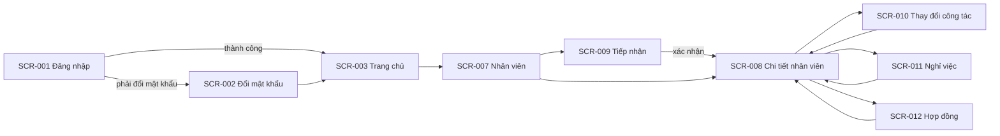
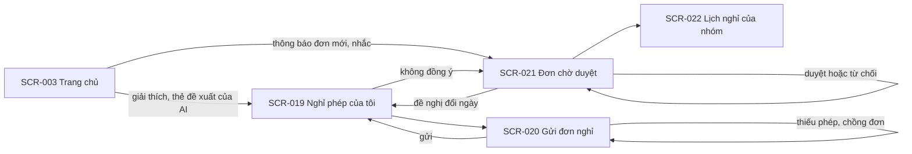
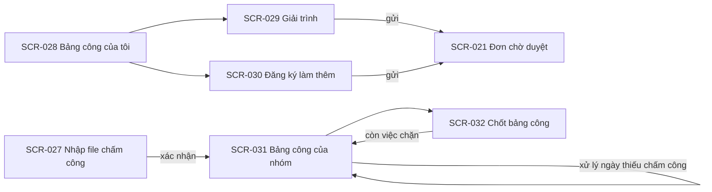
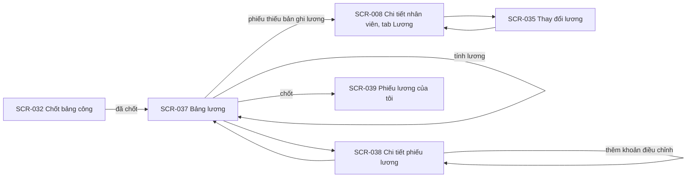
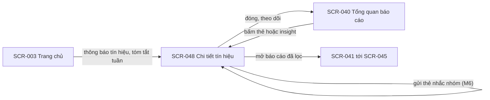

# UI flow: hr-manager

- **Status:** Accepted
- **Updated:** 2026-10-31
- **Reviewed:** 2026-10-30: chủ dự án review từng phần qua PR #17 tới #22; agent chạy Analysis checklist. Chưa có
  người ngoài review
- **Related:** [requirements](requirements.md) · [stories](stories.md) · [domain](domain.md) · [UI design](../design/ui.md)

Trang này ghi người dùng thấy gì và đi qua màn hình nào, ở mức wireframe. Giao diện ẩn nút chỉ để dễ dùng; quyền thật
được kiểm ở backend theo Permission matrix trong [requirements](requirements.md#permission-matrix). Bản hiện tại có
information architecture và các màn hình của M1 tới M5, cùng phần AI Leave Coordinator và AI Report Analyst của M6. Phần AI của một màn
hình ghi trong dòng **AI (M6)**; khi AI không dùng được, màn hình chạy như không có dòng đó (BR-162).

## Information architecture

Menu chính chỉ hiện mục người dùng có quyền.

```mermaid
flowchart TD
  HOME["Trang chủ<br/>SCR-003"]
  HOME --> ME["Hồ sơ của tôi<br/>SCR-004"]
  HOME --> DIR["Danh bạ<br/>SCR-005"]
  HOME --> ORG["Sơ đồ tổ chức<br/>SCR-006"]
  HOME --> EMP["Nhân viên<br/>SCR-007"]
  EMP --> EMPD["Chi tiết nhân viên<br/>SCR-008"]
  EMP --> ONB["Tiếp nhận<br/>SCR-009"]
  EMP --> IMP["Nhập từ bảng tính<br/>SCR-018"]
  EMP --> EXP["Hợp đồng sắp hết hạn<br/>SCR-013"]
  HOME --> ADM["Quản trị"]
  ADM --> OU["Phòng ban<br/>SCR-014"]
  ADM --> POS["Chức danh<br/>SCR-015"]
  ADM --> ACC["Tài khoản<br/>SCR-016"]
  ADM --> LOG["Nhật ký thao tác<br/>SCR-017"]
  ADM --> LT["Loại nghỉ<br/>SCR-023"]
  ADM --> CAL["Lịch làm việc<br/>SCR-024"]
  ADM --> SH["Ca làm việc<br/>SCR-025"]
  ADM --> SHA["Gán ca<br/>SCR-026"]
  ADM --> ALW["Loại phụ cấp<br/>SCR-033"]
  ADM --> PPAR["Tham số lương<br/>SCR-034"]
  ADM --> RET["Dữ liệu hết hạn lưu<br/>SCR-046"]
  ADM --> LRS["Lý do nghỉ<br/>SCR-047"]
  HOME --> APR["Đơn chờ duyệt<br/>SCR-021"]
  HOME --> LV["Nghỉ phép"]
  LV --> LVME["Nghỉ phép của tôi<br/>SCR-019"]
  LVME --> LVREQ["Gửi đơn nghỉ<br/>SCR-020"]
  LV --> LVCAL["Lịch nghỉ của nhóm<br/>SCR-022"]
  HOME --> AT["Chấm công"]
  AT --> ATME["Bảng công của tôi<br/>SCR-028"]
  ATME --> ATADJ["Giải trình<br/>SCR-029"]
  ATME --> ATOT["Đăng ký làm thêm<br/>SCR-030"]
  AT --> ATTEAM["Bảng công của nhóm<br/>SCR-031"]
  AT --> ATIMP["Nhập file chấm công<br/>SCR-027"]
  AT --> ATCLOSE["Chốt bảng công<br/>SCR-032"]
  HOME --> PY["Lương"]
  PY --> PYME["Phiếu lương của tôi<br/>SCR-039"]
  PY --> PYRUN["Bảng lương<br/>SCR-037"]
  PYRUN --> PYSLIP["Chi tiết phiếu lương<br/>SCR-038"]
  HOME --> RP["Báo cáo<br/>SCR-040"]
  RP --> RPHC["Biến động nhân sự<br/>SCR-041"]
  RP --> RPST["Cơ cấu nhân sự<br/>SCR-042"]
  RP --> RPLV["Nghỉ phép<br/>SCR-043"]
  RP --> RPAT["Chấm công<br/>SCR-044"]
  RP --> RPPY["Chi phí lương<br/>SCR-045"]
  RP --> SIG["Chi tiết tín hiệu<br/>SCR-048"]
```

| Menu | Nhân viên | Quản lý | HR | Screens |
|---|---|---|---|---|
| Trang chủ | ✅ | ✅ | ✅ | SCR-003 |
| Hồ sơ của tôi | ✅ | ✅ | ✅ | SCR-004 |
| Danh bạ | ✅ | ✅ | ✅ | SCR-005 |
| Sơ đồ tổ chức | ✅ | ✅ | ✅ | SCR-006 |
| Nhân viên | ❌ | ✅ chỉ trong phạm vi, không có nút thao tác | ✅ | SCR-007 tới SCR-013, SCR-018 |
| Đơn chờ duyệt | ❌ | ✅ đơn mình là người duyệt | ✅ mọi đơn | SCR-021 |
| Nghỉ phép | ✅ chỉ nghỉ phép của mình | ✅ thêm lịch nghỉ của nhóm | ✅ thêm lịch nghỉ của nhóm | SCR-019, SCR-020, SCR-022 |
| Chấm công | ✅ chỉ bảng công của mình | ✅ thêm bảng công của nhóm | ✅ thêm nhập file và chốt bảng công | SCR-027 tới SCR-032 |
| Lương | ✅ chỉ phiếu lương của mình | ✅ chỉ phiếu lương của mình | ✅ thêm bảng lương | SCR-037 tới SCR-039 |
| Báo cáo | ❌ | ✅ chỉ phạm vi; chi phí lương chỉ số tổng hợp | ✅ | SCR-040 tới SCR-045, SCR-048 |
| Quản trị | ❌ | ❌ | ✅ | SCR-014 tới SCR-017, SCR-023 tới SCR-026, SCR-033, SCR-034, SCR-046, SCR-047 |

Chi tiết nhân viên (SCR-008) chia thành các tab. Tab nào người xem không có quyền thì không hiện.

| Tab | Nội dung | Quản lý | HR |
|---|---|---|---|
| Thông tin chung | Thông tin công việc và liên hệ công việc; với HR thêm thông tin cá nhân | Chỉ phần công việc | ✅ |
| Công tác | Các quá trình công tác, thay đổi sắp tới, bổ nhiệm trưởng | ✅ | ✅ |
| Hợp đồng | Các hợp đồng lao động | ❌ | ✅ |
| Nghỉ phép | Số dư phép, biến động phép, các đơn nghỉ | ✅ không thấy lý do nghỉ của đơn mình không duyệt | ✅ thêm nút Điều chỉnh số dư |
| Chấm công | Mã chấm công, lịch sử ca, bảng công theo tháng | ✅ | ✅ thêm nút Đổi ca và sửa mã chấm công |
| Lương | Các bản ghi lương, thông tin thuế và bảo hiểm, người phụ thuộc, phiếu lương các tháng; mở SCR-035, SCR-036 | ❌ (BR-122) | ✅ |
| Tài khoản | Trạng thái tài khoản, vai trò | ❌ | ✅ |
| Nhật ký | Thay đổi trên hồ sơ này | ❌ | ✅ |

## Flows

- **Đăng nhập:** bắt đầu ở SCR-001. Tài khoản phải đổi mật khẩu thì sang SCR-002 rồi mới tới SCR-003. Đăng nhập sai thì
  ở lại SCR-001 kèm thông báo.
- **Tiếp nhận:** từ SCR-007, HR mở SCR-009 và đi qua bốn bước: thông tin cá nhân, công tác, hợp đồng, xác nhận. Xác nhận
  xong thì mở SCR-008 của người mới. Hủy giữa chừng thì không lưu gì.
- **Thay đổi trên hồ sơ:** từ SCR-008, HR mở SCR-010, SCR-011 hoặc SCR-012 dạng hộp thoại. Mỗi hộp thoại có bước xem
  trước tác động. Lưu xong thì quay về SCR-008 ở tab tương ứng.
- **Tái cấu trúc:** ở SCR-014, HR chọn phòng ban, chọn thao tác, nhập ngày hiệu lực, xem trước cơ cấu và nhân viên bị ảnh
  hưởng, rồi xác nhận.

- **Gửi đơn:** nhân viên mở SCR-019, bấm Gửi đơn để mở SCR-020. Nhân viên chọn lý do rồi loại nghỉ hợp lệ, hoặc gõ một
  câu mô tả để AI điền form (M6). Trong lúc nhập, màn hình tính ngay số ngày nghỉ, số phép còn lại và cảnh báo nhóm
  thiếu người. Gửi thành công thì quay về SCR-019 với đơn ở trạng thái Chờ duyệt. Lỗi như thiếu phép hay chồng đơn thì
  ở lại SCR-020 kèm thông báo.
- **Duyệt đơn:** người duyệt thấy thông báo hoặc lời nhắc trên SCR-003, mở SCR-021, chọn một đơn để xem chi tiết, rồi
  duyệt, từ chối kèm lý do, hoặc đề nghị đổi ngày. Từ SCR-021 có thể mở SCR-022 để xem lịch nghỉ của nhóm. SCR-021 nhận
  cả đơn nghỉ, đơn làm thêm giờ và giải trình chấm công.
- **Đề nghị đổi ngày:** nhân viên nhận thông báo, mở đơn ở SCR-019 và chọn Chấp nhận hoặc Không đồng ý (BR-151).
- **Tình huống (M6):** giải thích và thẻ đề xuất của AI hiện trong thông báo ở SCR-003 và trên đơn ở SCR-019. Thẻ mở
  form điền sẵn hoặc có nút xác nhận; không có gì xảy ra nếu người nhận không bấm (BR-157).

- **Nhập chấm công:** HR mở SCR-027, tải file, xem kết quả kiểm từng dòng rồi xác nhận. Công được tính lại và hiện ở
  SCR-028 và SCR-031.
- **Giải trình và làm thêm:** từ SCR-028, nhân viên bấm Giải trình trên một ngày để mở SCR-029, hoặc bấm Đăng ký làm thêm
  để mở SCR-030. Đơn gửi đi vào SCR-021 của người duyệt.
- **Chốt bảng công:** cuối tháng, HR mở SCR-032. Nếu còn việc chặn, mỗi việc có đường dẫn tới SCR-021 hoặc tới ngày cần
  xử lý trên SCR-031. Xử lý xong thì quay lại SCR-032 để chốt.

- **Tính lương:** sau khi chốt bảng công, HR mở SCR-037, chọn tháng và bấm Tính lương. Bảng lương hiện ở trạng thái Nháp
  kèm danh sách lỗi và cảnh báo. Lỗi thiếu bản ghi lương có đường dẫn tới tab Lương của SCR-008.
- **Điều chỉnh:** HR bấm một dòng của SCR-037 để mở SCR-038, thêm khoản điều chỉnh, rồi quay lại. Phiếu được tính lại
  ngay.
- **Chốt lương:** khi không còn lỗi, HR bấm Chốt ở SCR-037. Nhân viên nhận thông báo và thấy phiếu ở SCR-039.

- **Điều đáng chú ý:** Quản lý và HR thấy thẻ cảnh báo ở SCR-040, hoặc nhận thông báo tín hiệu mức Cao và tóm tắt tuần ở
  SCR-003. Bấm một thẻ hay một dòng thông báo để mở SCR-048, rồi mở báo cáo đã lọc sẵn khi cần xem từng người.
- **Insight (M6):** SCR-040 hiện insight của AI thay cho các thẻ rời; SCR-048 có thêm giải thích và thẻ nhắc nhóm. Thẻ
  nhắc chỉ gửi khi người xem bấm Gửi (BR-185).

## Screens

### SCR-001: Đăng nhập

- **Purpose:** vào hệ thống · **Stories:** US-001
- **Content and actions:** ô mã nhân viên, ô mật khẩu, nút Đăng nhập, dòng "Quên mật khẩu? Liên hệ HR."
- **Inputs:**

  | Field | Required | Rule | Message when invalid |
  |---|---|---|---|
  | Mã nhân viên | Có | — | Mã nhân viên hoặc mật khẩu không đúng. |
  | Mật khẩu | Có | — | Mã nhân viên hoặc mật khẩu không đúng. |

- **States:** tài khoản khóa tạm: "Tài khoản tạm khóa do nhập sai nhiều lần. Thử lại sau 15 phút." Tài khoản bị khóa:
  "Tài khoản đã bị khóa. Liên hệ HR."

### SCR-002: Đổi mật khẩu

- **Purpose:** đặt mật khẩu mới · **Stories:** US-001
- **Content and actions:** mật khẩu hiện tại, mật khẩu mới, nhập lại mật khẩu mới, nút Lưu. Khi bắt buộc đổi mật khẩu,
  màn hình không có nút bỏ qua.
- **Inputs:**

  | Field | Required | Rule | Message when invalid |
  |---|---|---|---|
  | Mật khẩu mới | Có | Tối thiểu `min_password_length` ký tự; khác mật khẩu hiện tại (BR-036) | Mật khẩu mới phải có ít nhất 8 ký tự và khác mật khẩu hiện tại. |
  | Nhập lại | Có | Trùng mật khẩu mới | Hai mật khẩu không khớp. |

### SCR-003: Trang chủ

- **Purpose:** điểm bắt đầu sau khi đăng nhập · **Stories:** US-001, US-016, US-034, US-092, US-094, US-095
- **Content and actions:** lối tắt tới các mục trong menu theo vai trò; số dư phép của mình; danh sách thông báo kèm số
  thông báo chưa đọc. Quản lý và HR thấy số đơn đang chờ mình duyệt. HR thấy thêm số hợp đồng sắp hết hạn và số hồ sơ
  chưa có hợp đồng. Bấm vào mỗi con số để mở danh sách tương ứng. Với Quản lý và HR, danh sách thông báo gồm cả thông báo
  tín hiệu mức Cao, nhắc theo dõi và tóm tắt tuần; bấm một dòng để mở SCR-048 (BR-177, BR-180, BR-181).
- **AI (M6):** cập nhật theo dõi và tóm tắt tuần là đoạn ngắn do AI viết, có nhãn AI; AI lỗi thì dùng nội dung mẫu
  (BR-191).

### SCR-004: Hồ sơ của tôi

- **Purpose:** xem hồ sơ của mình và sửa thông tin liên hệ · **Stories:** US-017
- **Content and actions:** thông tin cá nhân, thông tin liên hệ, quá trình công tác, hợp đồng. Chỉ phần liên hệ có nút
  Sửa (BR-021). Cạnh các trường khác có dòng "Cần sửa? Liên hệ HR."
- **Inputs:**

  | Field | Required | Rule | Message when invalid |
  |---|---|---|---|
  | Điện thoại cá nhân | Không | Số điện thoại Việt Nam hợp lệ | Số điện thoại không hợp lệ. |
  | Email cá nhân | Không | Địa chỉ email hợp lệ | Email không hợp lệ. |

### SCR-005: Danh bạ

- **Purpose:** tìm đồng nghiệp · **Stories:** US-019
- **Content and actions:** ô tìm theo tên, bộ lọc phòng ban, danh sách nhân viên đang làm với các trường theo BR-032.
- **States:** không có kết quả: "Không tìm thấy nhân viên phù hợp."

### SCR-006: Sơ đồ tổ chức

- **Purpose:** xem cây phòng ban · **Stories:** US-009, US-010
- **Content and actions:** cây phòng ban mở và thu được; mỗi nút có tên, trưởng phòng ban và số nhân viên đang làm. HR có
  thêm ô chọn ngày để xem cơ cấu tại ngày đó; người khác chỉ xem được hôm nay.
- **States:** ngày trước ngày thành lập phòng ban gốc: "Chưa có cơ cấu tổ chức tại ngày này." (EC-013)

### SCR-007: Danh sách nhân viên

- **Purpose:** tìm nhân viên để xem hoặc thao tác · **Stories:** US-018, US-020
- **Content and actions:** bảng gồm mã, họ tên, phòng ban, chức danh, trạng thái. Có ô tìm, bộ lọc phòng ban kèm lựa chọn
  gồm phòng ban con, chức danh, trạng thái, loại hợp đồng, và phân trang kèm tổng số. HR có thêm nút Tiếp nhận và Nhập từ
  bảng tính. Quản lý chỉ thấy nhân viên trong phạm vi và không có nút thao tác.

### SCR-008: Chi tiết nhân viên

- **Purpose:** xem và thao tác trên một hồ sơ · **Stories:** US-012, US-013, US-014, US-015, US-018, US-032, US-037,
  US-038
- **Content and actions:** các tab theo bảng ở mục Information architecture. Nếu có thay đổi công tác hoặc ngày nghỉ việc
  ở tương lai, đầu trang hiện dòng báo kèm ngày hiệu lực. HR có các nút Sửa hồ sơ, Ghi nhận thay đổi công tác, Ghi nhận
  nghỉ việc, Thêm hợp đồng; ở tab Nghỉ phép có nút Điều chỉnh số dư, mở hộp thoại nhập số ngày cộng hoặc trừ và lý do
  bắt buộc (BR-055).
- **States:** hồ sơ đã bị người khác sửa trong lúc đang sửa: "Hồ sơ vừa được cập nhật. Tải lại để xem bản mới trước khi
  lưu." (EC-016)

### SCR-009: Tiếp nhận nhân viên mới

- **Purpose:** tạo hồ sơ cho người mới hoặc tuyển lại người cũ · **Stories:** US-011, US-071 · **Use case:** UC-001
- **Content and actions:** bốn bước có thanh tiến độ. Bước 1: thông tin cá nhân. Bước 2: ngày vào làm, phòng ban, chức
  danh. Bước 3: hợp đồng đầu tiên, có nút bỏ qua. Bước 4: tóm tắt, ô chọn tạo tài khoản, nút Xác nhận. Tạo tài khoản
  xong thì hiện mật khẩu tạm đúng một lần. Ở chế độ Tuyển lại, mở từ SCR-008 của nhân viên
  Đã nghỉ việc: bước 1 điền sẵn thông tin cũ, mã nhân viên giữ nguyên (BR-139).
- **Inputs:**

  | Field | Required | Rule | Message when invalid |
  |---|---|---|---|
  | Họ tên | Có | Không trống | Nhập họ tên. |
  | Ngày sinh | Có | Trước ngày vào làm | Ngày sinh không hợp lệ. |
  | Số CCCD | Có | 12 chữ số; không trùng hồ sơ khác (BR-022) | Số CCCD đã có trong hồ sơ của [họ tên, mã nhân viên]. |
  | Ngày vào làm | Có | — | Nhập ngày vào làm. |
  | Phòng ban | Có | Đang hoạt động tại ngày vào làm (BR-014) | Phòng ban chưa thành lập hoặc đã giải thể tại ngày vào làm. |
  | Chức danh | Có | Đang dùng (BR-035) | Chọn chức danh. |
  | Email công việc | Không | Địa chỉ email hợp lệ | Email không hợp lệ. |

### SCR-010: Ghi nhận thay đổi công tác

- **Purpose:** chuyển phòng ban hoặc đổi chức danh · **Stories:** US-013 · **Use case:** UC-002
- **Content and actions:** hộp thoại gồm các trường dưới, phần xem trước quá trình công tác trước và sau cùng quản lý
  trực tiếp mới, nút Xác nhận. Nhân viên đang là trưởng phòng ban thì hiện cảnh báo theo EC-004.
- **Inputs:**

  | Field | Required | Rule | Message when invalid |
  |---|---|---|---|
  | Ngày hiệu lực | Có | Trong khoảng làm việc; không trùng ngày của thay đổi khác (BR-017, EC-002) | Ngày hiệu lực ngoài thời gian làm việc của nhân viên. / Đã có thay đổi khác vào ngày này. |
  | Phòng ban mới | Một trong hai | Đang hoạt động từ ngày hiệu lực (BR-014) | Phòng ban không hoạt động tại ngày hiệu lực. |
  | Chức danh mới | Một trong hai | Đang dùng (BR-035) | Chọn chức danh. |
  | Lý do | Khi ngày hiệu lực trước hôm nay | Không trống (BR-018) | Nhập lý do khi ghi nhận thay đổi cho ngày đã qua. |

### SCR-011: Ghi nhận nghỉ việc

- **Purpose:** ghi nhận nhân viên nghỉ việc · **Stories:** US-014, US-035 · **Use case:** UC-003
- **Content and actions:** hộp thoại gồm các trường dưới, danh sách tác động theo BR-019 và BR-065, số ngày phép năm chưa
  nghỉ tính tới ngày làm việc cuối cùng, nút Xác nhận. Khi ngày làm việc cuối cùng chưa qua, SCR-008 có thêm nút Hủy
  ghi nhận nghỉ việc.
- **Inputs:**

  | Field | Required | Rule | Message when invalid |
  |---|---|---|---|
  | Ngày làm việc cuối cùng | Có | Không trước ngày vào làm; không còn thay đổi công tác sau ngày này (EC-009) | Còn thay đổi công tác sau ngày này: [danh sách]. Hủy các thay đổi đó trước. |
  | Lý do nghỉ | Có | Một trong: tự nghỉ, hết hạn hợp đồng, công ty cho thôi việc, khác | Chọn lý do nghỉ. |

### SCR-012: Thêm và sửa hợp đồng

- **Purpose:** ghi lại hợp đồng lao động · **Stories:** US-015
- **Content and actions:** hộp thoại gồm các trường dưới. Cảnh báo theo BR-026 hiện trước nút Xác nhận, và HR phải tick
  "Tôi đã kiểm tra" mới lưu được.
- **Inputs:**

  | Field | Required | Rule | Message when invalid |
  |---|---|---|---|
  | Số hợp đồng | Có | Không trùng (BR-037) | Số hợp đồng đã tồn tại. |
  | Loại hợp đồng | Có | Thử việc, xác định thời hạn hoặc không xác định thời hạn (BR-023) | Chọn loại hợp đồng. |
  | Nhóm công việc | Khi thử việc | Một trong các nhóm của `probation_max_days` | Chọn nhóm công việc. |
  | Ngày bắt đầu | Có | Không chồng hợp đồng khác (BR-025) | Hợp đồng chồng thời gian với hợp đồng [số hợp đồng]. |
  | Ngày kết thúc | Khi thử việc hoặc xác định thời hạn | Trong giới hạn của BR-024 hoặc BR-028 | Hợp đồng xác định thời hạn tối đa 36 tháng. / Thời gian thử việc vượt mức tối đa của nhóm công việc. |

### SCR-013: Hợp đồng sắp hết hạn

- **Purpose:** biết hợp đồng nào cần ký tiếp · **Stories:** US-016
- **Content and actions:** bảng gồm nhân viên, phòng ban, loại hợp đồng, ngày kết thúc, số ngày còn lại hoặc số ngày đã
  quá hạn; xếp theo ngày kết thúc. Bấm một dòng để mở SCR-008 ở tab Hợp đồng.
- **States:** danh sách trống: "Không có hợp đồng nào sắp hết hạn trong 30 ngày tới."

### SCR-014: Quản lý phòng ban

- **Purpose:** sửa cơ cấu tổ chức và trưởng phòng ban · **Stories:** US-006, US-007, US-008, US-075 · **Use case:**
  UC-004
- **Content and actions:** cây phòng ban bên trái, chi tiết phòng ban đang chọn bên phải. Thao tác: thêm phòng ban con,
  đổi tên, chuyển nhánh, giải thể, bổ nhiệm trưởng, thay trưởng, thôi bổ nhiệm. Mỗi thao tác có ô ngày hiệu lực và bước
  xem trước. Với phòng ban gốc, chỉ thao tác đổi tên và các thao tác về trưởng được hiện. Chi tiết phòng ban có ô ngưỡng
  nhân sự; để trống thì dùng `min_staff_ratio` (BR-146).

### SCR-015: Danh mục chức danh

- **Purpose:** quản lý danh sách chức danh · **Stories:** US-005
- **Content and actions:** bảng chức danh với số nhân viên đang giữ; thao tác thêm, đổi tên, ngừng dùng, dùng lại. Nút
  Xóa chỉ hiện với chức danh chưa từng được dùng (BR-035).

### SCR-016: Tài khoản người dùng

- **Purpose:** quản lý quyền truy cập · **Stories:** US-002, US-003
- **Content and actions:** bảng gồm mã nhân viên, họ tên, vai trò, trạng thái tài khoản. Thao tác: tạo tài khoản cho
  nhân viên chưa có, khóa, mở khóa, đặt lại mật khẩu, gán và thu hồi vai trò HR. Mật khẩu tạm hiện trong hộp thoại đúng
  một lần, kèm nút sao chép.

### SCR-017: Nhật ký thao tác

- **Purpose:** truy lại thay đổi · **Stories:** US-004
- **Content and actions:** bảng gồm thời điểm, người làm, đối tượng, thao tác, giá trị trước và sau. Bộ lọc theo người
  làm, loại đối tượng và khoảng thời gian. Màn hình chỉ để xem, không có thao tác sửa.

### SCR-018: Nhập nhân viên từ bảng tính

- **Purpose:** đưa danh sách nhân viên có sẵn vào hệ thống · **Stories:** US-021
- **Content and actions:** ba bước. Bước 1: tải file mẫu. Bước 2: tải file đã điền lên. Bước 3: bảng kết quả kiểm từng
  dòng, dòng lỗi tô đỏ kèm lý do, nút Xác nhận chỉ bật khi không còn dòng lỗi (EC-020).

### SCR-019: Nghỉ phép của tôi

- **Purpose:** biết mình còn bao nhiêu phép và theo dõi đơn của mình · **Stories:** US-022, US-024, US-030, US-031,
  US-079, US-080, US-085, US-086
- **Content and actions:** ba khối. Khối số dư: số phép hiện tại, phép tồn kèm hạn dùng, số ngày của các đơn đang chờ.
  Khối đơn của tôi: danh sách đơn với loại, ngày, số ngày, trạng thái; nút Hủy với đơn được hủy theo BR-061; nút Đổi
  đơn mở SCR-020 với dữ liệu của đơn (BR-152). Đơn ở trạng thái Chờ phản hồi hiện khoảng ngày và lời nhắn của người
  duyệt, kèm nút Chấp nhận và Không đồng ý (BR-151). Khối biến động phép: ngày, loại biến động, số ngày, lý do. Nút Gửi
  đơn mở SCR-020.
- **AI (M6):** đơn gặp tình huống có giải thích và thẻ đề xuất của AI, gắn nhãn AI (BR-169). Trước hạn phép tồn, khối
  số dư hiện các khoảng ngày gợi ý dùng phép tồn; chọn một khoảng thì mở SCR-020 điền sẵn (BR-170).
- **States:** chưa có đơn nào: "Bạn chưa có đơn nghỉ nào."

### SCR-020: Gửi đơn nghỉ

- **Purpose:** tạo hoặc đổi đơn nghỉ · **Stories:** US-023, US-033, US-074, US-075, US-076, US-080, US-081, US-082,
  US-083, US-084 · **Use case:** UC-005, UC-013
- **Content and actions:** form gồm các trường dưới. Khi nhập, form hiện ngay số ngày nghỉ, người duyệt, và với phép năm
  thì hiện số phép còn lại sau đơn. Form hiện cảnh báo khi đơn làm nhóm thiếu người (BR-146) hoặc thuộc giai đoạn hạn
  chế (BR-147). Nút Thêm đơn liền kề để gửi nhiều đơn trong một lần (BR-153). HR mở form từ hồ sơ của nhân viên thì có
  thêm ô chọn nhân viên, và đơn được duyệt ngay khi lưu (BR-063).
- **AI (M6):** ô "Mô tả nhu cầu nghỉ" ở đầu form; AI điền các trường, mỗi trường AI điền có nhãn AI gợi ý (BR-166).
  Khối Gợi ý của AI hiện câu hỏi làm rõ, cảnh báo mô tả không khớp lý do (BR-167), và tối đa `leave_option_count`
  phương án kèm hệ quả (BR-168). Chọn một phương án thì form điền theo phương án đó. Đơn chỉ được gửi khi nhân viên bấm
  Gửi.
- **Inputs:**

  | Field | Required | Rule | Message when invalid |
  |---|---|---|---|
  | Lý do nghỉ | Có | Đang dùng trong danh mục (BR-142) | Chọn lý do nghỉ. |
  | Loại nghỉ | Có | Đang dùng (BR-042) và thuộc các loại hợp lệ của lý do (BR-142) | Chọn loại nghỉ hợp lệ cho lý do này. |
  | Từ ngày, buổi | Có | Trong khoảng làm việc (BR-046); không sớm hơn hôm nay quá `leave_backdate_days` ngày, trừ khi HR ghi (BR-062) | Không gửi được đơn cho ngày quá 7 ngày trước. |
  | Đến ngày, buổi | Có | Không trước Từ ngày; có ít nhất một buổi làm việc (BR-044) | Khoảng nghỉ không có ngày làm việc nào. |
  | Mô tả thêm | Khi lý do là Khác | Không trống khi lý do là Khác (BR-144) | Mô tả lý do nghỉ. |
  | Người nhận bàn giao | Không | Nhân viên đang làm trong cùng phòng ban (BR-154) | Chọn đồng nghiệp trong phòng ban của bạn. |

- **States:** thiếu phép: "Không đủ phép năm. Còn thiếu [số ngày] ngày vào ngày [ngày]." Chồng đơn: "Đã có đơn khác vào
  [ngày, buổi]." Vượt tối đa của loại: "Loại nghỉ này tối đa [số ngày] ngày mỗi đơn." Nhóm thiếu người: "[Buổi, ngày]:
  nhóm thiếu người." AI không dùng được: "Gợi ý của AI tạm không dùng được. Bạn vẫn điền và gửi đơn như thường."; chữ
  đã gõ được giữ.

### SCR-021: Đơn chờ duyệt

- **Purpose:** duyệt mọi loại đơn · **Stories:** US-025, US-026, US-043, US-045, US-075, US-076, US-077, US-078, US-079,
  US-088, US-089 · **Use case:** UC-005, UC-008, UC-015
- **Content and actions:** danh sách đơn đang chờ, có bộ lọc theo loại đơn: đơn nghỉ, đơn làm thêm giờ, giải trình chấm
  công. Mỗi dòng có người gửi, loại đơn, ngày, số ngày hoặc số giờ, ngày gửi; đơn đã qua ngày bắt đầu được đánh dấu quá
  hạn, đơn chờ quá `approval_reminder_days` ngày làm việc được đánh dấu chờ lâu (BR-148). Quản lý thấy đơn mình là người
  duyệt, và đơn được giao thêm khi là người duyệt thay, kèm nhãn Người duyệt thay (BR-149); HR thấy mọi đơn và lọc được
  theo người duyệt. Chi tiết theo loại đơn: đơn nghỉ hiện lý do và mô tả thêm, số phép trước và sau đơn, các đơn đã duyệt
  khác của nhóm trong cùng khoảng ngày, các buổi dưới ngưỡng kèm mức phủ và tên người nghỉ (BR-146), cờ giai đoạn hạn
  chế (BR-147); đơn làm thêm hiện số giờ làm thêm đã dùng và còn lại trong tháng và năm; giải trình hiện giờ từ máy và giờ
  đề nghị. Nút Duyệt, Từ chối và, với đơn nghỉ, Đề nghị đổi ngày. Từ chối mở ô lý do bắt buộc; Đề nghị đổi ngày mở ô
  khoảng ngày, buổi và lời nhắn (BR-150).
- **AI (M6):** đơn nghỉ có khối Tóm tắt của AI: tác động của đơn và khoảng ngày thay thế giữ nhóm trên ngưỡng; không có
  gợi ý duyệt hay từ chối (BR-164). Ô lý do từ chối và ô lời nhắn có nút Soạn bằng AI; bản nháp chỉ được gửi khi người
  duyệt bấm (BR-157).
- **States:** không còn đơn chờ: "Không có đơn nào chờ bạn duyệt."

### SCR-022: Lịch nghỉ của nhóm

- **Purpose:** biết ai nghỉ ngày nào · **Stories:** US-027, US-087
- **Content and actions:** lịch theo tháng, mỗi dòng một nhân viên trong phạm vi, mỗi cột một ngày. Ô có đơn đã duyệt và
  đơn đang chờ được tô khác nhau, ghi loại nghỉ và buổi. Ngày nghỉ lễ và cuối tuần được tô xám; buổi dưới ngưỡng và
  ngày thuộc giai đoạn hạn chế có đánh dấu riêng (BR-146, BR-147). Có bộ lọc phòng ban trong phạm vi và nút chuyển
  tháng.
- **AI (M6):** trước giai đoạn hạn chế, khối Tổng hợp giai đoạn hạn chế liệt kê các buổi dưới ngưỡng và tối đa
  `leave_option_count` cách xử lý các đơn chờ (BR-171). Mỗi cách có đường dẫn tới đơn ở SCR-021; quản lý quyết từng
  đơn.

### SCR-023: Loại nghỉ

- **Purpose:** cấu hình loại nghỉ · **Stories:** US-028
- **Content and actions:** bảng loại nghỉ với các thuộc tính theo BR-040 và số đơn đã dùng. Thao tác thêm, sửa, ngừng
  dùng, dùng lại. Loại Phép năm không có nút ngừng dùng và nút xóa (BR-041). Nút Xóa chỉ hiện với loại chưa có đơn nào
  (BR-042).

### SCR-024: Lịch làm việc

- **Purpose:** khai báo ngày nghỉ lễ, ngày làm bù và giai đoạn hạn chế nghỉ · **Stories:** US-029, US-076
- **Content and actions:** ô chọn năm; danh sách ngày nghỉ lễ và ngày làm bù của năm đó với ngày, loại, tên. Thao tác
  thêm, sửa, xóa ngày; ngày thuộc tháng đã chốt không sửa được (BR-090). Trước khi lưu một thay đổi, màn hình hiện các đơn
  bị tính lại và các đơn sẽ làm số phép bị âm (BR-064, EC-032). Ngày làm việc trong tuần khai báo ở SCR-025. Khối Giai
  đoạn hạn chế nghỉ liệt kê các giai đoạn với khoảng ngày, phạm vi, ghi chú; thao tác thêm, sửa, xóa (BR-147).
- **Inputs:**

  | Field | Required | Rule | Message when invalid |
  |---|---|---|---|
  | Ngày | Có | Không vừa là ngày nghỉ lễ vừa là ngày làm bù | Ngày này đã được khai là [loại]. |
  | Loại | Có | Nghỉ lễ hoặc làm bù | Chọn loại ngày. |
  | Tên | Có | Không trống | Nhập tên, ví dụ Tết Nguyên đán. |

### SCR-025: Ca làm việc

- **Purpose:** định nghĩa ca · **Stories:** US-036
- **Content and actions:** bảng ca với giờ bắt đầu, giờ kết thúc, nghỉ giữa ca, giờ làm chuẩn, ngày làm việc trong tuần,
  số nhân viên đang dùng. Thao tác thêm, sửa, ngừng dùng. Form hiện ngay giờ làm chuẩn và hai buổi của ca khi nhập.
- **Inputs:**

  | Field | Required | Rule | Message when invalid |
  |---|---|---|---|
  | Tên ca | Có | Không trùng (BR-068) | Tên ca đã tồn tại. |
  | Giờ bắt đầu, giờ kết thúc | Có | Khác nhau; kết thúc sớm hơn bắt đầu là ca qua nửa đêm | Giờ bắt đầu và giờ kết thúc không được trùng nhau. |
  | Nghỉ giữa ca | Không | Nằm trong ca | Giờ nghỉ phải nằm trong ca. |
  | Ngày làm việc trong tuần | Có | Ít nhất một ngày | Chọn ít nhất một ngày làm việc. |

- **States:** giờ làm chuẩn vượt `normal_hours_max_per_day`: "Ca dài hơn 8 giờ làm việc bình thường. Kiểm tra lại trước
  khi lưu." kèm ô xác nhận (BR-069).

### SCR-026: Gán ca

- **Purpose:** gán ca cho nhiều nhân viên cùng lúc · **Stories:** US-037
- **Content and actions:** chọn ca, ngày hiệu lực, rồi chọn nhân viên theo danh sách hoặc theo phòng ban. Bước xem trước
  liệt kê từng người với ca cũ và ca mới. Ngày hiệu lực thuộc tháng đã chốt thì hiện cảnh báo theo BR-090. Đổi ca cho một
  người cũng làm được ở tab Chấm công của SCR-008.

### SCR-027: Nhập file chấm công

- **Purpose:** đưa lượt chấm từ máy vào hệ thống · **Stories:** US-039 · **Use case:** UC-007
- **Content and actions:** ba bước. Bước 1: tải file lên, kèm mô tả các cột bắt buộc. Bước 2: kết quả kiểm gồm số dòng sẽ
  lưu, số dòng trùng, bảng dòng bị bỏ qua kèm lý do. Bước 3: nút Xác nhận; sau khi lưu, hiện báo cáo nhập. Danh sách các
  lần nhập trước nằm dưới cùng.
- **States:** file thiếu cột: "File thiếu cột [tên cột]. Kiểm tra lại file xuất từ máy chấm công."

### SCR-028: Bảng công của tôi

- **Purpose:** xem công từng ngày và tổng hợp tháng · **Stories:** US-040, US-041, US-042, US-044
- **Content and actions:** ô chọn tháng; trạng thái kỳ công (Đang mở hoặc Đã chốt); bảng mỗi ngày một dòng với ca, giờ
  vào, giờ ra, đi muộn, về sớm, trạng thái, giờ làm thêm; phần tổng hợp theo BR-092. Ngày Thiếu chấm công hoặc Vắng chưa
  xử lý có nút Giải trình mở SCR-029. Nút Đăng ký làm thêm mở SCR-030. Danh sách đơn làm thêm và giải trình của tháng kèm
  trạng thái, có nút Hủy với đơn được hủy.

### SCR-029: Gửi giải trình chấm công

- **Purpose:** đề nghị sửa giờ vào hoặc giờ ra · **Stories:** US-042
- **Content and actions:** hộp thoại hiện giờ từ máy của ngày đó, các trường dưới và người duyệt.
- **Inputs:**

  | Field | Required | Rule | Message when invalid |
  |---|---|---|---|
  | Giờ vào đề nghị | Một trong hai | Trước giờ ra đề nghị hoặc giờ ra từ máy | Giờ vào phải trước giờ ra. |
  | Giờ ra đề nghị | Một trong hai | Sau giờ vào | Giờ ra phải sau giờ vào. |
  | Lý do | Có | Không trống | Nhập lý do, ví dụ quên chấm hoặc đi công tác. |

### SCR-030: Đăng ký làm thêm giờ

- **Purpose:** xin làm thêm trước khi làm · **Stories:** US-044 · **Use case:** UC-008
- **Content and actions:** form gồm các trường dưới. Khi nhập, form hiện số giờ của đơn, số giờ làm thêm đã dùng và còn
  lại trong tháng và năm, và người duyệt.
- **Inputs:**

  | Field | Required | Rule | Message when invalid |
  |---|---|---|---|
  | Ngày | Có | Tháng chưa chốt; không có đơn nghỉ cả ngày (BR-087, BR-090) | Không đăng ký làm thêm được vào ngày này. |
  | Giờ bắt đầu, giờ kết thúc | Có | Sau thời điểm gửi; ngoài giờ ca; không chồng đơn khác (BR-083, BR-086) | Giờ làm thêm phải sau thời điểm gửi đơn và nằm ngoài giờ ca. |
  | Lý do | Có | Không trống | Nhập lý do làm thêm. |

- **States:** vượt giới hạn: "Vượt giới hạn làm thêm. Tháng này bạn còn được làm thêm [số giờ] giờ." (BR-084)

### SCR-031: Bảng công của nhóm

- **Purpose:** xem và xử lý bảng công của nhiều người · **Stories:** US-046, US-047, US-049
- **Content and actions:** ô chọn tháng; bộ lọc phòng ban trong phạm vi và bộ lọc chỉ hiện ngày cần xử lý. Bảng mỗi
  nhân viên một dòng, mỗi ngày một cột, ô ghi trạng thái ngắn gọn; ô bất thường hoặc được đánh dấu được tô nổi bật; các
  cột cuối là tổng hợp theo BR-092. Bấm một ô để xem chi tiết ngày. HR có thêm thao tác ghi công cho ngày Thiếu chấm công
  hoặc Vắng chưa xử lý (BR-082) và nút Xuất bảng tính. Quản lý chỉ xem.

### SCR-032: Chốt bảng công

- **Purpose:** chốt hoặc mở lại kỳ công · **Stories:** US-048 · **Use case:** UC-009
- **Content and actions:** ô chọn tháng và trạng thái kỳ công. Khi Đang mở: danh sách việc còn chặn theo BR-089, mỗi
  việc có đường dẫn tới chỗ xử lý; nút Chốt chỉ bật khi danh sách trống. Khi Đã chốt: người chốt, thời điểm chốt, nút Mở
  lại có ô lý do bắt buộc; nút này tắt nếu bảng lương của tháng đã chốt (BR-091).

### SCR-033: Loại phụ cấp

- **Purpose:** định nghĩa loại phụ cấp theo quy chế · **Stories:** US-050
- **Content and actions:** bảng loại phụ cấp với cách tính, chế độ thuế, mức miễn thuế, số nhân viên đang có. Thao tác
  thêm, sửa, ngừng dùng.
- **Inputs:**

  | Field | Required | Rule | Message when invalid |
  |---|---|---|---|
  | Tên | Có | Không trùng (BR-097) | Tên loại phụ cấp đã tồn tại. |
  | Cách tính | Có | Theo công hoặc cố định theo tháng | Chọn cách tính. |
  | Chế độ thuế | Có | Chịu thuế, miễn thuế, hoặc miễn thuế trong mức | Chọn chế độ thuế. |
  | Mức miễn thuế mỗi tháng | Khi chọn miễn thuế trong mức | Lớn hơn 0 | Nhập mức miễn thuế. |

### SCR-034: Tham số lương

- **Purpose:** cập nhật giá trị luật định theo ngày hiệu lực · **Stories:** US-054
- **Content and actions:** danh sách tham số lương; mỗi tham số hiện giá trị đang hiệu lực, giá trị sắp tới và lịch sử
  các giá trị cũ. Thao tác Thêm giá trị mới; giá trị chưa dùng ở bảng lương đã chốt thì sửa hoặc xóa được. Biểu thuế
  nhập thành bảng các bậc.
- **Inputs:**

  | Field | Required | Rule | Message when invalid |
  |---|---|---|---|
  | Ngày hiệu lực | Có | Không trùng giá trị khác của cùng tham số | Tham số này đã có giá trị từ ngày này. |
  | Giá trị | Có | Số không âm; biểu thuế có các bậc liền nhau | Các bậc thuế phải liền nhau, bậc đầu bắt đầu từ 0. |

- **States:** sửa giá trị đã dùng: "Giá trị này đã dùng ở bảng lương đã chốt. Thêm giá trị mới với ngày hiệu lực mới."
  (BR-123)

### SCR-035: Thay đổi lương

- **Purpose:** ghi bản ghi lương mới · **Stories:** US-051 · **Use case:** UC-011
- **Content and actions:** hộp thoại mở từ tab Lương của SCR-008. Có bước xem trước bản ghi trước và sau thay đổi. Ngày
  hiệu lực thuộc tháng có bảng lương đã chốt thì bước xem trước hiện chênh lệch của từng tháng (BR-098).
- **Inputs:**

  | Field | Required | Rule | Message when invalid |
  |---|---|---|---|
  | Ngày hiệu lực | Có | Trong khoảng làm việc; không trùng bản ghi khác (BR-093) | Đã có bản ghi lương từ ngày này. |
  | Lương cơ bản | Có | Từ lương tối thiểu vùng trở lên (BR-094) | Lương cơ bản thấp hơn lương tối thiểu vùng [số tiền] đồng. |
  | Lương đóng bảo hiểm | Có | Từ lương tối thiểu vùng trở lên (BR-096) | Lương đóng bảo hiểm thấp hơn lương tối thiểu vùng [số tiền] đồng. |
  | Phụ cấp | Không | Mỗi loại một lần; số tiền lớn hơn 0 | Loại phụ cấp này đã có trong bản ghi. |
  | Lý do | Có | Không trống | Nhập lý do, ví dụ tăng lương định kỳ. |

- **States:** lương đóng bảo hiểm thấp hơn lương cơ bản: "Lương đóng bảo hiểm thấp hơn lương cơ bản. Kiểm tra lại trước
  khi lưu." kèm ô xác nhận (BR-095).

### SCR-036: Người phụ thuộc

- **Purpose:** ghi người phụ thuộc để giảm trừ gia cảnh · **Stories:** US-053
- **Content and actions:** hộp thoại mở từ tab Lương của SCR-008, dùng để thêm hoặc sửa một người phụ thuộc.
- **Inputs:**

  | Field | Required | Rule | Message when invalid |
  |---|---|---|---|
  | Họ tên, quan hệ, ngày sinh | Có | Không trống | Nhập đủ họ tên, quan hệ và ngày sinh. |
  | Số định danh hoặc mã số thuế | Có | Không đang được tính cho nhân viên khác trong tháng chung (BR-099) | Người này đang là người phụ thuộc của nhân viên khác trong cùng thời gian. |
  | Tháng bắt đầu, tháng kết thúc | Tháng bắt đầu bắt buộc | Tháng kết thúc không trước tháng bắt đầu | Tháng kết thúc phải sau tháng bắt đầu. |

### SCR-037: Bảng lương

- **Purpose:** tính, kiểm và chốt lương tháng · **Stories:** US-055, US-060, US-063 · **Use case:** UC-010
- **Content and actions:** ô chọn tháng; trạng thái bảng lương (Chưa tính, Nháp, Cần tính lại, Đã chốt) và trạng thái bảng
  công của tháng. Khu lỗi và cảnh báo, mỗi mục có đường dẫn tới chỗ xử lý. Bảng mỗi nhân viên một dòng: công chuẩn, công
  hưởng lương, tổng thu nhập, bảo hiểm nhân viên đóng, thuế, điều chỉnh, thực lĩnh, phần công ty đóng; dòng tổng ở cuối.
  Bấm một dòng mở SCR-038. Nút Tính lương hoặc Tính lại, nút Chốt, nút Xuất bảng lương, nút Xuất danh sách chuyển khoản.
- **States:**
  - Bảng công chưa chốt: "Bảng công tháng [tháng] chưa chốt. Chốt bảng công trước khi tính lương." kèm đường dẫn tới
    SCR-032 (BR-102).
  - Cần tính lại: "Dữ liệu đã thay đổi sau lần tính trước. Tính lại trước khi chốt." Nút Chốt tắt (BR-119).
  - Đã chốt: người chốt, thời điểm chốt; không còn nút Tính lại và Chốt (BR-118).

### SCR-038: Chi tiết phiếu lương

- **Purpose:** xem cách tính và thêm khoản điều chỉnh cho một nhân viên · **Stories:** US-056 tới US-059, US-062
- **Content and actions:** phần đầu: nhân viên, tháng, công chuẩn, công hưởng lương, số người phụ thuộc. Các nhóm dòng:
  thu nhập (lương theo công từng đoạn, phụ cấp, làm thêm theo loại, làm ban đêm, tiền phép chưa nghỉ), khấu trừ (BHXH,
  BHYT, BHTN, thuế TNCN), khoản điều chỉnh, thực lĩnh, phần công ty đóng. Mỗi dòng tự tính có diễn giải công thức, ví dụ
  "10.000.000 × 20 ÷ 22". Khi bảng lương chưa chốt, HR thêm, sửa hoặc xóa khoản điều chỉnh.
- **Inputs:**

  | Field | Required | Rule | Message when invalid |
  |---|---|---|---|
  | Tên khoản | Có | Không trống | Nhập tên khoản, ví dụ Thưởng dự án. |
  | Cộng hay trừ | Có | — | Chọn khoản cộng hoặc khoản trừ. |
  | Số tiền | Có | Lớn hơn 0 | Số tiền phải lớn hơn 0. |
  | Chịu thuế | Khi là khoản cộng | — | Chọn khoản này có chịu thuế không. |
  | Lý do | Có | Không trống (BR-115) | Nhập lý do. |

- **States:** thực lĩnh âm: "Thực lĩnh âm. Giảm khoản trừ hoặc chuyển một phần sang tháng sau." (BR-117)

### SCR-039: Phiếu lương của tôi

- **Purpose:** nhân viên xem phiếu lương · **Stories:** US-061
- **Content and actions:** danh sách các tháng có bảng lương đã chốt; chọn một tháng để xem phiếu với các nhóm dòng như
  SCR-038, không có phần công ty đóng và không có thao tác sửa. Tháng chưa chốt không hiện (BR-122).

### Report screens

Các màn hình SCR-041 tới SCR-045 dùng chung một bố cục: thanh lọc gồm kỳ báo cáo và phòng ban trong phạm vi (BR-127); một
biểu đồ tóm tắt; bảng số liệu theo phòng ban, bấm một dòng để xem phòng ban con; nút Xuất bảng tính (BR-136). Số liệu tạm
tính có nhãn "Tạm tính" ở đầu báo cáo. Mỗi màn hình dưới đây chỉ ghi phần khác.

### SCR-040: Tổng quan báo cáo

- **Purpose:** xem nhanh tình hình nhân sự, điều đáng chú ý và mở các báo cáo · **Stories:** US-064, US-070, US-090,
  US-093, US-096, US-097 · **Use case:** UC-017
- **Content and actions:** các thẻ số theo phạm vi: nhân viên đang làm, vào mới và nghỉ việc trong tháng, người đang nghỉ
  hôm nay, đơn chờ mình duyệt. HR thấy thêm hợp đồng sắp hết hạn, ngày chưa xử lý của tháng đang mở, trạng thái bảng công
  và bảng lương tháng trước. Bấm một thẻ số để mở danh sách chi tiết (BR-137).
- **Điều đáng chú ý:** tối đa `insight_max_count` thẻ cảnh báo, xếp theo mức độ (BR-175). Mỗi thẻ có tên tín hiệu, phòng
  ban, kỳ, con số chính, mức độ và thời điểm tính; có nút Hữu ích, Không hữu ích, và menu Theo dõi, Đóng, Tắt loại này
  (BR-178, BR-180). Bấm thẻ để mở SCR-048. Đường dẫn Xem tất cả mở danh sách đầy đủ các tín hiệu đang có, nơi bật lại
  loại đã tắt; HR thấy thêm tỷ lệ đánh giá hữu ích theo loại tín hiệu. Bên dưới là danh sách năm báo cáo.
- **AI (M6):** khối Điều đáng chú ý hiện insight thay cho các thẻ rời. Mỗi insight có tiêu đề, 2 tới 3 câu giải thích,
  nhãn AI và thời điểm tính; các nút như thẻ cảnh báo (BR-186, BR-187). Insight được tính sẵn nên trang không chờ AI
  (BR-189).
- **States:**
  - Không có tín hiệu: "Không có điều gì cần chú ý trong phạm vi của bạn."
  - AI không dùng được hoặc insight không đạt kiểm tra: hiện thẻ cảnh báo của rule (BR-162, BR-188).

### SCR-041: Biến động nhân sự

- **Purpose:** theo dõi người vào, ra · **Stories:** US-065
- **Content and actions:** kỳ báo cáo là khoảng tháng. Biểu đồ cột vào mới và nghỉ việc theo tháng, kèm đường tỷ lệ nghỉ
  việc. Bảng mỗi phòng ban một dòng với các cột theo BR-132. HR bấm vào số vào mới hoặc nghỉ việc để xem danh sách người.

### SCR-042: Cơ cấu nhân sự

- **Purpose:** xem cơ cấu tại một ngày · **Stories:** US-066
- **Content and actions:** ô chọn ngày, chỉ HR đổi được (BR-133). Ô chọn chiều: phòng ban, chức danh, thâm niên; HR có
  thêm loại hợp đồng, giới tính, độ tuổi. Biểu đồ cột ngang theo chiều đã chọn, bảng số lượng và tỷ lệ.

### SCR-043: Báo cáo nghỉ phép

- **Purpose:** xem ngày nghỉ và số phép còn lại · **Stories:** US-067
- **Content and actions:** kỳ báo cáo là khoảng ngày. Tab Ngày nghỉ: số ngày theo loại nghỉ, theo phòng ban và theo
  nhân viên (BR-135). Tab Số dư phép: mỗi nhân viên một dòng với phép năm còn lại, phép tồn và hạn dùng; lọc được người có
  phép tồn sắp hết hạn. Quản lý không thấy lý do nghỉ (BR-067).

### SCR-044: Báo cáo chấm công

- **Purpose:** xem tổng hợp công và làm thêm · **Stories:** US-068
- **Content and actions:** kỳ báo cáo là một tháng hoặc một năm. Bảng theo phòng ban với số công, ngày vắng không lý do,
  số lần và phút đi muộn, về sớm, giờ làm thêm theo loại (BR-092). Danh sách xếp hạng theo đi muộn và vắng không lý do.
  Danh sách người đã dùng từ 80% giới hạn giờ làm thêm năm trở lên (BR-084).

### SCR-045: Chi phí lương

- **Purpose:** kiểm soát chi phí nhân sự · **Stories:** US-069 · **Use case:** UC-012
- **Content and actions:** kỳ báo cáo là khoảng tháng. Biểu đồ cột chồng chi phí theo tháng, tách tổng thu nhập và phần
  công ty đóng. Bảng mỗi phòng ban một dòng: số người, tổng thu nhập, phần công ty đóng, tổng chi phí, chênh lệch với tháng
  trước (BR-131). HR bấm một phòng ban để xem từng nhân viên; Quản lý chỉ xem tới phòng ban con.
- **States:**
  - Nhóm nhỏ được gộp: dòng phòng ban cha có ghi chú "Gồm số liệu của [tên phòng ban] vì có dưới [ngưỡng] người." (BR-129)
  - Phạm vi dưới ngưỡng: "Phạm vi của bạn có dưới [ngưỡng] người nên báo cáo không hiện số liệu." (BR-129)

### SCR-046: Dữ liệu hết hạn lưu

- **Purpose:** xóa thông tin liên hệ và ẩn danh hồ sơ đã hết hạn lưu · **Stories:** US-072
- **Content and actions:** hai tab. Tab Thông tin liên hệ: nhân viên nghỉ việc quá `contact_retention_months` tháng
  (BR-140). Tab Ẩn danh: nhân viên nghỉ việc quá `retention_years` năm (BR-141). Mỗi dòng có họ tên, mã, ngày làm việc
  cuối cùng và các trường sẽ bị xóa; HR chọn nhiều dòng rồi bấm Xác nhận. Hộp thoại xác nhận ghi rõ thao tác không hoàn
  tác được.
- **States:** danh sách trống: "Không có dữ liệu nào hết hạn lưu."

### SCR-047: Lý do nghỉ

- **Purpose:** quản lý danh mục lý do nghỉ · **Stories:** US-073
- **Content and actions:** bảng lý do nghỉ với loại nghỉ hợp lệ, số ngày theo luật, nguồn, trạng thái và số đơn đã
  dùng. Thao tác thêm, sửa, ngừng dùng, dùng lại; nút Xóa chỉ hiện với lý do chưa có đơn nào (BR-143). Đầu trang hiện số
  đơn dùng lý do Khác trong 3 tháng gần nhất, để HR cân nhắc thêm lý do (EC-094).
- **Inputs:**

  | Field | Required | Rule | Message when invalid |
  |---|---|---|---|
  | Tên | Có | Không trùng (BR-143) | Lý do này đã có. |
  | Loại nghỉ hợp lệ | Có | Ít nhất một loại nghỉ đang dùng (BR-143) | Chọn ít nhất một loại nghỉ. |
  | Số ngày theo luật | Không | Bội số của 0,5 | Nhập số ngày theo bội số của 0,5. |
  | Nguồn | Không | — | — |

### SCR-048: Chi tiết tín hiệu

- **Purpose:** hiểu một điều đáng chú ý và làm việc tiếp theo · **Stories:** US-091, US-093, US-094, US-097, US-098,
  US-099 · **Use case:** UC-017
- **Content and actions:** tên tín hiệu, phòng ban, kỳ, mức độ và thời điểm tính. Bảng phân rã theo các thành phần ở mục
  Default signal types của [domain](domain.md#default-signal-types), kèm so với kỳ trước và cùng kỳ năm trước (BR-176).
  Quản lý chỉ thấy chỉ số và chiều có trong báo cáo của mình. Nút Mở báo cáo mở báo cáo tương ứng với kỳ và phòng ban
  đã lọc sẵn. Nút Theo dõi hoặc Bỏ theo dõi, Đóng, Hữu ích, Không hữu ích (BR-178, BR-180). Tín hiệu đang được theo dõi
  hiện số liệu lúc bắt đầu theo dõi và hiện tại.
- **AI (M6):** với insight, đầu trang là tiêu đề và giải thích của AI, rồi danh sách tín hiệu nguồn, mỗi tín hiệu có bảng
  phân rã riêng (BR-187). Với loại tín hiệu có việc nhắc, khối Thẻ nhắc nhóm hiện số người nhận do core chọn và nội dung
  do AI soạn; người xem sửa nội dung rồi bấm Gửi (BR-190). Cập nhật theo dõi do AI viết hiện trên phần theo dõi (BR-191).
- **States:**
  - Bảng công của tháng tín hiệu dùng đang mở lại: "Số liệu của tháng này đang được sửa và sẽ được tính lại khi bảng
    công được chốt." (BR-179)
  - Tín hiệu đã hết: "Điều này không còn đúng từ [ngày]." kèm số liệu lúc hết.
  - AI không dùng được: chỉ hiện bảng phân rã và các nút của rule (BR-162).
