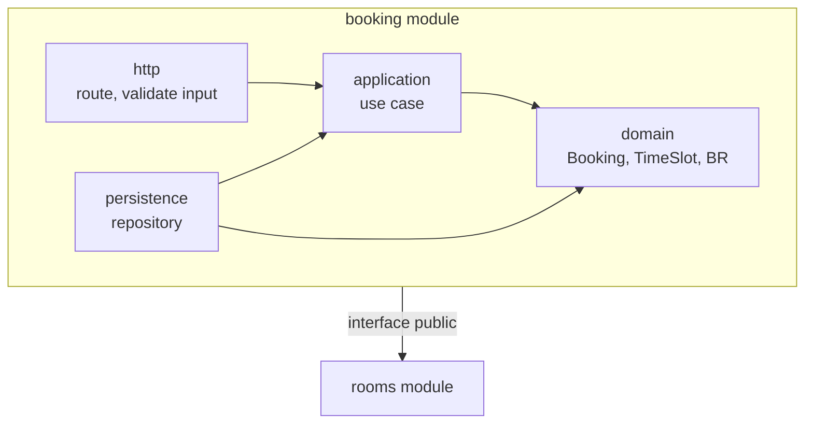

# Components

- **Status:** [Draft | Accepted | Superseded]
- **Updated:** [YYYY-MM-DD]
- **Reviewed:** [YYYY-MM-DD: review nguội; AI review; người ngoài nếu có]
- **Related:** [ARCHITECTURE](../../ARCHITECTURE.md) · [SPEC](../SPEC.md) · [design guide](../playbook/design.md)

> Điền ở Phase 3 cho container có logic đáng kể; container mỏng thì bỏ mục của nó. Đây là C4 Level 3: bên trong một
> container gồm module nào và module nào được phụ thuộc vào module nào. Danh sách module kèm path nằm ở SPEC; file này
> ghi cấu trúc và quy tắc. Quy tắc cách viết code nằm ở [conventions](../conventions/README.md). Dòng in nghiêng và sơ
> đồ mẫu là ví dụ, xóa khi điền.

## [container]: structure

- **Organization:** [chia theo feature hay theo tầng. Ví dụ: theo feature; mỗi feature có http, application, domain,
  persistence]
- **Dependency rule:** [ví dụ: domain không import framework hay DB; http không gọi persistence trực tiếp; module khác
  chỉ dùng interface public]
- **Checked by:** [công cụ kiểm import, hoặc `Review`]

| Component | Responsibility | Depends on | Enforces |
|---|---|---|---|
| *booking.domain* | *Entity Booking, value object TimeSlot, kiểm độ dài khung giờ* | *Không phụ thuộc gì* | *BR-002, BR-003, BR-004* |
| *booking.persistence* | *Đọc, ghi Booking; đổi lỗi constraint trùng lịch thành lỗi domain* | *domain, db* | *BR-001, qua constraint trong DB* |

## Frontend

Bỏ mục này khi sản phẩm không có giao diện. Người dùng thấy gì nằm ở [UI flow](../ui-flow.md); mục này ghi cách xây.

- **Code layout:** [route, feature, component dùng chung nằm ở đâu]
- **Types:** [sinh từ contract hay viết tay; cách giữ khớp với backend]
- **UI rules:** design system, trạng thái màn hình và accessibility theo [UI design](ui.md)

| Data | Source | Load and update | States | Recovery |
|---|---|---|---|---|
| *Lịch tuần của phòng* | *`GET /rooms/{id}/bookings`* | *Tải khi đổi tuần; tải lại sau khi đặt* | *loading, empty, error* | *Nút thử lại; giữ dữ liệu đã tải* |

## Configuration

Giá trị của bảng Parameters trong [domain](../domain.md) và config theo môi trường.

| Key | Meaning | Source | Used by |
|---|---|---|---|
| *`MAX_BOOKING_HOURS`* | *Giá trị của `max_booking_hours`* | *Biến môi trường; default 4* | *BR-002* |
