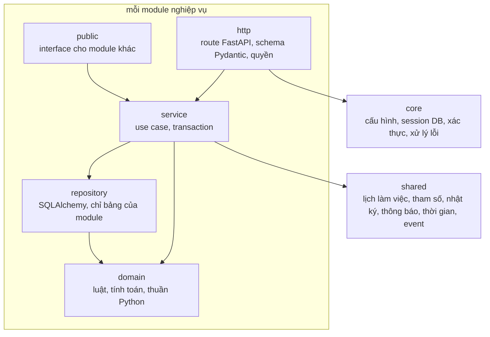
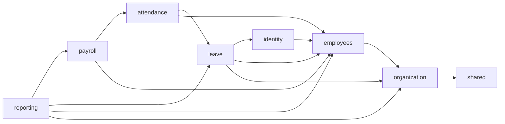

# Components

- **Status:** Draft
- **Updated:** 2026-10-30
- **Reviewed:** [YYYY-MM-DD: review nguội; AI review; người ngoài nếu có]
- **Related:** [ARCHITECTURE](../../ARCHITECTURE.md) · [SPEC](../build/SPEC.md) · [design guide](../playbook/design.md) ·
  ADR-0001, ADR-0002

> C4 Level 3 của container `api`, cùng phần frontend và cấu hình. Danh sách module kèm path nằm ở SPEC; file này ghi cấu
> trúc và quy tắc. Quy tắc cách viết code nằm ở [conventions](../build/conventions/README.md).

## api: structure

- **Organization:** theo module nghiệp vụ của ADR-0001; mỗi module có năm phần `http`, `service`, `domain`,
  `repository`, `public`. `core` và `shared` không phải module nghiệp vụ.
- **Dependency rule:**
  - `domain` không import FastAPI, SQLAlchemy, hay module khác; chỉ dùng thư viện chuẩn, `Decimal` và kiểu của chính
    nó. Nhờ vậy luật và công thức lương test được bằng bảng số liệu, không cần DB (QA-002).
  - `http` chỉ gọi `service` của chính module; không gọi `repository`.
  - `repository` chỉ đọc ghi bảng của chính module. Không module nào đọc bảng của module khác.
  - Module chỉ dùng `public` của module khác, và chỉ theo chiều mũi tên ở sơ đồ thứ hai: module ở bên trái được dùng
    module ở bên phải.
  - Module dưới cần biết điều gì đó của module trên thì khai báo một port (Protocol) trong `public` của mình; module trên
    cài đặt port đó, và `core` nối chúng khi khởi động. Việc phải xảy ra ở module trên sau một thay đổi ở module dưới thì
    đi qua event đồng bộ của `shared`, chạy trong cùng transaction.
  - `shared` và `core` không import module nghiệp vụ.
- **Checked by:** `import-linter` trong `make check`, với một contract cho mỗi quy tắc trên. Công cụ thêm ở Issue #14,
  sau khi chủ dự án đồng ý thêm thư viện dev.

| Component | Responsibility | Depends on | Enforces |
|---|---|---|---|
| core | Đọc cấu hình; session DB theo request; giải mã JWT, tải tài khoản, kiểm `token_version`; dependency kiểm quyền; đổi lỗi domain và lỗi constraint sang RFC 9457; log request | shared | ADR-0004; QA-003 |
| shared | Ngày hôm nay theo `Asia/Ho_Chi_Minh`; lịch làm việc và ngày làm việc (BR-038); `app_settings`, `legal_parameters` theo ngày (BR-123); ghi nhật ký trong transaction (BR-030); thông báo; event đồng bộ; lần chạy job | — | BR-030, BR-031, BR-038, BR-039, BR-123 |
| organization | Phòng ban có lịch sử, trưởng phòng ban, chức danh; cây tại ngày D; quản lý trực tiếp và phạm vi quản lý | shared. Port `EmploymentChecker` do employees cài đặt | BR-007 tới BR-014, BR-034, BR-035 |
| employees | Hồ sơ, khoảng làm việc, quá trình công tác, hợp đồng, tiếp nhận, nghỉ việc, tuyển lại. Phát event `EmployeeTerminated`, `EmployeeRehired` | organization, shared. Port `HrGuard` do identity cài đặt | BR-015 tới BR-029, BR-033, BR-037, BR-139 tới BR-141 |
| identity | Tài khoản, mật khẩu, khóa tạm, refresh token, vai trò HR; cài đặt `HrGuard`; nhận `EmployeeTerminated` để khóa tài khoản | employees, organization, shared | BR-001 tới BR-006, BR-036 |
| leave | Loại nghỉ, sổ phép, đơn nghỉ, người duyệt, cộng phép và phép tồn; nhận `EmployeeTerminated` để hủy đơn sau ngày nghỉ việc | identity, employees, organization, shared. Port `PeriodLock` do attendance cài đặt; trong MVP là bản luôn mở | BR-040 tới BR-067 |
| attendance | M3: ca, gán ca, mã chấm công, nhập file, tính công, giải trình, làm thêm, kỳ công; cài đặt `PeriodLock` | leave, employees, organization, shared. Port `PayrollLock` do payroll cài đặt | BR-068 tới BR-092 |
| payroll | M4: phụ cấp, bản ghi lương, người phụ thuộc, tham số lương, tính và chốt bảng lương; cài đặt `PayrollLock`. Công thức lương nằm trong `domain`, nhận đầu vào đã đọc sẵn | attendance, leave, employees, shared | BR-093 tới BR-126 |
| reporting | M5: chỉ đọc; tổng hợp qua `public` của các module khác; xuất XLSX | mọi module khác, shared | BR-127 tới BR-138 |
| jobs | Lệnh CLI cho actor Thời gian; mỗi lệnh gọi `public` của một module | Module có job | EC-038 |

Luật trải nhiều aggregate được giữ bằng DB hay khóa nằm ở mục Consistency của [data](data.md#consistency); luật còn lại
kiểm ở `domain` hoặc `service` của module ghi trong cột Enforces.

## Frontend

Người dùng thấy gì nằm ở [UI flow](../analysis/ui-flow.md); mục này ghi cách xây.

- **Code layout:**
  - `routes/` là một file cho mỗi màn hình `SCR-xxx`, theo React Router (ADR-0006).
  - `features/<module>/` chứa component và hook theo cùng tên module của backend.
  - `components/` là component dùng chung theo [UI design](ui.md).
  - `api/` là client sinh từ contract.
- **Types:** sinh từ `contracts/openapi.yaml` bằng `openapi-typescript`; không viết tay kiểu của dữ liệu API. Sinh lại
  là một bước của `make check`, nên contract đổi mà frontend chưa sửa thì build lỗi.
- **Server state:** TanStack Query với `openapi-fetch` (ADR-0006). Dữ liệu được cache và tải lại theo key của
  operation; sau một thao tác ghi, chỉ tải lại các key bị ảnh hưởng.
- **Quyền ở giao diện:** ẩn menu và nút theo `roles` của `GET /me` để dễ dùng; không coi đó là kiểm quyền (BR-006).
- **UI rules:** design system, trạng thái màn hình và accessibility theo [UI design](ui.md).

| Data | Source | Load and update | States | Recovery |
|---|---|---|---|---|
| Người dùng hiện tại | `GET /me` | Tải khi mở app; tải lại sau khi đổi mật khẩu | loading, error | Lỗi `401` thì về SCR-001 |
| Danh sách nhân viên | `GET /employees` | Tải theo bộ lọc và trang; bộ lọc nằm trong URL | loading, empty, error | Nút thử lại; giữ trang đã tải |
| Số dư phép và đơn của mình | `GET /me/leave/balance`, `GET /leave-requests?scope=mine` | Tải khi mở SCR-019; tải lại sau khi gửi hoặc hủy đơn | loading, empty, error | Nút thử lại |
| Bản tính trước của đơn nghỉ | `POST /leave-requests/preview` | Gọi khi đổi ngày hoặc buổi, chờ 300 ms sau lần gõ cuối | loading, error | Hiện lỗi luật ngay dưới trường liên quan |
| Đơn chờ duyệt | `GET /leave-requests?scope=to-approve` | Tải khi mở SCR-021; tải lại sau mỗi lần duyệt, từ chối | loading, empty, error | Lỗi `409` thì tải lại đơn và báo lý do |
| Thông báo | `GET /notifications?unreadOnly=true` | Tải khi mở app và mỗi 60 giây khi tab đang mở | — | Lỗi thì giữ số cũ, thử lại lần sau |
| Báo cáo | `GET /reports/...` | Tải theo bộ lọc; bộ lọc nằm trong URL | loading, empty, error | Nút thử lại |

## Configuration

| Key | Meaning | Source | Used by |
|---|---|---|---|
| `APP_ENV` | `local`, `staging` hoặc `production`; script dữ liệu giả từ chối chạy khi là `production` | Biến môi trường | core, sample data |
| `DATABASE_URL` | Kết nối PostgreSQL của app, dùng role không có quyền sửa bảng nhật ký và sổ phép | Biến môi trường, secret | core |
| `MIGRATION_DATABASE_URL` | Kết nối dùng để chạy migration, có quyền tạo bảng | Biến môi trường, secret | Alembic |
| `JWT_SIGNING_KEY` | Khóa ký access token, khác nhau giữa các môi trường | Biến môi trường, secret | core |
| `PUBLIC_ORIGIN` | Domain của hệ thống, để kiểm header `Origin` | Biến môi trường | core |
| Tham số trong mục Parameters của [domain](../analysis/domain.md#parameters), không phải tham số lương | Ví dụ `max_failed_logins`, `carryover_max_days`, `report_min_group_size`, `login_rate_limit_per_ip` | Bảng `app_settings`, seed theo giá trị trong domain | Module ghi ở cột Used by của domain |
| Tham số lương | Ví dụ `pit_brackets`, `regional_min_wage` | Bảng `legal_parameters` có `valid_from` (BR-123) | payroll |
