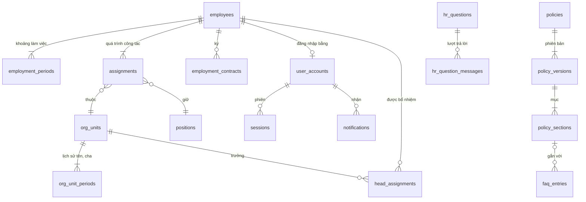
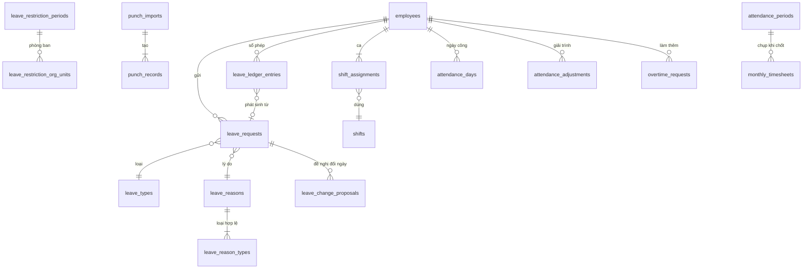
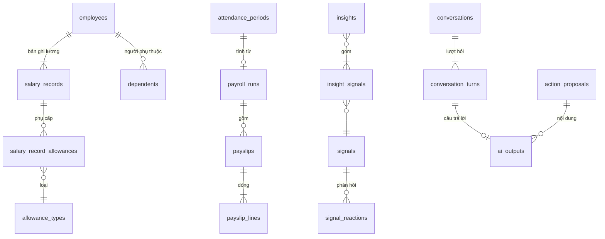

# Data design

- **Status:** Draft
- **Updated:** 2026-11-03
- **Reviewed:** [YYYY-MM-DD: review nguội; AI review; người ngoài nếu có]
- **Related:** [domain](../analysis/domain.md) · [ARCHITECTURE](../../ARCHITECTURE.md) · [schema](schema.dbml) ·
  [design guide](../playbook/design.md)

> File này ghi cách lưu dữ liệu và luật nào được giữ ở tầng dữ liệu. Entity và luật nằm ở domain. Bảng và cột nằm ở
> [schema.dbml](schema.dbml) cho tới khi có migration đầu tiên; từ đó migration là nguồn chính và PR đổi schema sửa cả
> hai. Đang làm ở #9, trước khi duyệt prototype (#61).

## Storage

| Store | Holds | Tech | ADR |
|---|---|---|---|
| db | Mọi dữ liệu nghiệp vụ, phiên đăng nhập, hàng đợi job, chỉ mục tìm kiếm quy chế | PostgreSQL managed, extension `btree_gist` cho exclusion constraint | ADR-0009 |

Không có kho file. File chấm công được đọc trong request rồi bỏ; file xuất ra được tạo khi tải về (BR-136).

## Conventions

| Topic | Convention |
|---|---|
| Tên bảng, tên cột | `snake_case`, tiếng Anh; tên bảng số nhiều, ví dụ `leave_requests` |
| Khóa chính | `id uuid`. Bảng chỉ ghi thêm và nhiều dòng (`audit_entries`, `punch_records`, `jobs`) dùng `bigint identity`. Bảng theo ngày dùng khóa tự nhiên, ví dụ `attendance_days (employee_id, work_date)` |
| Khóa ngoại | `<bảng số ít>_id`, ví dụ `employee_id`. Người thao tác là `*_by_account_id`, trỏ tới `user_accounts` |
| Thời điểm | `timestamptz`, lưu UTC. Mọi bảng có `created_at`, `updated_at` |
| Ngày nghiệp vụ | `date` theo giờ Việt Nam, như ngày nghỉ, ngày hiệu lực, ngày công. Không đổi múi giờ khi đọc |
| Khoảng hiệu lực | `daterange` nửa mở `[from, to)`; cận trên trống là còn hiệu lực. Không chồng thì dùng exclusion constraint |
| Tiền | `numeric(15,0)`, đơn vị đồng; tính bằng `Decimal`, làm tròn theo BR-114 trước khi lưu |
| Số ngày phép | `numeric(8,4)` trong sổ phép để giữ phần lẻ của 1/12; số ngày của đơn `numeric(5,1)` vì đơn vị nhỏ nhất là nửa ngày |
| Tập giá trị cố định | Cột `text` kèm `CHECK (... IN (...))`; giá trị viết theo mã trạng thái trong domain, như `pending`, `awaiting` |
| Danh mục người dùng thêm được | Bảng riêng, như `leave_types`, `allowance_types`, `positions`; ngừng dùng bằng `is_active`, không xóa dòng đã được dùng |
| Xóa dữ liệu | Không xóa mềm. Bảng có vòng đời dùng cột `status`. Xóa thật chỉ ở phiên hết hạn, hội thoại AI quá hạn và các trường liên hệ theo BR-140 |
| Dữ liệu chỉ ghi thêm | `leave_ledger_entries`, `audit_entries`, `hr_question_messages`: user của ứng dụng không có quyền `UPDATE`, `DELETE` trên các bảng này |

## Model

Sơ đồ chỉ có bảng và quan hệ chính; cột đủ ở [schema.dbml](schema.dbml).

**M1: tổ chức, nhân sự, tài khoản**

**M2 và M3: nghỉ phép, chấm công**

**M4, M5 và M6: lương, báo cáo, AI**

- **Schema:** [schema.dbml](schema.dbml), 54 bảng. Migration đầu tiên viết ở #14 khi cấu hình dự án.
- **From domain:**

  | Domain | Lưu ở | Ghi chú |
  |---|---|---|
  | Value object `EmploymentPeriod`, `OrgUnitPeriod` | Bảng riêng có `daterange` | Cần exclusion constraint và truy vấn theo ngày, nên không gộp vào cột JSON |
  | Value object `PolicySection`, `HrQuestionMessage`, `SalaryAllowance`, `ChangeProposal`, `CalendarDay` | Bảng con | Cần thứ tự, tìm kiếm hoặc lịch sử |
  | `DateRange` | Kiểu `daterange` | — |
  | `WorkCalendar` | `work_calendar_days` | Một lịch cho cả công ty nên không có bảng cha |
  | Danh sách bậc thuế của `PayrollParameter` | `payroll_parameters.value` dạng JSON | Đọc nguyên bộ theo ngày hiệu lực, không truy vấn từng bậc |
  | `Conversation` | `conversations` và `conversation_turns` | Lượt hỏi cần thứ tự và nối với `ai_outputs` |
  | Các loại tín hiệu tắt ở `UserAccount` (M5) | `user_accounts.muted_signal_types` | Danh sách ngắn, chỉ đọc theo người dùng |
  | Tham số ở mục Parameters | `parameters`; tham số lương ở `payroll_parameters` vì có ngày hiệu lực | — |
  | Phiên đăng nhập, hàng đợi job | `sessions`, `jobs` | Không có trong domain; thêm theo ADR-0010, ADR-0009 |

## Rules enforced in data

Luật còn lại giữ ở domain, ghi trong [components](components.md) khi làm #11. Tên migration điền khi có migration.

| Rule | Mechanism | Where |
|---|---|---|
| BR-015 mã nhân viên không trùng | `UNIQUE (employee_code)` | `employees` |
| BR-022 số CCCD không trùng | Unique index trên `national_id` khi `status <> 'anonymized'` | `employees` |
| BR-139 khoảng làm việc không chồng | `EXCLUDE (employee_id WITH =, period WITH &&)` | `employment_periods` |
| BR-016 quá trình công tác không chồng | `EXCLUDE (employee_id WITH =, valid WITH &&)`. Phần không hở kiểm ở domain | `assignments` |
| BR-011 mỗi phòng ban tối đa một trưởng mỗi ngày | `EXCLUDE (org_unit_id WITH =, valid WITH &&)` | `head_assignments` |
| Lịch sử phòng ban không chồng | `EXCLUDE (org_unit_id WITH =, valid WITH &&)` | `org_unit_periods` |
| BR-025 hợp đồng không chồng | `EXCLUDE (employee_id WITH =, valid WITH &&)` | `employment_contracts` |
| BR-037 số hợp đồng không trùng | `UNIQUE (contract_no)` | `employment_contracts` |
| BR-034 tên chức danh không trùng | Unique index trên `lower(name)` | `positions` |
| BR-045 đơn nghỉ không chồng buổi | `EXCLUDE (employee_id WITH =, half_slots WITH &&) WHERE status IN ('pending','awaiting','approved')`; `half_slots` là cột sinh đánh số buổi | `leave_requests` |
| BR-041 đúng một loại Phép năm | Unique index trên `is_annual_leave` khi `true`; đủ một loại kiểm bằng seed và domain | `leave_types` |
| BR-054 sổ phép không sửa, không xóa | Không cấp `UPDATE`, `DELETE` cho user của ứng dụng | `leave_ledger_entries` |
| EC-038 mỗi tháng cộng phép một lần | Unique index `(employee_id, accrual_month)` khi `kind = 'accrual'` | `leave_ledger_entries` |
| BR-073 lượt chấm không trùng | `UNIQUE (timeclock_code, punched_at)`; nhập file dùng `ON CONFLICT DO NOTHING` và đếm dòng trùng | `punch_records` |
| BR-072 mã chấm công không trùng giữa người đang làm | Unique index trên `timeclock_code` khi `status IN ('upcoming','active')` | `employees` |
| BR-070 mỗi ngày đúng một ca | `EXCLUDE (employee_id WITH =, valid WITH &&)`. Phần không hở kiểm ở domain | `shift_assignments` |
| BR-093 bản ghi lương không chồng | `EXCLUDE (employee_id WITH =, valid WITH &&)`. Phần không hở kiểm ở domain | `salary_records` |
| Mỗi tham số không có hai giá trị cùng ngày hiệu lực | `UNIQUE (key, valid_from)` | `payroll_parameters` |
| Một bảng lương mỗi tháng | `UNIQUE (month)` | `payroll_runs` |
| EC-072 hai thao tác chốt cùng lúc | `UPDATE payroll_runs SET status = 'closed' ... WHERE id = $1 AND status = 'draft'`; 0 dòng đổi thì báo đã chốt | `payroll_runs` |
| BR-192 phiên bản quy chế đã đăng không sửa | Trigger chặn `UPDATE` khi `status = 'published'`; unique `(policy_id, effective_on)` khi published | `policy_versions`, `policy_sections` |
| BR-172 tối đa một tín hiệu Đang có mỗi loại, phòng ban, kỳ | Unique index trên `(signal_type, coalesce(org_unit_id, ...), period_key)` khi `status = 'active'` | `signals` |
| Ngày kết thúc không trước ngày bắt đầu | Kiểu `daterange` tự từ chối; với cặp cột dùng `CHECK`, ví dụ `starts_at < ends_at` | `overtime_requests`, `dependents` |
| Mỗi trạng thái nằm trong vòng đời | `CHECK (status IN (...))` theo mục Lifecycles của domain | Mọi bảng có `status` |

## Access patterns

Truy vấn chính lấy từ story; quy mô 300 nhân viên, dữ liệu 12 tháng (QA-004).

| Query | Story | Index | Expected volume |
|---|---|---|---|
| Quá trình công tác và phòng ban của một người tại một ngày | US-018, BR-013 | GiST của exclusion constraint trên `(employee_id, valid)` | 1 dòng |
| Nhân viên trong phạm vi một quản lý tại hôm nay: cây phòng ban con rồi quá trình công tác | US-018 | GiST trên `org_unit_periods (parent_id, valid)`, `assignments (org_unit_id, valid)` | Tới 300 dòng |
| Đơn chờ mình duyệt | US-025 | `leave_requests (approver_id, status)`, `(delegate_approver_id, status)` | Vài chục dòng |
| Số dư phép của một người | US-022 | `leave_ledger_entries (employee_id, leave_year)` | Khoảng 20 dòng mỗi năm |
| Mức phủ của một phòng ban trong một buổi | US-075 | GiST của exclusion constraint trên `leave_requests`; `assignments (org_unit_id, valid)` | Tới vài chục dòng |
| Bảng công tháng của một người hoặc một nhóm | US-041, US-046 | Khóa chính `attendance_days (employee_id, work_date)` | 300 × 23 dòng cho cả công ty |
| Nhập file chấm công | US-039 | Unique `(timeclock_code, punched_at)` | Khoảng 20.000 dòng mỗi tháng |
| Phiếu lương của một tháng | US-055 | Unique `payslips (payroll_run_id, employee_id)` | 300 phiếu, mỗi phiếu khoảng 20 dòng |
| Thông báo chưa đọc của một người | US-034 | `notifications (recipient_account_id, read_at, sent_at DESC)` | Vài chục dòng |
| Tìm quy chế theo từ khóa | US-102 | GIN trên `policy_sections.search` | Vài trăm mục |
| Lấy job tiếp theo | — | `jobs (status, run_at)` | Vài trăm dòng mỗi ngày |

## Consistency

- **Transactions:** một thao tác nghiệp vụ là một transaction, gồm cả dòng nhật ký `audit_entries` và thông báo tạo
  ra. Thao tác đi qua nhiều aggregate trong cùng module monolith vẫn là một transaction, ví dụ duyệt đơn nghỉ ghi
  `leave_requests`, `leave_ledger_entries` và `notifications` (ADR-0007).
- **Concurrency:**
  - Số dư phép và giới hạn làm thêm (QA-001, EC-024, BR-084): thao tác gửi, duyệt, đổi đơn nghỉ hay đơn làm thêm của
    một người bắt đầu bằng `SELECT ... FROM employees WHERE id = $1 FOR UPDATE`, rồi mới đọc số dư và ghi. Hai thao
    tác cùng người chạy lần lượt; khác người không chặn nhau.
  - Chốt bảng lương và chốt bảng công: cập nhật có điều kiện trạng thái, như ở EC-072.
  - Sửa cùng một hồ sơ: cột `updated_at` làm version; client gửi kèm, lệch thì báo dữ liệu đã đổi và tải lại.
- **Idempotency:**
  - Job theo lịch có `dedupe_key`, ví dụ `accrual:2026-10`; unique index chặn xếp trùng, và unique của sổ phép chặn cộng
    hai lần (EC-038).
  - Nhập lại cùng file chấm công không thêm lượt nào nhờ `UNIQUE (timeclock_code, punched_at)`.
  - Gửi form hai lần: client gửi kèm `Idempotency-Key`, cách lưu ghi ở [api](api.md) khi làm #10.

## Migrations

- **Tool:** chưa chọn; chọn khi cấu hình dự án ở #14, theo stack ở ADR-0008.
- **Rules:** một migration mỗi PR có đổi schema; không sửa migration đã chạy trên staging hay production; đổi không
  tương thích thì theo ba bước: thêm, chuyển dữ liệu, bỏ.
- **Fresh database:** mọi migration chạy được trên DB trống; CI hoặc `make check` kiểm điều này.
- **Seed data:** dữ liệu bắt buộc để hệ thống chạy, chạy ở mọi môi trường: tham số mặc định ở mục Parameters, loại
  nghỉ, lý do nghỉ, loại phụ cấp và loại tín hiệu mặc định của domain, phòng ban gốc, tài khoản HR đầu tiên với mật khẩu
  phải đổi. Nơi lưu chọn cùng công cụ migration.
- **Sample data:** chuyển từ [prototype-data](prototype-data.md) cho local, staging và demo; không bao giờ chạy trên
  production.

## Retention and backup

| Data | Retention | Backup | Restore tested |
|---|---|---|---|
| Thông tin liên hệ và tài khoản ngân hàng của người đã nghỉ việc | Xóa trường sau `contact_retention_months` tháng khi HR xác nhận (BR-140) | Theo db | — |
| Hồ sơ, hợp đồng, đơn, công, lương, nhật ký | Ẩn danh sau `retention_years` năm (BR-141); số tổng hợp giữ lại | Theo db | — |
| Hội thoại với AI HR Assistant | Xóa sau `assistant_retention_days` ngày bằng job hằng ngày | Theo db | — |
| Phiên đăng nhập | Xóa khi hết hạn hoặc khi tài khoản bị khóa | Không cần | — |
| db | — | Theo gói managed của hosting, tối thiểu hằng ngày để đạt QA-005; chốt ở ADR-0011 | [YYYY-MM-DD] |

Bản backup vẫn chứa dữ liệu đã xóa cho tới khi hết hạn giữ backup. Thời hạn giữ backup ghi ở runbook khi chọn hosting.
