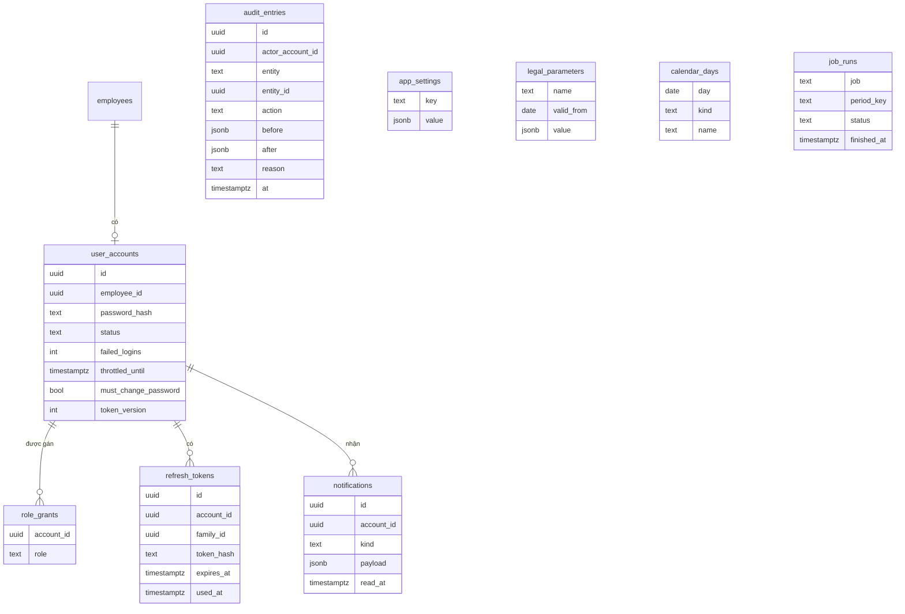
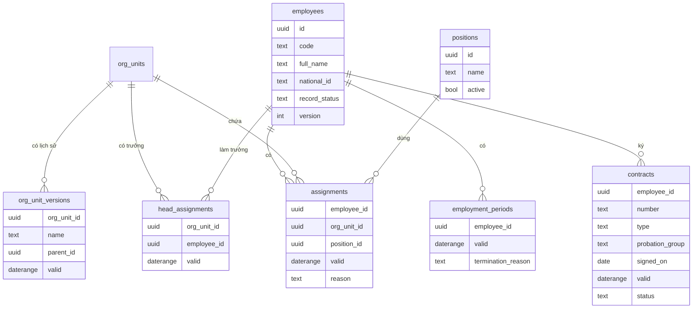
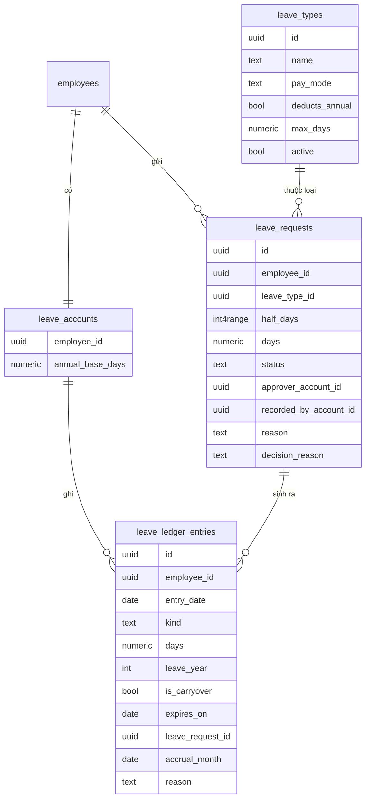
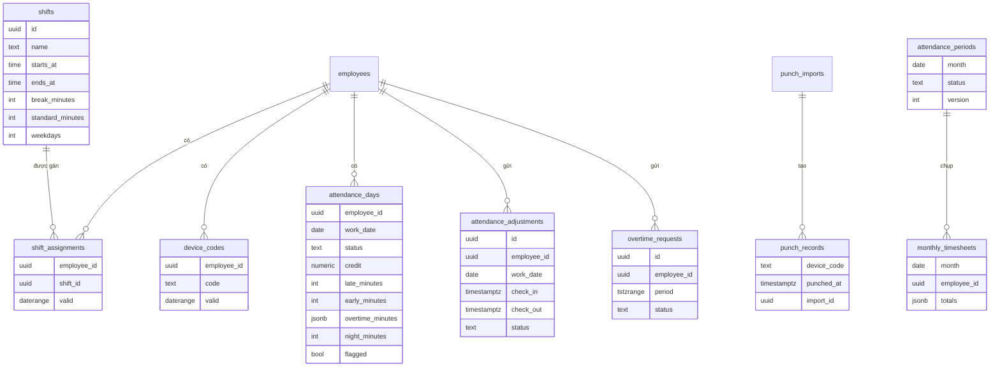
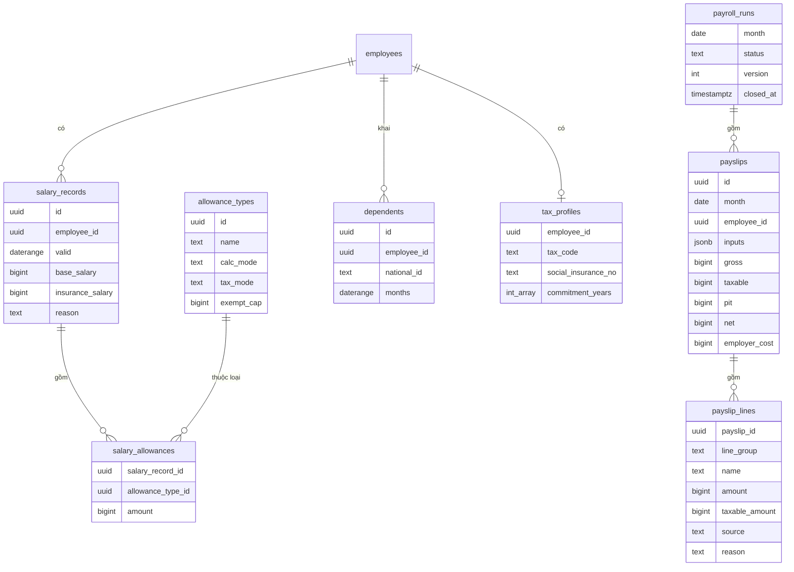

# Data design

- **Status:** Draft
- **Updated:** 2026-10-30
- **Reviewed:** [YYYY-MM-DD: review nguội; AI review; người ngoài nếu có]
- **Related:** [domain](../analysis/domain.md) · [ARCHITECTURE](../../ARCHITECTURE.md) · [design guide](../playbook/design.md) ·
  ADR-0003

> File này ghi cách lưu dữ liệu và luật nào được giữ ở tầng dữ liệu. Entity và luật nằm ở domain; schema thật nằm trong
> migration. Sơ đồ chỉ ghi cột chính; tên đầy đủ của cột xem trong migration.

## Storage

| Store | Holds | Tech | ADR |
|---|---|---|---|
| db | Mọi dữ liệu nghiệp vụ, nhật ký thao tác, refresh token, thông báo, lần chạy job | PostgreSQL 16 trở lên, extension `btree_gist`, `pg_trgm`, `unaccent` | ADR-0003 |

## Conventions

| Topic | Convention |
|---|---|
| Tên bảng, tên cột | `snake_case`; tên bảng số nhiều, ví dụ `leave_requests` |
| Khóa chính | `id` kiểu `uuid`, giá trị UUID v7 sinh ở app. Bảng có khóa tự nhiên dùng khóa đó, ví dụ `attendance_periods.month` |
| Khóa ngoại | `<bảng số ít>_id`, ví dụ `employee_id`; luôn có index |
| Thời điểm | `created_at`, `updated_at` kiểu `timestamptz`, lưu theo UTC |
| Ngày nghiệp vụ | Kiểu `date`, hiểu theo giờ Việt Nam. Tháng lưu là `date` ngày 1 của tháng, ví dụ `2026-05-01` |
| Khoảng hiệu lực | Cột `valid` kiểu `daterange` dạng `[from, to)`; đầu trên để trống nghĩa là chưa kết thúc. Domain ghi khoảng gồm cả hai đầu, nên app đổi ngày kết thúc D thành đầu trên D+1 |
| Tiền | `bigint` theo đồng. Tính toán dùng `Decimal` trong app (ADR-0002) |
| Số ngày nghỉ | `numeric(5,1)`, bước 0,5 ngày |
| Thời lượng | `integer` theo phút: đi muộn, về sớm, làm thêm, giờ làm chuẩn |
| Tập giá trị cố định | Cột `text` kèm `CHECK (status IN (...))`. Không dùng enum của Postgres, để thêm giá trị không cần đổi kiểu |
| Sửa đồng thời | Bảng được sửa qua form có cột `version integer`; cập nhật kèm `WHERE version = :v` để chặn ghi đè ngầm (EC-016) |
| Xóa dữ liệu | Không xóa mềm. Bản ghi nghiệp vụ đổi trạng thái thay vì bị xóa. Xóa cứng chỉ dùng cho dữ liệu hết hạn lưu (BR-140, BR-141) và refresh token hết hạn |

## Model

Sơ đồ chia theo module của ADR-0001. Mỗi bảng có `valid` là một dòng của khoảng hiệu lực: ghi thay đổi từ ngày D thì
cắt dòng đang chứa D ở đầu trên D và thêm dòng mới bắt đầu từ D, trong cùng một transaction.

**identity và shared**

**organization và employees**

**leave**

**attendance**

**payroll**

- **Schema:** migration Alembic trong thư mục backend; đường dẫn chốt ở SPEC (Issue #13). Migration đầu tiên gồm bảng
  của MVP: identity, shared, organization, employees, leave. Bảng của M3, M4 thêm bằng migration khi làm milestone đó.
- **From domain:**
  - **Theo khoảng hiệu lực:** OrgUnitPeriod thành `org_unit_versions`; Assignment, HeadAssignment, EmploymentContract,
    EmploymentPeriod, ShiftAssignment, SalaryRecord mỗi entity một bảng có `valid`. Mã chấm công tách ra
    `device_codes` có `valid`, để chặn trùng mã giữa những người cùng làm trong một khoảng thời gian (BR-072).
    Dependent dùng `months`, khoảng theo ngày đầu tháng.
  - **Tham số luật:** PayrollParameter thành `legal_parameters`. Giá trị tại ngày D là dòng có `valid_from` lớn nhất
    không quá D. Tham số không đổi theo thời gian nằm ở `app_settings`.
  - **Vai trò:** chỉ vai trò HR được lưu, ở `role_grants`. Nhân viên và Quản lý suy ra khi đọc (BR-006).
  - **Trạng thái suy ra khi đọc:** trạng thái Sắp vào làm, Đang làm, Đã nghỉ việc tính từ `employment_periods` và ngày
    hôm nay. `record_status` chỉ lưu ba giá trị không suy ra được: `normal`, `cancelled`, `anonymized`.
  - **Buổi nghỉ:** khoảng nghỉ lưu thành `half_days` kiểu `int4range`, mỗi buổi một số nguyên: số ngày kể từ một mốc
    nhân 2, buổi chiều cộng 1. Nhờ đó chặn chồng buổi được bằng exclusion constraint.
  - **Bản chụp:** MonthlyTimesheet và Payslip lưu bản chụp đầu vào trong `jsonb`, vì không truy vấn bên trong và không
    được đổi sau khi chốt.
  - **Khoản điều chỉnh:** PayAdjustment là dòng `payslip_lines` có `source = 'manual'`. Tính lại chỉ xóa và tạo lại
    dòng có `source = 'system'` (BR-116).
  - **Không lưu:** báo cáo của M5 tính khi đọc, không có bảng riêng (BR-138). Trạng thái AttendanceDay được tính lại
    khi dữ liệu nguồn đổi và lưu lại để đọc nhanh (QA-004).

## Rules enforced in data

Luật không có ở đây được giữ ở domain, ghi trong [components](components.md).

| Rule | Mechanism | Where |
|---|---|---|
| BR-007 tại mỗi ngày tối đa một phòng ban gốc | Exclusion `(valid WITH &&)` trên `org_unit_versions` với `parent_id IS NULL`. Phần "ít nhất một" kiểm ở domain | Migration đầu tiên |
| Lịch sử một phòng ban không chồng khoảng | Exclusion `(org_unit_id WITH =, valid WITH &&)` trên `org_unit_versions` | Migration đầu tiên |
| BR-011 mỗi phòng ban tối đa một trưởng mỗi ngày | Exclusion constraint `(org_unit_id WITH =, valid WITH &&)` trên `head_assignments` | Migration đầu tiên |
| BR-015 mã nhân viên duy nhất, không dùng lại | `UNIQUE (code)` trên `employees`; không có thao tác xóa hồ sơ, kể cả khi ẩn danh | Migration đầu tiên |
| BR-016 quá trình công tác không chồng | Exclusion `(employee_id WITH =, valid WITH &&)` trên `assignments`. Phần "không hở" kiểm ở domain | Migration đầu tiên |
| BR-022 CCCD không trùng | Unique index một phần trên `national_id` với `record_status = 'normal'` | Migration đầu tiên |
| BR-025 hợp đồng không chồng | Exclusion `(employee_id WITH =, valid WITH &&)` trên `contracts` | Migration đầu tiên |
| BR-037 số hợp đồng không trùng | `UNIQUE (number)` trên `contracts` | Migration đầu tiên |
| BR-139 khoảng làm việc không chồng | Exclusion `(employee_id WITH =, valid WITH &&)` trên `employment_periods` | Migration đầu tiên |
| BR-001 mỗi nhân viên tối đa một tài khoản | `UNIQUE (employee_id)` trên `user_accounts` | Migration đầu tiên |
| BR-031, BR-054 nhật ký và sổ phép không sửa, không xóa | Role DB của app chỉ có `INSERT`, `SELECT` trên `audit_entries` và `leave_ledger_entries` | Migration đầu tiên |
| BR-045 đơn nghỉ không chồng buổi | Exclusion `(employee_id WITH =, half_days WITH &&)` trên `leave_requests` với `status IN ('pending','approved')` | Migration đầu tiên |
| EC-038 mỗi tháng chỉ cộng phép một lần | Unique index một phần `(employee_id, accrual_month)` trên `leave_ledger_entries` với `kind = 'accrual'` | Migration đầu tiên |
| BR-034, BR-040, BR-068, BR-097 tên danh mục không trùng | Unique index trên `lower(name)` | Migration của từng module |
| BR-070 mỗi ngày đúng một ca | Exclusion trên `shift_assignments`; phần "không hở" kiểm ở domain | Migration của M3 |
| BR-072 mã chấm công không trùng | Exclusion `(code WITH =, valid WITH &&)` trên `device_codes` | Migration của M3 |
| BR-073 lượt chấm không trùng | `UNIQUE (device_code, punched_at)` trên `punch_records`; nhập dùng `ON CONFLICT DO NOTHING` | Migration của M3 |
| BR-086 đơn làm thêm không chồng | Exclusion `(employee_id WITH =, period WITH &&)` trên `overtime_requests` với `status IN ('pending','approved')` | Migration của M3 |
| BR-093 bản ghi lương không chồng | Exclusion trên `salary_records`; phần "không hở" kiểm ở domain | Migration của M4 |
| BR-099 người phụ thuộc không tính cho hai người cùng tháng | Exclusion `(national_id WITH =, months WITH &&)` trên `dependents`, áp dụng cho mọi nhân viên | Migration của M4 |
| BR-102 mỗi tháng một bảng lương | Khóa chính `month` trên `payroll_runs`; `UNIQUE (month, employee_id)` trên `payslips` | Migration của M4 |
| Khoảng hiệu lực hợp lệ | `CHECK (NOT isempty(valid) AND lower(valid) IS NOT NULL)` trên mọi bảng có `valid` | Mọi migration |
| Tiền và số ngày không âm khi luật yêu cầu | `CHECK (base_salary > 0)`, `CHECK (days > 0)` trên đơn nghỉ; sổ phép cho phép số âm vì là biến động | Migration tương ứng |

## Access patterns

| Query | Story | Index | Expected volume |
|---|---|---|---|
| Đăng nhập theo mã nhân viên | US-001 | `UNIQUE` trên `employees.code` | 1 dòng |
| Kiểm tài khoản và `token_version` ở mỗi request | ADR-0004 | Khóa chính `user_accounts` | 1 dòng, mỗi request |
| Phòng ban, trưởng và quá trình công tác tại ngày D | US-009, US-010, BR-012, BR-013 | GiST của các exclusion constraint trên `valid` | Tối đa khoảng 30 phòng ban, 300 nhân viên |
| Phạm vi của Quản lý: cây con của các phòng ban người đó làm trưởng tại hôm nay | Mọi story của Quản lý | Truy vấn đệ quy trên `org_unit_versions`; GiST trên `(employee_id, valid)` của `head_assignments` | 5 cấp, khoảng 30 nút |
| Tìm nhân viên theo tên không dấu, lọc phòng ban và trạng thái | US-020, EC-019 | GIN `pg_trgm` trên `unaccent(lower(full_name))` | 300 dòng, phân trang 50 |
| Số dư phép của một nhân viên | US-022, BR-054 | `(employee_id, leave_year)` trên `leave_ledger_entries` | Khoảng 30 dòng mỗi năm |
| Đơn chờ một người duyệt | US-025, SCR-021 | `(approver_account_id, status)` trên `leave_requests`, `overtime_requests`, `attendance_adjustments` | Vài chục dòng |
| Lịch nghỉ của nhóm trong một khoảng ngày | US-027 | GiST của exclusion trên `half_days` | Vài trăm dòng |
| Ngày công của một tháng theo nhân viên hoặc phòng ban | US-041, US-046 | Khóa chính `(employee_id, work_date)` trên `attendance_days` | 300 × 31 dòng |
| Lượt chấm của một mã trong một ngày | US-040 | `UNIQUE (device_code, punched_at)` | Vài dòng |
| Phiếu lương của một tháng | US-055, US-061 | `UNIQUE (month, employee_id)` trên `payslips`; `payslip_id` trên `payslip_lines` | 300 phiếu, khoảng 6.000 dòng |
| Giá trị tham số luật tại ngày D | BR-123 | Khóa chính `(name, valid_from)` trên `legal_parameters` | Vài dòng mỗi tham số |
| Biến động nhân sự trong một kỳ | US-065 | GiST trên `valid` của `employment_periods` và `assignments` | 300 nhân viên |

## Consistency

- **Transactions:** mỗi thao tác của một use case là một transaction, gồm cả dòng nhật ký (BR-030). Job theo lịch xử lý
  từng nhân viên trong một transaction riêng, để một người lỗi không chặn cả lần chạy.
- **Concurrency:**

  | Contention | Mechanism | Rule |
  |---|---|---|
  | Gửi, duyệt, hủy đơn phép năm; HR điều chỉnh; cộng phép | `SELECT ... FOR UPDATE` dòng `leave_accounts` của nhân viên, rồi tính số dư từ `leave_ledger_entries` và kiểm trước khi ghi | BR-053, EC-024, QA-001 |
  | Gửi, duyệt đơn làm thêm | Cùng cách: khóa dòng `leave_accounts` của nhân viên trước khi cộng giờ làm thêm của tháng và năm | BR-084 |
  | Ghi dữ liệu vào một tháng, so với chốt kỳ công | Thao tác ghi khóa `FOR SHARE` dòng `attendance_periods` của tháng; chốt và mở lại khóa `FOR UPDATE` | BR-089, BR-090 |
  | Chốt bảng lương, so với tính lại | `UPDATE payroll_runs SET status = 'closed' WHERE month = :m AND status = 'draft' AND version = :v`; không có dòng nào được cập nhật thì báo lỗi. Tính lại tăng `version` | BR-117, EC-072 |
  | Mở lại bảng công, so với chốt bảng lương | Mở lại khóa `FOR UPDATE` dòng `attendance_periods`, rồi đọc `payroll_runs` của tháng với `FOR SHARE` | BR-091 |
  | Đổi cây phòng ban | `pg_advisory_xact_lock` một khóa chung cho cơ cấu tổ chức, rồi kiểm không có vòng | BR-008 |
  | HR sửa cùng một hồ sơ | Cột `version` | EC-016 |

- **Idempotency:** nhập lại cùng file chấm công không tạo lượt chấm trùng (BR-073). Job ghi `job_runs` theo khóa job và
  kỳ; cộng phép còn được chặn bằng unique index (EC-038). Refresh token chỉ dùng được một lần (ADR-0004).

## Migrations

- **Tool:** Alembic, viết tay từng migration, không dùng autogenerate cho constraint và extension.
- **Rules:**
  - Một PR có tối đa một migration.
  - Không sửa migration đã chạy trên staging hay production.
  - Khi có dữ liệu thật, đổi schema theo ba bước: thêm, chuyển dữ liệu, rồi mới bỏ.
  - Migration tạo role DB của app và cấp quyền theo bảng `Rules enforced in data`.
- **Fresh database:** mọi migration chạy được trên DB trống; `make check` và CI chạy `alembic upgrade head` trên
  PostgreSQL trống.
- **Seed data:** chạy ở mọi môi trường bằng lệnh seed của app, idempotent. Gồm:
  - loại nghỉ mặc định;
  - ca mặc định `default_shift`;
  - `app_settings` theo mục Parameters của domain;
  - giá trị ban đầu của `legal_parameters`;
  - phòng ban gốc.

  Tài khoản HR đầu tiên tạo bằng lệnh riêng, mật khẩu nhập lúc chạy, không nằm trong repo.
- **Sample data:** dữ liệu giả sinh bằng script cho local và staging, gồm 300 nhân viên, khoảng 30 phòng ban, 12 tháng
  đơn nghỉ. Không bao giờ chạy trên production; script từ chối chạy khi `APP_ENV=production`.

## Retention and backup

| Data | Retention | Backup | Restore tested |
|---|---|---|---|
| db, production | Theo mục Sensitive data của [domain](../analysis/domain.md#sensitive-data); xóa và ẩn danh theo BR-140, BR-141 | Point-in-time recovery của Render Postgres, 3 ngày; logical backup tải về hằng tuần, giữ 8 tuần (ADR-0005) | Chưa; diễn tập lần đầu trước khi công ty dùng thử |
| db, staging | Dữ liệu giả, có thể xóa bất cứ lúc nào | Point-in-time recovery 6 giờ của gói miễn phí Neon | Không cần |
| refresh_tokens | Xóa khi hết hạn quá 7 ngày | Như db | — |
