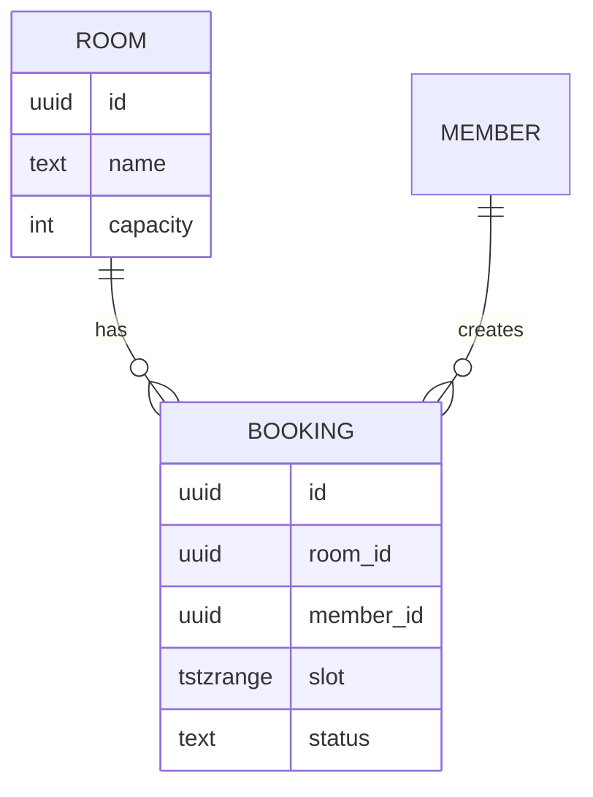

# Data design

- **Status:** [Draft | Accepted | Superseded]
- **Updated:** [YYYY-MM-DD]
- **Reviewed:** [YYYY-MM-DD: review nguội; AI review; người ngoài nếu có]
- **Related:** [domain](../analysis/domain.md) · [ARCHITECTURE](../../ARCHITECTURE.md) · [design guide](../playbook/design.md)

> Điền ở Phase 3 từ domain. File này ghi cách lưu dữ liệu và luật nào được giữ ở tầng dữ liệu. Entity và luật nằm ở
> domain; schema thật nằm trong migration, file này dẫn link thay vì chép từng cột. Dòng in nghiêng và sơ đồ mẫu là ví
> dụ, xóa khi điền.

## Storage

| Store | Holds | Tech | ADR |
|---|---|---|---|
| *db* | *Mọi dữ liệu nghiệp vụ và hàng đợi job* | *[Postgres]* | *ADR-0003* |

## Conventions

| Topic | Convention |
|---|---|
| *Tên bảng, tên cột* | *`snake_case`; tên bảng số nhiều, ví dụ `bookings`* |
| *Khóa chính* | *`id` kiểu [uuid / bigint identity]* |
| *Khóa ngoại* | *`<bảng số ít>_id`, ví dụ `room_id`* |
| *Thời gian* | *`created_at`, `updated_at` lưu theo UTC* |
| *Xóa dữ liệu* | *[xóa mềm bằng `deleted_at` / xóa cứng], áp dụng cho [bảng nào]; theo Retention bên dưới* |
| *Tập giá trị cố định* | *[enum của DB / CHECK constraint / bảng tham chiếu]* |

## Model

- **Schema:** [link tới migration hoặc file schema]
- **From domain:** [entity nào thành bảng nào; value object lưu thế nào; phần nào trong domain không lưu và vì sao]

## Rules enforced in data

Mỗi luật mà tầng dữ liệu giữ được ghi một dòng. Luật còn lại được giữ ở domain, ghi trong
[components](components.md).

| Rule | Mechanism | Where |
|---|---|---|
| *BR-001 không trùng lịch* | *Exclusion constraint trên `room_id` và `slot`, chỉ áp dụng khi `status = 'confirmed'`* | *`migrations/0002_booking.sql`* |
| *TimeSlot hợp lệ* | *`CHECK (lower(slot) < upper(slot))`* | *`migrations/0002_booking.sql`* |

## Access patterns

Mỗi truy vấn chính lấy từ user story một dòng, để chọn index.

| Query | Story | Index | Expected volume |
|---|---|---|---|
| *Lịch của một phòng trong một tuần* | *US-002* | *GiST trên `room_id`, `slot`* | *Tối đa khoảng 200 dòng* |

## Consistency

- **Transactions:** [ranh giới một lần cập nhật, thường theo aggregate]
- **Concurrency:** [hai người cùng ghi thì sao: constraint, khóa, cột version]
- **Idempotency:** [thao tác nào có thể bị gửi lặp và cách tránh làm hai lần]

## Migrations

- **Tool:** [công cụ migration]
- **Rules:** [ví dụ: một migration mỗi PR; không sửa migration đã chạy trên production; đổi tương thích ngược theo ba
  bước thêm, chuyển dữ liệu, bỏ]
- **Fresh database:** mọi migration chạy được trên DB trống; CI hoặc `make check` kiểm điều này.
- **Seed data:** [dữ liệu bắt buộc để hệ thống chạy, như vai trò hay danh mục mặc định; chạy ở mọi môi trường; nơi lưu]
- **Sample data:** [dữ liệu cho local, staging và demo; không bao giờ chạy trên production; nơi lưu]

## Retention and backup

| Data | Retention | Backup | Restore tested |
|---|---|---|---|
| *db* | *Theo Sensitive data trong domain* | *Snapshot hằng ngày, giữ 7 ngày* | *[YYYY-MM-DD]* |
