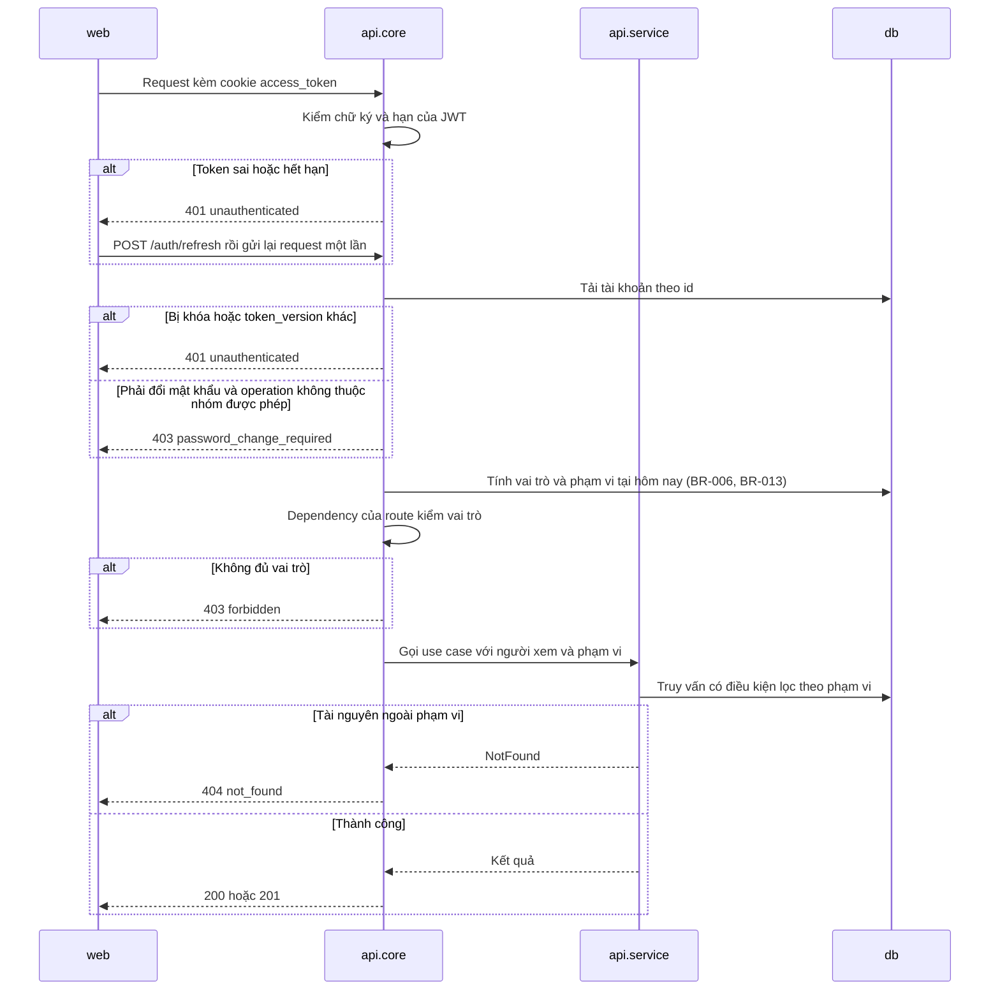
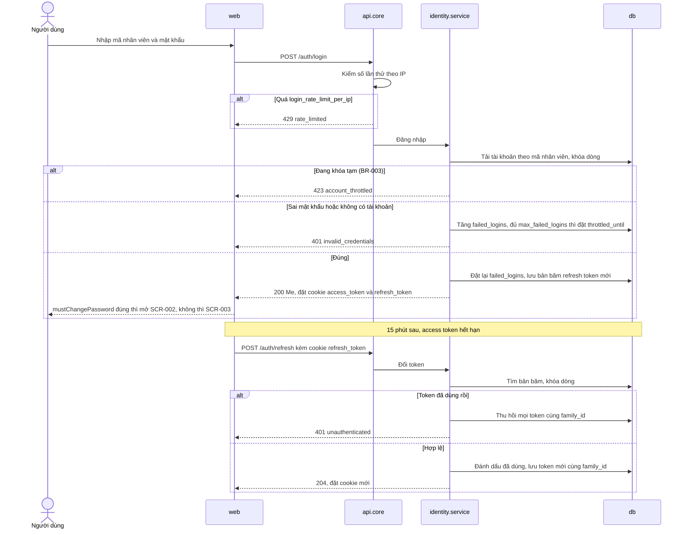
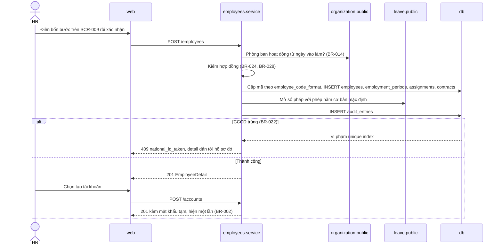
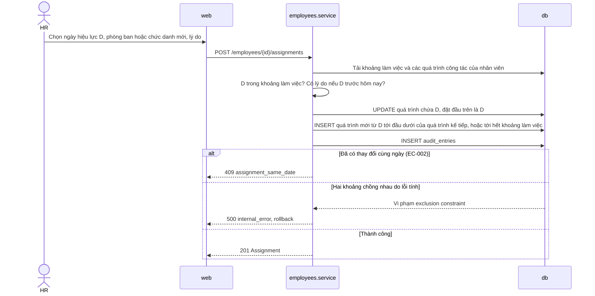
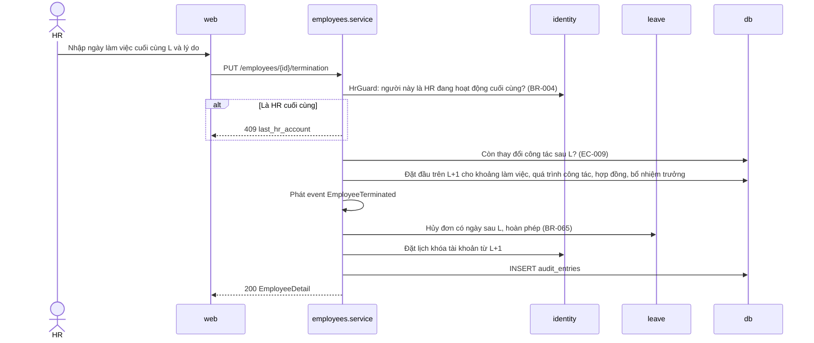
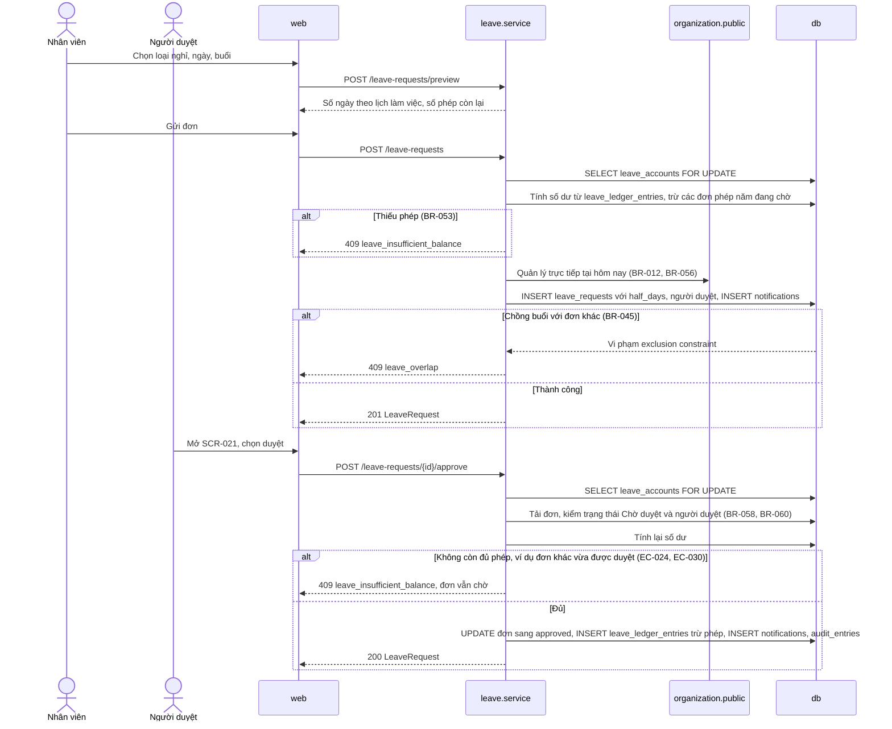
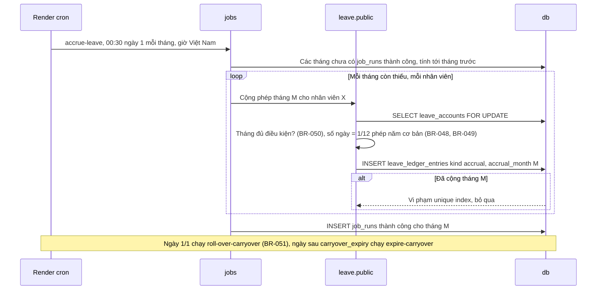
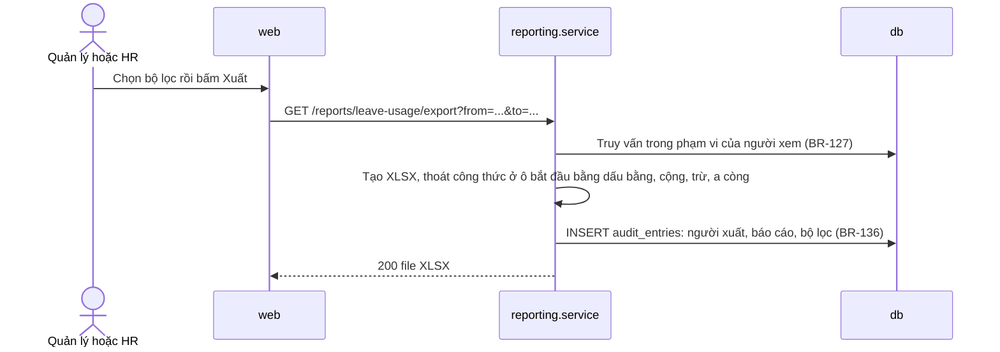
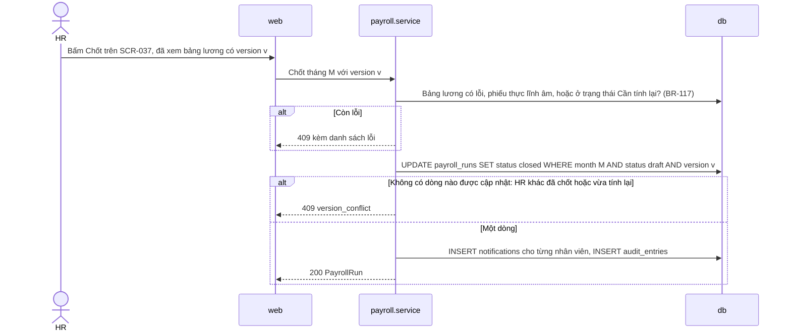

# Flows

- **Status:** Draft
- **Updated:** 2026-10-30
- **Reviewed:** [YYYY-MM-DD: review nguội; AI review; người ngoài nếu có]
- **Related:** [requirements](../analysis/requirements.md) · [api](api.md) · [data](data.md) · [components](components.md) ·
  [design guide](../playbook/design.md)

> Mỗi luồng chính và mỗi use case của MVP có một sequence diagram. Use case của M3, M4 có sơ đồ khi làm milestone đó,
> trừ luồng chốt bảng lương, vì đó là một phần của architecture driver QA-001. Participant `api` được tách theo
> component khi cần: `core`, `service` của module, `db`.

## Mỗi request đã đăng nhập

- **Covers:** QA-003, ADR-0004; mọi operation trừ đăng nhập và refresh
- **Transaction:** một transaction cho cả request, mở ở `core`, commit khi route trả kết quả thành công

- **Failure handling:** lỗi luật từ `domain` và lỗi vi phạm constraint từ `db` được `core` đổi sang mã lỗi trong bảng
  Errors của [api](api.md#errors). Lỗi khác trả `500 internal_error` kèm `traceId`; transaction bị rollback.

## Đăng nhập và đổi refresh token

- **Covers:** US-001; BR-001 tới BR-003; ADR-0004
- **Transaction:** đăng nhập là một transaction, gồm cập nhật số lần sai và tạo refresh token

- **Failure handling:** sai mã hay sai mật khẩu trả cùng một mã lỗi và mất cùng khoảng thời gian, để không đoán được mã
  nhân viên nào có tồn tại (EC-015).

## Tiếp nhận nhân viên mới

- **Covers:** UC-001; US-011, US-015, US-002
- **Transaction:** hồ sơ, khoảng làm việc, quá trình công tác đầu tiên, hợp đồng, sổ phép và nhật ký trong một
  transaction; tạo tài khoản là request riêng

- **Failure handling:** lỗi ở bất kỳ bước nào làm rollback cả hồ sơ; không có hồ sơ dở dang (Postconditions của UC-001).

## Ghi nhận thay đổi công tác

- **Covers:** UC-002; US-013; BR-016 tới BR-018
- **Transaction:** cắt quá trình cũ, thêm quá trình mới và ghi nhật ký trong một transaction

- **Failure handling:** exclusion constraint là lớp chặn cuối; nếu nó báo lỗi thì code tính khoảng đang sai, nên trả
  `500` và ghi log thay vì một mã lỗi nghiệp vụ.

## Ghi nhận nghỉ việc

- **Covers:** UC-003; US-014; BR-004, BR-019, BR-065
- **Transaction:** kết thúc các khoảng, hủy đơn sau ngày nghỉ việc, khóa tài khoản theo lịch và ghi nhật ký trong một
  transaction

- **Failure handling:** event chạy đồng bộ trong cùng transaction; handler lỗi thì cả thao tác rollback. Trạng thái Đã
  nghỉ việc suy ra từ khoảng làm việc, nên không cần job để chuyển trạng thái; job hằng ngày chỉ đặt `status` của tài
  khoản thành khóa cho đúng với màn hình tài khoản (BR-005).

## Gửi và duyệt đơn nghỉ

- **Covers:** UC-005; US-023, US-025, US-026, US-034; QA-001
- **Transaction:** gửi đơn là một transaction; duyệt là một transaction khác. Cả hai khóa dòng `leave_accounts` của nhân
  viên khi đơn là phép năm

- **Failure handling:** hai lần duyệt đồng thời của cùng một nhân viên phải chờ nhau ở `FOR UPDATE`; lần sau tính số dư
  sau khi lần trước đã commit. Lần duyệt gửi lặp nhận `409 invalid_state`. Đây là kịch bản của test QA-001.

## Cộng phép hằng tháng và phép tồn

- **Covers:** UC-006; US-030, US-031; EC-038
- **Transaction:** mỗi nhân viên một transaction; `job_runs` ghi kết quả cả lần chạy

- **Failure handling:** một nhân viên lỗi thì ghi log, đánh dấu lần chạy là có lỗi, và chạy tiếp người khác. Lần chạy
  sau cộng bù tháng còn thiếu. Unique index bảo đảm không cộng trùng kể cả khi hai lần chạy chồng nhau.

## Xuất báo cáo

- **Covers:** US-065, US-067, US-070; BR-127, BR-136
- **Transaction:** đọc trong một transaction chỉ đọc; ghi nhật ký xuất là transaction riêng

- **Failure handling:** file được tạo trong bộ nhớ và trả về ngay; lỗi giữa chừng thì không có file nào được lưu.

## Chốt bảng lương

- **Covers:** UC-010; US-060; BR-091, BR-117; EC-072. Làm ở M4
- **Transaction:** một transaction

- **Failure handling:** mở lại bảng công cần `FOR UPDATE` trên kỳ công và đọc `payroll_runs` với `FOR SHARE`, nên mở
  lại và chốt lương của cùng tháng không chạy chen nhau (BR-091).

## Jobs and external calls

Hệ thống không gọi dịch vụ ngoài. Mọi job do Render cron gọi bằng `python -m app.jobs <job>`, theo giờ Việt Nam.

| Job or call | Trigger | Timeout | Retry | When unavailable |
|---|---|---|---|---|
| `accrue-leave` | 00:30 ngày 1 mỗi tháng | 10 phút | Không retry ngay; lần chạy sau cộng bù tháng thiếu, unique index chặn cộng trùng (EC-038) | HR thấy cảnh báo job lỗi trên trang tổng quan |
| `roll-over-carryover` | 00:30 ngày 1/1 | 10 phút | Idempotent theo năm trong `job_runs`; chạy lại tay được | Như trên |
| `expire-carryover` | 00:30 ngày sau `carryover_expiry` | 10 phút | Idempotent theo năm | Như trên |
| `lock-terminated-accounts` | 00:15 hằng ngày | 5 phút | Idempotent; lần sau làm tiếp. Kiểm quyền ở mỗi request vẫn chặn người đã nghỉ việc, kể cả khi job chưa chạy | Như trên |
| `purge-refresh-tokens` | 03:00 hằng ngày | 5 phút | Idempotent | Bảng lớn dần; không ảnh hưởng đăng nhập |
| Job của M3, M4, như mở kỳ công | Thêm khi làm milestone đó | — | — | — |
