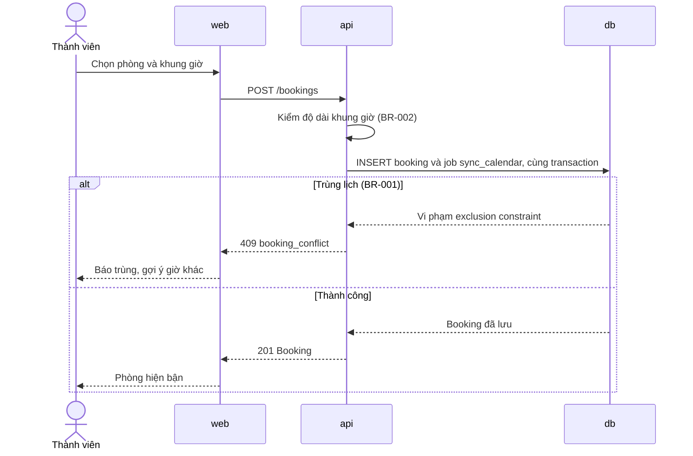

# Flows

- **Status:** [Draft | Accepted | Superseded]
- **Updated:** [YYYY-MM-DD]
- **Reviewed:** [YYYY-MM-DD: review nguội; AI review; người ngoài nếu có]
- **Related:** [requirements](../requirements.md) · [api](api.md) · [data](data.md) ·
  [design guide](../playbook/design.md)

> Điền ở Phase 3: mỗi luồng chính và mỗi use case có một sequence diagram. Use case trong requirements ghi actor và hệ
> thống làm gì; sequence diagram ở đây ghi container và component nào trao đổi gì để làm được việc đó. Vẽ cả nhánh lỗi
> quan trọng, rồi walkthrough theo design guide. Dòng in nghiêng và sơ đồ mẫu là ví dụ, xóa khi điền.

## [Tên luồng]

- **Covers:** [US-xxx, UC-xxx]
- **Transaction:** [phần nào nằm trong một transaction]

- **Failure handling:** [phụ thuộc nào lỗi thì luồng làm gì]

## Jobs and external calls

Phân biệt lỗi thử lại được với thao tác đã có tác động mà chưa biết thành công hay chưa. Loại thứ hai không retry tự
động.

| Job or call | Trigger | Timeout | Retry | When unavailable |
|---|---|---|---|---|
| *Đồng bộ Google Calendar* | *Job `sync_calendar` sau khi tạo hoặc hủy Booking* | *10 s* | *3 lần, backoff; idempotent theo booking id* | *Giữ job, giao diện hiện "chưa đồng bộ"* |
| *Gửi email thông báo* | *Job sau khi hủy Booking* | *10 s* | *Không retry khi timeout; đặt trạng thái `unknown` để kiểm tay* | *Giữ job, thử lại khi provider có lại* |
