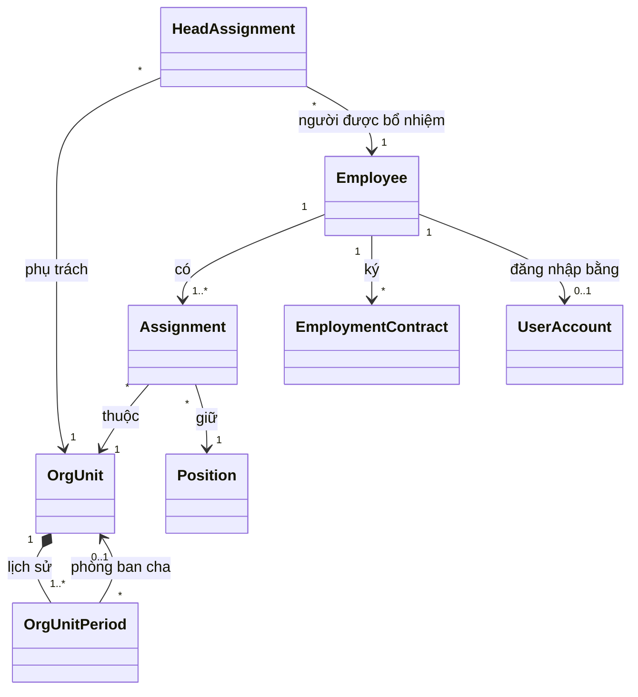
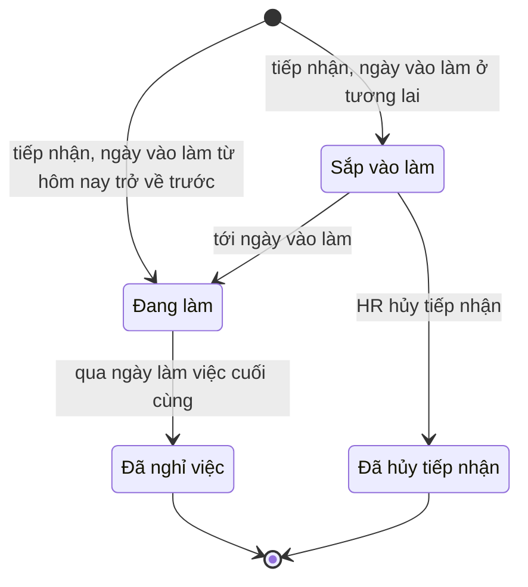
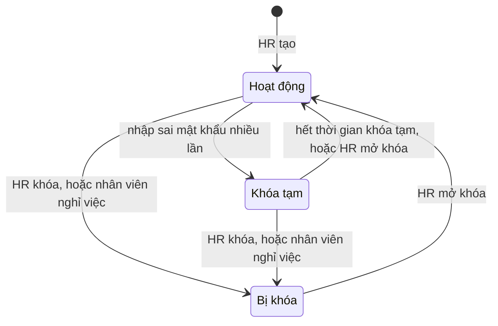
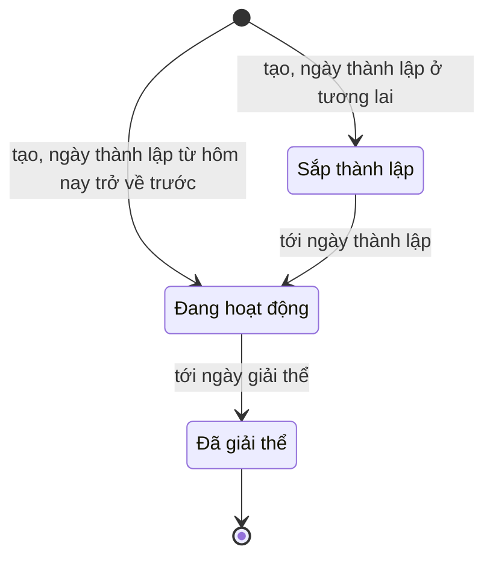
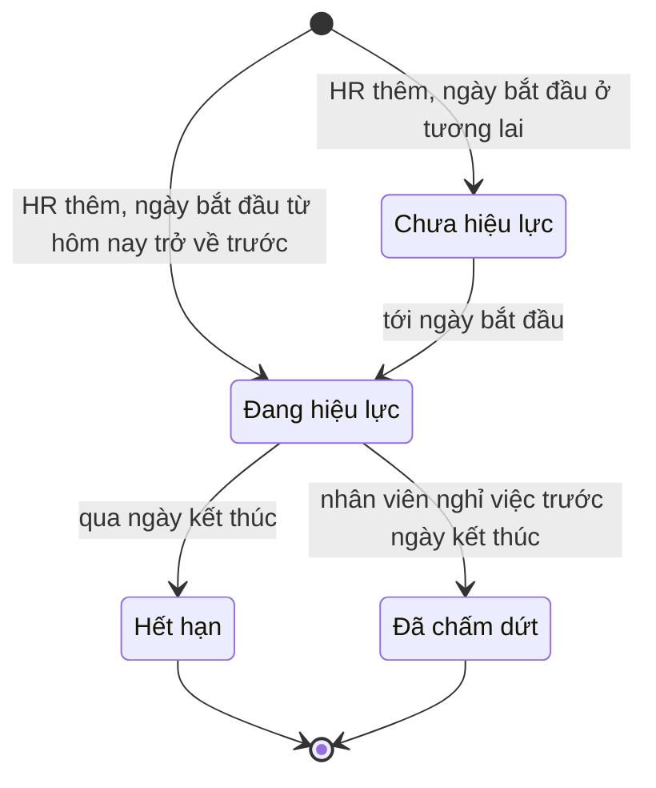

# Domain: hr-manager

- **Status:** Draft
- **Updated:** 2026-10-30
- **Reviewed:** [YYYY-MM-DD: review nguội; AI review; người ngoài nếu có]
- **Related:** [requirements](requirements.md) · [questions](questions.md) · [research](research.md) ·
  [data design](design/data.md) · [analysis guide](playbook/analysis.md)

Bản hiện tại có phần dùng chung và M1. Luật của M2–M5 được thêm ở lần phân tích của milestone đó.

## Glossary

Hệ thống có một bounded context.

| Term | Meaning | Code name | Not to confuse with |
|---|---|---|---|
| Nhân viên | Người có hồ sơ trong hệ thống, ở mọi trạng thái, kể cả đã nghỉ việc | `Employee` | Tài khoản |
| Tài khoản | Thông tin để một nhân viên đăng nhập | `UserAccount` | Nhân viên |
| Vai trò | Nhóm quyền trong hệ thống: Nhân viên, Quản lý, HR | `Role` | Chức danh |
| Chức danh | Tên công việc của nhân viên, ví dụ Kế toán viên | `Position` | Vai trò |
| Phòng ban | Một nút trong cây tổ chức, như khối, phòng hay nhóm | `OrgUnit` | — |
| Phòng ban gốc | Phòng ban ở đỉnh cây, đại diện cho cả công ty | `OrgUnit` có `parent` trống | — |
| Trưởng phòng ban | Nhân viên được bổ nhiệm phụ trách một phòng ban trong một khoảng thời gian | `HeadAssignment` | Quản lý trực tiếp |
| Quản lý trực tiếp | Người theo dõi và duyệt yêu cầu của một nhân viên, suy ra từ trưởng phòng ban theo BR-012 | `lineManager` | Trưởng phòng ban |
| Phạm vi quản lý | Tập nhân viên mà một Quản lý được xem, theo BR-013 | `managerScope` | — |
| Quá trình công tác | Một khoảng thời gian nhân viên thuộc một phòng ban với một chức danh | `Assignment` | Hợp đồng lao động |
| Ngày hiệu lực | Ngày một thay đổi bắt đầu có tác dụng; có thể trước hoặc sau ngày ghi nhận | `effectiveDate` | Ngày ghi nhận: ngày HR nhập thay đổi |
| Khoảng hiệu lực | Từ ngày tới ngày, tính cả hai đầu; ngày kết thúc trống nghĩa là chưa kết thúc | `DateRange` | — |
| Ngày vào làm | Ngày làm việc đầu tiên của nhân viên | `hireDate` | Ngày ký hợp đồng |
| Ngày làm việc cuối cùng | Ngày cuối cùng nhân viên làm việc; từ ngày hôm sau nhân viên ở trạng thái Đã nghỉ việc | `lastWorkingDate` | Ngày nộp đơn nghỉ việc |
| Hợp đồng lao động | Thỏa thuận lao động giữa công ty và nhân viên, gồm cả hợp đồng thử việc | `EmploymentContract` | Quá trình công tác |
| Nhật ký thao tác | Bản ghi không sửa được về mọi thay đổi dữ liệu | `AuditEntry` | — |

## Entities

| Name | Kind | Key attributes | Relations |
|---|---|---|---|
| Employee | Entity | Mã nhân viên, họ tên, ngày sinh, giới tính, số CCCD, địa chỉ thường trú, địa chỉ hiện tại, điện thoại và email cá nhân, điện thoại và email công việc, tài khoản ngân hàng, người liên hệ khẩn cấp, ngày vào làm, ngày làm việc cuối cùng, lý do nghỉ, trạng thái | Có nhiều Assignment và EmploymentContract; có tối đa một UserAccount |
| Assignment | Entity | Khoảng hiệu lực, phòng ban, chức danh, lý do | Thuộc một Employee |
| OrgUnit | Entity | Mã phòng ban, ngày thành lập, ngày giải thể, trạng thái | Có lịch sử OrgUnitPeriod và nhiều HeadAssignment |
| OrgUnitPeriod | Value object | Khoảng hiệu lực, tên, phòng ban cha | Thuộc một OrgUnit |
| HeadAssignment | Entity | Khoảng hiệu lực, phòng ban, người được bổ nhiệm | — |
| Position | Entity | Tên, đang dùng hay ngừng dùng | Được nhiều Assignment dùng |
| EmploymentContract | Entity | Số hợp đồng, loại, nhóm công việc khi thử việc, ngày ký, ngày bắt đầu, ngày kết thúc, trạng thái | Thuộc một Employee |
| UserAccount | Entity | Tên đăng nhập, có vai trò HR hay không, có phải đổi mật khẩu không, số lần đăng nhập sai liên tiếp, trạng thái | Thuộc một Employee |
| AuditEntry | Entity | Thời điểm, người làm, đối tượng, thao tác, giá trị trước và sau, lý do | — |
| DateRange | Value object | Ngày bắt đầu, ngày kết thúc có thể trống; ngày kết thúc không trước ngày bắt đầu | — |

## Aggregates and invariants

| Aggregate (root) | Contains | Invariants | Cross-aggregate rules |
|---|---|---|---|
| Employee | Employee, Assignment | Mã nhân viên không đổi (BR-015); quá trình công tác không chồng, không hở (BR-016) | Phòng ban của mỗi quá trình công tác phải đang hoạt động (BR-014); số CCCD không trùng (BR-022) |
| EmploymentContract | EmploymentContract | Thời hạn hợp lệ theo loại hợp đồng (BR-024, BR-028) | Hợp đồng của một nhân viên không chồng thời gian (BR-025); kiểm số hợp đồng xác định thời hạn liên tiếp (BR-026); số hợp đồng không trùng (BR-037) |
| OrgUnit | OrgUnit, OrgUnitPeriod | Các khoảng lịch sử không chồng; tên không trống | Đúng một phòng ban gốc (BR-007); cây không có vòng (BR-008); điều kiện giải thể (BR-010) |
| HeadAssignment | HeadAssignment | Khoảng hiệu lực hợp lệ | Mỗi phòng ban có tối đa một trưởng mỗi ngày; người được bổ nhiệm đang làm việc (BR-011) |
| UserAccount | UserAccount | BR-001, BR-002, BR-003 | Luôn còn ít nhất một HR đang hoạt động (BR-004) |

## Lifecycles

Chuyển trạng thái không có trong bảng là không được phép. Chuyển trạng thái do "Thời gian" xảy ra khi tới ngày tương
ứng, không cần ai thao tác.

**Employee**

| From | To | Trigger and actor | Guard |
|---|---|---|---|
| — | `upcoming` | HR tiếp nhận | Ngày vào làm sau hôm nay |
| — | `active` | HR tiếp nhận hoặc nhập từ bảng tính | Ngày vào làm từ hôm nay trở về trước |
| `upcoming` | `active` | Thời gian, tới ngày vào làm | — |
| `upcoming` | `cancelled` | HR hủy tiếp nhận | Trước ngày vào làm |
| `active` | `terminated` | Thời gian, sang ngày sau ngày làm việc cuối cùng | HR đã ghi nhận nghỉ việc (BR-019) |

**UserAccount**

| From | To | Trigger and actor | Guard |
|---|---|---|---|
| — | `active` | HR tạo tài khoản | Nhân viên chưa có tài khoản (BR-001) |
| `active` | `throttled` | Người dùng nhập sai mật khẩu `max_failed_logins` lần liên tiếp | — (BR-003) |
| `throttled` | `active` | Thời gian, sau `lockout_minutes` phút; hoặc HR mở khóa | — |
| `active`, `throttled` | `locked` | HR khóa; hoặc Thời gian, khi nhân viên nghỉ việc | Không phải HR đang hoạt động cuối cùng (BR-004) |
| `locked` | `active` | HR mở khóa | Nhân viên chưa nghỉ việc (BR-005) |

**OrgUnit**

| From | To | Trigger and actor | Guard |
|---|---|---|---|
| — | `planned`, `active` | HR tạo phòng ban | Phòng ban cha đang hoạt động tại ngày thành lập |
| `planned` | `active` | Thời gian, tới ngày thành lập | — |
| `active` | `dissolved` | Thời gian, tới ngày giải thể do HR đặt | BR-007, BR-010 |

**EmploymentContract**

| From | To | Trigger and actor | Guard |
|---|---|---|---|
| — | `upcoming`, `active` | HR thêm hợp đồng | BR-023 tới BR-028 |
| `upcoming` | `active` | Thời gian, tới ngày bắt đầu | — |
| `active` | `expired` | Thời gian, qua ngày kết thúc | Hợp đồng có ngày kết thúc |
| `active` | `terminated` | HR ghi nhận nghỉ việc | Ngày làm việc cuối cùng trước ngày kết thúc của hợp đồng (BR-019) |

## Business rules

- **Status:** `Confirmed` khi có nguồn xác nhận; `Assumed` khi dựa trên assumption; `Disputed` khi các nguồn mâu thuẫn và
  chưa ai chốt. Luật `Disputed` không được đưa vào code.
- **Nguồn A-003:** luật do agent đề xuất theo cách làm phổ biến ở doanh nghiệp nhỏ, chưa được HR công ty xác nhận.
- **Nguồn là văn bản pháp luật:** luật giữ `Assumed` cho tới khi đối chiếu văn bản gốc (Q-013).

**Tài khoản và vai trò**

| ID | When | Then | Source | Status |
|---|---|---|---|---|
| BR-001 | Tạo tài khoản cho một nhân viên | Mỗi nhân viên có tối đa một tài khoản; tên đăng nhập là mã nhân viên | A-003, A-004 | Assumed |
| BR-002 | Tài khoản vừa được tạo hoặc vừa được HR đặt lại mật khẩu | Người dùng phải đặt mật khẩu mới ở lần đăng nhập kế tiếp, trước khi dùng chức năng khác | A-003 | Assumed |
| BR-003 | Nhập sai mật khẩu `max_failed_logins` lần liên tiếp | Tài khoản bị khóa tạm `lockout_minutes` phút | A-003 | Assumed |
| BR-004 | Thu hồi vai trò HR, khóa tài khoản hoặc ghi nhận nghỉ việc của HR đang hoạt động cuối cùng | Từ chối | A-003 | Assumed |
| BR-005 | Nhân viên qua ngày làm việc cuối cùng | Tài khoản tự bị khóa và không mở khóa được nữa | A-003 | Assumed |
| BR-006 | Xác định vai trò của một người tại ngày D | Nhân viên: có tài khoản đang hoạt động. Quản lý: đang là trưởng của ít nhất một phòng ban tại D; không gán tay. HR: được gán tay | Chủ dự án, 2026-10-30 | Confirmed |
| BR-036 | Đặt mật khẩu mới | Mật khẩu dài tối thiểu `min_password_length` ký tự và khác mật khẩu hiện tại | A-003 | Assumed |

**Cơ cấu tổ chức**

| ID | When | Then | Source | Status |
|---|---|---|---|---|
| BR-007 | Tạo hoặc sửa cơ cấu tổ chức | Cơ cấu là một cây nhiều cấp có đúng một phòng ban gốc. Phòng ban gốc không có phòng ban cha, không bị chuyển, không bị giải thể; chỉ đổi tên được | Chủ dự án, 2026-10-30 | Confirmed |
| BR-008 | Đổi phòng ban cha của P thành Q từ ngày D | Từ chối nếu tại D, Q là P hoặc Q nằm trong nhánh con của P | Hệ quả của BR-007 | Confirmed |
| BR-009 | Đổi tên hoặc phòng ban cha của một phòng ban với ngày hiệu lực D | Thay đổi có tác dụng từ D; cơ cấu tại một ngày bất kỳ dùng giá trị có hiệu lực tại ngày đó | Chủ dự án, mục tiêu học trong [project](project.md) | Confirmed |
| BR-010 | Giải thể phòng ban P từ ngày D | Từ chối nếu từ D trở đi còn nhân viên thuộc P, kể cả do thay đổi công tác đã ghi cho tương lai, hoặc còn phòng ban con của P đang hoạt động | A-003 | Assumed |
| BR-011 | Bổ nhiệm trưởng cho phòng ban P trong một khoảng hiệu lực | Mỗi ngày P có tối đa một trưởng. Người được bổ nhiệm phải đang làm việc trong suốt khoảng đó. Một người được làm trưởng nhiều phòng ban; trưởng không bắt buộc thuộc P | A-003 | Assumed |
| BR-012 | Xác định quản lý trực tiếp của nhân viên X tại ngày D | Lấy trưởng của phòng ban X thuộc tại D. Nếu phòng ban đó không có trưởng, hoặc trưởng chính là X, thì đi lên phòng ban cha gần nhất có trưởng khác X. Không tìm được ai thì X không có quản lý trực tiếp | Chủ dự án, 2026-10-30 | Confirmed |
| BR-013 | Xác định phạm vi của Quản lý M tại ngày D | Gồm mọi nhân viên thuộc các phòng ban M làm trưởng tại D và mọi phòng ban con của chúng | Chủ dự án, 2026-10-30 | Confirmed |
| BR-014 | Xếp nhân viên vào một phòng ban | Phòng ban phải đang hoạt động trong mọi ngày của quá trình công tác | A-003 | Assumed |
| BR-034 | Thêm hoặc đổi tên chức danh | Tên chức danh không trùng, không phân biệt hoa thường | A-003 | Assumed |
| BR-035 | Xóa chức danh đã được dùng trong quá trình công tác | Từ chối; chỉ ngừng dùng được. Chức danh ngừng dùng không chọn được cho thay đổi mới | A-003 | Assumed |

**Hồ sơ và công tác**

| ID | When | Then | Source | Status |
|---|---|---|---|---|
| BR-015 | Cấp mã nhân viên | Mã duy nhất trong toàn hệ thống, không đổi, không dùng lại kể cả sau khi nhân viên nghỉ việc. Hệ thống tự cấp theo `employee_code_format` khi tiếp nhận; khi nhập từ bảng tính thì giữ mã trong file | A-003 | Assumed |
| BR-016 | Lưu quá trình công tác của một nhân viên | Từ ngày vào làm tới ngày làm việc cuối cùng, mỗi ngày nhân viên có đúng một quá trình công tác; các quá trình không chồng, không hở | A-003 | Assumed |
| BR-017 | Ghi nhận thay đổi công tác với ngày hiệu lực D | D phải nằm trong khoảng làm việc. Quá trình chứa D kết thúc ở D−1. Quá trình mới bắt đầu từ D và kéo dài tới ngày trước thay đổi kế tiếp đã có, hoặc tới ngày làm việc cuối cùng | A-003 | Assumed |
| BR-018 | Ghi nhận thay đổi công tác với ngày hiệu lực trước hôm nay | Lý do là bắt buộc | A-003 | Assumed |
| BR-019 | Ghi nhận nghỉ việc với ngày làm việc cuối cùng L | Quá trình công tác, bổ nhiệm trưởng và hợp đồng đang hiệu lực kết thúc ở L. Từ ngày sau L, nhân viên ở trạng thái Đã nghỉ việc và tài khoản bị khóa | A-003 | Assumed |
| BR-020 | Hủy ghi nhận nghỉ việc | Chỉ được khi L chưa qua | A-003 | Assumed |
| BR-021 | Nhân viên tự sửa hồ sơ của mình | Chỉ sửa được điện thoại cá nhân, email cá nhân, địa chỉ hiện tại và người liên hệ khẩn cấp; thay đổi có hiệu lực ngay. Thông tin còn lại chỉ HR sửa | A-003 | Assumed |
| BR-022 | Lưu số CCCD | Số CCCD không trùng giữa các hồ sơ chưa bị hủy tiếp nhận | A-003 | Assumed |

**Hợp đồng lao động**

| ID | When | Then | Source | Status |
|---|---|---|---|---|
| BR-023 | Chọn loại hợp đồng | Có ba loại: thử việc, xác định thời hạn, không xác định thời hạn | Bộ luật Lao động 2019, Điều 20 và Điều 24 | Assumed |
| BR-024 | Lưu hợp đồng xác định thời hạn | Phải có ngày kết thúc, không quá `fixed_term_max_months` tháng sau ngày bắt đầu; vi phạm thì từ chối | Bộ luật Lao động 2019, Điều 20 | Assumed |
| BR-025 | Lưu một hợp đồng | Các hợp đồng của một nhân viên, kể cả thử việc, không chồng thời gian | A-003 | Assumed |
| BR-026 | Thêm hợp đồng xác định thời hạn khi hai hợp đồng liền trước đều là xác định thời hạn | Cảnh báo rằng luật yêu cầu ký hợp đồng không xác định thời hạn; HR xác nhận thì vẫn lưu, vì luật có ngoại lệ | Bộ luật Lao động 2019, Điều 20 | Assumed |
| BR-027 | Hợp đồng xác định thời hạn đã hết hạn, nhân viên vẫn làm việc và chưa có hợp đồng mới | Cảnh báo HR. Sau `contract_auto_convert_days` ngày, luật coi hợp đồng đó là không xác định thời hạn; hệ thống chỉ cảnh báo, không tự đổi loại hợp đồng | Bộ luật Lao động 2019, Điều 20 | Assumed |
| BR-028 | Lưu hợp đồng thử việc | Phải có ngày kết thúc, và thời gian thử việc không quá `probation_max_days` của nhóm công việc đã chọn; vi phạm thì từ chối | Bộ luật Lao động 2019, Điều 25 | Assumed |
| BR-029 | Xác định hợp đồng sắp hết hạn | Hợp đồng thử việc hoặc xác định thời hạn có ngày kết thúc trong `contract_expiry_warning_days` ngày tới, và nhân viên chưa có hợp đồng tiếp theo | A-003 | Assumed |
| BR-037 | Lưu số hợp đồng | Số hợp đồng không trùng trong toàn hệ thống | A-003 | Assumed |

**Nhật ký và quyền xem**

| ID | When | Then | Source | Status |
|---|---|---|---|---|
| BR-030 | Tạo, sửa hoặc xóa hồ sơ, quá trình công tác, hợp đồng, phòng ban, chức danh, tài khoản hoặc vai trò | Ghi nhật ký: người làm, thời điểm, đối tượng, giá trị trước và sau, lý do nếu có | A-003 | Assumed |
| BR-031 | Bất kỳ ai cố sửa hoặc xóa nhật ký | Hệ thống không có thao tác nào cho phép việc đó | A-003 | Assumed |
| BR-032 | Hiển thị danh bạ | Chỉ gồm nhân viên đang làm; chỉ hiện họ tên, chức danh, phòng ban, email và điện thoại công việc | A-003 | Assumed |
| BR-033 | Quản lý xem nhân viên trong phạm vi | Xem được thông tin công việc, liên hệ công việc và quá trình công tác; không xem được CCCD, ngày sinh, giới tính, địa chỉ, tài khoản ngân hàng, liên hệ khẩn cấp và hợp đồng | A-003 | Assumed |

### Parameters

Giá trị lấy từ Bộ luật Lao động chưa được đối chiếu văn bản gốc, xem [questions](questions.md).

| Parameter | Meaning and unit | Value | Used by |
|---|---|---|---|
| `max_failed_logins` | Số lần nhập sai mật khẩu liên tiếp trước khi khóa tạm | 5 | BR-003 |
| `lockout_minutes` | Thời gian khóa tạm, phút | 15 | BR-003 |
| `min_password_length` | Độ dài tối thiểu của mật khẩu, ký tự | 8 | BR-036 |
| `employee_code_format` | Mẫu mã nhân viên do hệ thống tự cấp | `NV` cùng 5 chữ số tăng dần, ví dụ `NV00001` | BR-015 |
| `fixed_term_max_months` | Thời hạn tối đa của hợp đồng xác định thời hạn, tháng | 36 | BR-024 |
| `contract_auto_convert_days` | Số ngày sau khi hợp đồng xác định thời hạn hết hạn mà luật coi là không xác định thời hạn, nếu chưa ký hợp đồng mới | 30 | BR-027 |
| `probation_max_days` | Thời gian thử việc tối đa theo nhóm công việc | Quản lý doanh nghiệp: 180 ngày. Cần trình độ cao đẳng trở lên: 60 ngày. Trung cấp, công nhân kỹ thuật, nhân viên nghiệp vụ: 30 ngày. Công việc khác: 6 ngày làm việc | BR-028 |
| `contract_expiry_warning_days` | Số ngày trước ngày kết thúc hợp đồng để đưa vào danh sách sắp hết hạn | 30 | BR-029 |

## Sensitive data

| Data | Purpose | Who may see | Retention |
|---|---|---|---|
| Số CCCD, ngày sinh, giới tính, địa chỉ thường trú | Hồ sơ lao động, hợp đồng; từ M4 dùng cho BHXH và thuế | HR; chính nhân viên | Undecided (Q-012) |
| Tài khoản ngân hàng | Trả lương, từ M4 | HR; chính nhân viên | Undecided (Q-012) |
| Điện thoại, email và địa chỉ cá nhân; người liên hệ khẩn cấp | Liên lạc | HR; chính nhân viên | Undecided (Q-012) |
| Hợp đồng lao động | Quản lý quan hệ lao động | HR; chính nhân viên | Undecided (Q-012) |
| Mật khẩu | Đăng nhập | Không ai, kể cả HR; HR chỉ đặt lại được | Tới khi tài khoản bị xóa |
| Nhật ký thao tác | Truy vết thay đổi | HR | Undecided (Q-012) |

## Edge cases

| ID | Situation | Expected handling | Rule | Verified by |
|---|---|---|---|---|
| EC-001 | Tiếp nhận nhân viên có ngày vào làm ở tương lai | Hồ sơ ở trạng thái Sắp vào làm, không hiện trong danh bạ. Tài khoản tạo được nhưng chỉ đăng nhập được từ ngày vào làm | BR-032 | — |
| EC-002 | Ghi nhận hai thay đổi công tác cùng ngày hiệu lực | Từ chối thay đổi thứ hai; HR sửa thay đổi đã có | BR-016 | — |
| EC-003 | Ghi bù một thay đổi công tác vào giữa hai thay đổi đã có | Thay đổi mới chỉ có tác dụng tới ngày trước thay đổi kế tiếp; các thay đổi sau giữ nguyên | BR-017 | — |
| EC-004 | Trưởng phòng ban được chuyển sang phòng ban khác | Bổ nhiệm trưởng không tự kết thúc; hệ thống cảnh báo HR | BR-011 | — |
| EC-005 | Trưởng phòng ban nghỉ việc | Bổ nhiệm kết thúc ở ngày làm việc cuối cùng. Quản lý trực tiếp của nhân viên trong phòng ban chuyển lên phòng ban cha gần nhất có trưởng | BR-012, BR-019 | — |
| EC-006 | Chuyển một phòng ban sang nhánh khác | Từ ngày hiệu lực, nhân viên trong nhánh đó có quản lý gián tiếp mới; quản lý cũ không còn thấy nhánh đó | BR-012, BR-013 | — |
| EC-007 | Giải thể phòng ban còn nhân viên | Từ chối và liệt kê nhân viên cần chuyển đi | BR-010 | — |
| EC-008 | Nhân viên đã nghỉ việc được tuyển lại | Undecided (Q-011) | BR-015, BR-022 | — |
| EC-009 | Ghi nhận nghỉ việc khi còn thay đổi công tác có hiệu lực sau ngày làm việc cuối cùng | Từ chối và liệt kê thay đổi cần hủy | BR-019 | — |
| EC-010 | HR thu hồi vai trò HR của chính mình | Cho phép khi còn HR khác đang hoạt động; từ chối khi là HR cuối cùng | BR-004 | — |
| EC-011 | Phòng ban gốc không có trưởng | Nhân viên không tìm được trưởng nào ở các cấp trên thì không có quản lý trực tiếp. Ai duyệt đơn nghỉ trong trường hợp này sẽ quyết khi phân tích M2 | BR-012 | — |
| EC-012 | Nhân viên muốn đổi số tài khoản ngân hàng | Chỉ HR sửa được, để kẻ chiếm được tài khoản đăng nhập không đổi được nơi nhận lương | BR-021 | — |
| EC-013 | Xem cơ cấu tại một ngày trước ngày thành lập phòng ban gốc | Hiện cơ cấu trống kèm thông báo | BR-009 | — |
| EC-014 | Hợp đồng mới bắt đầu trước khi hợp đồng cũ kết thúc | Từ chối; HR sửa ngày kết thúc của hợp đồng cũ trước | BR-025 | — |
| EC-015 | Đăng nhập khi tài khoản đang bị khóa tạm | Từ chối với thông báo thử lại sau; không cho biết mật khẩu vừa nhập đúng hay sai | BR-003 | — |
| EC-016 | Hai HR cùng sửa một hồ sơ | Người lưu sau được báo hồ sơ đã thay đổi; không ghi đè ngầm | BR-030 | — |
| EC-017 | Tiếp nhận nhân viên khi chưa có hợp đồng | Cho lưu; hồ sơ hiện cảnh báo chưa có hợp đồng cho HR | — | — |
| EC-018 | Số CCCD trùng với một hồ sơ đã có | Từ chối và dẫn tới hồ sơ đó | BR-022 | — |
| EC-019 | Tìm tên không dấu hoặc khác hoa thường | Vẫn tìm thấy; ví dụ "nguyen van a" khớp "Nguyễn Văn A" | — | — |
| EC-020 | File nhập nhân viên có dòng lỗi | Không lưu dòng nào; hiện từng dòng lỗi kèm lý do | BR-015, BR-016, BR-022 | — |
| EC-021 | Nhân viên là trưởng của chính phòng ban mình thuộc | Quản lý trực tiếp là trưởng của phòng ban cha gần nhất có trưởng khác người đó | BR-012 | — |
| EC-022 | Đã ghi thay đổi chuyển nhân viên vào phòng ban P cho tương lai, rồi HR giải thể P trước ngày đó | Từ chối giải thể, vì từ ngày hiệu lực P vẫn còn nhân viên | BR-010, BR-014 | — |
