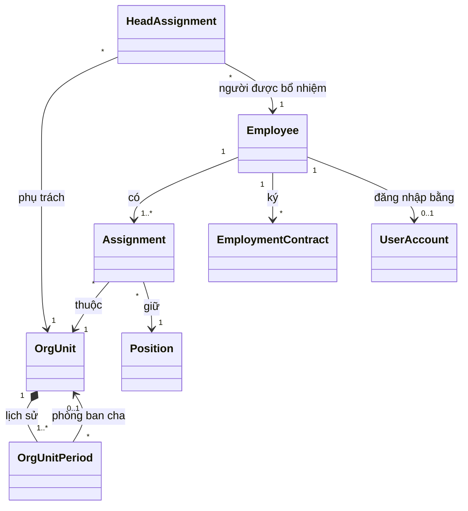
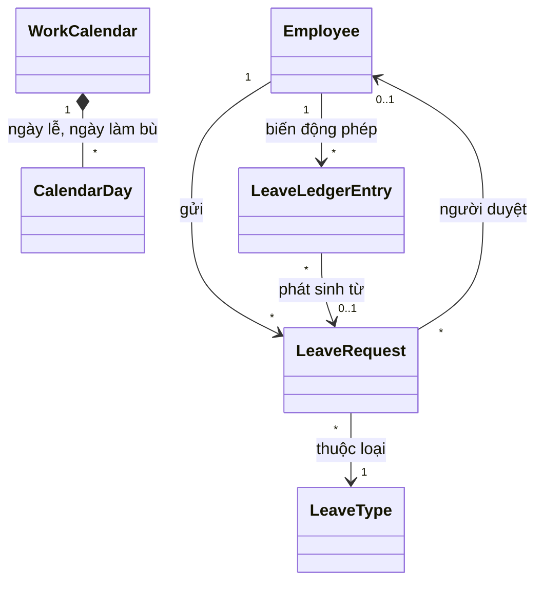
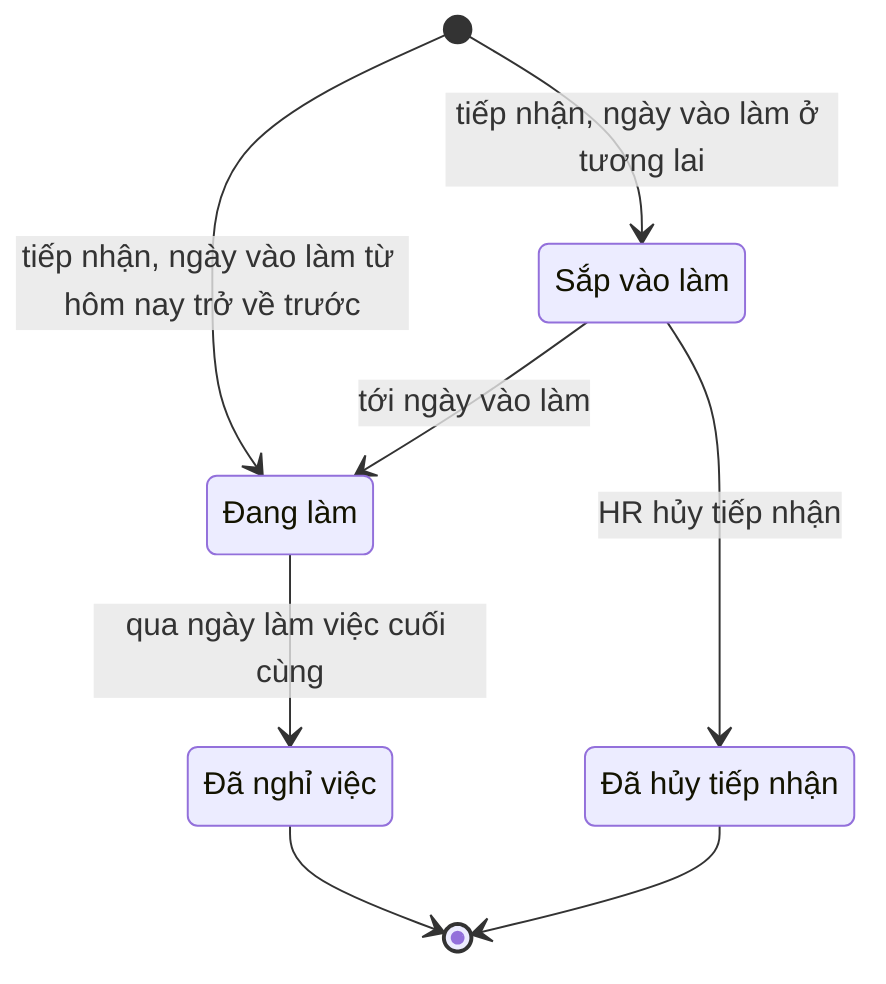
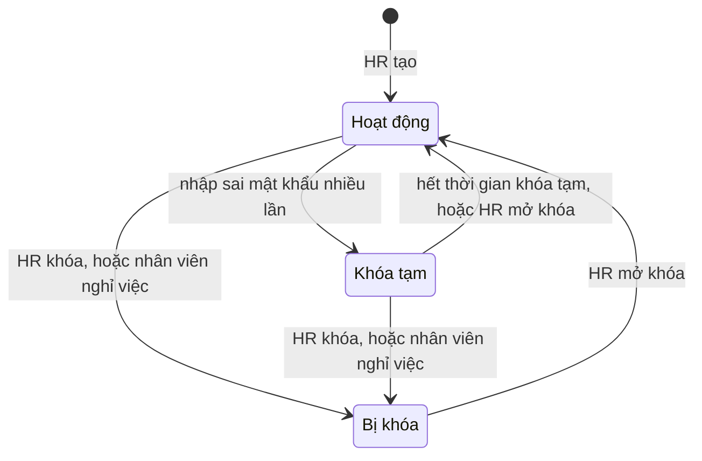
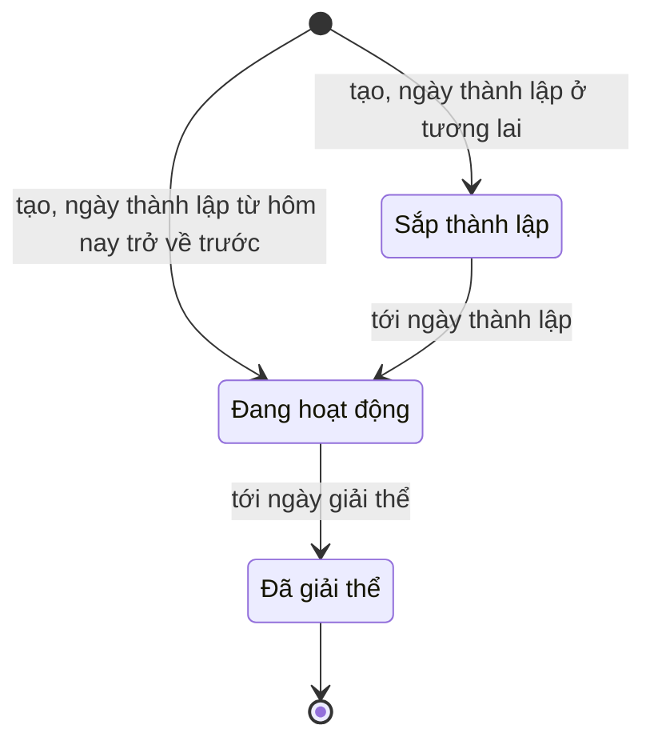
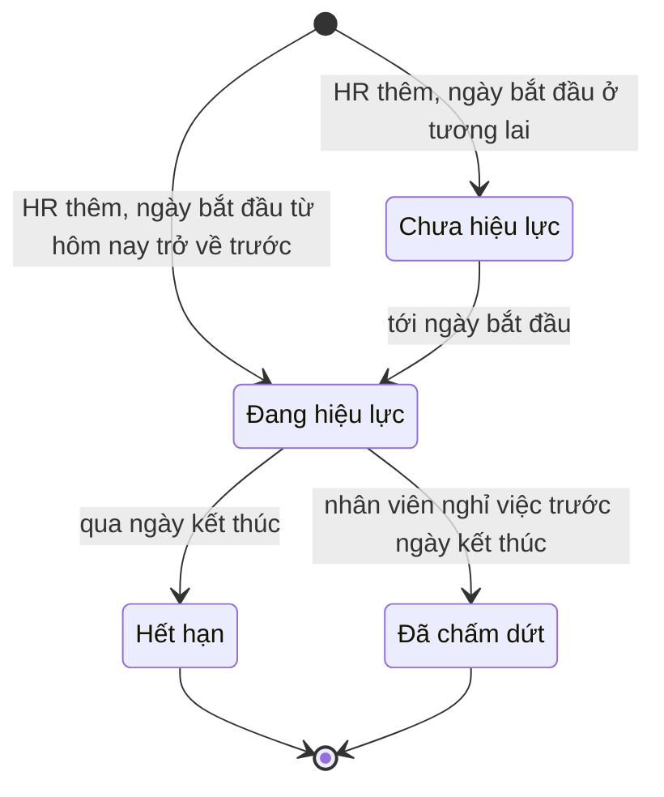
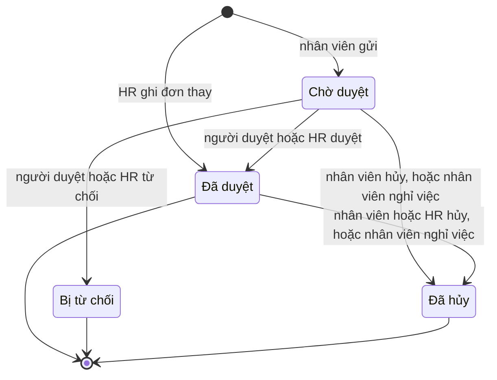

# Domain: hr-manager

- **Status:** Draft
- **Updated:** 2026-10-30
- **Reviewed:** [YYYY-MM-DD: review nguội; AI review; người ngoài nếu có]
- **Related:** [requirements](requirements.md) · [questions](questions.md) · [research](research.md) ·
  [data design](design/data.md) · [analysis guide](playbook/analysis.md)

Bản hiện tại có phần dùng chung, M1 và M2. Luật của M3–M5 được thêm ở lần phân tích của milestone đó.

## Glossary

Hệ thống có một bounded context.

| Term | Meaning | Code name | Not to confuse with |
|---|---|---|---|
| Nhân viên | Người có hồ sơ trong hệ thống, ở mọi trạng thái, kể cả đã nghỉ việc | `Employee` | Tài khoản |
| Tài khoản | Thông tin để một nhân viên đăng nhập | `UserAccount` | Nhân viên |
| Vai trò | Nhóm quyền trong hệ thống: Nhân viên, Quản lý, HR | `Role` | Chức danh |
| Chức danh | Tên công việc của nhân viên, ví dụ Kế toán viên | `Position` | Vai trò |
| Phòng ban | Một nút trong cây tổ chức, như khối, phòng hay nhóm | `OrgUnit` | — |
| Phòng ban gốc | Phòng ban ở đỉnh cây, đại diện cho cả công ty | `OrgUnit` có `parent` trống | — |
| Trưởng phòng ban | Nhân viên được bổ nhiệm phụ trách một phòng ban trong một khoảng thời gian | `HeadAssignment` | Quản lý trực tiếp |
| Quản lý trực tiếp | Người theo dõi và duyệt yêu cầu của một nhân viên, suy ra từ trưởng phòng ban theo BR-012 | `lineManager` | Trưởng phòng ban |
| Phạm vi quản lý | Tập nhân viên mà một Quản lý được xem, theo BR-013 | `managerScope` | — |
| Quá trình công tác | Một khoảng thời gian nhân viên thuộc một phòng ban với một chức danh | `Assignment` | Hợp đồng lao động |
| Ngày hiệu lực | Ngày một thay đổi bắt đầu có tác dụng; có thể trước hoặc sau ngày ghi nhận | `effectiveDate` | Ngày ghi nhận: ngày HR nhập thay đổi |
| Khoảng hiệu lực | Từ ngày tới ngày, tính cả hai đầu; ngày kết thúc trống nghĩa là chưa kết thúc | `DateRange` | — |
| Ngày vào làm | Ngày làm việc đầu tiên của nhân viên | `hireDate` | Ngày ký hợp đồng |
| Ngày làm việc cuối cùng | Ngày cuối cùng nhân viên làm việc; từ ngày hôm sau nhân viên ở trạng thái Đã nghỉ việc | `lastWorkingDate` | Ngày nộp đơn nghỉ việc |
| Hợp đồng lao động | Thỏa thuận lao động giữa công ty và nhân viên, gồm cả hợp đồng thử việc | `EmploymentContract` | Quá trình công tác |
| Nhật ký thao tác | Bản ghi không sửa được về mọi thay đổi dữ liệu | `AuditEntry` | — |
| Loại nghỉ | Một kiểu nghỉ có luật riêng, như phép năm, kết hôn, ốm đau | `LeaveType` | — |
| Đơn nghỉ | Yêu cầu nghỉ của một nhân viên cho một khoảng ngày, theo một loại nghỉ | `LeaveRequest` | — |
| Phép năm | Loại nghỉ có hưởng lương theo Điều 113 Bộ luật Lao động, trừ vào số dư phép | `ANNUAL` | Nghỉ việc riêng có lương: không trừ số dư |
| Phép năm cơ bản | Số ngày phép năm một nhân viên được hưởng cho cả năm, gồm cả ngày tăng theo thâm niên | `annualEntitlement` | Số dư phép |
| Số dư phép | Số ngày phép năm còn dùng được tại một ngày | `leaveBalance` | Phép năm cơ bản |
| Phép tồn | Phép năm chưa dùng được chuyển sang năm sau, có hạn dùng | `carryover` | — |
| Biến động phép | Một lần số dư phép thay đổi, kèm ngày, số ngày và lý do | `LeaveLedgerEntry` | — |
| Năm phép | Năm dương lịch dùng để tính phép năm | `leaveYear` | — |
| Ngày làm việc | Ngày nhân viên phải đi làm theo lịch làm việc của công ty | `workingDay` | Ngày dương lịch |
| Ngày làm bù | Ngày cuối tuần được đổi thành ngày làm việc, thường để bù cho kỳ nghỉ lễ dài | `makeupWorkday` | — |
| Buổi | Nửa ngày làm việc: sáng hoặc chiều | `HalfDay` | — |
| Người duyệt | Người được giao duyệt một đơn nghỉ | `approver` | Quản lý trực tiếp: người duyệt mặc định |

## Entities

| Name | Kind | Key attributes | Relations |
|---|---|---|---|
| Employee | Entity | Mã nhân viên, họ tên, ngày sinh, giới tính, số CCCD, địa chỉ thường trú, địa chỉ hiện tại, điện thoại và email cá nhân, điện thoại và email công việc, tài khoản ngân hàng, người liên hệ khẩn cấp, ngày vào làm, ngày làm việc cuối cùng, lý do nghỉ, trạng thái | Có nhiều Assignment và EmploymentContract; có tối đa một UserAccount |
| Assignment | Entity | Khoảng hiệu lực, phòng ban, chức danh, lý do | Thuộc một Employee |
| OrgUnit | Entity | Mã phòng ban, ngày thành lập, ngày giải thể, trạng thái | Có lịch sử OrgUnitPeriod và nhiều HeadAssignment |
| OrgUnitPeriod | Value object | Khoảng hiệu lực, tên, phòng ban cha | Thuộc một OrgUnit |
| HeadAssignment | Entity | Khoảng hiệu lực, phòng ban, người được bổ nhiệm | — |
| Position | Entity | Tên, đang dùng hay ngừng dùng | Được nhiều Assignment dùng |
| EmploymentContract | Entity | Số hợp đồng, loại, nhóm công việc khi thử việc, ngày ký, ngày bắt đầu, ngày kết thúc, trạng thái | Thuộc một Employee |
| UserAccount | Entity | Tên đăng nhập, có vai trò HR hay không, có phải đổi mật khẩu không, số lần đăng nhập sai liên tiếp, trạng thái | Thuộc một Employee |
| AuditEntry | Entity | Thời điểm, người làm, đối tượng, thao tác, giá trị trước và sau, lý do | — |
| DateRange | Value object | Ngày bắt đầu, ngày kết thúc có thể trống; ngày kết thúc không trước ngày bắt đầu | — |

**M2: nghỉ phép**

| Name | Kind | Key attributes | Relations |
|---|---|---|---|
| Employee | Entity, bổ sung ở M2 | Phép năm cơ bản không tính thâm niên: 12, 14 hoặc 16 ngày | — |
| LeaveType | Entity | Tên, chế độ hưởng (công ty trả lương, BHXH chi trả, không hưởng lương), có trừ phép năm không, số ngày tối đa mỗi đơn, đang dùng hay ngừng | Có nhiều LeaveRequest |
| LeaveRequest | Entity | Loại nghỉ, ngày và buổi bắt đầu, ngày và buổi kết thúc, số ngày, lý do, người duyệt, người ghi nếu HR ghi thay, trạng thái, lý do từ chối hoặc hủy | Thuộc một Employee |
| LeaveLedgerEntry | Entity | Ngày, loại biến động, số ngày có dấu, năm phép, là phép tồn hay không, hạn dùng nếu là phép tồn, lý do | Thuộc một Employee; có thể phát sinh từ một LeaveRequest |
| WorkCalendar | Entity | Các ngày làm việc trong tuần | Một lịch cho cả công ty; chứa nhiều CalendarDay |
| CalendarDay | Value object | Ngày, loại (nghỉ lễ hoặc làm bù), tên | Thuộc WorkCalendar |

## Aggregates and invariants

| Aggregate (root) | Contains | Invariants | Cross-aggregate rules |
|---|---|---|---|
| Employee | Employee, Assignment | Mã nhân viên không đổi (BR-015); quá trình công tác không chồng, không hở (BR-016) | Phòng ban của mỗi quá trình công tác phải đang hoạt động (BR-014); số CCCD không trùng (BR-022) |
| EmploymentContract | EmploymentContract | Thời hạn hợp lệ theo loại hợp đồng (BR-024, BR-028) | Hợp đồng của một nhân viên không chồng thời gian (BR-025); kiểm số hợp đồng xác định thời hạn liên tiếp (BR-026); số hợp đồng không trùng (BR-037) |
| OrgUnit | OrgUnit, OrgUnitPeriod | Các khoảng lịch sử không chồng; tên không trống | Đúng một phòng ban gốc (BR-007); cây không có vòng (BR-008); điều kiện giải thể (BR-010) |
| HeadAssignment | HeadAssignment | Khoảng hiệu lực hợp lệ | Mỗi phòng ban có tối đa một trưởng mỗi ngày; người được bổ nhiệm đang làm việc (BR-011) |
| UserAccount | UserAccount | BR-001, BR-002, BR-003 | Luôn còn ít nhất một HR đang hoạt động (BR-004) |
| LeaveRequest | LeaveRequest | Số ngày khớp lịch làm việc (BR-044); không vượt tối đa của loại nghỉ (BR-047) | Không chồng buổi với đơn khác (BR-045); nằm trong khoảng làm việc (BR-046); hai đơn phép năm gửi hoặc duyệt cùng lúc không được làm thiếu phép (BR-053, EC-024) |
| LeaveLedgerEntry | LeaveLedgerEntry | Không sửa, không xóa (BR-054) | Số dư phép bằng tổng các biến động (BR-054); mỗi tháng chỉ được cộng một lần (EC-038) |
| LeaveType | LeaveType | BR-040 | Có đúng một loại Phép năm (BR-041) |
| WorkCalendar | WorkCalendar, CalendarDay | Một ngày không vừa là ngày nghỉ lễ vừa là ngày làm bù | Đổi lịch thì tính lại các đơn chưa bắt đầu (BR-064) |

## Lifecycles

Chuyển trạng thái không có trong bảng là không được phép. Chuyển trạng thái do "Thời gian" xảy ra khi tới ngày tương
ứng, không cần ai thao tác.

**Employee**

| From | To | Trigger and actor | Guard |
|---|---|---|---|
| — | `upcoming` | HR tiếp nhận | Ngày vào làm sau hôm nay |
| — | `active` | HR tiếp nhận hoặc nhập từ bảng tính | Ngày vào làm từ hôm nay trở về trước |
| `upcoming` | `active` | Thời gian, tới ngày vào làm | — |
| `upcoming` | `cancelled` | HR hủy tiếp nhận | Trước ngày vào làm |
| `active` | `terminated` | Thời gian, sang ngày sau ngày làm việc cuối cùng | HR đã ghi nhận nghỉ việc (BR-019) |

**UserAccount**

| From | To | Trigger and actor | Guard |
|---|---|---|---|
| — | `active` | HR tạo tài khoản | Nhân viên chưa có tài khoản (BR-001) |
| `active` | `throttled` | Người dùng nhập sai mật khẩu `max_failed_logins` lần liên tiếp | — (BR-003) |
| `throttled` | `active` | Thời gian, sau `lockout_minutes` phút; hoặc HR mở khóa | — |
| `active`, `throttled` | `locked` | HR khóa; hoặc Thời gian, khi nhân viên nghỉ việc | Không phải HR đang hoạt động cuối cùng (BR-004) |
| `locked` | `active` | HR mở khóa | Nhân viên chưa nghỉ việc (BR-005) |

**OrgUnit**

| From | To | Trigger and actor | Guard |
|---|---|---|---|
| — | `planned`, `active` | HR tạo phòng ban | Phòng ban cha đang hoạt động tại ngày thành lập |
| `planned` | `active` | Thời gian, tới ngày thành lập | — |
| `active` | `dissolved` | Thời gian, tới ngày giải thể do HR đặt | BR-007, BR-010 |

**EmploymentContract**

| From | To | Trigger and actor | Guard |
|---|---|---|---|
| — | `upcoming`, `active` | HR thêm hợp đồng | BR-023 tới BR-028 |
| `upcoming` | `active` | Thời gian, tới ngày bắt đầu | — |
| `active` | `expired` | Thời gian, qua ngày kết thúc | Hợp đồng có ngày kết thúc |
| `active` | `terminated` | HR ghi nhận nghỉ việc | Ngày làm việc cuối cùng trước ngày kết thúc của hợp đồng (BR-019) |

**LeaveRequest**

| From | To | Trigger and actor | Guard |
|---|---|---|---|
| — | `pending` | Nhân viên gửi đơn | BR-043 tới BR-047, BR-053, BR-062 |
| — | `approved` | HR ghi đơn thay | Như trên, trừ giới hạn ghi bù (BR-062, BR-063) |
| `pending` | `approved` | Người duyệt hoặc HR duyệt | Người duyệt không phải người gửi (BR-060); vẫn đủ phép (BR-053) |
| `pending` | `rejected` | Người duyệt hoặc HR từ chối | Có lý do (BR-059) |
| `pending` | `cancelled` | Nhân viên hủy; hoặc Thời gian, khi việc nghỉ việc có hiệu lực | — |
| `approved` | `cancelled` | Nhân viên hủy; HR hủy; hoặc Thời gian, khi việc nghỉ việc có hiệu lực | Nhân viên chỉ hủy được trước ngày bắt đầu; HR phải nhập lý do (BR-061, BR-065) |
| `approved` | `approved` | HR rút ngắn đơn đã bắt đầu | Có lý do; phép năm được hoàn phần rút ngắn (BR-061) |

## Business rules

- **Status:** `Confirmed` khi có nguồn xác nhận; `Assumed` khi dựa trên assumption; `Disputed` khi các nguồn mâu thuẫn và
  chưa ai chốt. Luật `Disputed` không được đưa vào code.
- **Nguồn A-003:** luật do agent đề xuất theo cách làm phổ biến ở doanh nghiệp nhỏ, chưa được HR công ty xác nhận.
- **Nguồn là văn bản pháp luật:** luật giữ `Assumed` cho tới khi đối chiếu văn bản gốc (Q-013).

**Tài khoản và vai trò**

| ID | When | Then | Source | Status |
|---|---|---|---|---|
| BR-001 | Tạo tài khoản cho một nhân viên | Mỗi nhân viên có tối đa một tài khoản; tên đăng nhập là mã nhân viên | A-003, A-004 | Assumed |
| BR-002 | Tài khoản vừa được tạo hoặc vừa được HR đặt lại mật khẩu | Người dùng phải đặt mật khẩu mới ở lần đăng nhập kế tiếp, trước khi dùng chức năng khác | A-003 | Assumed |
| BR-003 | Nhập sai mật khẩu `max_failed_logins` lần liên tiếp | Tài khoản bị khóa tạm `lockout_minutes` phút | A-003 | Assumed |
| BR-004 | Thu hồi vai trò HR, khóa tài khoản hoặc ghi nhận nghỉ việc của HR đang hoạt động cuối cùng | Từ chối | A-003 | Assumed |
| BR-005 | Nhân viên qua ngày làm việc cuối cùng | Tài khoản tự bị khóa và không mở khóa được nữa | A-003 | Assumed |
| BR-006 | Xác định vai trò của một người tại ngày D | Nhân viên: có tài khoản đang hoạt động. Quản lý: đang là trưởng của ít nhất một phòng ban tại D; không gán tay. HR: được gán tay | Chủ dự án, 2026-10-30 | Confirmed |
| BR-036 | Đặt mật khẩu mới | Mật khẩu dài tối thiểu `min_password_length` ký tự và khác mật khẩu hiện tại | A-003 | Assumed |

**Cơ cấu tổ chức**

| ID | When | Then | Source | Status |
|---|---|---|---|---|
| BR-007 | Tạo hoặc sửa cơ cấu tổ chức | Cơ cấu là một cây nhiều cấp có đúng một phòng ban gốc. Phòng ban gốc không có phòng ban cha, không bị chuyển, không bị giải thể; chỉ đổi tên được | Chủ dự án, 2026-10-30 | Confirmed |
| BR-008 | Đổi phòng ban cha của P thành Q từ ngày D | Từ chối nếu tại D, Q là P hoặc Q nằm trong nhánh con của P | Hệ quả của BR-007 | Confirmed |
| BR-009 | Đổi tên hoặc phòng ban cha của một phòng ban với ngày hiệu lực D | Thay đổi có tác dụng từ D; cơ cấu tại một ngày bất kỳ dùng giá trị có hiệu lực tại ngày đó | Chủ dự án, mục tiêu học trong [project](project.md) | Confirmed |
| BR-010 | Giải thể phòng ban P từ ngày D | Từ chối nếu từ D trở đi còn nhân viên thuộc P, kể cả do thay đổi công tác đã ghi cho tương lai, hoặc còn phòng ban con của P đang hoạt động | A-003 | Assumed |
| BR-011 | Bổ nhiệm trưởng cho phòng ban P trong một khoảng hiệu lực | Mỗi ngày P có tối đa một trưởng. Người được bổ nhiệm phải đang làm việc trong suốt khoảng đó. Một người được làm trưởng nhiều phòng ban; trưởng không bắt buộc thuộc P | A-003 | Assumed |
| BR-012 | Xác định quản lý trực tiếp của nhân viên X tại ngày D | Lấy trưởng của phòng ban X thuộc tại D. Nếu phòng ban đó không có trưởng, hoặc trưởng chính là X, thì đi lên phòng ban cha gần nhất có trưởng khác X. Không tìm được ai thì X không có quản lý trực tiếp | Chủ dự án, 2026-10-30 | Confirmed |
| BR-013 | Xác định phạm vi của Quản lý M tại ngày D | Gồm mọi nhân viên thuộc các phòng ban M làm trưởng tại D và mọi phòng ban con của chúng | Chủ dự án, 2026-10-30 | Confirmed |
| BR-014 | Xếp nhân viên vào một phòng ban | Phòng ban phải đang hoạt động trong mọi ngày của quá trình công tác | A-003 | Assumed |
| BR-034 | Thêm hoặc đổi tên chức danh | Tên chức danh không trùng, không phân biệt hoa thường | A-003 | Assumed |
| BR-035 | Xóa chức danh đã được dùng trong quá trình công tác | Từ chối; chỉ ngừng dùng được. Chức danh ngừng dùng không chọn được cho thay đổi mới | A-003 | Assumed |

**Hồ sơ và công tác**

| ID | When | Then | Source | Status |
|---|---|---|---|---|
| BR-015 | Cấp mã nhân viên | Mã duy nhất trong toàn hệ thống, không đổi, không dùng lại kể cả sau khi nhân viên nghỉ việc. Hệ thống tự cấp theo `employee_code_format` khi tiếp nhận; khi nhập từ bảng tính thì giữ mã trong file | A-003 | Assumed |
| BR-016 | Lưu quá trình công tác của một nhân viên | Từ ngày vào làm tới ngày làm việc cuối cùng, mỗi ngày nhân viên có đúng một quá trình công tác; các quá trình không chồng, không hở | A-003 | Assumed |
| BR-017 | Ghi nhận thay đổi công tác với ngày hiệu lực D | D phải nằm trong khoảng làm việc. Quá trình chứa D kết thúc ở D−1. Quá trình mới bắt đầu từ D và kéo dài tới ngày trước thay đổi kế tiếp đã có, hoặc tới ngày làm việc cuối cùng | A-003 | Assumed |
| BR-018 | Ghi nhận thay đổi công tác với ngày hiệu lực trước hôm nay | Lý do là bắt buộc | A-003 | Assumed |
| BR-019 | Ghi nhận nghỉ việc với ngày làm việc cuối cùng L | Quá trình công tác, bổ nhiệm trưởng và hợp đồng đang hiệu lực kết thúc ở L. Từ ngày sau L, nhân viên ở trạng thái Đã nghỉ việc và tài khoản bị khóa | A-003 | Assumed |
| BR-020 | Hủy ghi nhận nghỉ việc | Chỉ được khi L chưa qua | A-003 | Assumed |
| BR-021 | Nhân viên tự sửa hồ sơ của mình | Chỉ sửa được điện thoại cá nhân, email cá nhân, địa chỉ hiện tại và người liên hệ khẩn cấp; thay đổi có hiệu lực ngay. Thông tin còn lại chỉ HR sửa | A-003 | Assumed |
| BR-022 | Lưu số CCCD | Số CCCD không trùng giữa các hồ sơ chưa bị hủy tiếp nhận | A-003 | Assumed |

**Hợp đồng lao động**

| ID | When | Then | Source | Status |
|---|---|---|---|---|
| BR-023 | Chọn loại hợp đồng | Có ba loại: thử việc, xác định thời hạn, không xác định thời hạn | Bộ luật Lao động 2019, Điều 20 và Điều 24 | Assumed |
| BR-024 | Lưu hợp đồng xác định thời hạn | Phải có ngày kết thúc, không quá `fixed_term_max_months` tháng sau ngày bắt đầu; vi phạm thì từ chối | Bộ luật Lao động 2019, Điều 20 | Assumed |
| BR-025 | Lưu một hợp đồng | Các hợp đồng của một nhân viên, kể cả thử việc, không chồng thời gian | A-003 | Assumed |
| BR-026 | Thêm hợp đồng xác định thời hạn khi hai hợp đồng liền trước đều là xác định thời hạn | Cảnh báo rằng luật yêu cầu ký hợp đồng không xác định thời hạn; HR xác nhận thì vẫn lưu, vì luật có ngoại lệ | Bộ luật Lao động 2019, Điều 20 | Assumed |
| BR-027 | Hợp đồng xác định thời hạn đã hết hạn, nhân viên vẫn làm việc và chưa có hợp đồng mới | Cảnh báo HR. Sau `contract_auto_convert_days` ngày, luật coi hợp đồng đó là không xác định thời hạn; hệ thống chỉ cảnh báo, không tự đổi loại hợp đồng | Bộ luật Lao động 2019, Điều 20 | Assumed |
| BR-028 | Lưu hợp đồng thử việc | Phải có ngày kết thúc, và thời gian thử việc không quá `probation_max_days` của nhóm công việc đã chọn; vi phạm thì từ chối | Bộ luật Lao động 2019, Điều 25 | Assumed |
| BR-029 | Xác định hợp đồng sắp hết hạn | Hợp đồng thử việc hoặc xác định thời hạn có ngày kết thúc trong `contract_expiry_warning_days` ngày tới, và nhân viên chưa có hợp đồng tiếp theo | A-003 | Assumed |
| BR-037 | Lưu số hợp đồng | Số hợp đồng không trùng trong toàn hệ thống | A-003 | Assumed |

**Nhật ký và quyền xem**

| ID | When | Then | Source | Status |
|---|---|---|---|---|
| BR-030 | Tạo, sửa hoặc xóa hồ sơ, quá trình công tác, hợp đồng, phòng ban, chức danh, tài khoản hoặc vai trò | Ghi nhật ký: người làm, thời điểm, đối tượng, giá trị trước và sau, lý do nếu có | A-003 | Assumed |
| BR-031 | Bất kỳ ai cố sửa hoặc xóa nhật ký | Hệ thống không có thao tác nào cho phép việc đó | A-003 | Assumed |
| BR-032 | Hiển thị danh bạ | Chỉ gồm nhân viên đang làm; chỉ hiện họ tên, chức danh, phòng ban, email và điện thoại công việc | A-003 | Assumed |
| BR-033 | Quản lý xem nhân viên trong phạm vi | Xem được thông tin công việc, liên hệ công việc và quá trình công tác; không xem được CCCD, ngày sinh, giới tính, địa chỉ, tài khoản ngân hàng, liên hệ khẩn cấp và hợp đồng | A-003 | Assumed |

**Lịch làm việc và loại nghỉ**

| ID | When | Then | Source | Status |
|---|---|---|---|---|
| BR-038 | Xác định một ngày có phải ngày làm việc không | Là ngày làm việc nếu thuộc `working_weekdays` và không phải ngày nghỉ lễ, hoặc nếu là ngày làm bù do HR khai báo | A-003, A-005 | Assumed |
| BR-039 | Bắt đầu một năm mới | HR khai báo ngày nghỉ lễ và ngày làm bù của năm đó theo Điều 112 Bộ luật Lao động và thông báo của Chính phủ | Bộ luật Lao động 2019, Điều 112 | Assumed |
| BR-040 | Tạo hoặc sửa loại nghỉ | Mỗi loại có tên không trùng, chế độ hưởng (công ty trả lương, BHXH chi trả hoặc không hưởng lương), có trừ phép năm hay không, số ngày tối đa mỗi đơn nếu có | Chủ dự án, 2026-10-30 | Confirmed |
| BR-041 | Quản lý loại Phép năm | Hệ thống có đúng một loại trừ số dư phép năm là Phép năm; loại này không xóa và không ngừng dùng được | A-003 | Assumed |
| BR-042 | Xóa loại nghỉ đã có đơn | Từ chối; chỉ ngừng dùng được. Loại ngừng dùng không chọn được cho đơn mới | A-003 | Assumed |

**Đơn nghỉ và duyệt**

| ID | When | Then | Source | Status |
|---|---|---|---|---|
| BR-043 | Nhập ngày nghỉ | Đơn có ngày và buổi bắt đầu, ngày và buổi kết thúc. Đơn vị nhỏ nhất là một buổi, tức nửa ngày | A-003 | Assumed |
| BR-044 | Tính số ngày của đơn | Số ngày bằng số ngày làm việc trong khoảng nghỉ theo BR-038; một buổi tính 0,5 ngày. Số ngày bằng 0 thì từ chối | A-003 | Assumed |
| BR-045 | Gửi hoặc ghi một đơn | Từ chối nếu chồng buổi với đơn khác đang chờ duyệt hoặc đã duyệt của cùng nhân viên | A-003 | Assumed |
| BR-046 | Gửi hoặc ghi một đơn | Mọi ngày của đơn phải nằm trong khoảng từ ngày vào làm tới ngày làm việc cuối cùng, nếu đã có | A-003 | Assumed |
| BR-047 | Gửi đơn của loại có số ngày tối đa mỗi đơn | Từ chối nếu số ngày của đơn vượt mức đó | A-003 | Assumed |
| BR-056 | Gửi đơn | Người duyệt là quản lý trực tiếp của nhân viên tại ngày gửi (BR-012). Nhân viên không có quản lý trực tiếp thì HR duyệt | Chủ dự án, 2026-10-30 | Confirmed |
| BR-057 | Người duyệt không còn là quản lý trực tiếp của người gửi trước khi duyệt, ví dụ do chuyển phòng ban hoặc nghỉ việc | Đơn chuyển cho quản lý trực tiếp hiện tại; không có thì chuyển cho HR | A-003 | Assumed |
| BR-058 | HR duyệt hoặc từ chối một đơn không giao cho mình | Được phép; nhật ký ghi là HR duyệt thay | A-003 | Assumed |
| BR-059 | Từ chối đơn | Lý do từ chối là bắt buộc | A-003 | Assumed |
| BR-060 | Duyệt đơn | Người gửi không duyệt được đơn của chính mình, trừ trường hợp ở EC-035 | A-003 | Assumed |
| BR-061 | Hủy hoặc rút ngắn đơn | Nhân viên hủy được đơn đang chờ duyệt bất kỳ lúc nào, và đơn đã duyệt khi chưa tới ngày bắt đầu. Đơn đã bắt đầu chỉ HR hủy hoặc rút ngắn được, kèm lý do. Phép năm của phần bị hủy được hoàn lại | A-003 | Assumed |
| BR-062 | Gửi đơn cho ngày đã qua | Nhân viên chỉ gửi được nếu ngày bắt đầu không sớm hơn hôm nay quá `leave_backdate_days` ngày; HR ghi đơn thay thì không giới hạn | A-003 | Assumed |
| BR-063 | HR ghi đơn thay nhân viên | Đơn có trạng thái Đã duyệt ngay; nhật ký ghi HR là người ghi | A-003 | Assumed |
| BR-066 | Đơn được gửi, duyệt, từ chối, hủy hoặc tính lại | Gửi thông báo trong hệ thống: cho người duyệt khi đơn được gửi; cho người gửi trong các trường hợp còn lại | A-003 | Assumed |
| BR-067 | Quản lý xem đơn của nhân viên trong phạm vi | Thấy ngày nghỉ và loại nghỉ; chỉ người duyệt, HR và chính nhân viên thấy lý do nghỉ | A-003 | Assumed |

**Phép năm**

| ID | When | Then | Source | Status |
|---|---|---|---|---|
| BR-048 | Xác định phép năm cơ bản của nhân viên | Mặc định `annual_leave_base_days` ngày; HR đặt 14 hoặc 16 ngày cho nhân viên thuộc các trường hợp ở Điều 113. Cứ đủ `seniority_step_years` năm làm việc thì thêm 1 ngày. Thay đổi có tác dụng từ tháng kế tiếp | Bộ luật Lao động 2019, Điều 113 và Điều 114 | Assumed |
| BR-049 | Tới ngày cuối của một tháng đủ điều kiện | Nhân viên được cộng 1/12 phép năm cơ bản của mình | Chủ dự án, 2026-10-30; Bộ luật Lao động 2019, Điều 113 | Confirmed |
| BR-050 | Xét một tháng có đủ điều kiện để cộng phép không | Tháng vào làm hoặc nghỉ việc chỉ đủ điều kiện khi số ngày làm việc và nghỉ có hưởng lương đạt `accrual_min_month_ratio` số ngày làm việc của tháng. Nghỉ không lương vượt `unpaid_leave_counted_months` tháng và nghỉ ốm vượt `sick_leave_counted_months` tháng cộng dồn trong năm không được tính là thời gian làm việc | Nghị định 145/2020/NĐ-CP, Điều 65 và Điều 66 | Assumed |
| BR-051 | Tới ngày 1/1 | Phép năm chưa dùng của năm trước thành phép tồn, tối đa `carryover_max_days` ngày; phần vượt bị hủy. Phép tồn còn lại bị hủy sau ngày `carryover_expiry` | Chủ dự án, 2026-10-30 | Confirmed |
| BR-052 | Trừ phép cho một ngày nghỉ phép năm ở ngày D | Trừ vào phép tồn trước, nếu D không sau hạn phép tồn và phép tồn còn; phần còn lại trừ vào phép cộng của năm chứa D | A-003 | Assumed |
| BR-053 | Gửi hoặc duyệt đơn phép năm | Từ chối nếu tại một ngày nghỉ nào đó, sau khi trừ theo BR-052, số phép bị âm. Số phép tại ngày D gồm số dư hôm nay, phép sẽ được cộng tới cuối tháng trước D, trừ các đơn phép năm khác đang chờ duyệt hoặc đã duyệt | A-003 | Assumed |
| BR-054 | Số dư phép thay đổi | Mỗi thay đổi là một biến động phép: cộng hằng tháng, chuyển phép tồn, hủy phép, sử dụng, hoàn lại hoặc điều chỉnh. Số dư bằng tổng các biến động. Biến động không sửa, không xóa; sai thì ghi biến động bù | A-003 | Assumed |
| BR-055 | HR điều chỉnh số dư | Lý do là bắt buộc; điều chỉnh được ghi thành một biến động | A-003 | Assumed |
| BR-064 | HR thêm hoặc bỏ ngày nghỉ lễ hoặc ngày làm bù | Số ngày của các đơn đã duyệt hoặc đang chờ mà chưa bắt đầu được tính lại; chênh lệch phép năm được trừ hoặc hoàn; nhân viên được thông báo. Đơn đã bắt đầu không tự đổi | A-003 | Assumed |
| BR-065 | Việc nghỉ việc có hiệu lực | Các đơn có ngày sau ngày làm việc cuối cùng bị hủy. Số ngày phép năm chưa nghỉ tính tới ngày làm việc cuối cùng được chốt để thanh toán ở M4 | Bộ luật Lao động 2019, Điều 113 | Assumed |

### Parameters

Giá trị lấy từ Bộ luật Lao động và Nghị định 145/2020/NĐ-CP chưa được đối chiếu văn bản gốc, xem
[questions](questions.md). Giá trị không có nguồn luật là đề xuất của agent, chờ HR công ty xác nhận.

| Parameter | Meaning and unit | Value | Used by |
|---|---|---|---|
| `max_failed_logins` | Số lần nhập sai mật khẩu liên tiếp trước khi khóa tạm | 5 | BR-003 |
| `lockout_minutes` | Thời gian khóa tạm, phút | 15 | BR-003 |
| `min_password_length` | Độ dài tối thiểu của mật khẩu, ký tự | 8 | BR-036 |
| `employee_code_format` | Mẫu mã nhân viên do hệ thống tự cấp | `NV` cùng 5 chữ số tăng dần, ví dụ `NV00001` | BR-015 |
| `fixed_term_max_months` | Thời hạn tối đa của hợp đồng xác định thời hạn, tháng | 36 | BR-024 |
| `contract_auto_convert_days` | Số ngày sau khi hợp đồng xác định thời hạn hết hạn mà luật coi là không xác định thời hạn, nếu chưa ký hợp đồng mới | 30 | BR-027 |
| `probation_max_days` | Thời gian thử việc tối đa theo nhóm công việc | Quản lý doanh nghiệp: 180 ngày. Cần trình độ cao đẳng trở lên: 60 ngày. Trung cấp, công nhân kỹ thuật, nhân viên nghiệp vụ: 30 ngày. Công việc khác: 6 ngày làm việc | BR-028 |
| `contract_expiry_warning_days` | Số ngày trước ngày kết thúc hợp đồng để đưa vào danh sách sắp hết hạn | 30 | BR-029 |
| `working_weekdays` | Các ngày làm việc trong tuần | Thứ Hai tới thứ Sáu | BR-038 |
| `annual_leave_base_days` | Phép năm cơ bản mặc định, ngày | 12 | BR-048 |
| `seniority_step_years` | Số năm làm việc để được thêm 1 ngày phép năm | 5 | BR-048 |
| `accrual_min_month_ratio` | Tỷ lệ ngày làm việc tối thiểu để tháng vào làm hoặc nghỉ việc được cộng phép | 50% | BR-050 |
| `unpaid_leave_counted_months` | Số tháng nghỉ không lương cộng dồn trong năm vẫn được tính là thời gian làm việc | 1 | BR-050 |
| `sick_leave_counted_months` | Số tháng nghỉ ốm cộng dồn trong năm vẫn được tính là thời gian làm việc | 2 | BR-050 |
| `carryover_max_days` | Số ngày phép tồn tối đa được chuyển sang năm sau | 5 | BR-051 |
| `carryover_expiry` | Ngày cuối cùng dùng được phép tồn, tính trong năm mới | 31/3 | BR-051 |
| `leave_backdate_days` | Số ngày tối đa nhân viên được gửi đơn cho ngày đã qua | 7 | BR-062 |

### Default leave types

Các loại nghỉ có sẵn khi cài hệ thống (US-028). HR sửa, thêm hoặc ngừng dùng được, trừ loại Phép năm (BR-041).

| Leave type | Chế độ hưởng | Trừ phép năm | Tối đa mỗi đơn | Source |
|---|---|---|---|---|
| Phép năm | Công ty trả lương | Có | — | Bộ luật Lao động 2019, Điều 113 |
| Kết hôn | Công ty trả lương | Không | 3 ngày | Bộ luật Lao động 2019, Điều 115 |
| Con kết hôn | Công ty trả lương | Không | 1 ngày | Bộ luật Lao động 2019, Điều 115 |
| Tang cha, mẹ, vợ hoặc chồng, con; cha, mẹ của vợ hoặc chồng | Công ty trả lương | Không | 3 ngày | Bộ luật Lao động 2019, Điều 115 |
| Việc riêng không lương | Không hưởng lương | Không | — | Bộ luật Lao động 2019, Điều 115 |
| Ốm đau | BHXH chi trả | Không | — | Luật Bảo hiểm xã hội 2024 |
| Thai sản | BHXH chi trả | Không | — | Luật Bảo hiểm xã hội 2024 |

## Sensitive data

| Data | Purpose | Who may see | Retention |
|---|---|---|---|
| Số CCCD, ngày sinh, giới tính, địa chỉ thường trú | Hồ sơ lao động, hợp đồng; từ M4 dùng cho BHXH và thuế | HR; chính nhân viên | Undecided (Q-012) |
| Tài khoản ngân hàng | Trả lương, từ M4 | HR; chính nhân viên | Undecided (Q-012) |
| Điện thoại, email và địa chỉ cá nhân; người liên hệ khẩn cấp | Liên lạc | HR; chính nhân viên | Undecided (Q-012) |
| Hợp đồng lao động | Quản lý quan hệ lao động | HR; chính nhân viên | Undecided (Q-012) |
| Mật khẩu | Đăng nhập | Không ai, kể cả HR; HR chỉ đặt lại được | Tới khi tài khoản bị xóa |
| Nhật ký thao tác | Truy vết thay đổi | HR | Undecided (Q-012) |
| Lý do nghỉ; đơn nghỉ ốm đau và thai sản | Duyệt đơn, chấm công, BHXH | Chính nhân viên, người duyệt, HR. Quản lý khác trong phạm vi chỉ thấy loại nghỉ (BR-067) | Undecided (Q-012) |

## Edge cases

| ID | Situation | Expected handling | Rule | Verified by |
|---|---|---|---|---|
| EC-001 | Tiếp nhận nhân viên có ngày vào làm ở tương lai | Hồ sơ ở trạng thái Sắp vào làm, không hiện trong danh bạ. Tài khoản tạo được nhưng chỉ đăng nhập được từ ngày vào làm | BR-032 | — |
| EC-002 | Ghi nhận hai thay đổi công tác cùng ngày hiệu lực | Từ chối thay đổi thứ hai; HR sửa thay đổi đã có | BR-016 | — |
| EC-003 | Ghi bù một thay đổi công tác vào giữa hai thay đổi đã có | Thay đổi mới chỉ có tác dụng tới ngày trước thay đổi kế tiếp; các thay đổi sau giữ nguyên | BR-017 | — |
| EC-004 | Trưởng phòng ban được chuyển sang phòng ban khác | Bổ nhiệm trưởng không tự kết thúc; hệ thống cảnh báo HR | BR-011 | — |
| EC-005 | Trưởng phòng ban nghỉ việc | Bổ nhiệm kết thúc ở ngày làm việc cuối cùng. Quản lý trực tiếp của nhân viên trong phòng ban chuyển lên phòng ban cha gần nhất có trưởng | BR-012, BR-019 | — |
| EC-006 | Chuyển một phòng ban sang nhánh khác | Từ ngày hiệu lực, nhân viên trong nhánh đó có quản lý gián tiếp mới; quản lý cũ không còn thấy nhánh đó | BR-012, BR-013 | — |
| EC-007 | Giải thể phòng ban còn nhân viên | Từ chối và liệt kê nhân viên cần chuyển đi | BR-010 | — |
| EC-008 | Nhân viên đã nghỉ việc được tuyển lại | Undecided (Q-011) | BR-015, BR-022 | — |
| EC-009 | Ghi nhận nghỉ việc khi còn thay đổi công tác có hiệu lực sau ngày làm việc cuối cùng | Từ chối và liệt kê thay đổi cần hủy | BR-019 | — |
| EC-010 | HR thu hồi vai trò HR của chính mình | Cho phép khi còn HR khác đang hoạt động; từ chối khi là HR cuối cùng | BR-004 | — |
| EC-011 | Phòng ban gốc không có trưởng | Nhân viên không tìm được trưởng nào ở các cấp trên thì không có quản lý trực tiếp; đơn nghỉ của người đó do HR duyệt | BR-012, BR-056 | — |
| EC-012 | Nhân viên muốn đổi số tài khoản ngân hàng | Chỉ HR sửa được, để kẻ chiếm được tài khoản đăng nhập không đổi được nơi nhận lương | BR-021 | — |
| EC-013 | Xem cơ cấu tại một ngày trước ngày thành lập phòng ban gốc | Hiện cơ cấu trống kèm thông báo | BR-009 | — |
| EC-014 | Hợp đồng mới bắt đầu trước khi hợp đồng cũ kết thúc | Từ chối; HR sửa ngày kết thúc của hợp đồng cũ trước | BR-025 | — |
| EC-015 | Đăng nhập khi tài khoản đang bị khóa tạm | Từ chối với thông báo thử lại sau; không cho biết mật khẩu vừa nhập đúng hay sai | BR-003 | — |
| EC-016 | Hai HR cùng sửa một hồ sơ | Người lưu sau được báo hồ sơ đã thay đổi; không ghi đè ngầm | BR-030 | — |
| EC-017 | Tiếp nhận nhân viên khi chưa có hợp đồng | Cho lưu; hồ sơ hiện cảnh báo chưa có hợp đồng cho HR | — | — |
| EC-018 | Số CCCD trùng với một hồ sơ đã có | Từ chối và dẫn tới hồ sơ đó | BR-022 | — |
| EC-019 | Tìm tên không dấu hoặc khác hoa thường | Vẫn tìm thấy; ví dụ "nguyen van a" khớp "Nguyễn Văn A" | — | — |
| EC-020 | File nhập nhân viên có dòng lỗi | Không lưu dòng nào; hiện từng dòng lỗi kèm lý do | BR-015, BR-016, BR-022 | — |
| EC-021 | Nhân viên là trưởng của chính phòng ban mình thuộc | Quản lý trực tiếp là trưởng của phòng ban cha gần nhất có trưởng khác người đó | BR-012 | — |
| EC-022 | Đã ghi thay đổi chuyển nhân viên vào phòng ban P cho tương lai, rồi HR giải thể P trước ngày đó | Từ chối giải thể, vì từ ngày hiệu lực P vẫn còn nhân viên | BR-010, BR-014 | — |
| EC-023 | Đơn phép năm trải qua hai năm, ví dụ 29/12 tới 2/1 | Phần ngày của mỗi năm trừ vào phép của năm đó | BR-052 | — |
| EC-024 | Hai đơn phép năm của cùng nhân viên được gửi hoặc duyệt cùng lúc, tổng số ngày vượt số phép | Chỉ một đơn được chấp nhận; đơn kia bị từ chối vì thiếu phép. Số phép không bao giờ âm vì lý do này | BR-053 | — |
| EC-025 | Đơn chỉ gồm ngày cuối tuần hoặc ngày nghỉ lễ | Từ chối vì số ngày bằng 0 | BR-044 | — |
| EC-026 | Có ngày nghỉ lễ nằm giữa khoảng nghỉ | Ngày nghỉ lễ không được tính vào số ngày | BR-044 | — |
| EC-027 | Quản lý trực tiếp chuyển phòng ban khi đơn còn đang chờ | Đơn chuyển cho người duyệt mới và người đó được thông báo | BR-057 | — |
| EC-028 | Nhân viên nghỉ việc khi còn đơn có ngày sau ngày làm việc cuối cùng | Các đơn đó bị hủy khi việc nghỉ có hiệu lực; phép năm được hoàn; nhân viên được thông báo | BR-065 | — |
| EC-029 | Đơn đang chờ mà đã qua ngày bắt đầu | Vẫn duyệt hoặc từ chối được; đơn được đánh dấu quá hạn cho người duyệt và HR | — | — |
| EC-030 | Số phép giảm sau khi gửi đơn, do HR điều chỉnh hoặc đơn khác được duyệt, nên không còn đủ cho đơn đang chờ | Thao tác duyệt bị từ chối kèm thông báo thiếu phép; đơn vẫn chờ để nhân viên hủy hoặc người duyệt từ chối | BR-053 | — |
| EC-031 | HR thêm ngày nghỉ lễ trùng một đơn đã duyệt chưa bắt đầu | Số ngày của đơn giảm; phép năm được hoàn; nhân viên được thông báo | BR-064 | — |
| EC-032 | HR thêm ngày làm bù làm tăng số ngày của một đơn phép năm đã duyệt, và nhân viên không đủ phép cho phần tăng | Đơn giữ nguyên trạng thái; số phép tạm âm; HR thấy cảnh báo kèm danh sách đơn cần xử lý. Đây là trường hợp duy nhất số phép được âm | BR-064 | — |
| EC-033 | Đơn đã duyệt có ngày nghỉ sau hạn phép tồn | Phần ngày sau hạn đã được trừ vào phép năm mới ngay lúc duyệt, nên khi phép tồn hết hạn không có gì thay đổi | BR-052 | — |
| EC-034 | Nhân viên vào làm giữa tháng | Tháng đó chỉ được cộng phép khi đủ tỷ lệ ngày làm việc | BR-050 | — |
| EC-035 | Người gửi đơn là HR duy nhất và không có quản lý trực tiếp, nên không có ai khác để duyệt | Đơn được tự duyệt và nhật ký ghi rõ là tự duyệt | BR-060 | — |
| EC-036 | Nhân viên muốn sửa đơn đang chờ duyệt | Không có thao tác sửa; nhân viên hủy rồi gửi đơn mới | BR-061 | — |
| EC-037 | HR đổi phép năm cơ bản của nhân viên giữa năm, ví dụ từ 12 lên 14 ngày | Các tháng đã cộng giữ nguyên; từ tháng kế tiếp cộng theo mức mới | BR-048 | — |
| EC-038 | Lần cộng phép hằng tháng không chạy được đúng ngày, hoặc chạy hai lần | Lần chạy sau cộng bù các tháng còn thiếu; tháng đã cộng không được cộng lại | BR-049 | — |
