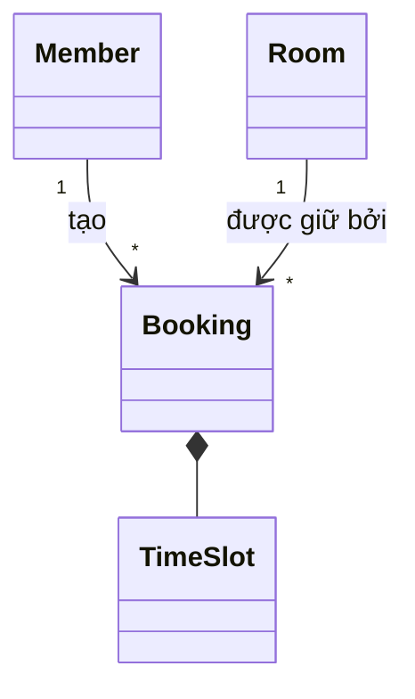
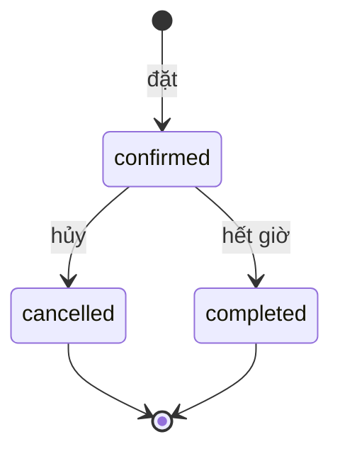

# Domain: [tên dự án]

- **Status:** [Draft | Accepted | Superseded]
- **Updated:** [YYYY-MM-DD]
- **Reviewed:** [YYYY-MM-DD: review nguội; AI review; người ngoài nếu có]
- **Related:** [requirements](requirements.md) · [questions](questions.md) · [data design](design/data.md) ·
  [analysis guide](playbook/analysis.md)

> Điền ở Phase 2; cập nhật ở mỗi Feature loop. Đây là nguồn chính cho thuật ngữ, entity, vòng đời, luật nghiệp vụ và
> edge case. Requirements, thiết kế, code và test dẫn mã `BR-xxx`, `EC-xxx` tới đây thay vì viết lại. File này không
> ghi tên bảng hay công nghệ; cách lưu nằm ở data design. Luật chưa được xác nhận thì để Status `Assumed` và dẫn mã
> `A-xxx`. Mục dài quá một màn hình thì tách thành file riêng và để link ở đây. Dòng in nghiêng và sơ đồ mẫu là ví dụ,
> xóa khi điền.

## Glossary

Chỉ ghi từ mà người dùng, tài liệu và code có thể hiểu khác nhau. Dự án chỉ có một bounded context thì ghi một câu như
vậy ở đây.

| Term | Meaning | Code name | Not to confuse with |
|---|---|---|---|
| *Lịch đặt* | *Một lần giữ một phòng cho một khung giờ, kể cả khi chưa diễn ra* | *`Booking`* | *Cuộc họp: sự kiện trong lịch cá nhân, có thể không cần phòng* |

## Entities

Entity có danh tính và sống qua thời gian; value object được so sánh theo giá trị và không đổi sau khi tạo.

| Name | Kind | Key attributes | Relations |
|---|---|---|---|
| *Booking* | *Entity* | *Khung giờ, người đặt, mục đích, số người, trạng thái* | *Thuộc một Room; do một Member tạo* |
| *TimeSlot* | *Value object* | *Bắt đầu, kết thúc, timezone; kết thúc luôn sau bắt đầu* | *—* |

## Aggregates and invariants

Bỏ mục này khi không có luật nhất quán giữa nhiều entity. Luật trải trên nhiều aggregate ghi ở cột cuối để Phase 3 chọn
cơ chế giữ luật.

| Aggregate (root) | Contains | Invariants | Cross-aggregate rules |
|---|---|---|---|
| *Booking* | *Booking, TimeSlot, danh sách người tham dự* | *Số người tham dự không vượt sức chứa của phòng tại lúc đặt (BR-003)* | *Không hai Booking `confirmed` chồng giờ trên cùng một Room (BR-001)* |

## Lifecycles

Mỗi entity có trạng thái có một sơ đồ và một bảng. Chuyển trạng thái không có trong bảng là không được phép.

| Entity | From | To | Trigger and actor | Guard |
|---|---|---|---|---|
| *Booking* | *`confirmed`* | *`cancelled`* | *Người đặt hoặc quản trị hủy* | *Trước giờ bắt đầu (BR-004)* |

## Business rules

Status: `Confirmed` khi có nguồn xác nhận, `Assumed` khi dựa trên assumption, `Disputed` khi các nguồn mâu thuẫn và
chưa ai chốt. Luật `Disputed` không được đưa vào code.

| ID | When | Then | Source | Status |
|---|---|---|---|---|
| *BR-001* | *Đặt một phòng cho khung giờ chồng lên một lịch `confirmed` khác của phòng đó* | *Từ chối và báo lịch bị trùng* | *Quy định phòng họp, mục 2* | *Confirmed* |
| *BR-004* | *Hủy một lịch đặt* | *Chỉ được hủy trước giờ bắt đầu* | *A-002* | *Assumed* |

### Parameters

Con số trong luật nằm ở đây để đổi được mà không sửa luật. Giá trị đặt trong config, không hard-code; nơi lưu ghi ở mục
Configuration của [components](design/components.md).

| Parameter | Meaning and unit | Value | Used by |
|---|---|---|---|
| *`max_booking_hours`* | *Số giờ tối đa của một lịch đặt* | *4* | *BR-002* |

## Sensitive data

Ghi loại dữ liệu nhạy cảm, mục đích và ai được xem. Dữ liệu đi qua thành phần nào và được bảo vệ ra sao ghi ở mục Data
and trust boundaries của [ARCHITECTURE.md](../ARCHITECTURE.md).

| Data | Purpose | Who may see | Retention |
|---|---|---|---|
| *Email thành viên* | *Gửi thông báo khi lịch thay đổi* | *Chính thành viên, quản trị* | *Xóa 30 ngày sau khi tài khoản bị xóa* |

## Edge cases

Ca chưa biết cách xử lý thì ghi `Undecided` và mở câu hỏi `Q-xxx`. Ca đã có link tới test chưa có nghĩa là test đó đã
chạy trên bản hiện tại.

| ID | Situation | Expected handling | Rule | Verified by |
|---|---|---|---|---|
| *EC-001* | *Lịch đặt qua nửa đêm, 23:00–01:00* | *Cho phép; lịch hiện ở cả hai ngày* | *BR-002* | *[test]* |
| *EC-005* | *Người khác đặt mất khung giờ trong lúc thành viên đang xác nhận lịch lặp* | *Bỏ qua lần đó và báo lại* | *BR-001* | *[test]* |
