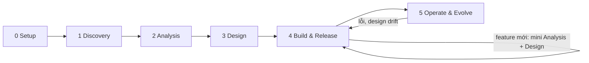

# Playbook

Playbook chia dự án thành sáu phase và dùng bốn mũ cho một người. Trang này tóm tắt nguyên tắc, các phase và cách chọn
tài liệu theo loại dự án.

Các file trong `docs/playbook/` là hướng dẫn và default, dùng chung cho mọi dự án. Dự án làm khác default ở đâu thì ghi
vào [project.md](../project.md), không sửa ở đây. Các mẫu cần điền nằm ở phần còn lại của `docs/` và ở
[ARCHITECTURE.md](../../ARCHITECTURE.md).

## Principles

1. **Ghi lại rồi mới làm.** Quyết định và thay đổi nằm trong repo hoặc tracker. Kết luận từ ghi chú hay từ chat với AI
   thì tóm tắt về đó.
2. **Mỗi thông tin một nguồn.** Nơi khác cần thì dẫn link hoặc mã, không chép lại.
3. **Vấn đề trước, giải pháp sau.** Tài liệu phân tích ghi người dùng cần gì và luật nào phải đúng, không nhắc tên công
   nghệ. Công nghệ được chọn ở Design, kèm lý do.
4. **Mỗi quyết định truy được về yêu cầu.** Quyết định kiến trúc dẫn tới quality attribute hoặc ràng buộc; module dẫn
   tới user story. Phần thiết kế không truy được về đâu thì hoặc đang thiếu yêu cầu, hoặc đang thiết kế thừa.
5. **Thiết kế sâu theo rủi ro.** Phần khó đảo ngược như data model, contract và bảo mật thì thiết kế kỹ trước khi code.
   Phần dễ đổi để code quyết.
6. **Luật nằm trong code.** Tiền, quyền và ngưỡng nằm trong code hoặc config, không nằm trong prompt hay giao diện.
7. **Một người vẫn cần góc nhìn thứ hai.** Tài liệu và PR quan trọng qua review nguội và AI phản biện trước khi chốt.
8. **Báo đúng bằng chứng.** Kết quả ghi rõ đã chạy gì, ở môi trường nào và phần nào chưa kiểm.
9. **Exit criteria chặn việc chốt, không chặn việc bắt đầu.** Việc của phase sau có thể làm nháp từ sớm.

## Phases

| Phase | Hat | Goal | Key output | Exit criteria |
|---|---|---|---|---|
| 0 Setup | Ops | Dựng repo, tracker và nhịp làm việc | `project.md`, `main` được bảo vệ, Issue baseline | `project.md` đã merge |
| 1 Discovery | Analyst | Hiểu bài toán, thử phần rủi ro nhất, quyết có làm không | Brief, questions, spike | Brief ghi `Go`, `Pivot` hoặc `Stop` |
| 2 Analysis | Analyst | Mô tả hệ thống phải làm gì, theo luật nào, tốt tới mức nào | Requirements, stories, domain, UI flow | Requirements, stories và domain `Accepted` |
| 3 Design | Architect | Chọn cấu trúc hệ thống đáp ứng yêu cầu, kèm lý do | ARCHITECTURE, `design/`, contract, ADR, SPEC, setup | Qua design review; SPEC v1.0 `Accepted` |
| 4 Build & Release | Developer | Làm theo vertical slice; feature mới chạy mini Analysis + Design | Code, testing, bản phát hành, CHANGELOG | Mỗi milestone qua release gate |
| 5 Operate & Evolve | Ops, Architect | Giữ hệ thống chạy, giữ thiết kế khớp code, rút kinh nghiệm | Backup, runbook, user guide, retro, ADR mới | Chạy liên tục |

Phase 0–3 làm một lần để có baseline. Sau baseline, feature mới đi theo Feature loop ở Phase 4; thay đổi những gì đã
chốt đi theo [change-control.md](change-control.md). Chi tiết từng phase ở [phases.md](phases.md).

## Project types

Chọn cột gần với dự án nhất. Cột Product là default của [phases.md](phases.md). Muốn luyện phân tích và thiết kế thì
theo cột Product, kể cả khi chỉ mình dùng. Client delivery là Product cộng các mục cho một bên nhận: xác nhận phạm vi,
nghiệm thu và bàn giao.

| Artifact | Experiment | Personal tool | Product | Client delivery |
|---|---|---|---|---|
| Brief | Một đoạn: câu hỏi cần trả lời và time box | ✅ | ✅ | ✅ |
| Questions | — | ✅ | ✅ | ✅ |
| Requirements | — | Actors; 1–3 quality attribute | Thêm use case cho luồng nhiều nhánh, ma trận phân quyền; 3–5 quality attribute có số đo | ✅, thêm Sign-off |
| Stories | — | Story và acceptance criteria | ✅ | ✅ |
| Domain | — | Glossary, business rule, vòng đời | ✅, thêm aggregate khi cần và sensitive data | ✅ |
| ARCHITECTURE.md | — | Context và Container | ✅, thêm drivers, cross-cutting, threats | ✅ |
| `design/` | — | `data.md`, `api.md` khi có | `components`, `data`, `api`, `flows`; `ui` khi có giao diện; `ai` khi có tính năng AI | ✅ |
| Contract | — | Khi có client ngoài repo | ✅ khi có API | ✅ khi có API |
| ADR | Kết luận ghi trong Issue Spike | Stack, lưu trữ dữ liệu | Mọi quyết định khó đảo ngược | ✅ |
| SPEC | — | Modules, Commands, Boundaries | ✅, đủ Traceability | ✅ |
| Setup | — | ✅ | ✅ | ✅ |
| Testing | — | Defect severity | ✅ | ✅, thêm Acceptance sign-off |
| Staging | — | — | ✅ | ✅ |
| CHANGELOG và tag | — | Tag | ✅ | ✅, thêm bản `-rc` cho nghiệm thu |
| Phase 5 | — | Backup, runbook rollback | Error tracking, uptime, backup, runbook, kiểm design drift; user guide khi có người dùng khác | ✅, thêm user guide và handover |

## Guides

| File | Nội dung |
|---|---|
| [phases.md](phases.md) | Goal, output, exit criteria và activities của từng phase |
| [hats.md](hats.md) | Bốn mũ, AI giúp được gì ở từng mũ, cách tự review khi làm một mình |
| [analysis.md](analysis.md) | Kỹ thuật phân tích: actor, user story, use case, domain modeling, quality attribute |
| [design.md](design.md) | Kỹ thuật thiết kế: C4, data, API, component, sequence, ADR, design review |
| [working-agreement.md](working-agreement.md) | Default về task, board, label, Definition of Ready và Definition of Done |
| [git-workflow.md](git-workflow.md) | Nhánh, commit, PR, review, CI, branch protection, phát hành |
| [change-control.md](change-control.md) | Cách đổi những gì đã chốt sau baseline |
| [documents.md](documents.md) | Tài liệu nào trả lời câu hỏi nào, mã ID, quy ước mẫu, sơ đồ, cách viết |
| [ai-components.md](ai-components.md) | Thiết kế và eval-lite cho tính năng AI của sản phẩm |
