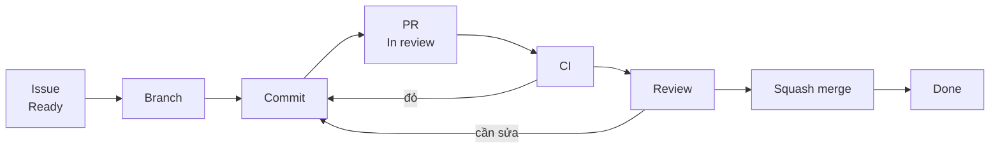

# Git workflow

Chi tiết về nhánh, commit, PR, CI và phát hành. Tóm tắt và Definition of Done nằm ở
[working-agreement.md](working-agreement.md). Áp dụng cho mọi thay đổi: code, tài liệu, cấu hình. Làm khác chỗ nào thì
ghi vào [project.md](../project.md), không sửa file này.

## Strategy

GitHub Flow: chỉ có một nhánh chính là `main`, luôn chạy được và chỉ thay đổi qua PR. Mỗi Issue một nhánh tách từ
`main`, sống tối đa vài ngày. Không dùng `develop` hay `release/*`; với một người, các nhánh đó chỉ thêm việc merge và
conflict. Tính năng chưa xong thì merge từng PR nhỏ sau feature flag thay vì giữ nhánh sống lâu.

## From issue to merge



| # | Step | What to do |
|---|---|---|
| 1 | Pick | Lấy Issue ở cột `Ready` (đã đạt Definition of Ready), chuyển sang `In progress` |
| 2 | Branch | Tạo nhánh từ `main` mới nhất, đặt tên theo mục Branches |
| 3 | Commit | Commit nhỏ, mỗi commit một ý; chạy `make check` trước khi push |
| 4 | PR | Mở PR theo mẫu, để Draft khi chưa xong; ghi `Closes #N` hoặc `Refs #N` theo mục Pull requests |
| 5 | CI | Mọi check phải xanh. Check đỏ thì sửa, không tắt hay bỏ qua |
| 6 | Review | Theo mục Review before merge |
| 7 | Merge | Squash merge; GitHub xóa nhánh, đóng Issue và chuyển thẻ sang `Done` |

```bash
git switch main && git pull
git switch -c feat/12-recurring-booking
# ... code, commit ...
git push -u origin feat/12-recurring-booking
gh pr create --draft                  # mở PR theo mẫu
gh pr ready                           # xong thì chuyển khỏi Draft
gh pr merge --squash --delete-branch  # sau khi CI xanh và đã review
```

## Branches

```text
<type>/<issue>-<short-desc>
```

- **type:** một type trong bảng Commits, cộng `spike` cho nhánh thử nghiệm không merge.
- **short-desc:** tiếng Anh, chữ thường, không dấu, nối bằng `-`, khoảng 40 ký tự trở xuống.

Ví dụ: `feat/12-recurring-booking` · `fix/34-overlap-check` · `docs/5-domain-draft` · `spike/7-calendar-sync`

## Commits

Theo [Conventional Commits](https://www.conventionalcommits.org/):

```text
<type>(<scope>): <mô tả>

<body: vì sao thay đổi, nếu cần>

<footer: Refs #12 | BREAKING CHANGE: ...>
```

| Type | When | Version impact |
|---|---|---|
| `feat` | Thêm hành vi người dùng thấy được | MINOR |
| `fix` | Sửa lỗi | PATCH |
| `perf` | Cải thiện hiệu năng | PATCH |
| `refactor` | Đổi cấu trúc code, không đổi hành vi | — |
| `docs` | Chỉ sửa tài liệu | — |
| `test` | Thêm hoặc sửa test | — |
| `build` | Build, dependency | — |
| `ci` | Cấu hình CI | — |
| `chore` | Việc khác: cấu hình, script, phát hành | — |
| `revert` | Hoàn tác một commit | Theo commit gốc |

- Thay đổi không tương thích ngược: thêm `!` sau type hoặc footer `BREAKING CHANGE:`; tăng MAJOR.
- **Scope:** tên module (`booking`, `rooms`) hoặc tên tài liệu (`domain`, `api`, `adr`). Có thể bỏ.
- **Mô tả:** `type(scope)` viết tiếng Anh, mô tả viết tiếng Việt. Bắt đầu bằng động từ, không chấm cuối, cả dòng tối
  đa 72 ký tự.
- Không commit secret, file `.env`, file build.

| Unclear | Clearer |
|---|---|
| `update` | `docs(domain): thêm vòng đời của Booking` |
| `fix bug` | `fix(booking): trả 409 thay vì 500 khi trùng lịch` |
| `thêm login và test` | Hai commit: `feat(auth): thêm đăng nhập bằng email`, `test(auth): kiểm sai mật khẩu` |

## Pull requests

- **Title:** theo mục Commits; khi squash merge, tiêu đề PR thành commit trên `main`. CI kiểm tiêu đề bằng
  [pr-title.yml](../../.github/workflows/pr-title.yml).
- **Issue và PR:**

  | Issue | Rule |
  |---|---|
  | Task | Một Task một PR, ghi `Closes #N`. Cần nhiều PR thì Task quá lớn: tách thành Task mới |
  | Tài liệu baseline | Một Issue có thể nhiều PR. PR trung gian ghi `Refs #N`; PR cuối ghi `Closes #N` |
  | Bug | Một PR, ghi `Closes #N`, kèm test tái hiện lỗi |

- Thay đổi giao diện thì đính kèm ảnh chụp.
- Đổi API thì sửa contract; đổi hành vi thì sửa stories hoặc domain; đổi thiết kế thì sửa tài liệu thiết kế và
  Traceability. Làm trong cùng PR, hoặc mở Issue và ghi vào mục Design impact.

## Review before merge

1. Cho AI review diff. Phải sửa hết phát hiện mức Critical và Required, hoặc mức tương đương của công cụ đang dùng;
   mức Optional và Nit thì tùy.
2. Tự đọc lại toàn bộ diff trên GitHub, tab *Files changed*, không chỉ trong editor.
3. PR rủi ro cao chờ review nguội trước khi merge, theo [working-agreement.md](working-agreement.md).
4. PR tài liệu: xem bản render trên GitHub, kiểm tra bảng, sơ đồ Mermaid và link.
5. Điền mục Verification trong mẫu PR: đã chạy gì, ở môi trường nào, phần nào chưa kiểm.

## CI checks

| Check | What it checks | File |
|---|---|---|
| `docs` | Link nội bộ trong Markdown | [ci.yml](../../.github/workflows/ci.yml) |
| `contract` | Lint `contracts/openapi.yaml`; tự bỏ qua khi không có file | [ci.yml](../../.github/workflows/ci.yml) |
| `pr-title` | Tiêu đề PR theo Conventional Commits | [pr-title.yml](../../.github/workflows/pr-title.yml) |
| *[`check`]* | *`make check`, thêm ở Phase 3* | *[ci.yml](../../.github/workflows/ci.yml)* |

Check đỏ thì không merge. Không tắt, skip hay xóa test để CI xanh. Thêm hoặc bỏ job thì cập nhật required status
checks bằng `scripts/bootstrap-github.sh --protect`.

## Branch protection

`scripts/bootstrap-github.sh --protect` bật cho `main`:

- Chỉ thay đổi qua PR; không yêu cầu người duyệt, vì GitHub không cho tự duyệt PR của mình.
- Phải qua các check ở mục CI checks; nhánh phải cập nhật theo `main` trước khi merge.
- Áp dụng cả cho admin: chủ repo cũng không push thẳng lên `main` được.
- Chặn force-push và chặn xóa `main`. Script cũng chỉ bật squash merge và tự xóa nhánh sau merge.

Repo private ở gói GitHub Free không bật được branch protection. Khi đó tự giữ các quy tắc trên.

## Releases

Version theo [Semantic Versioning](https://semver.org/): `vMAJOR.MINOR.PATCH`.

| When | Tag |
|---|---|
| Đóng một milestone, trước khi có người dùng thật | `v0.1.0`, `v0.2.0`, … |
| Bản cho bên nhận nghiệm thu, khi dự án là Client delivery | `v1.0.0-rc.1`, `v1.0.0-rc.2`, … |
| Bản production đầu tiên cho người dùng thật | `v1.0.0` |
| Sau đó | MINOR khi có `feat`, PATCH khi chỉ có `fix` hoặc `perf`, MAJOR khi có breaking change |

**Steps**

1. Mở PR `chore(release): vX.Y.Z`: chuyển mục Unreleased trong [CHANGELOG](../../CHANGELOG.md) thành version mới. Lấy
   danh sách từ `git log --oneline <tag-trước>..HEAD`.
2. Sau khi merge:

   ```bash
   git switch main && git pull
   git tag -a vX.Y.Z -m "vX.Y.Z"
   git push origin vX.Y.Z
   gh release create vX.Y.Z --generate-notes
   ```

3. Ghi kết quả release gate vào Release test log trong [testing.md](../testing.md).

**Hotfix:** nhánh `fix/<issue>-...` từ `main`, đi đúng luồng PR, rồi phát hành với PATCH tăng một.
