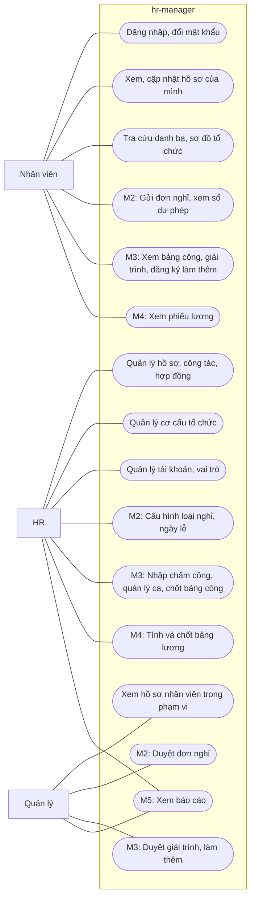

# Requirements: hr-manager

- **Status:** Draft
- **Updated:** 2026-10-30
- **Reviewed:** [YYYY-MM-DD: review nguội; AI review; người ngoài nếu có]
- **Related:** [brief](brief.md) · [stories](stories.md) · [domain](domain.md) · [ui-flow](ui-flow.md) · [SPEC](SPEC.md) ·
  [analysis guide](playbook/analysis.md)

## Goal

Baseline mô tả đủ hành vi của năm milestone M1–M5 trong [brief](brief.md#scope) để thiết kế toàn hệ thống trước khi
code. Tài liệu được điền theo từng milestone và đã đủ phần dùng chung cùng M1 tới M5.

## Actors

Hệ thống có ba vai trò người. Một người có thể giữ nhiều vai trò, ví dụ trưởng phòng vừa là Nhân viên vừa là Quản lý.
Ban giám đốc không có vai trò riêng: giám đốc là trưởng phòng ban gốc nên dùng vai trò Quản lý với phạm vi toàn công ty.

| Actor | Type | Goals | Permissions |
|---|---|---|---|
| Nhân viên | Người | Xem và cập nhật thông tin của mình; tra cứu đồng nghiệp | Mọi người có tài khoản đang hoạt động đều có vai trò này (BR-006) |
| Quản lý | Người | Nắm thông tin nhân sự trong phạm vi mình phụ trách; từ M2, duyệt yêu cầu của nhân viên trong phạm vi; từ M5, xem báo cáo của phạm vi | Tự có khi đang là trưởng của ít nhất một phòng ban, không gán tay (BR-006). Phạm vi gồm phòng ban mình làm trưởng và mọi phòng ban con (BR-013) |
| HR | Người | Giữ hồ sơ, hợp đồng và cơ cấu tổ chức đúng; quản lý tài khoản và cấu hình; từ M4, tính và chốt lương | Được gán tay (BR-006). HR kiêm quản trị hệ thống và tính lương; hệ thống không có vai trò Kế toán |
| Thời gian | Lịch | Làm cho thay đổi có ngày hiệu lực tự có tác dụng khi tới ngày | Chỉ thực hiện các chuyển trạng thái do thời gian trong mục Lifecycles của [domain](domain.md#lifecycles) |
| Máy chấm công | Hệ thống ngoài | Cung cấp lượt chấm công của nhân viên qua file do HR xuất ra và tải lên | Hệ thống không kết nối trực tiếp với máy |

### Permission matrix

"Phạm vi" là nhân viên trong phạm vi của Quản lý theo BR-013. Quyền được kiểm ở backend, kể cả khi giao diện đã ẩn nút.

| Operation | Nhân viên | Quản lý | HR |
|---|---|---|---|
| Đăng nhập, đổi mật khẩu của mình (US-001) | ✅ | ✅ | ✅ |
| Xem hồ sơ, quá trình công tác và hợp đồng của mình (US-017) | ✅ | ✅ | ✅ |
| Sửa thông tin liên hệ của mình (US-017) | ✅ | ✅ | ✅ |
| Tra cứu danh bạ (US-019) | ✅ | ✅ | ✅ |
| Xem sơ đồ tổ chức hiện tại (US-009) | ✅ | ✅ | ✅ |
| Xem thông tin công việc và quá trình công tác của người khác (US-018, US-020) | ❌ | ✅ phạm vi | ✅ mọi người |
| Xem thông tin cá nhân và hợp đồng của người khác (US-012, US-015) | ❌ | ❌ | ✅ |
| Tiếp nhận nhân viên mới; sửa hồ sơ (US-011, US-012) | ❌ | ❌ | ✅ |
| Nhập nhân viên từ bảng tính (US-021) | ❌ | ❌ | ✅ |
| Ghi nhận thay đổi công tác, nghỉ việc (US-013, US-014) | ❌ | ❌ | ✅ |
| Quản lý hợp đồng; xem hợp đồng sắp hết hạn (US-015, US-016) | ❌ | ❌ | ✅ |
| Quản lý chức danh, phòng ban, trưởng phòng ban (US-005 tới US-008) | ❌ | ❌ | ✅ |
| Xem cơ cấu tổ chức tại một ngày khác hôm nay (US-010) | ❌ | ❌ | ✅ |
| Quản lý tài khoản; gán và thu hồi vai trò HR (US-002, US-003) | ❌ | ❌ | ✅ |
| Xem nhật ký thao tác (US-004) | ❌ | ❌ | ✅ |
| Xem số dư phép và biến động phép của mình (US-022) | ✅ | ✅ | ✅ |
| Gửi đơn nghỉ, hủy đơn nghỉ của mình (US-023, US-024) | ✅ | ✅ | ✅ |
| Duyệt, từ chối đơn nghỉ (US-025, US-026) | ❌ | ✅ chỉ đơn mình là người duyệt | ✅ mọi đơn, duyệt thay |
| Xem đơn, số dư phép và lịch nghỉ của người khác (US-027) | ❌ | ✅ phạm vi; lý do nghỉ chỉ khi là người duyệt | ✅ mọi người |
| Quản lý loại nghỉ và lịch làm việc (US-028, US-029) | ❌ | ❌ | ✅ |
| Điều chỉnh số dư phép; ghi đơn nghỉ thay nhân viên (US-032, US-033) | ❌ | ❌ | ✅ |
| Xem bảng công của mình; gửi giải trình chấm công; đăng ký và hủy đơn làm thêm giờ của mình (US-041, US-042, US-044) | ✅ | ✅ | ✅ |
| Duyệt, từ chối giải trình chấm công và đơn làm thêm giờ (US-043, US-045) | ❌ | ✅ chỉ đơn mình là người duyệt | ✅ mọi đơn, duyệt thay |
| Xem bảng công của người khác (US-046) | ❌ | ✅ phạm vi | ✅ mọi người |
| Quản lý ca, gán ca, khai báo mã chấm công (US-036 tới US-038) | ❌ | ❌ | ✅ |
| Nhập file chấm công; xử lý ngày thiếu chấm công (US-039, US-047) | ❌ | ❌ | ✅ |
| Chốt, mở lại và xuất bảng công (US-048, US-049) | ❌ | ❌ | ✅ |
| Xem phiếu lương đã chốt của mình (US-061) | ✅ | ✅ | ✅ |
| Xem lương, phụ cấp, thông tin thuế, bảo hiểm và người phụ thuộc của người khác (US-051 tới US-053) | ❌ | ❌ kể cả trong phạm vi (BR-122) | ✅ |
| Ghi lương, thông tin thuế, bảo hiểm và người phụ thuộc (US-051 tới US-053) | ❌ | ❌ | ✅ |
| Quản lý loại phụ cấp và tham số lương (US-050, US-054) | ❌ | ❌ | ✅ |
| Tính, điều chỉnh, chốt và xuất bảng lương (US-055 tới US-060, US-062, US-063) | ❌ | ❌ | ✅ |
| Xem trang tổng quan và báo cáo nhân sự, nghỉ phép, chấm công; xuất báo cáo (US-064 tới US-068, US-070) | ❌ | ✅ phạm vi (BR-127) | ✅ mọi người |
| Xem báo cáo chi phí lương (US-069) | ❌ | ✅ phạm vi, chỉ số tổng hợp từ bảng lương đã chốt (BR-128, BR-129) | ✅ mọi người, kể cả bảng lương Nháp |

## User stories

Story và acceptance criteria nằm ở [stories.md](stories.md).

## Use cases

Sơ đồ tổng thể của baseline. Quản lý và HR cũng là Nhân viên nên dùng được mọi use case của Nhân viên; sơ đồ không vẽ
lại các đường đó.

### UC-001: Tiếp nhận nhân viên mới

- **Actor:** HR · **Stories:** US-011, US-015, US-002
- **Trigger:** Công ty tuyển được người và đã chốt ngày vào làm.
- **Preconditions:** Phòng ban và chức danh dự kiến đã có trên hệ thống.
- **Main flow:**
  1. HR nhập thông tin cá nhân.
  2. HR nhập ngày vào làm, chọn phòng ban và chức danh.
  3. HR nhập hợp đồng đầu tiên: loại, ngày bắt đầu, ngày kết thúc nếu có.
  4. Hệ thống kiểm luật hợp đồng (BR-024, BR-028) và hiện bản tóm tắt.
  5. HR xác nhận. Hệ thống cấp mã nhân viên (BR-015) rồi lưu hồ sơ, quá trình công tác đầu tiên và hợp đồng cùng lúc.
  6. HR chọn tạo tài khoản. Hệ thống tạo tài khoản và hiện mật khẩu tạm đúng một lần (BR-002).
- **Alternative flows:**
  - `3a`. Chưa ký hợp đồng: HR bỏ qua bước 3; hồ sơ được lưu kèm cảnh báo chưa có hợp đồng (EC-017).
  - `6a`. HR chưa muốn tạo tài khoản: bỏ qua bước 6; tạo sau ở màn hình tài khoản.
- **Exceptions:**
  - `4a`. Hợp đồng vi phạm giới hạn của luật: hệ thống từ chối và chỉ ra trường sai; HR sửa ở bước 3.
  - `5a`. Số CCCD trùng với một hồ sơ đã có: hệ thống từ chối và dẫn tới hồ sơ đó (BR-022, EC-018).
- **Postconditions:** Thành công thì có hồ sơ, một quá trình công tác bắt đầu từ ngày vào làm, hợp đồng nếu đã nhập và
  tài khoản nếu đã tạo; nhật ký ghi lại thao tác. Thất bại ở bước 5 thì không có dữ liệu nào được lưu.

### UC-002: Ghi nhận thay đổi công tác

- **Actor:** HR; Thời gian · **Stories:** US-013
- **Trigger:** Nhân viên được chuyển phòng ban hoặc đổi chức danh.
- **Preconditions:** Nhân viên đang làm việc hoặc sắp vào làm.
- **Main flow:**
  1. HR mở hồ sơ và chọn ghi nhận thay đổi công tác.
  2. HR chọn ngày hiệu lực, phòng ban mới hoặc chức danh mới, và nhập lý do.
  3. Hệ thống hiện quá trình công tác trước và sau thay đổi, cùng quản lý trực tiếp mới (BR-012).
  4. HR xác nhận. Hệ thống lưu thay đổi (BR-016, BR-017).
- **Alternative flows:**
  - `2a`. Ngày hiệu lực ở tương lai: thay đổi được lưu và tự có tác dụng khi tới ngày.
  - `2b`. Ngày hiệu lực ở quá khứ: lý do là bắt buộc; quá trình mới chỉ kéo dài tới thay đổi kế tiếp đã có (BR-018,
    EC-003).
  - `3a`. Nhân viên đang là trưởng một phòng ban: hệ thống cảnh báo rằng bổ nhiệm trưởng không tự kết thúc (EC-004).
- **Exceptions:**
  - `2c`. Ngày hiệu lực ngoài khoảng làm việc của nhân viên: từ chối (BR-017).
  - `2d`. Đã có thay đổi khác cùng ngày hiệu lực: từ chối (EC-002).
  - `2e`. Phòng ban mới không hoạt động tại ngày hiệu lực hoặc sau đó: từ chối (BR-014).
- **Postconditions:** Các quá trình công tác của nhân viên không chồng, không hở (BR-016); nhật ký ghi người làm, lý do,
  giá trị trước và sau.

### UC-003: Ghi nhận nghỉ việc

- **Actor:** HR; Thời gian · **Stories:** US-014
- **Trigger:** Nhân viên nghỉ việc vì tự nghỉ, hết hợp đồng hoặc bị cho thôi việc.
- **Preconditions:** Nhân viên đang làm việc.
- **Main flow:**
  1. HR nhập ngày làm việc cuối cùng và lý do nghỉ.
  2. Hệ thống liệt kê tác động: quá trình công tác, bổ nhiệm trưởng và hợp đồng đang hiệu lực kết thúc ở ngày đó; tài
     khoản bị khóa từ ngày hôm sau (BR-019).
  3. HR xác nhận. Hệ thống lưu.
  4. Sang ngày sau ngày làm việc cuối cùng, Thời gian chuyển nhân viên sang Đã nghỉ việc và khóa tài khoản (BR-005).
- **Alternative flows:**
  - `2a`. Nhân viên là trưởng phòng ban: hệ thống nhắc HR bổ nhiệm người thay; nếu không, phòng ban không có trưởng từ
    ngày hôm sau (EC-005).
  - `3a`. HR hủy ghi nhận khi ngày làm việc cuối cùng chưa qua: mọi tác động bị bỏ (BR-020).
- **Exceptions:**
  - `1a`. Còn thay đổi công tác có hiệu lực sau ngày làm việc cuối cùng: từ chối và liệt kê thay đổi cần hủy (EC-009).
  - `1b`. Ngày làm việc cuối cùng trước ngày vào làm: từ chối.
  - `3b`. Nhân viên là HR đang hoạt động cuối cùng: từ chối (BR-004).
- **Postconditions:** Hồ sơ được giữ, không bị xóa. Từ ngày hôm sau, nhân viên không còn trong danh bạ. Nhật ký ghi lại
  thao tác.

### UC-004: Tái cấu trúc phòng ban

- **Actor:** HR; Thời gian · **Stories:** US-006, US-007, US-008
- **Trigger:** Công ty đổi tên, chuyển nhánh hoặc giải thể một phòng ban.
- **Preconditions:** Phòng ban đang hoạt động.
- **Main flow:**
  1. HR chọn phòng ban, chọn thao tác đổi tên, đổi phòng ban cha hoặc giải thể, và nhập ngày hiệu lực.
  2. Hệ thống hiện cơ cấu trước và sau, cùng danh sách nhân viên đổi quản lý trực tiếp (BR-012).
  3. HR xác nhận. Hệ thống lưu.
- **Alternative flows:**
  - `1a`. Ngày hiệu lực ở tương lai: thay đổi tự có tác dụng khi tới ngày.
- **Exceptions:**
  - `1b`. Phòng ban cha mới là chính phòng ban đó hoặc nằm trong nhánh con của nó: từ chối (BR-008).
  - `1c`. Giải thể khi còn nhân viên hoặc phòng ban con đang hoạt động: từ chối và liệt kê (BR-010, EC-007, EC-022).
  - `1d`. Thao tác khác đổi tên trên phòng ban gốc: từ chối (BR-007).
- **Postconditions:** Cây tổ chức hợp lệ tại mọi ngày; nhật ký ghi lại thao tác.

### UC-005: Gửi và duyệt đơn nghỉ

- **Actor:** Nhân viên; Quản lý, HR · **Stories:** US-023, US-025, US-026, US-034
- **Trigger:** Nhân viên cần nghỉ.
- **Preconditions:** Nhân viên đang làm việc và có tài khoản.
- **Main flow:**
  1. Nhân viên chọn loại nghỉ, ngày và buổi bắt đầu, ngày và buổi kết thúc, nhập lý do.
  2. Hệ thống tính số ngày nghỉ theo lịch làm việc (BR-044). Với phép năm, hệ thống hiện số phép còn lại sau đơn
     (BR-053).
  3. Nhân viên gửi đơn.
  4. Hệ thống xác định người duyệt (BR-056) và gửi thông báo cho người đó (BR-066).
  5. Người duyệt xem đơn, số dư phép của nhân viên và các đơn khác của nhóm trong cùng khoảng ngày.
  6. Người duyệt duyệt đơn.
  7. Hệ thống kiểm lại số phép, trừ phép nếu là phép năm (BR-053, BR-054) và thông báo cho nhân viên.
- **Alternative flows:**
  - `4a`. Nhân viên không có quản lý trực tiếp: HR là người duyệt (BR-056).
  - `5a`. Người duyệt không còn quản lý nhân viên trước khi duyệt: đơn chuyển cho người duyệt mới (BR-057, EC-027).
  - `5b`. HR duyệt thay người duyệt (BR-058).
  - `6a`. Người duyệt từ chối và nhập lý do (BR-059). Số dư không đổi.
- **Exceptions:**
  - `2a`. Khoảng nghỉ không có ngày làm việc nào: từ chối (EC-025).
  - `2b`. Đơn chồng buổi với đơn khác đang chờ duyệt hoặc đã duyệt: từ chối (BR-045).
  - `2c`. Thiếu phép năm, vượt số ngày tối đa của loại nghỉ hoặc ra ngoài khoảng làm việc: từ chối (BR-053, BR-047,
    BR-046).
  - `7a`. Tại lúc duyệt, số phép không còn đủ: từ chối thao tác duyệt; đơn vẫn chờ (EC-024, EC-030).
- **Postconditions:** Đơn được duyệt thì có một biến động phép trừ số ngày, nếu là phép năm. Đơn bị từ chối hay bị hủy
  thì số dư không đổi. Mọi bước được ghi nhật ký.

### UC-006: Cộng phép và chuyển phép tồn

- **Actor:** Thời gian · **Stories:** US-030, US-031
- **Trigger:** Tới ngày cuối tháng, ngày 1/1 hoặc ngày sau hạn phép tồn.
- **Preconditions:** Lịch làm việc của tháng hoặc năm liên quan đã có.
- **Main flow:**
  1. Ngày cuối mỗi tháng, hệ thống xác định nhân viên có tháng đủ điều kiện (BR-050).
  2. Hệ thống cộng cho mỗi người 1/12 phép năm cơ bản của họ, ghi thành biến động phép (BR-048, BR-049).
  3. Ngày 1/1, hệ thống chuyển phép năm chưa dùng của năm trước thành phép tồn, tối đa `carryover_max_days` ngày, và hủy
     phần vượt (BR-051).
  4. Ngày sau `carryover_expiry`, hệ thống hủy phép tồn còn lại.
- **Alternative flows:**
  - `1a`. Nhân viên vào làm hoặc nghỉ việc trong tháng: tháng đó chỉ được tính khi đủ tỷ lệ ngày làm việc (BR-050,
    EC-034).
- **Exceptions:**
  - `1b`. Hệ thống không chạy được đúng ngày: lần chạy sau cộng bù các tháng còn thiếu và không cộng trùng (EC-038).
- **Postconditions:** Mỗi tháng đủ điều kiện của mỗi nhân viên được cộng đúng một lần. Số dư phép luôn bằng tổng các biến
  động phép.

### UC-007: Nhập file chấm công và tính công

- **Actor:** HR; Máy chấm công, Thời gian · **Stories:** US-039, US-040
- **Trigger:** HR xuất file từ máy chấm công, thường mỗi tuần một lần.
- **Preconditions:** Nhân viên đã có mã chấm công và ca làm việc.
- **Main flow:**
  1. HR tải file lên.
  2. Hệ thống đọc từng dòng, ghép mã chấm công với nhân viên và bỏ qua lượt chấm trùng (BR-073).
  3. Hệ thống hiện số dòng sẽ lưu, số dòng trùng, và từng dòng bị bỏ qua kèm lý do.
  4. HR xác nhận. Hệ thống lưu lượt chấm.
  5. Hệ thống tính lại công cho các ngày có lượt chấm mới: giờ vào, giờ ra, đi muộn, về sớm, giờ làm thêm (BR-074 tới
     BR-080, BR-085).
- **Alternative flows:**
  - `3a`. HR hủy sau khi xem kết quả: không lượt chấm nào được lưu.
- **Exceptions:**
  - `2a`. File sai định dạng: từ chối cả file và chỉ ra cột thiếu.
  - `2b`. Dòng thuộc tháng đã chốt: bỏ qua và liệt kê (BR-090).
- **Postconditions:** Nhập lại cùng một file không tạo lượt chấm trùng (EC-041). Nhật ký ghi người nhập, file và số dòng.

### UC-008: Đăng ký và duyệt làm thêm giờ

- **Actor:** Nhân viên; Quản lý, HR · **Stories:** US-044, US-045
- **Trigger:** Nhân viên cần làm thêm ngoài giờ ca.
- **Preconditions:** Nhân viên đang làm việc; tháng của ngày làm thêm chưa chốt.
- **Main flow:**
  1. Nhân viên nhập ngày, giờ bắt đầu, giờ kết thúc và lý do, trước giờ bắt đầu (BR-083).
  2. Hệ thống kiểm khoảng làm thêm nằm ngoài giờ ca và không chồng đơn khác (BR-086), rồi kiểm giới hạn giờ làm thêm theo
     ngày, tháng và năm (BR-084).
  3. Hệ thống gửi đơn cho người duyệt theo cùng luật với đơn nghỉ (BR-056) và thông báo.
  4. Người duyệt duyệt đơn.
  5. Sau khi có chấm công, hệ thống tính giờ làm thêm thực tế bằng phần giao giữa khoảng đã duyệt và khoảng có mặt, rồi
     phân loại theo ngày và ban đêm (BR-085).
- **Alternative flows:**
  - `4a`. Người duyệt từ chối kèm lý do (BR-059).
  - `4b`. HR duyệt thay (BR-058).
- **Exceptions:**
  - `1a`. Gửi sau giờ bắt đầu: từ chối (EC-051).
  - `2a`. Vượt giới hạn giờ làm thêm: từ chối và hiện số giờ còn được làm (BR-084, EC-050).
  - `5a`. Không có chấm công trong khoảng đã duyệt: giờ làm thêm thực tế bằng 0; nhân viên gửi giải trình nếu quên chấm
    (BR-081).
- **Postconditions:** Chỉ giờ làm thêm đã duyệt và có mặt mới vào bảng công. Nhật ký ghi mọi bước.

### UC-009: Chốt bảng công tháng

- **Actor:** HR · **Stories:** US-047, US-048
- **Trigger:** Hết tháng, trước khi tính lương.
- **Preconditions:** Đã nhập đủ file chấm công của tháng.
- **Main flow:**
  1. HR chọn tháng cần chốt.
  2. Hệ thống liệt kê việc còn chặn: đơn nghỉ, đơn làm thêm, giải trình đang chờ duyệt; ngày thiếu chấm công hoặc vắng
     chưa xử lý (BR-089).
  3. HR xử lý từng việc: nhắc người duyệt, duyệt thay, hoặc ghi công trực tiếp cho ngày thiếu chấm công (BR-082).
  4. Khi không còn việc chặn, HR chốt. Hệ thống chụp lại bảng công tháng của mọi nhân viên (BR-092).
- **Alternative flows:**
  - `4a`. Cần sửa sau khi chốt: HR mở lại kèm lý do nếu bảng lương tháng đó chưa chốt (BR-091), sửa, rồi chốt lại.
- **Exceptions:**
  - `4b`. Còn việc chặn: không chốt được (BR-089).
- **Postconditions:** Tháng đã chốt không nhận thay đổi về đơn, lượt chấm hay lịch làm việc (BR-090). Bảng công đã chốt
  là đầu vào của bảng lương ở M4.

### UC-010: Tính và chốt bảng lương tháng

- **Actor:** HR · **Stories:** US-055 tới US-060, US-062
- **Trigger:** Bảng công tháng đã chốt, tới ngày tính lương.
- **Preconditions:** Bảng công của tháng đã chốt (BR-102); tham số lương có giá trị hiệu lực cho tháng đó (BR-123).
- **Main flow:**
  1. HR chọn tháng và bấm Tính lương.
  2. Hệ thống tạo phiếu lương cho mỗi nhân viên có ngày làm việc trong tháng: lương theo công, phụ cấp, tiền làm thêm và
     làm đêm, bảo hiểm, thuế TNCN, thực lĩnh (BR-103 tới BR-114).
  3. Hệ thống hiện bảng lương ở trạng thái Nháp, kèm danh sách lỗi và cảnh báo, như thiếu bản ghi lương hay thiếu số tài
     khoản ngân hàng.
  4. HR thêm khoản điều chỉnh vào từng phiếu nếu cần: thưởng, tạm ứng, truy lĩnh, truy thu (BR-115). Hệ thống tính lại
     thuế và thực lĩnh của phiếu đó.
  5. HR kiểm bảng lương rồi bấm Chốt.
  6. Hệ thống chốt bảng lương, công bố phiếu lương và thông báo cho nhân viên (BR-117, BR-125).
- **Alternative flows:**
  - `2a`. Nhân viên có ngày làm việc cuối cùng trong tháng: phiếu có thêm tiền phép chưa nghỉ (BR-120, BR-121).
  - `4a`. Dữ liệu nguồn đổi sau khi tính, như HR sửa lương hay mở lại bảng công: bảng lương được đánh dấu Cần tính lại;
    HR tính lại, khoản điều chỉnh được giữ (BR-116, BR-119).
- **Exceptions:**
  - `1a`. Bảng công của tháng chưa chốt: không tính được (BR-102).
  - `5a`. Còn lỗi, phiếu có thực lĩnh âm, hoặc bảng lương Cần tính lại: không chốt được (BR-117).
  - `5b`. Hai HR cùng chốt: chỉ một thao tác thành công (EC-072).
- **Postconditions:** Bảng lương đã chốt không đổi và không mở lại được; sai sót được sửa bằng khoản điều chỉnh ở kỳ sau
  (BR-118). Bảng công của tháng không mở lại được nữa (BR-091). Mọi bước được ghi nhật ký (BR-124).

### UC-011: Thay đổi lương của nhân viên

- **Actor:** HR · **Stories:** US-051
- **Trigger:** Nhân viên được tăng lương, đổi phụ cấp, hoặc ký hợp đồng mới với mức lương khác.
- **Preconditions:** Nhân viên đang làm việc hoặc sắp vào làm.
- **Main flow:**
  1. HR mở tab Lương của nhân viên và chọn Thay đổi lương.
  2. HR nhập ngày hiệu lực, lương cơ bản, lương đóng bảo hiểm và các phụ cấp, kèm lý do.
  3. Hệ thống kiểm mức sàn (BR-094, BR-096) và hiện bản ghi lương trước và sau thay đổi.
  4. HR xác nhận. Hệ thống lưu; bản ghi trước kết thúc ở ngày trước ngày hiệu lực (BR-093).
- **Alternative flows:**
  - `3a`. Lương đóng bảo hiểm thấp hơn lương cơ bản: hệ thống cảnh báo; HR xác nhận thì vẫn lưu (BR-095).
  - `3b`. Ngày hiệu lực thuộc tháng có bảng lương nháp: bảng lương đó được đánh dấu Cần tính lại (BR-119).
  - `3c`. Ngày hiệu lực thuộc tháng có bảng lương đã chốt: hệ thống cảnh báo và hiện chênh lệch của từng tháng để HR thêm
    khoản truy lĩnh hoặc truy thu ở kỳ chưa chốt (BR-098, EC-063).
- **Exceptions:**
  - `3d`. Lương cơ bản hoặc lương đóng bảo hiểm dưới lương tối thiểu vùng: từ chối (BR-094, BR-096).
  - `2a`. Đã có bản ghi lương khác cùng ngày hiệu lực: từ chối; HR sửa bản ghi đó.
- **Postconditions:** Các bản ghi lương của nhân viên không chồng, không hở (BR-093); nhật ký ghi giá trị trước và sau.

### UC-012: Xem báo cáo chi phí lương

- **Actor:** Quản lý, HR · **Stories:** US-069, US-070
- **Trigger:** Ban giám đốc hoặc trưởng phòng ban cần biết chi phí nhân sự của một hoặc nhiều tháng.
- **Preconditions:** Có ít nhất một bảng lương đã chốt; với HR, đã có bảng lương Nháp.
- **Main flow:**
  1. Người xem mở báo cáo chi phí lương và chọn khoảng tháng.
  2. Hệ thống lấy các phiếu lương của bảng lương đã chốt, xếp mỗi nhân viên vào phòng ban tại ngày cuối tháng mà người đó
     còn làm (BR-127, BR-131).
  3. Hệ thống tổng hợp theo phòng ban trong phạm vi: số người, tổng thu nhập, phần công ty đóng, tổng chi phí, kèm so
     sánh với tháng trước.
  4. Người xem chọn một phòng ban để xem theo phòng ban con, hoặc xuất ra bảng tính (BR-136).
- **Alternative flows:**
  - `2a`. Người xem là HR: thêm tháng có bảng lương Nháp, đánh dấu tạm tính (BR-130), và xem được tới từng nhân viên.
  - `3a`. Người xem là Quản lý và một phòng ban có dưới `report_min_group_size` người: số liệu được gộp vào phòng ban cha
    (BR-129, EC-078).
- **Exceptions:**
  - `3b`. Cả phạm vi của Quản lý có dưới `report_min_group_size` người: không hiện số liệu và ghi lý do (BR-129, EC-079).
  - `4a`. Mở báo cáo của phòng ban ngoài phạm vi bằng đường dẫn trực tiếp: từ chối (BR-127, EC-086).
- **Postconditions:** Quản lý không suy ra được lương của từng người. Mỗi lần xuất được ghi nhật ký (BR-136).

## Quality attributes

Thêm ở lần cập nhật cuối của Phase 2, sau khi đủ M1–M5.

## Non-goals

Phạm vi ngoài baseline nằm ở mục Scope của [brief](brief.md#scope). Riêng M1 không làm:

- Đăng nhập bằng tài khoản Google hoặc Microsoft: một công ty nhỏ chưa cần.
- Tự đặt lại mật khẩu qua email: HR đặt lại mật khẩu, vì chưa chắc mọi nhân viên có email công việc.
- Đính kèm file vào hồ sơ và hợp đồng, như bản scan CCCD hay hợp đồng: để sau baseline.

Riêng M2 không làm:

- Nghỉ theo giờ: đơn vị nhỏ nhất là nửa ngày.
- Duyệt nhiều cấp: chủ dự án chọn duyệt một cấp.
- Đính kèm giấy tờ vào đơn nghỉ, như giấy nghỉ ốm: nhân viên nộp bản giấy cho HR.
- Thông báo qua email hoặc ứng dụng chat: chỉ thông báo trong hệ thống.

Riêng M3 không làm:

- Kết nối trực tiếp với máy chấm công: HR nhập file, theo lựa chọn của chủ dự án.
- Chấm công trên web hoặc điện thoại: chủ dự án chọn nhập file từ máy.
- Xếp ca theo lịch và ca xoay: mỗi nhân viên một ca cố định.
- Quản lý giao làm thêm giờ cho nhân viên: nhân viên tự đăng ký, và việc tự đăng ký cũng là sự đồng ý mà luật yêu cầu.
- Tính tiền làm thêm giờ và phụ cấp ca đêm: làm ở M4.

Riêng M4 không làm:

- Chuyển tiền lương qua ngân hàng: hệ thống chỉ xuất file danh sách chuyển khoản để HR tải lên ngân hàng.
- Quyết toán thuế TNCN cuối năm: chủ dự án chọn chỉ tính khấu trừ hằng tháng.
- Tính và chi trả chế độ BHXH như ốm đau, thai sản: cơ quan BHXH chi trả; hệ thống chỉ ghi ngày nghỉ.
- Khai báo và nộp hồ sơ BHXH, tờ khai thuế điện tử.
- Quản lý chương trình phúc lợi riêng như bảo hiểm sức khỏe hay quà lễ: HR ghi bằng phụ cấp hoặc khoản điều chỉnh.
- Lương theo sản phẩm, doanh số, hoa hồng; nhiều kỳ trả lương trong tháng: tạm ứng giữa tháng ghi bằng khoản trừ.
- Nhân viên không cư trú về thuế và trả lương bằng ngoại tệ.

Riêng M5 không làm:

- Người dùng tự tạo báo cáo, tự chọn cột hay kéo thả biểu đồ: hệ thống có bộ báo cáo cố định.
- Gửi báo cáo định kỳ qua email.
- Dự báo, phân tích xu hướng hay gợi ý bằng AI: để ở M6.
- Báo cáo nộp cơ quan nhà nước như báo cáo tình hình sử dụng lao động: HR tự lập từ file xuất.
