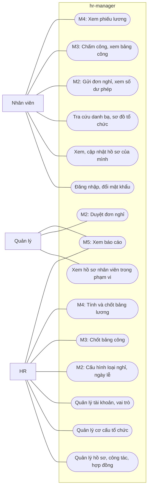

# Requirements: hr-manager

- **Status:** Draft
- **Updated:** 2026-10-30
- **Reviewed:** [YYYY-MM-DD: review nguội; AI review; người ngoài nếu có]
- **Related:** [brief](brief.md) · [stories](stories.md) · [domain](domain.md) · [ui-flow](ui-flow.md) · [SPEC](SPEC.md) ·
  [analysis guide](playbook/analysis.md)

## Goal

Baseline mô tả đủ hành vi của năm milestone M1–M5 trong [brief](brief.md#scope) để thiết kế toàn hệ thống trước khi
code. Tài liệu được điền theo từng milestone; bản hiện tại có phần dùng chung, M1 và M2.

## Actors

Hệ thống có ba vai trò người. Một người có thể giữ nhiều vai trò, ví dụ trưởng phòng vừa là Nhân viên vừa là Quản lý.
Ban giám đốc không có vai trò riêng: giám đốc là trưởng phòng ban gốc nên dùng vai trò Quản lý với phạm vi toàn công ty.

| Actor | Type | Goals | Permissions |
|---|---|---|---|
| Nhân viên | Người | Xem và cập nhật thông tin của mình; tra cứu đồng nghiệp | Mọi người có tài khoản đang hoạt động đều có vai trò này (BR-006) |
| Quản lý | Người | Nắm thông tin nhân sự trong phạm vi mình phụ trách; từ M2, duyệt yêu cầu của nhân viên trong phạm vi | Tự có khi đang là trưởng của ít nhất một phòng ban, không gán tay (BR-006). Phạm vi gồm phòng ban mình làm trưởng và mọi phòng ban con (BR-013) |
| HR | Người | Giữ hồ sơ, hợp đồng và cơ cấu tổ chức đúng; quản lý tài khoản và cấu hình | Được gán tay (BR-006). HR kiêm quản trị hệ thống |
| Thời gian | Lịch | Làm cho thay đổi có ngày hiệu lực tự có tác dụng khi tới ngày | Chỉ thực hiện các chuyển trạng thái do thời gian trong mục Lifecycles của [domain](domain.md#lifecycles) |

### Permission matrix

"Phạm vi" là nhân viên trong phạm vi của Quản lý theo BR-013. Quyền được kiểm ở backend, kể cả khi giao diện đã ẩn nút.

| Operation | Nhân viên | Quản lý | HR |
|---|---|---|---|
| Đăng nhập, đổi mật khẩu của mình (US-001) | ✅ | ✅ | ✅ |
| Xem hồ sơ, quá trình công tác và hợp đồng của mình (US-017) | ✅ | ✅ | ✅ |
| Sửa thông tin liên hệ của mình (US-017) | ✅ | ✅ | ✅ |
| Tra cứu danh bạ (US-019) | ✅ | ✅ | ✅ |
| Xem sơ đồ tổ chức hiện tại (US-009) | ✅ | ✅ | ✅ |
| Xem thông tin công việc và quá trình công tác của người khác (US-018, US-020) | ❌ | ✅ phạm vi | ✅ mọi người |
| Xem thông tin cá nhân và hợp đồng của người khác (US-012, US-015) | ❌ | ❌ | ✅ |
| Tiếp nhận nhân viên mới; sửa hồ sơ (US-011, US-012) | ❌ | ❌ | ✅ |
| Nhập nhân viên từ bảng tính (US-021) | ❌ | ❌ | ✅ |
| Ghi nhận thay đổi công tác, nghỉ việc (US-013, US-014) | ❌ | ❌ | ✅ |
| Quản lý hợp đồng; xem hợp đồng sắp hết hạn (US-015, US-016) | ❌ | ❌ | ✅ |
| Quản lý chức danh, phòng ban, trưởng phòng ban (US-005 tới US-008) | ❌ | ❌ | ✅ |
| Xem cơ cấu tổ chức tại một ngày khác hôm nay (US-010) | ❌ | ❌ | ✅ |
| Quản lý tài khoản; gán và thu hồi vai trò HR (US-002, US-003) | ❌ | ❌ | ✅ |
| Xem nhật ký thao tác (US-004) | ❌ | ❌ | ✅ |
| Xem số dư phép và biến động phép của mình (US-022) | ✅ | ✅ | ✅ |
| Gửi đơn nghỉ, hủy đơn nghỉ của mình (US-023, US-024) | ✅ | ✅ | ✅ |
| Duyệt, từ chối đơn nghỉ (US-025, US-026) | ❌ | ✅ chỉ đơn mình là người duyệt | ✅ mọi đơn, duyệt thay |
| Xem đơn, số dư phép và lịch nghỉ của người khác (US-027) | ❌ | ✅ phạm vi; lý do nghỉ chỉ khi là người duyệt | ✅ mọi người |
| Quản lý loại nghỉ và lịch làm việc (US-028, US-029) | ❌ | ❌ | ✅ |
| Điều chỉnh số dư phép; ghi đơn nghỉ thay nhân viên (US-032, US-033) | ❌ | ❌ | ✅ |

## User stories

Story và acceptance criteria nằm ở [stories.md](stories.md).

## Use cases

Sơ đồ tổng thể của baseline. Quản lý và HR cũng là Nhân viên nên dùng được mọi use case của Nhân viên; sơ đồ không vẽ
lại các đường đó. Use case của M2–M5 là dự kiến và được chi tiết hóa ở lần phân tích của milestone đó.

### UC-001: Tiếp nhận nhân viên mới

- **Actor:** HR · **Stories:** US-011, US-015, US-002
- **Trigger:** Công ty tuyển được người và đã chốt ngày vào làm.
- **Preconditions:** Phòng ban và chức danh dự kiến đã có trên hệ thống.
- **Main flow:**
  1. HR nhập thông tin cá nhân.
  2. HR nhập ngày vào làm, chọn phòng ban và chức danh.
  3. HR nhập hợp đồng đầu tiên: loại, ngày bắt đầu, ngày kết thúc nếu có.
  4. Hệ thống kiểm luật hợp đồng (BR-024, BR-028) và hiện bản tóm tắt.
  5. HR xác nhận. Hệ thống cấp mã nhân viên (BR-015) rồi lưu hồ sơ, quá trình công tác đầu tiên và hợp đồng cùng lúc.
  6. HR chọn tạo tài khoản. Hệ thống tạo tài khoản và hiện mật khẩu tạm đúng một lần (BR-002).
- **Alternative flows:**
  - `3a`. Chưa ký hợp đồng: HR bỏ qua bước 3; hồ sơ được lưu kèm cảnh báo chưa có hợp đồng (EC-017).
  - `6a`. HR chưa muốn tạo tài khoản: bỏ qua bước 6; tạo sau ở màn hình tài khoản.
- **Exceptions:**
  - `4a`. Hợp đồng vi phạm giới hạn của luật: hệ thống từ chối và chỉ ra trường sai; HR sửa ở bước 3.
  - `5a`. Số CCCD trùng với một hồ sơ đã có: hệ thống từ chối và dẫn tới hồ sơ đó (BR-022, EC-018).
- **Postconditions:** Thành công thì có hồ sơ, một quá trình công tác bắt đầu từ ngày vào làm, hợp đồng nếu đã nhập và
  tài khoản nếu đã tạo; nhật ký ghi lại thao tác. Thất bại ở bước 5 thì không có dữ liệu nào được lưu.

### UC-002: Ghi nhận thay đổi công tác

- **Actor:** HR; Thời gian · **Stories:** US-013
- **Trigger:** Nhân viên được chuyển phòng ban hoặc đổi chức danh.
- **Preconditions:** Nhân viên đang làm việc hoặc sắp vào làm.
- **Main flow:**
  1. HR mở hồ sơ và chọn ghi nhận thay đổi công tác.
  2. HR chọn ngày hiệu lực, phòng ban mới hoặc chức danh mới, và nhập lý do.
  3. Hệ thống hiện quá trình công tác trước và sau thay đổi, cùng quản lý trực tiếp mới (BR-012).
  4. HR xác nhận. Hệ thống lưu thay đổi (BR-016, BR-017).
- **Alternative flows:**
  - `2a`. Ngày hiệu lực ở tương lai: thay đổi được lưu và tự có tác dụng khi tới ngày.
  - `2b`. Ngày hiệu lực ở quá khứ: lý do là bắt buộc; quá trình mới chỉ kéo dài tới thay đổi kế tiếp đã có (BR-018,
    EC-003).
  - `3a`. Nhân viên đang là trưởng một phòng ban: hệ thống cảnh báo rằng bổ nhiệm trưởng không tự kết thúc (EC-004).
- **Exceptions:**
  - `2c`. Ngày hiệu lực ngoài khoảng làm việc của nhân viên: từ chối (BR-017).
  - `2d`. Đã có thay đổi khác cùng ngày hiệu lực: từ chối (EC-002).
  - `2e`. Phòng ban mới không hoạt động tại ngày hiệu lực hoặc sau đó: từ chối (BR-014).
- **Postconditions:** Các quá trình công tác của nhân viên không chồng, không hở (BR-016); nhật ký ghi người làm, lý do,
  giá trị trước và sau.

### UC-003: Ghi nhận nghỉ việc

- **Actor:** HR; Thời gian · **Stories:** US-014
- **Trigger:** Nhân viên nghỉ việc vì tự nghỉ, hết hợp đồng hoặc bị cho thôi việc.
- **Preconditions:** Nhân viên đang làm việc.
- **Main flow:**
  1. HR nhập ngày làm việc cuối cùng và lý do nghỉ.
  2. Hệ thống liệt kê tác động: quá trình công tác, bổ nhiệm trưởng và hợp đồng đang hiệu lực kết thúc ở ngày đó; tài
     khoản bị khóa từ ngày hôm sau (BR-019).
  3. HR xác nhận. Hệ thống lưu.
  4. Sang ngày sau ngày làm việc cuối cùng, Thời gian chuyển nhân viên sang Đã nghỉ việc và khóa tài khoản (BR-005).
- **Alternative flows:**
  - `2a`. Nhân viên là trưởng phòng ban: hệ thống nhắc HR bổ nhiệm người thay; nếu không, phòng ban không có trưởng từ
    ngày hôm sau (EC-005).
  - `3a`. HR hủy ghi nhận khi ngày làm việc cuối cùng chưa qua: mọi tác động bị bỏ (BR-020).
- **Exceptions:**
  - `1a`. Còn thay đổi công tác có hiệu lực sau ngày làm việc cuối cùng: từ chối và liệt kê thay đổi cần hủy (EC-009).
  - `1b`. Ngày làm việc cuối cùng trước ngày vào làm: từ chối.
  - `3b`. Nhân viên là HR đang hoạt động cuối cùng: từ chối (BR-004).
- **Postconditions:** Hồ sơ được giữ, không bị xóa. Từ ngày hôm sau, nhân viên không còn trong danh bạ. Nhật ký ghi lại
  thao tác.

### UC-004: Tái cấu trúc phòng ban

- **Actor:** HR; Thời gian · **Stories:** US-006, US-007, US-008
- **Trigger:** Công ty đổi tên, chuyển nhánh hoặc giải thể một phòng ban.
- **Preconditions:** Phòng ban đang hoạt động.
- **Main flow:**
  1. HR chọn phòng ban, chọn thao tác đổi tên, đổi phòng ban cha hoặc giải thể, và nhập ngày hiệu lực.
  2. Hệ thống hiện cơ cấu trước và sau, cùng danh sách nhân viên đổi quản lý trực tiếp (BR-012).
  3. HR xác nhận. Hệ thống lưu.
- **Alternative flows:**
  - `1a`. Ngày hiệu lực ở tương lai: thay đổi tự có tác dụng khi tới ngày.
- **Exceptions:**
  - `1b`. Phòng ban cha mới là chính phòng ban đó hoặc nằm trong nhánh con của nó: từ chối (BR-008).
  - `1c`. Giải thể khi còn nhân viên hoặc phòng ban con đang hoạt động: từ chối và liệt kê (BR-010, EC-007, EC-022).
  - `1d`. Thao tác khác đổi tên trên phòng ban gốc: từ chối (BR-007).
- **Postconditions:** Cây tổ chức hợp lệ tại mọi ngày; nhật ký ghi lại thao tác.

### UC-005: Gửi và duyệt đơn nghỉ

- **Actor:** Nhân viên; Quản lý, HR · **Stories:** US-023, US-025, US-026, US-034
- **Trigger:** Nhân viên cần nghỉ.
- **Preconditions:** Nhân viên đang làm việc và có tài khoản.
- **Main flow:**
  1. Nhân viên chọn loại nghỉ, ngày và buổi bắt đầu, ngày và buổi kết thúc, nhập lý do.
  2. Hệ thống tính số ngày nghỉ theo lịch làm việc (BR-044). Với phép năm, hệ thống hiện số phép còn lại sau đơn
     (BR-053).
  3. Nhân viên gửi đơn.
  4. Hệ thống xác định người duyệt (BR-056) và gửi thông báo cho người đó (BR-066).
  5. Người duyệt xem đơn, số dư phép của nhân viên và các đơn khác của nhóm trong cùng khoảng ngày.
  6. Người duyệt duyệt đơn.
  7. Hệ thống kiểm lại số phép, trừ phép nếu là phép năm (BR-053, BR-054) và thông báo cho nhân viên.
- **Alternative flows:**
  - `4a`. Nhân viên không có quản lý trực tiếp: HR là người duyệt (BR-056).
  - `5a`. Người duyệt không còn quản lý nhân viên trước khi duyệt: đơn chuyển cho người duyệt mới (BR-057, EC-027).
  - `5b`. HR duyệt thay người duyệt (BR-058).
  - `6a`. Người duyệt từ chối và nhập lý do (BR-059). Số dư không đổi.
- **Exceptions:**
  - `2a`. Khoảng nghỉ không có ngày làm việc nào: từ chối (EC-025).
  - `2b`. Đơn chồng buổi với đơn khác đang chờ duyệt hoặc đã duyệt: từ chối (BR-045).
  - `2c`. Thiếu phép năm, vượt số ngày tối đa của loại nghỉ hoặc ra ngoài khoảng làm việc: từ chối (BR-053, BR-047,
    BR-046).
  - `7a`. Tại lúc duyệt, số phép không còn đủ: từ chối thao tác duyệt; đơn vẫn chờ (EC-024, EC-030).
- **Postconditions:** Đơn được duyệt thì có một biến động phép trừ số ngày, nếu là phép năm. Đơn bị từ chối hay bị hủy
  thì số dư không đổi. Mọi bước được ghi nhật ký.

### UC-006: Cộng phép và chuyển phép tồn

- **Actor:** Thời gian · **Stories:** US-030, US-031
- **Trigger:** Tới ngày cuối tháng, ngày 1/1 hoặc ngày sau hạn phép tồn.
- **Preconditions:** Lịch làm việc của tháng hoặc năm liên quan đã có.
- **Main flow:**
  1. Ngày cuối mỗi tháng, hệ thống xác định nhân viên có tháng đủ điều kiện (BR-050).
  2. Hệ thống cộng cho mỗi người 1/12 phép năm cơ bản của họ, ghi thành biến động phép (BR-048, BR-049).
  3. Ngày 1/1, hệ thống chuyển phép năm chưa dùng của năm trước thành phép tồn, tối đa `carryover_max_days` ngày, và hủy
     phần vượt (BR-051).
  4. Ngày sau `carryover_expiry`, hệ thống hủy phép tồn còn lại.
- **Alternative flows:**
  - `1a`. Nhân viên vào làm hoặc nghỉ việc trong tháng: tháng đó chỉ được tính khi đủ tỷ lệ ngày làm việc (BR-050,
    EC-034).
- **Exceptions:**
  - `1b`. Hệ thống không chạy được đúng ngày: lần chạy sau cộng bù các tháng còn thiếu và không cộng trùng (EC-038).
- **Postconditions:** Mỗi tháng đủ điều kiện của mỗi nhân viên được cộng đúng một lần. Số dư phép luôn bằng tổng các biến
  động phép.

## Quality attributes

Thêm ở lần cập nhật cuối của Phase 2, sau khi đủ M1–M5.

## Non-goals

Phạm vi ngoài baseline nằm ở mục Scope của [brief](brief.md#scope). Riêng M1 không làm:

- Đăng nhập bằng tài khoản Google hoặc Microsoft: một công ty nhỏ chưa cần.
- Tự đặt lại mật khẩu qua email: HR đặt lại mật khẩu, vì chưa chắc mọi nhân viên có email công việc.
- Đính kèm file vào hồ sơ và hợp đồng, như bản scan CCCD hay hợp đồng: để sau baseline.

Riêng M2 không làm:

- Nghỉ theo giờ: đơn vị nhỏ nhất là nửa ngày.
- Duyệt nhiều cấp: chủ dự án chọn duyệt một cấp.
- Đính kèm giấy tờ vào đơn nghỉ, như giấy nghỉ ốm: nhân viên nộp bản giấy cho HR.
- Thông báo qua email hoặc ứng dụng chat: chỉ thông báo trong hệ thống.
