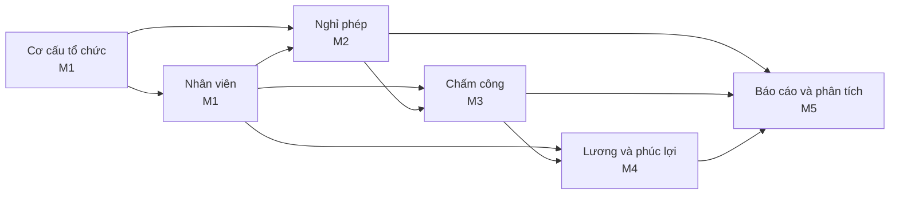

# Research: hr-manager

- **Status:** Accepted
- **Updated:** 2026-10-30
- **Reviewed:** 2026-10-30: chủ dự án đọc lại; không có AI review
- **Related:** [brief](brief.md) · [questions](questions.md) · [domain](domain.md)

> Phase 1. Trang này phân rã bài toán quản lý nhân sự từ trên xuống thành module và năng lực, và liệt kê nguồn luật cho
> Phase 2. Luật chi tiết như số ngày, tỷ lệ và công thức được ghi thành business rule ở [domain](domain.md), không ghi ở
> đây.

## Decomposition

Mũi tên A → B nghĩa là B dùng dữ liệu của A. Mọi module dùng tài khoản và vai trò của Quản trị hệ thống (M1); sơ đồ bỏ
các mũi tên đó cho gọn.

| Module | Main capabilities | Milestone | Uses data from |
|---|---|---|---|
| Quản trị hệ thống | Tài khoản, vai trò và phân quyền; nhật ký thao tác; cấu hình công ty | M1; mở rộng ở các milestone sau | — |
| Cơ cấu tổ chức | Phòng ban, chức danh, quan hệ quản lý; mỗi thay đổi có ngày hiệu lực | M1 | — |
| Nhân viên | Hồ sơ nhân viên, hợp đồng lao động, lịch sử công tác | M1 | Cơ cấu tổ chức |
| Nghỉ phép | Loại nghỉ, quỹ phép năm, gửi, duyệt và hủy đơn, số dư phép, lịch nghỉ lễ | M2 | Nhân viên, Cơ cấu tổ chức |
| Chấm công | Ca làm việc, giờ vào và ra, làm thêm giờ, bảng công tháng | M3 | Nhân viên, Nghỉ phép |
| Lương và phúc lợi | Cấu trúc lương và phụ cấp, BHXH, BHYT, BHTN, thuế TNCN, bảng lương, phiếu lương, phúc lợi | M4 | Nhân viên, Chấm công |
| Báo cáo và phân tích | Báo cáo nhân sự, nghỉ phép, công và chi phí lương | M5 | Mọi module |

- Thứ tự milestone đi theo phụ thuộc: module sau cần dữ liệu của module trước.
- Chỗ đau lớn nhất của công ty hiện được giả định là nghỉ phép, xem [questions](questions.md). Chỗ đau chỉ quyết định
  milestone nào là bản đầu tiên công ty dùng được, không đổi thứ tự milestone.
- Năng lực trong bảng là phạm vi dự kiến. Phase 2 chuyển năng lực thành user story và có thể tách hoặc gộp.

## Legal sources

Thông tin về hiệu lực lấy từ trang tư vấn pháp luật và báo chí ngày 2026-10-29, xem mục Sources. Phase 2 đối chiếu văn
bản gốc trên Cơ sở dữ liệu quốc gia về văn bản pháp luật trước khi coi một luật là đã xác nhận. Các chỗ ghi "cần xác
minh" đã có câu hỏi tương ứng ở [questions](questions.md).

| Topic | Document | Effective | Modules | Notes |
|---|---|---|---|---|
| Hợp đồng, thời giờ làm việc, phép năm, nghỉ lễ, làm thêm giờ, tiền lương | Bộ luật Lao động số 45/2019/QH14 | 01/01/2021 | Nhân viên, Nghỉ phép, Chấm công, Lương | Nguồn chính cho luật của M1–M4 |
| Bảo hiểm xã hội | Luật Bảo hiểm xã hội số 41/2024/QH15 | 01/07/2025 | Lương | Thay Luật Bảo hiểm xã hội 2014; dùng "mức tham chiếu" để tính mức đóng và mức hưởng một số chế độ |
| Bảo hiểm y tế, bảo hiểm thất nghiệp | Luật Bảo hiểm y tế; Luật Việc làm | Cần xác minh | Lương | Cần xác minh bản đang hiệu lực và tỷ lệ đóng |
| Thuế thu nhập cá nhân | Luật Thuế thu nhập cá nhân (sửa đổi), thông qua ngày 10/12/2025 | 01/07/2026 | Lương | Nâng mức giảm trừ gia cảnh; biểu thuế lũy tiến còn 5 bậc. Các nguồn nói khác nhau về thời điểm áp dụng cho tiền lương; số hiệu, mức giảm trừ và thuế suất từng bậc cần xác minh |
| Lương tối thiểu vùng | Nghị định của Chính phủ về lương tối thiểu | Cần xác minh | Lương | Mức sàn của tiền lương |
| Dữ liệu cá nhân | Luật Bảo vệ dữ liệu cá nhân số 91/2025/QH15; Nghị định 356/2025/NĐ-CP, thay Nghị định 13/2023/NĐ-CP | 01/01/2026 | Mọi module | Doanh nghiệp nhỏ được chọn chưa áp dụng một số quy định trong 5 năm. Mục Sensitive data của domain theo luật này |

## Sources

Truy cập ngày 2026-10-29.

- [Luật Bảo hiểm xã hội 2024 (LuatVietnam)](https://luatvietnam.vn/lao-dong/luat-bao-hiem-xa-hoi-2024-360809-d1.html)
- [Toàn văn Luật Bảo vệ dữ liệu cá nhân 2025 (LuatVietnam)](https://luatvietnam.vn/dan-su/tai-toan-van-luat-bao-ve-du-lieu-ca-nhan-2025-pdf-word-568-103646-article.html)
- [Nghị định 356/2025/NĐ-CP (Thư viện Pháp luật)](https://thuvienphapluat.vn/van-ban/Quyen-dan-su/Nghi-dinh-356-2025-ND-CP-huong-dan-Luat-Bao-ve-du-lieu-ca-nhan-687428.aspx)
- [New rules on personal data protection (PwC Việt Nam, 01/2026)](https://www.pwc.com/vn/vn/publications/2026/20260128-new-rules-personal-data-protection.pdf)
- [Từ 01/7/2026 người lao động được giảm thuế nhờ nâng giảm trừ gia cảnh (Báo Luật sư Việt Nam)](https://lsvn.vn/tu-01-7-2026-nguoi-lao-dong-duoc-giam-thue-nho-nang-giam-tru-gia-canh-a167717.html)
- [Thuế thu nhập cá nhân năm 2026 tính như thế nào (Thư viện Pháp luật)](https://thuvienphapluat.vn/ma-so-thue/phap-luat-thue/thue-thu-nhap-ca-nhan-nam-2026-tinh-nhu-the-nao-7008-218894.html)
