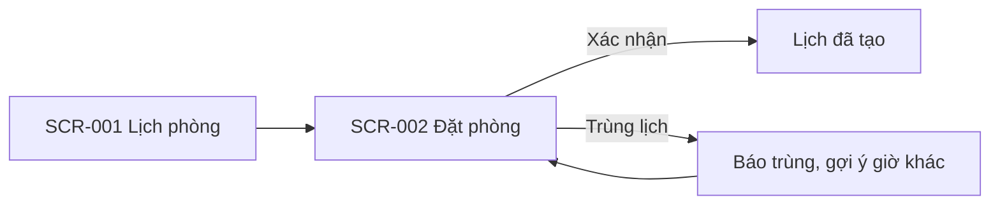

# UI flow: [tên dự án]

- **Status:** [Draft | Accepted | Superseded]
- **Updated:** [YYYY-MM-DD]
- **Reviewed:** [YYYY-MM-DD: review nguội; AI review; người ngoài nếu có]
- **Related:** [requirements](requirements.md) · [stories](stories.md) · [domain](domain.md) ·
  [UI design](design/ui.md)

> Điền ở Phase 2 khi sản phẩm có giao diện; nếu không thì bỏ file. Trang này ghi người dùng thấy gì và đi qua màn hình
> nào, ở mức wireframe; quy tắc giao diện chung nằm ở UI design, cách xây frontend nằm ở components. Actor và quyền nằm
> ở requirements. Mỗi màn hình có mã `SCR-xxx` và dẫn tới `US-xxx`, `BR-xxx` thay vì viết lại. Giao diện ẩn nút chỉ để
> dễ dùng; quyền thật sự được kiểm ở backend. Dòng in nghiêng và sơ đồ mẫu là ví dụ, xóa khi điền.

## Flows

[Mỗi luồng chính: bắt đầu ở đâu, các bước, nhánh hủy hoặc lỗi, kết thúc ở đâu.]

## Screens

Mỗi màn hình một mục như dưới.

### SCR-001: [tên màn hình]

- **Purpose:** [người dùng hoàn thành việc gì] · **Stories:** [US-xxx]
- **Content and actions:** [thông tin hiển thị, đầu vào, nút]
- **Inputs:** [bỏ nếu màn hình không nhận đầu vào]

  | Field | Required | Rule | Message when invalid |
  |---|---|---|---|
  | *Khung giờ* | *Có* | *Kết thúc sau bắt đầu; tối đa `max_booking_hours` (BR-002)* | *Lịch đặt dài tối đa 4 giờ.* |

- **States:** [chỉ ghi trạng thái có thật hoặc khác với Screen states trong UI design]
- **AI output:** [cách hiển thị kết quả AI, phần người dùng cần kiểm, bước xác nhận trước khi dùng; bỏ nếu không có]
- **Accessibility:** [chỉ ghi điểm khác mục Accessibility trong UI design, ví dụ thứ tự focus của form nhiều bước]
- **Design:** [link wireframe hoặc thiết kế, kèm version]
