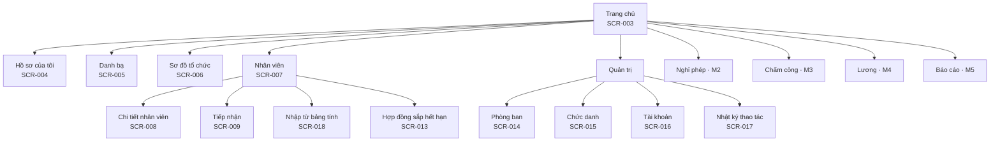
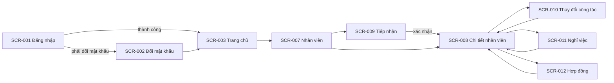

# UI flow: hr-manager

- **Status:** Draft
- **Updated:** 2026-10-30
- **Reviewed:** [YYYY-MM-DD: review nguội; AI review; người ngoài nếu có]
- **Related:** [requirements](requirements.md) · [stories](stories.md) · [domain](domain.md) · [UI design](design/ui.md)

Trang này ghi người dùng thấy gì và đi qua màn hình nào, ở mức wireframe. Giao diện ẩn nút chỉ để dễ dùng; quyền thật
được kiểm ở backend theo Permission matrix trong [requirements](requirements.md#permission-matrix). Bản hiện tại có
information architecture cho cả baseline và các màn hình của M1.

## Information architecture

Menu chính chỉ hiện mục người dùng có quyền. Mục của M2–M5 là dự kiến và được chi tiết hóa ở lần phân tích của milestone
đó.

| Menu | Nhân viên | Quản lý | HR | Screens |
|---|---|---|---|---|
| Trang chủ | ✅ | ✅ | ✅ | SCR-003 |
| Hồ sơ của tôi | ✅ | ✅ | ✅ | SCR-004 |
| Danh bạ | ✅ | ✅ | ✅ | SCR-005 |
| Sơ đồ tổ chức | ✅ | ✅ | ✅ | SCR-006 |
| Nhân viên | ❌ | ✅ chỉ trong phạm vi, không có nút thao tác | ✅ | SCR-007 tới SCR-013, SCR-018 |
| Quản trị | ❌ | ❌ | ✅ | SCR-014 tới SCR-017 |

Chi tiết nhân viên (SCR-008) chia thành các tab. Tab nào người xem không có quyền thì không hiện.

| Tab | Nội dung | Quản lý | HR |
|---|---|---|---|
| Thông tin chung | Thông tin công việc và liên hệ công việc; với HR thêm thông tin cá nhân | Chỉ phần công việc | ✅ |
| Công tác | Các quá trình công tác, thay đổi sắp tới, bổ nhiệm trưởng | ✅ | ✅ |
| Hợp đồng | Các hợp đồng lao động | ❌ | ✅ |
| Tài khoản | Trạng thái tài khoản, vai trò | ❌ | ✅ |
| Nhật ký | Thay đổi trên hồ sơ này | ❌ | ✅ |

## Flows

- **Đăng nhập:** bắt đầu ở SCR-001. Tài khoản phải đổi mật khẩu thì sang SCR-002 rồi mới tới SCR-003. Đăng nhập sai thì
  ở lại SCR-001 kèm thông báo.
- **Tiếp nhận:** từ SCR-007, HR mở SCR-009 và đi qua bốn bước: thông tin cá nhân, công tác, hợp đồng, xác nhận. Xác nhận
  xong thì mở SCR-008 của người mới. Hủy giữa chừng thì không lưu gì.
- **Thay đổi trên hồ sơ:** từ SCR-008, HR mở SCR-010, SCR-011 hoặc SCR-012 dạng hộp thoại. Mỗi hộp thoại có bước xem
  trước tác động. Lưu xong thì quay về SCR-008 ở tab tương ứng.
- **Tái cấu trúc:** ở SCR-014, HR chọn phòng ban, chọn thao tác, nhập ngày hiệu lực, xem trước cơ cấu và nhân viên bị ảnh
  hưởng, rồi xác nhận.

## Screens

### SCR-001: Đăng nhập

- **Purpose:** vào hệ thống · **Stories:** US-001
- **Content and actions:** ô mã nhân viên, ô mật khẩu, nút Đăng nhập, dòng "Quên mật khẩu? Liên hệ HR."
- **Inputs:**

  | Field | Required | Rule | Message when invalid |
  |---|---|---|---|
  | Mã nhân viên | Có | — | Mã nhân viên hoặc mật khẩu không đúng. |
  | Mật khẩu | Có | — | Mã nhân viên hoặc mật khẩu không đúng. |

- **States:** tài khoản khóa tạm: "Tài khoản tạm khóa do nhập sai nhiều lần. Thử lại sau 15 phút." Tài khoản bị khóa:
  "Tài khoản đã bị khóa. Liên hệ HR."

### SCR-002: Đổi mật khẩu

- **Purpose:** đặt mật khẩu mới · **Stories:** US-001
- **Content and actions:** mật khẩu hiện tại, mật khẩu mới, nhập lại mật khẩu mới, nút Lưu. Khi bắt buộc đổi mật khẩu,
  màn hình không có nút bỏ qua.
- **Inputs:**

  | Field | Required | Rule | Message when invalid |
  |---|---|---|---|
  | Mật khẩu mới | Có | Tối thiểu `min_password_length` ký tự; khác mật khẩu hiện tại (BR-036) | Mật khẩu mới phải có ít nhất 8 ký tự và khác mật khẩu hiện tại. |
  | Nhập lại | Có | Trùng mật khẩu mới | Hai mật khẩu không khớp. |

### SCR-003: Trang chủ

- **Purpose:** điểm bắt đầu sau khi đăng nhập · **Stories:** US-001, US-016
- **Content and actions:** lối tắt tới các mục trong menu theo vai trò. HR thấy thêm số hợp đồng sắp hết hạn và số hồ sơ
  chưa có hợp đồng, bấm vào để mở danh sách. Từ M2, trang chủ có thêm số dư phép và đơn chờ duyệt.

### SCR-004: Hồ sơ của tôi

- **Purpose:** xem hồ sơ của mình và sửa thông tin liên hệ · **Stories:** US-017
- **Content and actions:** thông tin cá nhân, thông tin liên hệ, quá trình công tác, hợp đồng. Chỉ phần liên hệ có nút
  Sửa (BR-021). Cạnh các trường khác có dòng "Cần sửa? Liên hệ HR."
- **Inputs:**

  | Field | Required | Rule | Message when invalid |
  |---|---|---|---|
  | Điện thoại cá nhân | Không | Số điện thoại Việt Nam hợp lệ | Số điện thoại không hợp lệ. |
  | Email cá nhân | Không | Địa chỉ email hợp lệ | Email không hợp lệ. |

### SCR-005: Danh bạ

- **Purpose:** tìm đồng nghiệp · **Stories:** US-019
- **Content and actions:** ô tìm theo tên, bộ lọc phòng ban, danh sách nhân viên đang làm với các trường theo BR-032.
- **States:** không có kết quả: "Không tìm thấy nhân viên phù hợp."

### SCR-006: Sơ đồ tổ chức

- **Purpose:** xem cây phòng ban · **Stories:** US-009, US-010
- **Content and actions:** cây phòng ban mở và thu được; mỗi nút có tên, trưởng phòng ban và số nhân viên đang làm. HR có
  thêm ô chọn ngày để xem cơ cấu tại ngày đó; người khác chỉ xem được hôm nay.
- **States:** ngày trước ngày thành lập phòng ban gốc: "Chưa có cơ cấu tổ chức tại ngày này." (EC-013)

### SCR-007: Danh sách nhân viên

- **Purpose:** tìm nhân viên để xem hoặc thao tác · **Stories:** US-018, US-020
- **Content and actions:** bảng gồm mã, họ tên, phòng ban, chức danh, trạng thái. Có ô tìm, bộ lọc phòng ban kèm lựa chọn
  gồm phòng ban con, chức danh, trạng thái, loại hợp đồng, và phân trang kèm tổng số. HR có thêm nút Tiếp nhận và Nhập từ
  bảng tính. Quản lý chỉ thấy nhân viên trong phạm vi và không có nút thao tác.

### SCR-008: Chi tiết nhân viên

- **Purpose:** xem và thao tác trên một hồ sơ · **Stories:** US-012, US-013, US-014, US-015, US-018
- **Content and actions:** các tab theo bảng ở mục Information architecture. Nếu có thay đổi công tác hoặc ngày nghỉ việc
  ở tương lai, đầu trang hiện dòng báo kèm ngày hiệu lực. HR có các nút Sửa hồ sơ, Ghi nhận thay đổi công tác, Ghi nhận
  nghỉ việc, Thêm hợp đồng.
- **States:** hồ sơ đã bị người khác sửa trong lúc đang sửa: "Hồ sơ vừa được cập nhật. Tải lại để xem bản mới trước khi
  lưu." (EC-016)

### SCR-009: Tiếp nhận nhân viên mới

- **Purpose:** tạo hồ sơ cho người mới · **Stories:** US-011 · **Use case:** UC-001
- **Content and actions:** bốn bước có thanh tiến độ. Bước 1: thông tin cá nhân. Bước 2: ngày vào làm, phòng ban, chức
  danh. Bước 3: hợp đồng đầu tiên, có nút bỏ qua. Bước 4: tóm tắt, ô chọn tạo tài khoản, nút Xác nhận. Tạo tài khoản
  xong thì hiện mật khẩu tạm đúng một lần.
- **Inputs:**

  | Field | Required | Rule | Message when invalid |
  |---|---|---|---|
  | Họ tên | Có | Không trống | Nhập họ tên. |
  | Ngày sinh | Có | Trước ngày vào làm | Ngày sinh không hợp lệ. |
  | Số CCCD | Có | 12 chữ số; không trùng hồ sơ khác (BR-022) | Số CCCD đã có trong hồ sơ của [họ tên, mã nhân viên]. |
  | Ngày vào làm | Có | — | Nhập ngày vào làm. |
  | Phòng ban | Có | Đang hoạt động tại ngày vào làm (BR-014) | Phòng ban chưa thành lập hoặc đã giải thể tại ngày vào làm. |
  | Chức danh | Có | Đang dùng (BR-035) | Chọn chức danh. |
  | Email công việc | Không | Địa chỉ email hợp lệ | Email không hợp lệ. |

### SCR-010: Ghi nhận thay đổi công tác

- **Purpose:** chuyển phòng ban hoặc đổi chức danh · **Stories:** US-013 · **Use case:** UC-002
- **Content and actions:** hộp thoại gồm các trường dưới, phần xem trước quá trình công tác trước và sau cùng quản lý
  trực tiếp mới, nút Xác nhận. Nhân viên đang là trưởng phòng ban thì hiện cảnh báo theo EC-004.
- **Inputs:**

  | Field | Required | Rule | Message when invalid |
  |---|---|---|---|
  | Ngày hiệu lực | Có | Trong khoảng làm việc; không trùng ngày của thay đổi khác (BR-017, EC-002) | Ngày hiệu lực ngoài thời gian làm việc của nhân viên. / Đã có thay đổi khác vào ngày này. |
  | Phòng ban mới | Một trong hai | Đang hoạt động từ ngày hiệu lực (BR-014) | Phòng ban không hoạt động tại ngày hiệu lực. |
  | Chức danh mới | Một trong hai | Đang dùng (BR-035) | Chọn chức danh. |
  | Lý do | Khi ngày hiệu lực trước hôm nay | Không trống (BR-018) | Nhập lý do khi ghi nhận thay đổi cho ngày đã qua. |

### SCR-011: Ghi nhận nghỉ việc

- **Purpose:** ghi nhận nhân viên nghỉ việc · **Stories:** US-014 · **Use case:** UC-003
- **Content and actions:** hộp thoại gồm các trường dưới, danh sách tác động theo BR-019, nút Xác nhận. Khi ngày làm việc
  cuối cùng chưa qua, SCR-008 có thêm nút Hủy ghi nhận nghỉ việc.
- **Inputs:**

  | Field | Required | Rule | Message when invalid |
  |---|---|---|---|
  | Ngày làm việc cuối cùng | Có | Không trước ngày vào làm; không còn thay đổi công tác sau ngày này (EC-009) | Còn thay đổi công tác sau ngày này: [danh sách]. Hủy các thay đổi đó trước. |
  | Lý do nghỉ | Có | Một trong: tự nghỉ, hết hạn hợp đồng, công ty cho thôi việc, khác | Chọn lý do nghỉ. |

### SCR-012: Thêm và sửa hợp đồng

- **Purpose:** ghi lại hợp đồng lao động · **Stories:** US-015
- **Content and actions:** hộp thoại gồm các trường dưới. Cảnh báo theo BR-026 hiện trước nút Xác nhận, và HR phải tick
  "Tôi đã kiểm tra" mới lưu được.
- **Inputs:**

  | Field | Required | Rule | Message when invalid |
  |---|---|---|---|
  | Số hợp đồng | Có | Không trùng (BR-037) | Số hợp đồng đã tồn tại. |
  | Loại hợp đồng | Có | Thử việc, xác định thời hạn hoặc không xác định thời hạn (BR-023) | Chọn loại hợp đồng. |
  | Nhóm công việc | Khi thử việc | Một trong các nhóm của `probation_max_days` | Chọn nhóm công việc. |
  | Ngày bắt đầu | Có | Không chồng hợp đồng khác (BR-025) | Hợp đồng chồng thời gian với hợp đồng [số hợp đồng]. |
  | Ngày kết thúc | Khi thử việc hoặc xác định thời hạn | Trong giới hạn của BR-024 hoặc BR-028 | Hợp đồng xác định thời hạn tối đa 36 tháng. / Thời gian thử việc vượt mức tối đa của nhóm công việc. |

### SCR-013: Hợp đồng sắp hết hạn

- **Purpose:** biết hợp đồng nào cần ký tiếp · **Stories:** US-016
- **Content and actions:** bảng gồm nhân viên, phòng ban, loại hợp đồng, ngày kết thúc, số ngày còn lại hoặc số ngày đã
  quá hạn; xếp theo ngày kết thúc. Bấm một dòng để mở SCR-008 ở tab Hợp đồng.
- **States:** danh sách trống: "Không có hợp đồng nào sắp hết hạn trong 30 ngày tới."

### SCR-014: Quản lý phòng ban

- **Purpose:** sửa cơ cấu tổ chức và trưởng phòng ban · **Stories:** US-006, US-007, US-008 · **Use case:** UC-004
- **Content and actions:** cây phòng ban bên trái, chi tiết phòng ban đang chọn bên phải. Thao tác: thêm phòng ban con,
  đổi tên, chuyển nhánh, giải thể, bổ nhiệm trưởng, thay trưởng, thôi bổ nhiệm. Mỗi thao tác có ô ngày hiệu lực và bước
  xem trước. Với phòng ban gốc, chỉ thao tác đổi tên và các thao tác về trưởng được hiện.

### SCR-015: Danh mục chức danh

- **Purpose:** quản lý danh sách chức danh · **Stories:** US-005
- **Content and actions:** bảng chức danh với số nhân viên đang giữ; thao tác thêm, đổi tên, ngừng dùng, dùng lại. Nút
  Xóa chỉ hiện với chức danh chưa từng được dùng (BR-035).

### SCR-016: Tài khoản người dùng

- **Purpose:** quản lý quyền truy cập · **Stories:** US-002, US-003
- **Content and actions:** bảng gồm mã nhân viên, họ tên, vai trò, trạng thái tài khoản. Thao tác: tạo tài khoản cho
  nhân viên chưa có, khóa, mở khóa, đặt lại mật khẩu, gán và thu hồi vai trò HR. Mật khẩu tạm hiện trong hộp thoại đúng
  một lần, kèm nút sao chép.

### SCR-017: Nhật ký thao tác

- **Purpose:** truy lại thay đổi · **Stories:** US-004
- **Content and actions:** bảng gồm thời điểm, người làm, đối tượng, thao tác, giá trị trước và sau. Bộ lọc theo người
  làm, loại đối tượng và khoảng thời gian. Màn hình chỉ để xem, không có thao tác sửa.

### SCR-018: Nhập nhân viên từ bảng tính

- **Purpose:** đưa danh sách nhân viên có sẵn vào hệ thống · **Stories:** US-021
- **Content and actions:** ba bước. Bước 1: tải file mẫu. Bước 2: tải file đã điền lên. Bước 3: bảng kết quả kiểm từng
  dòng, dòng lỗi tô đỏ kèm lý do, nút Xác nhận chỉ bật khi không còn dòng lỗi (EC-020).
