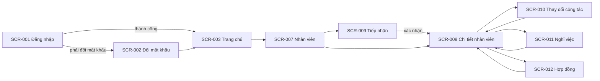
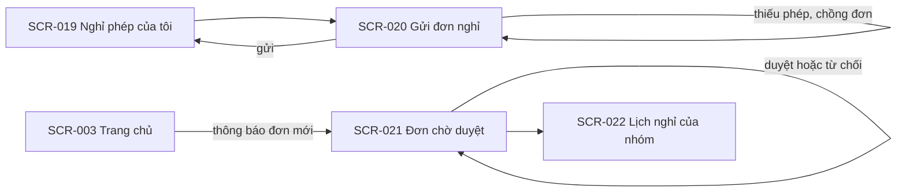
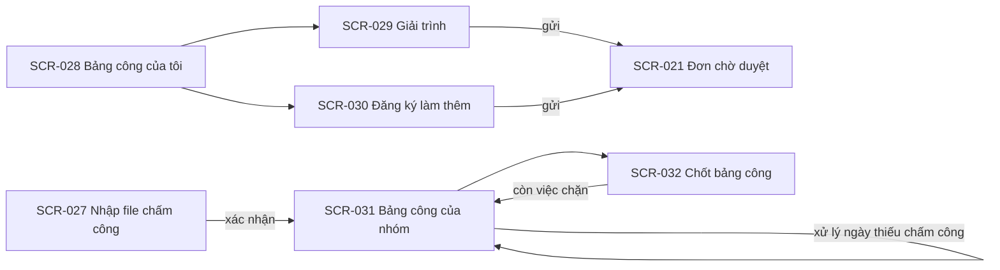

# UI flow: hr-manager

- **Status:** Draft
- **Updated:** 2026-10-30
- **Reviewed:** [YYYY-MM-DD: review nguội; AI review; người ngoài nếu có]
- **Related:** [requirements](requirements.md) · [stories](stories.md) · [domain](domain.md) · [UI design](design/ui.md)

Trang này ghi người dùng thấy gì và đi qua màn hình nào, ở mức wireframe. Giao diện ẩn nút chỉ để dễ dùng; quyền thật
được kiểm ở backend theo Permission matrix trong [requirements](requirements.md#permission-matrix). Bản hiện tại có
information architecture cho cả baseline và các màn hình của M1 tới M3.

## Information architecture

Menu chính chỉ hiện mục người dùng có quyền. Mục của M2–M5 là dự kiến và được chi tiết hóa ở lần phân tích của milestone
đó.

```mermaid
flowchart TD
  HOME["Trang chủ<br/>SCR-003"]
  HOME --> ME["Hồ sơ của tôi<br/>SCR-004"]
  HOME --> DIR["Danh bạ<br/>SCR-005"]
  HOME --> ORG["Sơ đồ tổ chức<br/>SCR-006"]
  HOME --> EMP["Nhân viên<br/>SCR-007"]
  EMP --> EMPD["Chi tiết nhân viên<br/>SCR-008"]
  EMP --> ONB["Tiếp nhận<br/>SCR-009"]
  EMP --> IMP["Nhập từ bảng tính<br/>SCR-018"]
  EMP --> EXP["Hợp đồng sắp hết hạn<br/>SCR-013"]
  HOME --> ADM["Quản trị"]
  ADM --> OU["Phòng ban<br/>SCR-014"]
  ADM --> POS["Chức danh<br/>SCR-015"]
  ADM --> ACC["Tài khoản<br/>SCR-016"]
  ADM --> LOG["Nhật ký thao tác<br/>SCR-017"]
  ADM --> LT["Loại nghỉ<br/>SCR-023"]
  ADM --> CAL["Lịch làm việc<br/>SCR-024"]
  ADM --> SH["Ca làm việc<br/>SCR-025"]
  ADM --> SHA["Gán ca<br/>SCR-026"]
  HOME --> APR["Đơn chờ duyệt<br/>SCR-021"]
  HOME --> LV["Nghỉ phép"]
  LV --> LVME["Nghỉ phép của tôi<br/>SCR-019"]
  LVME --> LVREQ["Gửi đơn nghỉ<br/>SCR-020"]
  LV --> LVCAL["Lịch nghỉ của nhóm<br/>SCR-022"]
  HOME --> AT["Chấm công"]
  AT --> ATME["Bảng công của tôi<br/>SCR-028"]
  ATME --> ATADJ["Giải trình<br/>SCR-029"]
  ATME --> ATOT["Đăng ký làm thêm<br/>SCR-030"]
  AT --> ATTEAM["Bảng công của nhóm<br/>SCR-031"]
  AT --> ATIMP["Nhập file chấm công<br/>SCR-027"]
  AT --> ATCLOSE["Chốt bảng công<br/>SCR-032"]
  HOME --> PY["Lương · M4"]
  HOME --> RP["Báo cáo · M5"]
```

| Menu | Nhân viên | Quản lý | HR | Screens |
|---|---|---|---|---|
| Trang chủ | ✅ | ✅ | ✅ | SCR-003 |
| Hồ sơ của tôi | ✅ | ✅ | ✅ | SCR-004 |
| Danh bạ | ✅ | ✅ | ✅ | SCR-005 |
| Sơ đồ tổ chức | ✅ | ✅ | ✅ | SCR-006 |
| Nhân viên | ❌ | ✅ chỉ trong phạm vi, không có nút thao tác | ✅ | SCR-007 tới SCR-013, SCR-018 |
| Đơn chờ duyệt | ❌ | ✅ đơn mình là người duyệt | ✅ mọi đơn | SCR-021 |
| Nghỉ phép | ✅ chỉ nghỉ phép của mình | ✅ thêm lịch nghỉ của nhóm | ✅ thêm lịch nghỉ của nhóm | SCR-019, SCR-020, SCR-022 |
| Chấm công | ✅ chỉ bảng công của mình | ✅ thêm bảng công của nhóm | ✅ thêm nhập file và chốt bảng công | SCR-027 tới SCR-032 |
| Quản trị | ❌ | ❌ | ✅ | SCR-014 tới SCR-017, SCR-023 tới SCR-026 |

Chi tiết nhân viên (SCR-008) chia thành các tab. Tab nào người xem không có quyền thì không hiện.

| Tab | Nội dung | Quản lý | HR |
|---|---|---|---|
| Thông tin chung | Thông tin công việc và liên hệ công việc; với HR thêm thông tin cá nhân | Chỉ phần công việc | ✅ |
| Công tác | Các quá trình công tác, thay đổi sắp tới, bổ nhiệm trưởng | ✅ | ✅ |
| Hợp đồng | Các hợp đồng lao động | ❌ | ✅ |
| Nghỉ phép | Số dư phép, biến động phép, các đơn nghỉ | ✅ không thấy lý do nghỉ của đơn mình không duyệt | ✅ thêm nút Điều chỉnh số dư |
| Chấm công | Mã chấm công, lịch sử ca, bảng công theo tháng | ✅ | ✅ thêm nút Đổi ca và sửa mã chấm công |
| Tài khoản | Trạng thái tài khoản, vai trò | ❌ | ✅ |
| Nhật ký | Thay đổi trên hồ sơ này | ❌ | ✅ |

## Flows

- **Đăng nhập:** bắt đầu ở SCR-001. Tài khoản phải đổi mật khẩu thì sang SCR-002 rồi mới tới SCR-003. Đăng nhập sai thì
  ở lại SCR-001 kèm thông báo.
- **Tiếp nhận:** từ SCR-007, HR mở SCR-009 và đi qua bốn bước: thông tin cá nhân, công tác, hợp đồng, xác nhận. Xác nhận
  xong thì mở SCR-008 của người mới. Hủy giữa chừng thì không lưu gì.
- **Thay đổi trên hồ sơ:** từ SCR-008, HR mở SCR-010, SCR-011 hoặc SCR-012 dạng hộp thoại. Mỗi hộp thoại có bước xem
  trước tác động. Lưu xong thì quay về SCR-008 ở tab tương ứng.
- **Tái cấu trúc:** ở SCR-014, HR chọn phòng ban, chọn thao tác, nhập ngày hiệu lực, xem trước cơ cấu và nhân viên bị ảnh
  hưởng, rồi xác nhận.

- **Gửi đơn:** nhân viên mở SCR-019, bấm Gửi đơn để mở SCR-020. Trong lúc nhập, màn hình tính ngay số ngày nghỉ và số
  phép còn lại. Gửi thành công thì quay về SCR-019 với đơn ở trạng thái Chờ duyệt. Lỗi như thiếu phép hay chồng đơn thì
  ở lại SCR-020 kèm thông báo.
- **Duyệt đơn:** người duyệt thấy thông báo trên SCR-003, mở SCR-021, chọn một đơn để xem chi tiết, rồi duyệt hoặc từ
  chối kèm lý do. Từ SCR-021 có thể mở SCR-022 để xem lịch nghỉ của nhóm. SCR-021 nhận cả đơn nghỉ, đơn làm thêm giờ và
  giải trình chấm công.

- **Nhập chấm công:** HR mở SCR-027, tải file, xem kết quả kiểm từng dòng rồi xác nhận. Công được tính lại và hiện ở
  SCR-028 và SCR-031.
- **Giải trình và làm thêm:** từ SCR-028, nhân viên bấm Giải trình trên một ngày để mở SCR-029, hoặc bấm Đăng ký làm thêm
  để mở SCR-030. Đơn gửi đi vào SCR-021 của người duyệt.
- **Chốt bảng công:** cuối tháng, HR mở SCR-032. Nếu còn việc chặn, mỗi việc có đường dẫn tới SCR-021 hoặc tới ngày cần
  xử lý trên SCR-031. Xử lý xong thì quay lại SCR-032 để chốt.

## Screens

### SCR-001: Đăng nhập

- **Purpose:** vào hệ thống · **Stories:** US-001
- **Content and actions:** ô mã nhân viên, ô mật khẩu, nút Đăng nhập, dòng "Quên mật khẩu? Liên hệ HR."
- **Inputs:**

  | Field | Required | Rule | Message when invalid |
  |---|---|---|---|
  | Mã nhân viên | Có | — | Mã nhân viên hoặc mật khẩu không đúng. |
  | Mật khẩu | Có | — | Mã nhân viên hoặc mật khẩu không đúng. |

- **States:** tài khoản khóa tạm: "Tài khoản tạm khóa do nhập sai nhiều lần. Thử lại sau 15 phút." Tài khoản bị khóa:
  "Tài khoản đã bị khóa. Liên hệ HR."

### SCR-002: Đổi mật khẩu

- **Purpose:** đặt mật khẩu mới · **Stories:** US-001
- **Content and actions:** mật khẩu hiện tại, mật khẩu mới, nhập lại mật khẩu mới, nút Lưu. Khi bắt buộc đổi mật khẩu,
  màn hình không có nút bỏ qua.
- **Inputs:**

  | Field | Required | Rule | Message when invalid |
  |---|---|---|---|
  | Mật khẩu mới | Có | Tối thiểu `min_password_length` ký tự; khác mật khẩu hiện tại (BR-036) | Mật khẩu mới phải có ít nhất 8 ký tự và khác mật khẩu hiện tại. |
  | Nhập lại | Có | Trùng mật khẩu mới | Hai mật khẩu không khớp. |

### SCR-003: Trang chủ

- **Purpose:** điểm bắt đầu sau khi đăng nhập · **Stories:** US-001, US-016, US-034
- **Content and actions:** lối tắt tới các mục trong menu theo vai trò; số dư phép của mình; danh sách thông báo kèm số
  thông báo chưa đọc. Quản lý và HR thấy số đơn đang chờ mình duyệt. HR thấy thêm số hợp đồng sắp hết hạn và số hồ sơ
  chưa có hợp đồng. Bấm vào mỗi con số để mở danh sách tương ứng.

### SCR-004: Hồ sơ của tôi

- **Purpose:** xem hồ sơ của mình và sửa thông tin liên hệ · **Stories:** US-017
- **Content and actions:** thông tin cá nhân, thông tin liên hệ, quá trình công tác, hợp đồng. Chỉ phần liên hệ có nút
  Sửa (BR-021). Cạnh các trường khác có dòng "Cần sửa? Liên hệ HR."
- **Inputs:**

  | Field | Required | Rule | Message when invalid |
  |---|---|---|---|
  | Điện thoại cá nhân | Không | Số điện thoại Việt Nam hợp lệ | Số điện thoại không hợp lệ. |
  | Email cá nhân | Không | Địa chỉ email hợp lệ | Email không hợp lệ. |

### SCR-005: Danh bạ

- **Purpose:** tìm đồng nghiệp · **Stories:** US-019
- **Content and actions:** ô tìm theo tên, bộ lọc phòng ban, danh sách nhân viên đang làm với các trường theo BR-032.
- **States:** không có kết quả: "Không tìm thấy nhân viên phù hợp."

### SCR-006: Sơ đồ tổ chức

- **Purpose:** xem cây phòng ban · **Stories:** US-009, US-010
- **Content and actions:** cây phòng ban mở và thu được; mỗi nút có tên, trưởng phòng ban và số nhân viên đang làm. HR có
  thêm ô chọn ngày để xem cơ cấu tại ngày đó; người khác chỉ xem được hôm nay.
- **States:** ngày trước ngày thành lập phòng ban gốc: "Chưa có cơ cấu tổ chức tại ngày này." (EC-013)

### SCR-007: Danh sách nhân viên

- **Purpose:** tìm nhân viên để xem hoặc thao tác · **Stories:** US-018, US-020
- **Content and actions:** bảng gồm mã, họ tên, phòng ban, chức danh, trạng thái. Có ô tìm, bộ lọc phòng ban kèm lựa chọn
  gồm phòng ban con, chức danh, trạng thái, loại hợp đồng, và phân trang kèm tổng số. HR có thêm nút Tiếp nhận và Nhập từ
  bảng tính. Quản lý chỉ thấy nhân viên trong phạm vi và không có nút thao tác.

### SCR-008: Chi tiết nhân viên

- **Purpose:** xem và thao tác trên một hồ sơ · **Stories:** US-012, US-013, US-014, US-015, US-018, US-032, US-037,
  US-038
- **Content and actions:** các tab theo bảng ở mục Information architecture. Nếu có thay đổi công tác hoặc ngày nghỉ việc
  ở tương lai, đầu trang hiện dòng báo kèm ngày hiệu lực. HR có các nút Sửa hồ sơ, Ghi nhận thay đổi công tác, Ghi nhận
  nghỉ việc, Thêm hợp đồng; ở tab Nghỉ phép có nút Điều chỉnh số dư, mở hộp thoại nhập số ngày cộng hoặc trừ và lý do
  bắt buộc (BR-055).
- **States:** hồ sơ đã bị người khác sửa trong lúc đang sửa: "Hồ sơ vừa được cập nhật. Tải lại để xem bản mới trước khi
  lưu." (EC-016)

### SCR-009: Tiếp nhận nhân viên mới

- **Purpose:** tạo hồ sơ cho người mới · **Stories:** US-011 · **Use case:** UC-001
- **Content and actions:** bốn bước có thanh tiến độ. Bước 1: thông tin cá nhân. Bước 2: ngày vào làm, phòng ban, chức
  danh. Bước 3: hợp đồng đầu tiên, có nút bỏ qua. Bước 4: tóm tắt, ô chọn tạo tài khoản, nút Xác nhận. Tạo tài khoản
  xong thì hiện mật khẩu tạm đúng một lần.
- **Inputs:**

  | Field | Required | Rule | Message when invalid |
  |---|---|---|---|
  | Họ tên | Có | Không trống | Nhập họ tên. |
  | Ngày sinh | Có | Trước ngày vào làm | Ngày sinh không hợp lệ. |
  | Số CCCD | Có | 12 chữ số; không trùng hồ sơ khác (BR-022) | Số CCCD đã có trong hồ sơ của [họ tên, mã nhân viên]. |
  | Ngày vào làm | Có | — | Nhập ngày vào làm. |
  | Phòng ban | Có | Đang hoạt động tại ngày vào làm (BR-014) | Phòng ban chưa thành lập hoặc đã giải thể tại ngày vào làm. |
  | Chức danh | Có | Đang dùng (BR-035) | Chọn chức danh. |
  | Email công việc | Không | Địa chỉ email hợp lệ | Email không hợp lệ. |

### SCR-010: Ghi nhận thay đổi công tác

- **Purpose:** chuyển phòng ban hoặc đổi chức danh · **Stories:** US-013 · **Use case:** UC-002
- **Content and actions:** hộp thoại gồm các trường dưới, phần xem trước quá trình công tác trước và sau cùng quản lý
  trực tiếp mới, nút Xác nhận. Nhân viên đang là trưởng phòng ban thì hiện cảnh báo theo EC-004.
- **Inputs:**

  | Field | Required | Rule | Message when invalid |
  |---|---|---|---|
  | Ngày hiệu lực | Có | Trong khoảng làm việc; không trùng ngày của thay đổi khác (BR-017, EC-002) | Ngày hiệu lực ngoài thời gian làm việc của nhân viên. / Đã có thay đổi khác vào ngày này. |
  | Phòng ban mới | Một trong hai | Đang hoạt động từ ngày hiệu lực (BR-014) | Phòng ban không hoạt động tại ngày hiệu lực. |
  | Chức danh mới | Một trong hai | Đang dùng (BR-035) | Chọn chức danh. |
  | Lý do | Khi ngày hiệu lực trước hôm nay | Không trống (BR-018) | Nhập lý do khi ghi nhận thay đổi cho ngày đã qua. |

### SCR-011: Ghi nhận nghỉ việc

- **Purpose:** ghi nhận nhân viên nghỉ việc · **Stories:** US-014, US-035 · **Use case:** UC-003
- **Content and actions:** hộp thoại gồm các trường dưới, danh sách tác động theo BR-019 và BR-065, số ngày phép năm chưa
  nghỉ tính tới ngày làm việc cuối cùng, nút Xác nhận. Khi ngày làm việc cuối cùng chưa qua, SCR-008 có thêm nút Hủy
  ghi nhận nghỉ việc.
- **Inputs:**

  | Field | Required | Rule | Message when invalid |
  |---|---|---|---|
  | Ngày làm việc cuối cùng | Có | Không trước ngày vào làm; không còn thay đổi công tác sau ngày này (EC-009) | Còn thay đổi công tác sau ngày này: [danh sách]. Hủy các thay đổi đó trước. |
  | Lý do nghỉ | Có | Một trong: tự nghỉ, hết hạn hợp đồng, công ty cho thôi việc, khác | Chọn lý do nghỉ. |

### SCR-012: Thêm và sửa hợp đồng

- **Purpose:** ghi lại hợp đồng lao động · **Stories:** US-015
- **Content and actions:** hộp thoại gồm các trường dưới. Cảnh báo theo BR-026 hiện trước nút Xác nhận, và HR phải tick
  "Tôi đã kiểm tra" mới lưu được.
- **Inputs:**

  | Field | Required | Rule | Message when invalid |
  |---|---|---|---|
  | Số hợp đồng | Có | Không trùng (BR-037) | Số hợp đồng đã tồn tại. |
  | Loại hợp đồng | Có | Thử việc, xác định thời hạn hoặc không xác định thời hạn (BR-023) | Chọn loại hợp đồng. |
  | Nhóm công việc | Khi thử việc | Một trong các nhóm của `probation_max_days` | Chọn nhóm công việc. |
  | Ngày bắt đầu | Có | Không chồng hợp đồng khác (BR-025) | Hợp đồng chồng thời gian với hợp đồng [số hợp đồng]. |
  | Ngày kết thúc | Khi thử việc hoặc xác định thời hạn | Trong giới hạn của BR-024 hoặc BR-028 | Hợp đồng xác định thời hạn tối đa 36 tháng. / Thời gian thử việc vượt mức tối đa của nhóm công việc. |

### SCR-013: Hợp đồng sắp hết hạn

- **Purpose:** biết hợp đồng nào cần ký tiếp · **Stories:** US-016
- **Content and actions:** bảng gồm nhân viên, phòng ban, loại hợp đồng, ngày kết thúc, số ngày còn lại hoặc số ngày đã
  quá hạn; xếp theo ngày kết thúc. Bấm một dòng để mở SCR-008 ở tab Hợp đồng.
- **States:** danh sách trống: "Không có hợp đồng nào sắp hết hạn trong 30 ngày tới."

### SCR-014: Quản lý phòng ban

- **Purpose:** sửa cơ cấu tổ chức và trưởng phòng ban · **Stories:** US-006, US-007, US-008 · **Use case:** UC-004
- **Content and actions:** cây phòng ban bên trái, chi tiết phòng ban đang chọn bên phải. Thao tác: thêm phòng ban con,
  đổi tên, chuyển nhánh, giải thể, bổ nhiệm trưởng, thay trưởng, thôi bổ nhiệm. Mỗi thao tác có ô ngày hiệu lực và bước
  xem trước. Với phòng ban gốc, chỉ thao tác đổi tên và các thao tác về trưởng được hiện.

### SCR-015: Danh mục chức danh

- **Purpose:** quản lý danh sách chức danh · **Stories:** US-005
- **Content and actions:** bảng chức danh với số nhân viên đang giữ; thao tác thêm, đổi tên, ngừng dùng, dùng lại. Nút
  Xóa chỉ hiện với chức danh chưa từng được dùng (BR-035).

### SCR-016: Tài khoản người dùng

- **Purpose:** quản lý quyền truy cập · **Stories:** US-002, US-003
- **Content and actions:** bảng gồm mã nhân viên, họ tên, vai trò, trạng thái tài khoản. Thao tác: tạo tài khoản cho
  nhân viên chưa có, khóa, mở khóa, đặt lại mật khẩu, gán và thu hồi vai trò HR. Mật khẩu tạm hiện trong hộp thoại đúng
  một lần, kèm nút sao chép.

### SCR-017: Nhật ký thao tác

- **Purpose:** truy lại thay đổi · **Stories:** US-004
- **Content and actions:** bảng gồm thời điểm, người làm, đối tượng, thao tác, giá trị trước và sau. Bộ lọc theo người
  làm, loại đối tượng và khoảng thời gian. Màn hình chỉ để xem, không có thao tác sửa.

### SCR-018: Nhập nhân viên từ bảng tính

- **Purpose:** đưa danh sách nhân viên có sẵn vào hệ thống · **Stories:** US-021
- **Content and actions:** ba bước. Bước 1: tải file mẫu. Bước 2: tải file đã điền lên. Bước 3: bảng kết quả kiểm từng
  dòng, dòng lỗi tô đỏ kèm lý do, nút Xác nhận chỉ bật khi không còn dòng lỗi (EC-020).

### SCR-019: Nghỉ phép của tôi

- **Purpose:** biết mình còn bao nhiêu phép và theo dõi đơn của mình · **Stories:** US-022, US-024, US-030, US-031
- **Content and actions:** ba khối. Khối số dư: số phép hiện tại, phép tồn kèm hạn dùng, số ngày của các đơn đang chờ.
  Khối đơn của tôi: danh sách đơn với loại, ngày, số ngày, trạng thái; nút Hủy với đơn được hủy theo BR-061. Khối biến
  động phép: ngày, loại biến động, số ngày, lý do. Nút Gửi đơn mở SCR-020.
- **States:** chưa có đơn nào: "Bạn chưa có đơn nghỉ nào."

### SCR-020: Gửi đơn nghỉ

- **Purpose:** tạo đơn nghỉ · **Stories:** US-023, US-033 · **Use case:** UC-005
- **Content and actions:** form gồm các trường dưới. Khi nhập, form hiện ngay số ngày nghỉ, người duyệt, và với phép năm
  thì hiện số phép còn lại sau đơn. HR mở form từ hồ sơ của nhân viên thì có thêm ô chọn nhân viên, và đơn được duyệt
  ngay khi lưu (BR-063).
- **Inputs:**

  | Field | Required | Rule | Message when invalid |
  |---|---|---|---|
  | Loại nghỉ | Có | Đang dùng (BR-042) | Chọn loại nghỉ. |
  | Từ ngày, buổi | Có | Trong khoảng làm việc (BR-046); không sớm hơn hôm nay quá `leave_backdate_days` ngày, trừ khi HR ghi (BR-062) | Không gửi được đơn cho ngày quá 7 ngày trước. |
  | Đến ngày, buổi | Có | Không trước Từ ngày; có ít nhất một buổi làm việc (BR-044) | Khoảng nghỉ không có ngày làm việc nào. |
  | Lý do | Có | Không trống | Nhập lý do nghỉ. |

- **States:** thiếu phép: "Không đủ phép năm. Còn thiếu [số ngày] ngày vào ngày [ngày]." Chồng đơn: "Đã có đơn khác vào
  [ngày, buổi]." Vượt tối đa của loại: "Loại nghỉ này tối đa [số ngày] ngày mỗi đơn."

### SCR-021: Đơn chờ duyệt

- **Purpose:** duyệt mọi loại đơn · **Stories:** US-025, US-026, US-043, US-045 · **Use case:** UC-005, UC-008
- **Content and actions:** danh sách đơn đang chờ, có bộ lọc theo loại đơn: đơn nghỉ, đơn làm thêm giờ, giải trình chấm
  công. Mỗi dòng có người gửi, loại đơn, ngày, số ngày hoặc số giờ, ngày gửi; đơn đã qua ngày bắt đầu được đánh dấu quá
  hạn. Quản lý chỉ thấy đơn mình là người duyệt; HR thấy mọi đơn và lọc được theo người duyệt. Chi tiết theo loại đơn:
  đơn nghỉ hiện lý do, số phép trước và sau đơn, các đơn đã duyệt khác của nhóm trong cùng khoảng ngày; đơn làm thêm hiện
  số giờ làm thêm đã dùng và còn lại trong tháng và năm; giải trình hiện giờ từ máy và giờ đề nghị. Nút Duyệt và Từ chối;
  Từ chối mở ô lý do bắt buộc.
- **States:** không còn đơn chờ: "Không có đơn nào chờ bạn duyệt."

### SCR-022: Lịch nghỉ của nhóm

- **Purpose:** biết ai nghỉ ngày nào · **Stories:** US-027
- **Content and actions:** lịch theo tháng, mỗi dòng một nhân viên trong phạm vi, mỗi cột một ngày. Ô có đơn đã duyệt và
  đơn đang chờ được tô khác nhau, ghi loại nghỉ và buổi. Ngày nghỉ lễ và cuối tuần được tô xám. Có bộ lọc phòng ban
  trong phạm vi và nút chuyển tháng.

### SCR-023: Loại nghỉ

- **Purpose:** cấu hình loại nghỉ · **Stories:** US-028
- **Content and actions:** bảng loại nghỉ với các thuộc tính theo BR-040 và số đơn đã dùng. Thao tác thêm, sửa, ngừng
  dùng, dùng lại. Loại Phép năm không có nút ngừng dùng và nút xóa (BR-041). Nút Xóa chỉ hiện với loại chưa có đơn nào
  (BR-042).

### SCR-024: Lịch làm việc

- **Purpose:** khai báo ngày nghỉ lễ và ngày làm bù · **Stories:** US-029
- **Content and actions:** ô chọn năm; danh sách ngày nghỉ lễ và ngày làm bù của năm đó với ngày, loại, tên. Thao tác
  thêm, sửa, xóa ngày; ngày thuộc tháng đã chốt không sửa được (BR-090). Trước khi lưu một thay đổi, màn hình hiện các đơn
  bị tính lại và các đơn sẽ làm số phép bị âm (BR-064, EC-032). Ngày làm việc trong tuần khai báo ở SCR-025.
- **Inputs:**

  | Field | Required | Rule | Message when invalid |
  |---|---|---|---|
  | Ngày | Có | Không vừa là ngày nghỉ lễ vừa là ngày làm bù | Ngày này đã được khai là [loại]. |
  | Loại | Có | Nghỉ lễ hoặc làm bù | Chọn loại ngày. |
  | Tên | Có | Không trống | Nhập tên, ví dụ Tết Nguyên đán. |

### SCR-025: Ca làm việc

- **Purpose:** định nghĩa ca · **Stories:** US-036
- **Content and actions:** bảng ca với giờ bắt đầu, giờ kết thúc, nghỉ giữa ca, giờ làm chuẩn, ngày làm việc trong tuần,
  số nhân viên đang dùng. Thao tác thêm, sửa, ngừng dùng. Form hiện ngay giờ làm chuẩn và hai buổi của ca khi nhập.
- **Inputs:**

  | Field | Required | Rule | Message when invalid |
  |---|---|---|---|
  | Tên ca | Có | Không trùng (BR-068) | Tên ca đã tồn tại. |
  | Giờ bắt đầu, giờ kết thúc | Có | Khác nhau; kết thúc sớm hơn bắt đầu là ca qua nửa đêm | Giờ bắt đầu và giờ kết thúc không được trùng nhau. |
  | Nghỉ giữa ca | Không | Nằm trong ca | Giờ nghỉ phải nằm trong ca. |
  | Ngày làm việc trong tuần | Có | Ít nhất một ngày | Chọn ít nhất một ngày làm việc. |

- **States:** giờ làm chuẩn vượt `normal_hours_max_per_day`: "Ca dài hơn 8 giờ làm việc bình thường. Kiểm tra lại trước
  khi lưu." kèm ô xác nhận (BR-069).

### SCR-026: Gán ca

- **Purpose:** gán ca cho nhiều nhân viên cùng lúc · **Stories:** US-037
- **Content and actions:** chọn ca, ngày hiệu lực, rồi chọn nhân viên theo danh sách hoặc theo phòng ban. Bước xem trước
  liệt kê từng người với ca cũ và ca mới. Ngày hiệu lực thuộc tháng đã chốt thì hiện cảnh báo theo BR-090. Đổi ca cho một
  người cũng làm được ở tab Chấm công của SCR-008.

### SCR-027: Nhập file chấm công

- **Purpose:** đưa lượt chấm từ máy vào hệ thống · **Stories:** US-039 · **Use case:** UC-007
- **Content and actions:** ba bước. Bước 1: tải file lên, kèm mô tả các cột bắt buộc. Bước 2: kết quả kiểm gồm số dòng sẽ
  lưu, số dòng trùng, bảng dòng bị bỏ qua kèm lý do. Bước 3: nút Xác nhận; sau khi lưu, hiện báo cáo nhập. Danh sách các
  lần nhập trước nằm dưới cùng.
- **States:** file thiếu cột: "File thiếu cột [tên cột]. Kiểm tra lại file xuất từ máy chấm công."

### SCR-028: Bảng công của tôi

- **Purpose:** xem công từng ngày và tổng hợp tháng · **Stories:** US-040, US-041, US-042, US-044
- **Content and actions:** ô chọn tháng; trạng thái kỳ công (Đang mở hoặc Đã chốt); bảng mỗi ngày một dòng với ca, giờ
  vào, giờ ra, đi muộn, về sớm, trạng thái, giờ làm thêm; phần tổng hợp theo BR-092. Ngày Thiếu chấm công hoặc Vắng chưa
  xử lý có nút Giải trình mở SCR-029. Nút Đăng ký làm thêm mở SCR-030. Danh sách đơn làm thêm và giải trình của tháng kèm
  trạng thái, có nút Hủy với đơn được hủy.

### SCR-029: Gửi giải trình chấm công

- **Purpose:** đề nghị sửa giờ vào hoặc giờ ra · **Stories:** US-042
- **Content and actions:** hộp thoại hiện giờ từ máy của ngày đó, các trường dưới và người duyệt.
- **Inputs:**

  | Field | Required | Rule | Message when invalid |
  |---|---|---|---|
  | Giờ vào đề nghị | Một trong hai | Trước giờ ra đề nghị hoặc giờ ra từ máy | Giờ vào phải trước giờ ra. |
  | Giờ ra đề nghị | Một trong hai | Sau giờ vào | Giờ ra phải sau giờ vào. |
  | Lý do | Có | Không trống | Nhập lý do, ví dụ quên chấm hoặc đi công tác. |

### SCR-030: Đăng ký làm thêm giờ

- **Purpose:** xin làm thêm trước khi làm · **Stories:** US-044 · **Use case:** UC-008
- **Content and actions:** form gồm các trường dưới. Khi nhập, form hiện số giờ của đơn, số giờ làm thêm đã dùng và còn
  lại trong tháng và năm, và người duyệt.
- **Inputs:**

  | Field | Required | Rule | Message when invalid |
  |---|---|---|---|
  | Ngày | Có | Tháng chưa chốt; không có đơn nghỉ cả ngày (BR-087, BR-090) | Không đăng ký làm thêm được vào ngày này. |
  | Giờ bắt đầu, giờ kết thúc | Có | Sau thời điểm gửi; ngoài giờ ca; không chồng đơn khác (BR-083, BR-086) | Giờ làm thêm phải sau thời điểm gửi đơn và nằm ngoài giờ ca. |
  | Lý do | Có | Không trống | Nhập lý do làm thêm. |

- **States:** vượt giới hạn: "Vượt giới hạn làm thêm. Tháng này bạn còn được làm thêm [số giờ] giờ." (BR-084)

### SCR-031: Bảng công của nhóm

- **Purpose:** xem và xử lý bảng công của nhiều người · **Stories:** US-046, US-047, US-049
- **Content and actions:** ô chọn tháng; bộ lọc phòng ban trong phạm vi và bộ lọc chỉ hiện ngày cần xử lý. Bảng mỗi
  nhân viên một dòng, mỗi ngày một cột, ô ghi trạng thái ngắn gọn; ô bất thường hoặc được đánh dấu được tô nổi bật; các
  cột cuối là tổng hợp theo BR-092. Bấm một ô để xem chi tiết ngày. HR có thêm thao tác ghi công cho ngày Thiếu chấm công
  hoặc Vắng chưa xử lý (BR-082) và nút Xuất bảng tính. Quản lý chỉ xem.

### SCR-032: Chốt bảng công

- **Purpose:** chốt hoặc mở lại kỳ công · **Stories:** US-048 · **Use case:** UC-009
- **Content and actions:** ô chọn tháng và trạng thái kỳ công. Khi Đang mở: danh sách việc còn chặn theo BR-089, mỗi
  việc có đường dẫn tới chỗ xử lý; nút Chốt chỉ bật khi danh sách trống. Khi Đã chốt: người chốt, thời điểm chốt, nút Mở
  lại có ô lý do bắt buộc; nút này tắt nếu bảng lương của tháng đã chốt (BR-091).
